# A 股与港股通个人量化投研交易系统调研

> 调研日期：2026-07-10；Pipeline 路线补充：2026-07-11（Asia/Shanghai）  
> 修订：2026-07-12 第三次修订。新增决策：已购 Tushare Pro 2000 积分并升级为研究主源；交易所官方源继续承担港股通资格、交易安排等最终事实；AKShare/BaoStock 降级为校验与灾备。Token 只存放在 Git 忽略的本地配置。  
> 范围：个人使用、A 股与港股通、先轻量投研再逐步接入实盘  
> 路线决策口径：按全新绿地项目评估，不复用、不迁移、也不受当前目录既有代码、数据和实验结果影响。  
> 本轮动作：仅调研并盘点本项目目录；未移动、删除、归档或改写任何既有代码和数据。

## 1. 结论先行

推荐采用“研究与交易解耦、共享同一数据与订单模型”的组合方案，而不是自行开发一套全包框架：

1. **研究主干：选择 Microsoft Qlib。** 这一选择基于其 A 股截面研究、Alpha158/360、机器学习、滚动训练、组合回测和实验工作流的完整度，而不是基于本地已有资产。Qlib 采用 MIT 许可，适合日频多因子选股和机器学习研究。
2. **快速规则策略：vectorbt 只作为可选实验工具，不作为系统核心依赖。** ETF 轮动、参数扫描和简单择时可以用 vectorbt 快速探索；其 Commons Clause 不是标准宽松开源许可。最终准入回测必须回到统一的市场规则和成本模拟层，避免 Qlib、vectorbt 各自产生不可比较的结果。
3. **行情和实盘：按券商通道现状做条件选择，不再默认 MiniQMT 首选。** 截至 2026-07，多家券商已全面停止 MiniQMT 新申请，存量用户暂可运行但通道处于收缩期；个人程序化通道正向标准版 QMT（本地客户端内置 Python）和恒生 PTrade（云端托管）收敛。本项目当前没有任何量化权限，应按“标准版 QMT → PTrade → MiniQMT（个别券商如仍开放）”的顺序向券商确认 A 股与港股通标的、实时行情、历史数据和 Python 交易权限；所有券商 API 必须包在自有 Gateway 抽象层之后，隔离通道政策变化，不要在确认前绑定任何第三方交易框架。
4. **交易中台：第一版不必引入；需要统一 OMS、风控、算法单和监控时再引入 vn.py。** vn.py 4.4.0 仍在活跃更新，已包含多因子研究、Alpha158、Alpha101、组合策略、纸面账户、风控、TWAP 等能力；但公开列出的股票柜台主要是 A 股，港股通能否通过 XtQuant/具体券商交易必须实际验收。
5. **数据：双源设计。** 历史研究以 Tushare Pro 或券商/XtQuant 为主源，AKShare 为免费补充与交叉校验；交易日历、证券状态、港股通名单、交易规则和公司公告以交易所/中证指数/HKEX 官方为最终依据。不能把任何单一爬虫接口当作生产级唯一来源。
6. **MVP 策略：先做可解释基线。** 优先验证 ETF 趋势轮动、A 股长仓多因子（价值 + 低风险 + 流动性/交易特征）、Alpha158 + LightGBM + Top-k，以及港股通高股息/低波动。暂不从高频、深度学习、强化学习、新闻 NLP 和 A/H 套利起步。

最重要的现实判断是：**系统难点不在“算出信号”，而在时间点正确的数据、退市/停牌/涨跌停/成分变更、真实成本、订单状态一致性和实盘故障保护。** MVP 应先把这些地基做好。

## 2. 目标、边界与原则

### 2.1 MVP 目标

- 支持 A 股、ETF、港股通股票/ETF的日频研究；分钟级仅保留扩展接口。
- 每日自动更新数据、执行质量检查、计算因子和信号。
- 支持因子评价、滚动训练、组合构建、含成本回测、纸面交易。
- 生成“目标仓位—订单建议—成交回报—持仓/资金对账—绩效归因”的闭环。
- 第一阶段默认人工复核并确认下单；纸面稳定后再开启自动执行。
- 所有结果可复现：数据版本、代码版本、参数、训练区间、随机种子和报告均可追溯。

### 2.2 暂不纳入 MVP

- Tick/逐笔高频、Level-2 订单簿、超低延迟执行。
- 融资融券、做空、期权、期货、可转债和场外资产。
- 强化学习、自动挖因子、LLM 新闻交易。
- 多账户、多租户、微服务/Kubernetes、大型实时数仓。
- 用未经许可的网页抓取数据直接驱动实盘。

### 2.3 设计原则

- 研究、回测、模拟和实盘共用同一份策略信号和组合目标定义。
- 数据接入、因子、模型、组合、执行通过清晰接口解耦，可替换不重写。
- 原始数据不可覆盖；清洗数据和派生特征可重建。
- 所有财务数据使用真实披露时间（Point-in-Time），禁止用报告期代替可知时间。
- 默认保守：无法确认能成交时按不能成交处理；费用、滑点和税费按不利方向估计。
- 实盘前必须经过历史回测、样本外、仿真、影子运行和小资金五道门。

### 2.4 程序化交易合规前提（实盘的“第零道门”）

沪深北三大交易所《程序化交易管理实施细则》已于 2025-07-07 正式施行，对个人程序化交易同样适用：

- **先报告、后交易。** 程序化交易投资者须通过开户券商报备账户基本信息、资金信息、交易信息和软件信息，履行报告义务后方可进行程序化交易；信息变更需要更新报备。
- **高频交易认定标准：** 单账户每秒申报、撤单合计 300 笔以上，或单账户全日申报、撤单合计 2 万笔以上。本系统按日频/低频设计，远低于该阈值，不属于高频交易，但**仍属于程序化交易，报备义务不可免除**。
- **异常交易监控：** 交易所对瞬时申报速率异常、频繁瞬时撤单、频繁拉抬打压、短时间大额成交四类行为重点监控。OMS 事前风控应内置当日下单/撤单次数上限，与 3.7 节的风控清单合并实现。
- **落地方式：** 把“完成券商程序化交易报备”列为五道门（回测、样本外、仿真、影子、小资金）之前的第零道门；合规要求与市场规则一样做成带有效期的版本表，规则修订时更新而不是硬编码。

## 3. 系统模块与功能拆分

### 3.1 证券主数据与市场规则

这是全系统的公共基础，不应散落在策略代码中。

- 统一证券标识：`000001.SZ`、`600000.SH`、`00700.HK`，同时保存交易端/数据源代码映射。
- 证券生命周期：上市、退市、暂停上市、代码变更、简称/ST 状态。
- 每日可交易域：A 股市场池、指数历史成分、当日港股通名单；必须是历史时点版本，不能用今天名单回测过去。
- 双交易日历：SSE/SZSE、HKEX，以及港股通可交易日、半日市和交收日。
- 交易单位和价格精度：A 股整手、港股每只证券不同的 board lot、港股价格档位。
- 市场制度：A 股 T+1、涨跌幅、停复牌；港股通 T+0、无个股涨跌幅、每日额度、只允许碎股卖出、T+2 交收、人民币换汇与公司行动差异。
- 公司行动：分红、送转、拆并股、配股/供股、复权因子；价格研究和现金账户核算分开。

截至本调研日，上交所 2026 年修订交易规则已于 2026-07-06 生效，主板风险警示股票涨跌幅等规则发生过调整，因此规则必须做成有效期版本表，不能硬编码一次后永久使用。

### 3.2 数据接入、落库与治理

- 连接器：交易所参考数据、Tushare、AKShare、XtQuant/券商，后续可加 RQData/JQData/Wind/Choice。
- 调度：全量初始化、每日增量、失败重试、限频、断点续传、补数。
- 分层：`raw` 原始响应、`clean` 标准表、`feature` 因子/标签、`mart` 回测和报表。
- 幂等：同一数据日期重复运行不产生重复行；更正数据有版本号与审计记录。
- 质量检查：唯一键、时间连续性、OHLC 合法性、成交量/金额单位、异常跳点、复权连续性、跨源差异、缺失率和延迟。
- 数据血缘：记录来源、接口、抓取时间、参数、校验和、清洗版本。
- 建议存储：MVP 使用 Parquet + DuckDB；研究框架需要时生成 Qlib bin。SQLite 只存配置、任务和订单元数据，不承载大规模行情。

核心标准表至少包括：

| 表 | 关键字段 |
|---|---|
| `instrument` | symbol、market、currency、list/delist date、board lot、status |
| `trade_calendar` | market、date、is_open、is_connect_open、is_half_day |
| `bar_1d` | symbol、trade_date、不复权 OHLC、volume、amount、累计后复权因子、source |
| `adjust_factor` | symbol、effective_date、累计后复权因子、source |
| `corporate_action` | ex_date、action type、cash/share ratio、announce time |
| `financial_pit` | symbol、period、announce_time、revision、statement fields |
| `universe_membership` | universe、symbol、effective_from/to |
| `factor_value` | date、symbol、factor、value、factor_version |
| `target_weight` | as_of、strategy/version、symbol、weight |
| `order/fill/position/cash` | broker ids、状态、价格、数量、费用、时间戳 |

### 3.3 研究环境与实验管理

- Notebook 只做探索和展示；稳定逻辑下沉为可测试的 Python 包。
- 配置化数据区间、股票池、因子、标签、模型、成本和组合约束。
- MLflow 记录参数、指标、模型、预测、组合报告和数据快照 ID。
- 因子/模型注册表：名称、公式、依赖字段、方向、版本、作者、有效期。
- 自动生成研究报告，包含数据范围、样本量、缺失率、IC、换手、分组收益、成本后结果和失败原因。

### 3.4 因子工程与因子评价

- 因子计算：价量、波动率、流动性、反转/动量、估值、质量、成长、分红、分析师/资金流（有可靠数据后）。
- 清洗：去极值、缺失处理、截面标准化、行业/市值中性化；所有拟合参数只能在训练期获得。
- 标签：未来 1/5/20 日收益、相对基准收益；信号可知时间与成交时间明确分离。
- 单因子检验：Pearson/Spearman IC、ICIR、分位数组合、单调性、多空差、胜率、换手、容量、行业和市值暴露。
- 稳健性：滚动窗口、不同市场阶段、不同股票池、不同调仓频率、成本敏感性、参数扰动。
- 冗余控制：相关性聚类、VIF/共线性、增量 IC、模型特征重要度稳定性。

### 3.5 策略与模型

- 统一策略接口：输入 `as_of` 可知数据，输出目标权重和原因；不得直接操作券商 API。
- 规则策略：ETF/行业轮动、趋势过滤、低波/高股息、多因子打分。
- 机器学习：先 Lasso/LightGBM，再考虑 MLP/时序模型；必须滚动训练。
- 组合构建：等权/分数权重、行业和个股上限、换手惩罚、最小交易金额、现金缓冲。
- 基准：A 股按股票池匹配 CSI300/500/1000；港股通按实际可投资基准和人民币收益口径。
- 组合优化属于后续项；MVP 用透明约束规则通常更稳健。

### 3.6 回测与验证引擎

- 时间正确性：信号时点、下单时点、成交价、财报披露时点和指数成分生效日。
- A 股撮合：T+1、涨跌停不可成交、停牌、100 股整手、最小佣金、印花税和过户费。
- 港股通撮合：T+0、board lot、碎股限制、增强限价盘、费用、换汇、额度/交易日、T+2 交收。
- 成本：双边佣金、税费、平台费用、滑点、冲击成本；按券商最新费率配置并带有效期。
- 数据偏差：幸存者偏差、未来函数、前视复权、指数成分后视、退市遗漏。
- 验证：训练/验证/测试、walk-forward、purged/embargo（标签重叠时）、参数稳定性、压力测试。
- 输出：收益、超额、波动、Sharpe/Sortino/Calmar、最大回撤及持续期、换手、成本、容量、暴露、持仓和逐笔交易。

实现时，停牌、涨停和跌停必须由带来源的显式日状态输入，不得由“成交量为零”或
缺失行情猜测。A 股卖出准入使用已交收可卖数量落实 T+1；股票成本按方向拆分为
双边佣金、双边过户费和卖出印花税，数值及有效期仍以 `configs/` 为 SSOT。
规则依据包括[上交所交易规则](https://www.sse.com.cn/lawandrules/sselawsrules2025/stocks/exchange/c/c_20250519_10779396.shtml)
以及[财政部、税务总局 2023 年第 39 号公告](https://shanxi.chinatax.gov.cn/web/detail/sx-11400-545-1780448)；
实盘前还需用开户券商交割单校准佣金和代收费用。

### 3.7 纸面交易、订单管理与执行

- 目标仓位转订单：当前持仓与目标权重差异、现金、整手、最小金额、卖出可用量。
- OMS 状态机：创建、已报、部分成交、全成、撤单中、已撤、拒单；券商订单 ID 幂等映射。
- 预交易风控：标的资格、交易时间、价格范围、数量、现金、可卖量、单票/行业/组合上限、当日下单和撤单次数。
- 执行算法：MVP 为限价/被动拆单；后续增加 TWAP/VWAP/尾盘执行。
- 对账：启动时、盘中和收盘后核对资金、持仓、订单、成交；券商状态为准，异常时只减仓不加仓。
- 人工控制：总开关、仅卖出、冻结证券、取消全部订单、人工确认队列。

### 3.8 调度、监控、日志与报表

- 日前：交易日检查、数据更新、质量门禁、模型/信号生成、目标仓位审核。
- 盘中：连接心跳、行情延迟、订单积压、拒单、成交偏差、风险阈值。
- 盘后：对账、净值、归因、交易成本、异常报告、数据补齐。
- 结构化日志，密钥脱敏；错误、预警和审计日志分开。
- 通知：本地/邮件/微信均可，但通知失败不能阻塞风控与撤单。
- 备份：配置、证券主数据、订单/成交、策略产物必须备份；原始行情可按来源恢复时降低备份等级。

### 3.9 配置、安全与测试

- 券商账号、token、密码不写入 Git、Notebook、日志或 MLflow；使用环境变量/系统凭据库。
- 研究和实盘配置物理分离，实盘默认关闭自动下单。
- 单元测试：复权、成本、整手、T+1、涨跌停、港股 board lot、状态机。
- 集成测试：数据源沙盒、纸面账户、券商查询/下单/撤单/重连。
- 回归测试：固定小数据集和“黄金结果”，框架或规则升级后对比。
- 故障演练：断网、终端退出、重复回报、部分成交、进程重启、时钟偏差和数据延迟。

### 3.10 端到端 Pipeline 全景与模块边界

轻量系统不等于缺少模块，而是把模块保留为清晰接口、尽量在一个进程和一台机器内运行。完整 Pipeline 可分为数据面、研究面、交易面和运维面：

```mermaid
flowchart LR
    subgraph DATA["数据面"]
        A["交易所 / 数据商 / 券商"] --> B["采集与增量同步"]
        B --> C["Raw 不可变原始层"]
        C --> D["标准化 / 复权 / PIT"]
        D --> E["质量门禁"]
        E --> F["Parquet + DuckDB / Qlib 数据集"]
    end

    subgraph RESEARCH["研究面"]
        F --> G["股票池 / 因子 / 标签"]
        G --> H["模型或规则策略"]
        H --> I["预测分数 / 交易信号"]
        I --> J["组合构建与目标权重"]
        J --> K["含成本与市场约束回测"]
        K --> L["实验记录 / 归因 / 报告"]
    end

    subgraph TRADING["交易面"]
        J --> M["目标仓位快照"]
        M --> N["差量订单生成"]
        N --> O["事前风控"]
        O --> P["OMS / EMS"]
        P --> Q["券商通道 Gateway：QMT / PTrade / MiniQMT"]
        Q --> R["委托 / 成交 / 资金 / 持仓"]
        R --> S["对账与账本"]
        S --> L
    end

    subgraph OPS["运维面"]
        T["调度 / 配置 / 密钥 / 日志 / 监控 / 告警 / 测试 / 备份"]
    end

    T -.治理.-> DATA
    T -.治理.-> RESEARCH
    T -.治理.-> TRADING
```



各模块最关键的输入和输出如下。只要这些契约稳定，内部工具可以替换：

| 阶段 | 输入 | 核心职责 | 标准输出 |
|---|---|---|---|
| 证券主数据 | 交易所、券商、指数公司文件 | 统一代码、上市状态、历史成分、交易单位、规则有效期 | `instrument`、`universe_membership`、`trade_calendar` |
| 数据采集 | API/文件/行情订阅 | 全量与增量下载、限频、重试、幂等、原始响应留档 | 带来源和抓取时间的 raw 数据 |
| 标准化与质量 | raw 数据 | 字段映射、单位、复权、PIT、缺失/异常/跨源检查 | clean Parquet + 质量报告 |
| 特征与因子 | clean 行情、财务、股票池 | 因子计算、去极值、标准化、中性化、标签生成 | `(as_of, symbol, factor/value/label)` |
| 模型/规则 | 因子与标签 | 拟合、滚动训练、参数搜索或规则计算 | `score` 或离散信号，不直接下单 |
| 组合构建 | score、风险暴露、当前持仓 | 排名、权重、行业/个股/换手/现金约束 | `target_weight` 快照 |
| 回测 | 目标权重、行情、规则、成本 | 时间推进、撮合、账户与公司行动模拟 | orders、fills、positions、NAV、metrics |
| 订单生成 | 目标权重、实盘持仓、现金 | 权重转股数、整手、最小金额、差量和顺序 | `order_intent` |
| 风控/OMS/EMS | order intent、行情、账户 | 合法性、状态机、拆单、撤单、重试、幂等 | broker order + 本地订单事件 |
| Gateway | 标准订单/查询命令 | 转成券商 API，接收异步回报 | 标准化委托、成交、持仓、资金事件 |
| 对账与账本 | 券商回报、本地事件 | 以券商为准核对订单、成交、现金、持仓和费用 | 可审计账本、差异和修复动作 |
| 报告与监控 | 研究/交易/系统事件 | 绩效、归因、数据新鲜度、连接和风险状态 | HTML/仪表盘/可执行告警 |

### 3.11 Qlib、vectorbt、券商通道在 Pipeline 中的位置

三者负责不同层次，不应当作三选一：

| 工具 | Pipeline 位置 | 它擅长做什么 | 它不负责什么 | 本项目定位 |
|---|---|---|---|---|
| **Qlib** | clean 数据之后的研究面：因子/标签、数据集、模型、预测、组合回测、实验分析 | 截面因子与机器学习工作流；Alpha158/360；LightGBM/深度模型；TopkDropout；训练/验证/测试；通过 MLflow 保存实验 | 原始数据治理、港股通主数据、可靠实盘 OMS、券商重连、资金/持仓对账 | **A 股截面投研主引擎**。输出预测分数或目标权重，不能直接成为实盘账户的唯一状态源 |
| **vectorbt** | 研究面的规则策略、信号矩阵、快速参数扫描和向量化回测 | ETF 轮动、技术择时、多参数批量实验、费用/滑点敏感性、交互图表 | 高保真 A 股/港股通事件规则、财务 PIT、券商接入、订单状态机、实盘恢复 | **规则策略快速试验台**。通过统一 `target_weight` 接口与 Qlib 汇合，不进入实盘进程 |
| **券商通道（QMT/PTrade/MiniQMT 存量）** | 数据面最前端和交易面最末端：券商行情、账户和交易 Gateway | 获取券商授权行情；查询资金/持仓/委托/成交；下单、撤单、接收异步回报 | 因子研究、严谨历史回测、实验管理、跨源数据治理、本地 OMS 审计和组合决策 | **券商适配器和最终交易通道**。2026-07 起 MiniQMT 停止新申请，具体通道以券商验收为准；外面必须包一层自己的标准 Gateway、风控、幂等和对账，使换通道不影响策略与组合层 |

一个典型的日频工作日流程是：

1. 调度器在收盘后从 Tushare/交易所/券商增量更新数据。
2. Pandera/自定义检查通过后写入 Parquet，并导出 Qlib 所需格式。
3. Qlib 生成股票截面分数；vectorbt/规则模块生成 ETF 策略目标权重。
4. 组合层合并策略预算，输出唯一的目标仓位快照。
5. 次一交易日前或指定时点，订单生成器读取券商通道的真实持仓并计算差量订单。
6. 风控通过后，OMS 将标准订单交给券商通道适配器（QMT/PTrade/MiniQMT）；适配器只负责与券商通信。
7. 成交回报进入本地账本并与券商资金/持仓对账，结果回流报告和下一轮组合计算。

必须避免以下错误边界：

- 让 Qlib 策略代码直接调用 `xttrader.order_stock` 或任何券商下单 API，导致研究与实盘耦合。
- 把券商通道返回的历史数据直接喂给模型而没有版本、质量和复权检查。
- 把 vectorbt 的向量化成交结果当作港股通真实可成交结果。
- 同时让 Qlib、vectorbt 和交易进程各自维护一份“当前持仓”。真实持仓只能以券商 + 本地对账账本为准。

### 3.12 各模块的可选工具对比

以下列出对个人 A 股/港股通系统有现实意义的主要选项。不是每一项都要安装；MVP 应选择每行最轻的一种。

#### 3.12.1 数据源与券商接入

| 选项 | 类型 | 优点 | 局限 | 适合阶段 |
|---|---|---|---|---|
| SSE/SZSE/HKEX/中证指数官方 | 官方参考源 | 规则、名单、公告和指数成分权威 | 批量历史和实时行情常需授权，接口不统一 | 全阶段必须保留 |
| Tushare Pro | 标准化数据 API | A 股/港股行情、财务、日历较全，增量方便 | 已购 2000 积分；港股日线/复权仍有独立权限与限频 | **当前历史研究主源** |
| AKShare | 公开网页数据聚合 | 免费、覆盖广、原型快 | 上游网页变更、许可和稳定性不适合唯一生产源 | 补充和交叉校验 |
| BaoStock | 免费 A 股接口 | 简单、无需复杂部署 | 港股覆盖弱，字段和更新有限 | A 股备用 |
| RQData/JQData | 商业量化数据 | 数据治理、财务和历史成分通常更省时间 | 付费、授权和导出限制需确认 | 预算允许时优先于自建清洗 |
| Wind/Choice/iFinD | 专业终端/API | A/H 基本面、预期和公司行动覆盖强 | 成本高、授权严格 | 后期专业数据 |
| 标准版 QMT | 券商策略交易终端（迅投） | 与 MiniQMT 同源，本地回测/实盘、Tick 级数据；支持文件单/HTTP 等外部对接 | 策略运行在客户端内置 Python 环境，调试/版本管理等工程化体验差；门槛与权限随券商（2026 年部分券商降至 10 万日均资产） | **新用户实盘首选候选** |
| 恒生 PTrade | 券商云端策略平台 | 云端托管、无需本机常驻，中低频友好 | 指定客户端开发、云端环境受限，可编程自由度低于本地方案；权限随券商 | 新用户实盘备选，可先开权限占位 |
| MiniQMT/XtQuant | 券商/迅投轻量接口 | 本地 Python 直连（xtquant），真实账户、行情和交易最贴近实盘，工程化体验最好 | **2026-07 起多数券商已停止新申请，存量暂可用但将逐步收缩**；权限随券商；Windows 终端依赖 | 仅存量权限用户；新用户需逐家券商确认是否仍开放 |
| vn.py Gateway（XTP/TORA/IB 等） | 开源统一网关 | 统一事件和订单模型，多柜台 | A 股权限门槛；港股通覆盖须逐柜台验证 | 需要多通道时 |
| easytrader 等 GUI 自动化 | 客户端自动化 | 某些无 API 券商可勉强接入 | 脆弱、难审计、易因界面变化失败 | **不建议实盘主通道** |

#### 3.12.2 采集、清洗与计算

| 选项 | 优点 | 局限 | 建议 |
|---|---|---|---|
| pandas | 生态最大、金融代码多 | 大截面和多文件性能/内存一般 | 兼容层和 Notebook 可用 |
| Polars | 快、惰性执行、表达式适合批量因子 | 部分金融库仍要求 pandas | **MVP 清洗与因子计算推荐** |
| PyArrow | Parquet/Arrow 标准、零拷贝交换 | 本身不是完整分析 API | 作为底层交换格式 |
| DuckDB SQL | 直接查询 Parquet，过滤/列裁剪，单机免服务 | 多进程并发写和高频实时库不是强项 | **MVP 查询与数据集拼装推荐** |
| Dask/Ray | 可扩展并行计算 | 单机日频数据通常过度设计 | 数据明显超出单机后再用 |
| DolphinDB | 时序存储与计算、量化生态 | 引入独立服务和专有脚本体系，部分能力/许可需确认 | 分钟/Tick 和大规模因子阶段 |

#### 3.12.3 存储与数据版本

| 选项 | 优点 | 局限 | 建议 |
|---|---|---|---|
| Parquet + DuckDB | 列式压缩、可移植、SQL 直查、零运维 | 需要自行约定分区和原子发布 | **个人 MVP 首选** |
| SQLite | 单文件、事务、Python 内置 | 不适合大行情表和高并发 | 存配置、任务、订单元数据 |
| PostgreSQL | 事务、约束、并发和生态成熟 | 需要服务运维 | 多进程、Web 和实盘账本增强时 |
| TimescaleDB | PostgreSQL 上的时序扩展 | 比 Parquet 复杂 | 分钟行情/监控指标增长后 |
| ClickHouse | 列式分析和大规模聚合快 | 服务运维、单人日频过重 | 大规模 Tick/日志阶段 |
| ArcticDB | 面向 DataFrame/时序版本化存储 | 生态小于 Parquet/SQL，运维认知成本 | 高频研究或大量版本数据备选 |
| Qlib bin | Qlib 查询性能和表达式兼容 | 框架专用，不应作为唯一原始存储 | 由 clean Parquet 经每证券 staging Parquet 和官方 `dump_bin.py` 单向派生；其 Parquet 支持是导入源读取，不等于 LocalProvider 可直接挂载本项目 clean 分区 |
| DVC | 数据/模型版本与 Git 元数据关联 | 大数据远端和工作流配置增加复杂度 | 需要严格数据快照复现时再加 |

#### 3.12.4 数据质量与契约

| 选项 | 优点 | 局限 | 建议 |
|---|---|---|---|
| 自定义断言 + pytest | 最轻、便于表达 OHLC、涨跌停、交易日等金融规则 | 报告和数据目录需自己做 | 必须有，作为领域规则核心 |
| Pandera | pandas/Polars Schema、类型和自定义检查，接入成本低 | 跨数据资产的历史质量看板有限 | **MVP 推荐，与自定义检查组合** |
| Great Expectations | Expectation Suite、Checkpoint、Data Docs 完整 | 配置和概念较重 | 多数据源、需要可视化质量文档时 |
| Dagster Asset Checks | 质量、资产血缘和调度结合 | 需要整体引入 Dagster | 选择 Dagster 时顺带使用 |

#### 3.12.5 因子、特征与标签

| 选项 | 优点 | 局限 | 建议 |
|---|---|---|---|
| Qlib Expression/Alpha158/360 | A 股基线成熟、与模型回测一体 | 数据格式和表达式有 Qlib 绑定 | **截面研究首选** |
| vnpy.alpha Alpha158/101 | Polars、因子到策略链路较统一 | 与 Qlib 功能重叠；应避免维护双份因子真源 | 若交易主干全面采用 vn.py 再选 |
| Polars/pandas 自定义因子 | 透明、灵活、容易测试 | 注册、血缘、重复计算需自己管理 | 基本面/PIT 和市场特有因子必需 |
| TA-Lib / pandas-ta | 技术指标丰富 | 指标多不等于 alpha，有数据挖掘风险 | 作为特征工具箱 |
| Alphalens / 兼容分支 | IC、分组收益、换手方法经典 | 原 Quantopian 项目老化 | 借鉴方法；优先用 Qlib/vn.py 内置分析 |
| Featuretools | 自动特征工程 | 不理解金融可知时间和市场规则 | 不作为 MVP 重点 |

#### 3.12.6 模型训练与参数优化

| 选项 | 优点 | 局限 | 建议 |
|---|---|---|---|
| scikit-learn | 线性模型、预处理、统一 API | 大规模 GBDT/深度时序不是重点 | Lasso/Ridge/ElasticNet 基线 |
| LightGBM | 表格截面数据速度和效果强，Qlib 示例成熟 | 易过拟合，需时间切分和稳定性检查 | **Alpha158 第一模型** |
| XGBoost / CatBoost | 强表格模型、约束和解释工具丰富 | 与 LightGBM 重叠，比较成本增加 | 第二基线，不必三者全上 |
| PyTorch | 深度时序/图模型灵活 | 数据、调参、复现和解释成本高 | 后续研究 |
| statsmodels | 回归、统计检验、时间序列模型透明 | 不负责完整训练流水线 | 因子诊断和统计基线 |
| Optuna | 定义式搜索、采样和剪枝，易接模型 | 若目标函数使用测试集会放大过拟合 | 只在滚动验证集内使用 |
| Qlib 模型 Zoo | 多模型配置、统一数据/记录接口 | 示例成绩不能直接外推当前市场 | 用于受控对比，不盲目全跑 |

#### 3.12.7 规则策略与回测引擎

| 选项 | 强项 | A 股/港股通适配成本 | 建议 |
|---|---|---:|---|
| Qlib | 截面 ML、Top-k、组合级日频回测 | 中；港股通规则需扩展 | **A 股截面主引擎** |
| vectorbt | 向量化、参数扫描、ETF/择时快速 | 中；复杂成交需自定义 | **规则研究推荐** |
| vn.py portfolio/CTA backtester | 事件驱动、策略与实盘生态接近 | 中；股票细则和数据要配置 | 采用 vn.py 交易中台时 |
| RQAlpha | 中国市场事件驱动、成本和风险模块 | 中；港股通与数据需扩展 | Qlib 替代候选，不并用 |
| Hikyuu | 国内股票、C++/Python、组合部件 | 中 | A 股规则型策略备选 |
| WonderTrader | 高性能、多引擎、数据/执行/风控较全 | 中到高；整体较重 | 多策略和分钟级后评估 |
| Backtrader | 教学、事件驱动、资料多 | 高；原主线老化 | 不作为新主干 |
| Zipline Reloaded | Pipeline/事件回测、维护中 | 高；默认海外市场语义 | 不优先 |
| backtesting.py | API 简单、单/少标的原型快 | 高；组合和中国规则需自己写；AGPL | 教学和小原型 |
| LEAN | Apache-2.0、成熟的回测/实盘多市场引擎 | 高；数据和中国券商 adapter 工程大 | 若未来转向全球多市场再评估 |
| NautilusTrader | Rust 高性能、回测/实盘同语义、订单簿与执行强 | 很高；需自建 MiniQMT/A 股规则 adapter | Tick/订单簿和多市场后期候选 |

这里的关键不是选“功能最多”的引擎，而是选改造最少的。个人日频 A 股/港股通系统采用 Qlib + vectorbt/薄回测层，比把 LEAN 或 NautilusTrader 改造成中国市场引擎更轻。

#### 3.12.8 组合优化与风险模型

| 选项 | 优点 | 局限 | 建议 |
|---|---|---|---|
| 自定义规则权重 | 可解释、稳定、容易纳入整手和换手 | 不是数学最优 | **MVP 首选：等权/分数权重 + 上限 + 换手阈值** |
| Qlib EnhancedIndexingStrategy | 信号与指数增强结合 | 需要 Qlib 风险/协方差输入 | 指数增强第二阶段 |
| CVXPY | 通用凸优化，可精确定义约束 | 需自己准备目标、风险模型和求解失败处理 | 复杂组合的底层工具 |
| PyPortfolioOpt | 均值方差、Black-Litterman、HRP、离散权重易用 | 预期收益/协方差误差敏感，市场交易约束仍需补 | 少量资产或 ETF 组合备选 |
| Riskfolio-Lib | 风险平价、CVaR/CDaR、HRP/HERC、多风险度量和约束丰富 | 参数/求解器复杂，容易产生虚假精确 | 组合研究高级阶段 |
| cvxportfolio | 多期优化、交易成本和约束框架 | 学习与数据准备成本较高 | 换手/成本优化成熟后 |

#### 3.12.9 实验、结果和数据版本管理

| 选项 | 优点 | 局限 | 建议 |
|---|---|---|---|
| MLflow | 参数、指标、代码版本、模型和报告 artifact；本地模式轻 | 需要制定命名和清理规范 | **绿地项目仍推荐采用**；MVP 使用 SQLite backend + 文件 artifact |
| Weights & Biases | UI 和协作体验好 | 云服务依赖、数据外发与费用需考虑 | 个人本地项目不优先 |
| DVC | 数据/模型版本与 Git 结合 | 与同步盘、远端对象存储配置有额外复杂度 | 数据快照增多后再用 |
| Sacred | Python 实验配置和记录轻量 | 生态/UI 小于 MLflow | MLflow 的替代项 |
| Optuna Dashboard | 参数搜索可视化 | 只解决参数搜索，不替代实验/数据版本 | 配合 MLflow 使用 |

#### 3.12.10 组合执行、OMS、EMS 与纸面交易

| 选项 | 优点 | 局限 | 建议 |
|---|---|---|---|
| 自有薄 OMS + 券商通道 Gateway（QMT/PTrade/MiniQMT） | 依赖少、完全贴合个人账户和港股通；Gateway 抽象隔离通道政策变化 | 必须认真实现状态机、幂等、重连、对账；QMT/PTrade 的外部对接方式（文件单/HTTP/云端）各不相同，适配层要逐通道验收 | **MVP 推荐：先人工确认和纸面执行** |
| vn.py MainEngine + riskmanager + algotrading + paperaccount | OMS/事件/风控/TWAP/纸面账户较完整 | 接入和配置较重；券商通道/港股通 adapter 需验收 | 自动化阶段首选候选 |
| WonderTrader 执行体系 | 信号执行分离、风控、调度、高性能 | 对个人日频系统偏重 | 多策略/分钟级后 |
| NautilusTrader TradingNode | 回测与实盘订单语义统一、恢复和对账设计强 | 没有现成 MiniQMT 适配，开发量大 | 国际多市场或高频后期 |
| LEAN Brokerage adapter | 完整算法引擎和实盘抽象 | 中国券商适配和数据成本高 | 不适合当前 MVP |
| 券商自带条件单/策略平台 | 少开发、由券商维护 | 可编程性、审计、回测一致性有限 | 作为人工确认/灾备通道 |

即使使用 vn.py，也仍需要项目自己的 `target_position`、策略版本、券商对账和审计表。第三方 OMS 不知道你的数据版本、模型版本和投资理由。

#### 3.12.11 绩效、归因和报告

| 选项 | 优点 | 局限 | 建议 |
|---|---|---|---|
| Qlib report/record | 模型 IC、组合分析和实验连接自然 | 面向 Qlib 工作流 | Qlib 策略主报告 |
| QuantStats | HTML tear sheet、回撤和滚动指标；M2 已为 S0 与 S1 测试折生成报告 | 主要分析周期收益，不是完整逐笔归因 | **MVP 组合报告已采用** |
| Empyrical-reloaded / pyfolio-reloaded | 经典绩效和风险分析 | 原 Quantopian 生态迁移历史较复杂 | 有特定归因需求时 |
| Riskfolio-Lib | 风险贡献和优化组合图表 | 更偏组合优化 | 高级风险报告 |
| Plotly | 交互图表 | 报告指标需自己定义 | 自定义报告底层 |

#### 3.12.12 调度与工作流编排

| 选项 | 优点 | 局限 | 建议 |
|---|---|---|---|
| Windows 任务计划 + Python CLI | 零额外服务、稳定、容易理解 | 重试、依赖和可视化需自己补 | **最初 MVP 可用** |
| APScheduler | 进程内定时轻量 | 进程退出即停止，分布式/历史 UI 弱 | 单进程研究服务 |
| Prefect | 纯 Python、重试、状态、部署、定时和事件触发 | 多一个 server/worker 概念 | **任务超过 5–10 个后推荐** |
| Dagster | 资产、血缘、可观测性、测试和质量结合强 | 概念和部署比 Prefect 重 | 数据资产和依赖变复杂后 |
| Airflow | 成熟 DAG、调度和生态 | 运维重、动态个人任务体验一般 | 个人系统通常不选 |
| cron | Linux 简单可靠 | Windows 主机不原生，状态和重试弱 | 将来迁 Linux 后的最小方案 |

#### 3.12.13 Dashboard、日志、监控与告警

| 选项 | 优点 | 局限 | 建议 |
|---|---|---|---|
| 静态 HTML + 日志 + 微信/邮件 | 最少组件、易归档 | 交互和集中状态有限 | **MVP 首选** |
| Streamlit | 快速做持仓、因子、回测和订单审核界面 | 长期后台任务和严格权限不是强项 | 个人研究/审核 Dashboard 推荐 |
| FastAPI + 简单前端 | API 清晰、可扩展 | 需要自己开发 UI 和鉴权 | 自动化服务阶段 |
| Grafana + Prometheus | 系统指标、时间序列 Dashboard 和告警成熟 | 对研究表格/订单审核不如 Streamlit；需服务运维 | 实盘稳定运行后监控 |
| Loki / structlog / loguru | 结构化日志和查询 | Loki 需服务；日志不能替代订单账本 | 初期 loguru/标准 JSON，后期 Loki |
| Sentry | 异常聚合、堆栈和版本定位 | 外部服务或自建运维 | 进程增多后可选 |

#### 3.12.14 配置、密钥、测试与发布

| 子模块 | 轻量选择 | 可升级选择 | 说明 |
|---|---|---|---|
| 配置 | TOML/YAML + Pydantic Settings | Hydra | 研究和实盘分配置；所有配置带版本 |
| 密钥 | 环境变量 + Windows Credential Manager/keyring | Vault | `.env` 只能本地且必须忽略，不把密码写日志 |
| 单元/集成测试 | pytest + monkeypatch | Hypothesis、respx、testcontainers | 金融规则用参数化测试，API 用录制/模拟回报 |
| Notebook 测试 | `jupyter nbconvert --execute` 或 nbmake | Papermill 参数化流水线 | 稳定逻辑仍应下沉到 Python 包 |
| 代码质量 | Ruff + mypy | pre-commit | 下单、成本、账本模块要求类型和测试更严格 |
| 环境 | conda + 锁定依赖 | uv/poetry + Docker | QMT/MiniQMT 常绑定 Windows/特定 Python，PTrade 为云端环境，研究环境与交易环境应分开 |
| 发布/回滚 | Git tag + 配置快照 + artifact | CI/CD + 容器镜像 | 实盘版本必须能一键回滚并保留旧配置 |
| 备份 | 同步盘 + 定期校验和 | restic/rclone + 异地存储 | 订单、成交、配置和主数据优先级高于可重下行情 |

### 3.13 推荐技术栈组合对比

| 方案 | 组成 | 优点 | 缺点 | 结论 |
|---|---|---|---|---|
| **A. 最轻研究版** | Tushare/AKShare + Parquet/DuckDB + Polars + Qlib + 可选 vectorbt + MLflow + QuantStats | 零服务、边界清楚、最快得到可靠研究基线 | 无自动交易闭环；最终验证需统一成交模拟 | **绿地项目第一阶段** |
| **B. 轻量交易 MVP** | A + Pandera + Python CLI/任务计划 + 自有目标仓位/薄 OMS + 券商通道（QMT/PTrade/MiniQMT 存量） + SQLite 账本 + Streamlit 审核 | 组件少、边界清楚、适合个人和人工确认 | OMS/重连/对账需自己写核心部分；通道适配层随券商政策变化需重验收 | **第一版目标架构** |
| **C. vn.py 交易增强版** | A 的数据研究层 + vn.py OMS/riskmanager/algotrading/paperaccount + 券商通道/其他 Gateway + PostgreSQL | 风控、事件、算法单和监控少造轮子 | 集成复杂度提高；港股通 Gateway 要验收 | 纸面交易稳定后选择 |
| **D. 数据资产增强版** | B/C + Prefect 或 Dagster + PostgreSQL/TimescaleDB + Great Expectations + Grafana | 血缘、调度、质量和监控完整 | 个人日频阶段容易过度工程 | 任务和数据规模增长后 |
| **E. 高性能多市场版** | NautilusTrader/WonderTrader/LEAN + 专用时序库 + 自建 Gateway | 回测实盘统一、高性能、多市场 | 中国券商适配和运维成本最高 | 当前不选 |

### 3.14 绿地项目的明确路线选择

以下选择完全忽略项目目录中已有代码和数据，只依据个人 A 股/港股通、日频起步、轻量部署和未来实盘的目标：

- **基础设施：** Python + Polars + Parquet + DuckDB + Pandera + pytest + Pydantic Settings。
- **研究主干：** Qlib + MLflow；数据由标准 clean 层单向导出为 Qlib 格式，Qlib 不拥有原始数据真源。
- **规则策略：** 优先用 Polars/pandas 编写透明规则；vectorbt 是可选研究加速器，不进入最终实盘依赖。所有候选策略必须通过同一套中国市场约束回测复核。
- **实盘：** 当前没有任何量化权限。先完成券商选择和程序化交易报备（见 2.4 节），按“标准版 QMT → PTrade → MiniQMT（如仍开放）”顺序验收 A 股/港股通权限；确认后实现标准 Gateway、只读账户、纸面订单、人工确认，再逐步自动化。Gateway 抽象层是隔离通道政策变化的关键，券商 API 不得直接出现在策略与组合代码中。
- **暂缓：** vn.py、Prefect、Streamlit。分别在“需要自动 OMS/算法单”“任务依赖明显增多”“需要统一审核界面”时引入。
- **不选作当前主干：** Backtrader、Zipline、RQAlpha、LEAN、NautilusTrader、WonderTrader。原因是中国个人券商/港股通适配成本、系统重量或与所选研究链路功能重叠，而不是因为目录中已经存在其他框架。
- **唯一自研重点：** 标准数据契约、历史股票池/规则、目标仓位接口、市场约束、订单幂等、券商对账和审计。其余优先复用。

绿地 MVP 的最短主链固定为：

```text
交易所官方 + Tushare Pro（主）+ AKShare/BaoStock（校验/降级）+ 券商行情 数据
  → Raw + Clean Parquet
  → DuckDB/Polars + Pandera
  → Qlib 因子/模型（规则策略可旁路计算）
  → 统一 target_weight
  → 统一市场约束回测
  → 纸面订单与人工确认
  → 券商通道 Gateway（QMT/PTrade/MiniQMT）
  → 本地账本与券商对账
```

## 4. 开源框架调研与选型

| 项目 | 适用部分 | 优点 | 主要限制 | 建议 |
|---|---|---|---|---|
| [Microsoft Qlib](https://github.com/microsoft/qlib) | 因子、ML、信号、组合回测 | MIT；A 股示例成熟；Alpha158/360 与 LightGBM workflow 完整；官方 dump 工具可读取 CSV/Parquet 导入源 | 不是面向个人券商的可靠 OMS；需自备 PIT 数据；当前 WSL base Python 3.13 无可安装 `pyqlib` 发行包；最终回测仍需本项目规则 | **保留为 M3 研究适配器，先过兼容门禁** |
| [vn.py](https://github.com/vnpy/vnpy) | 研究、交易网关、OMS、组合策略、算法单、风控、监控 | MIT；活跃；4.4.0（2026-05，新增微信通知、QuestDB 时序库支持）；Alpha158/101、Lasso/LightGBM/MLP、纸面账户、TWAP 等较全 | 组件较多；股票柜台权限受券商约束；公开文档不能证明任意券商的港股通可直接交易 | **第二阶段交易中台候选** |
| [XtQuant/MiniQMT](https://dict.thinktrader.net/nativeApi/start_now.html) | 券商行情与实盘 API | 与券商终端连接，本地 Python 直连，最接近个人 A 股/港股通实际账户 | **2026-07 起多数券商停止新申请，存量收缩**；Windows/终端/券商版本依赖；权限和覆盖必须向券商验收 | 仅存量用户；新用户按 QMT/PTrade 评估，先确认券商 |
| [RQAlpha](https://github.com/ricequant/rqalpha) | 中国市场事件驱动回测 | 模块化、风控/成本/分析完整，2026 仍有发布 | 仅限非商业使用；港股通支持需额外工作；与 Qlib 研究链路存在功能重叠 | 备选，不作为主干 |
| [WonderTrader](https://github.com/wondertrader/wondertrader) | 高性能一体化回测与执行 | C++ 内核、SEL 多因子、数据伺服、风控、调度齐全 | 架构和运维重，MVP 明显过度；券商/港股通接入仍要验证 | 后续高性能需求再评估 |
| [Hikyuu](https://github.com/fasiondog/hikyuu) | A 股研究与组合策略 | C++/Python、国内市场适配较深、可扩展 QMT | 与既有 Qlib 资产重叠；港股通闭环需验证 | A 股规则研究备选 |
| [vectorbt](https://github.com/polakowo/vectorbt) | 快速向量化策略、参数扫描 | 高速、费用/滑点/组合统计丰富、适合 ETF 轮动 | Commons Clause；不负责真实券商执行；复杂成交规则需自己建模 | 轻量规则策略可用 |
| [Backtrader](https://github.com/mementum/backtrader) | 教学和事件驱动回测 | 简单、生态资料多 | 原主线老化；A 股/港股通细则与数据需大量定制 | 不建议作为新主干 |
| [Zipline Reloaded](https://github.com/stefan-jansen/zipline-reloaded) | 通用事件驱动回测 | 活跃维护、Apache-2.0、Pipeline 思路成熟 | 默认美国市场语义，A 股/港股通日历和撮合改造较多 | 不优先 |

### 推荐的组合边界

- **Qlib 负责**：读取单向派生的 provider、Alpha158 特征、DatasetH 切分和模型研究；其 Top-k 回测与 recorder 仅作诊断。
- **MLflow 负责**：版本化实验元数据和 artifact 登记；标准预测、目标权重和报告仍独立保存。
- **轻量策略层负责**：ETF 轮动、高股息低波等规则型策略和统一目标权重输出。
- **自有薄层负责**：证券主数据、市场规则、双源数据标准化、组合约束、目标订单、对账和审计。这部分是业务差异，无法完全外包给框架。
- **券商通道（QMT/PTrade/MiniQMT 存量）负责**：券商行情、资金/持仓/订单/成交查询和实盘指令。
- **vn.py 可在后续负责**：统一事件引擎、OMS、风控、算法单、纸面账户和监控；是否引入取决于所选券商通道的适配验证结果。

不要同时维护 Qlib、vn.py、RQAlpha、Backtrader 和 WonderTrader 五套策略语义。MVP 最多保留 Qlib + 一套轻量规则回测 + 一个券商适配器。

当前 Qlib 0.9.7 官方仅支持 Python 3.8–3.12，PyPI 也只发布到 CPython 3.12 wheel；项目 WSL base 为
Python 3.13，因此不采用不受支持的 Qlib 源码硬装。`py312` 是当前需要 Python 3.12 的工具隔离环境，已完成
Qlib 0.9.7 官方 wheel、关键 import、依赖与 readiness 验收；完整数据/provider Gate 尚未运行。具体通用环境
边界、G0/G1 决策、工具哈希和取数计划见
[`docs/archive/2026-07至09_多Agent治理期/framework/M3实施与Agent交接.md`](docs/archive/2026-07至09_多Agent治理期/framework/M3实施与Agent交接.md)（已归档冻结）。

### 4.8 港股通名单与日历的落地口径（2026-07-11）

- **名单不是历史成分。** 上交所、深交所网页提供的是当前名单；历史可投资域应采用“某日官方基线快照 + 此后官方调入/调出事件”重建，并明确基线日前不可知，不能用今日名单回测过去。
- **双路由分别建模。** 同一只港股可能分别属于沪港通或深港通，clean 层使用 `SH_CONNECT` / `SZ_CONNECT`，不合并成一个无来源的 `HK_CONNECT` 布尔值。
- **官方机器源与年度通告。** 上交所名单与调整事件来自 `query.sse.com.cn/commonQuery.do` 的官方查询；深交所名单/调整来自 `api/report/ShowReport`，日历来自 `api/report/exchange/ggtrl`。香港基础日历用 Tushare 提供逐日底表，并以 HKEX 年度证券市场通告强制复核全日休市、补齐半日市；通告结构化配置保留 URL、文号和发布日期。所有接口响应先进入不可变 raw，再映射为 snapshot/event/calendar 契约。
- **交易日历不可简单取交集。** 港股通服务日还受新增交易日、半日市和交收安排影响。深交所提供逐日机器日历；上交所目前以年度与节假日公告为权威来源，在公告解析与复核完成前，不用深港通日历冒充沪港通日历。
- **日历必须做关系审计。** 除单表 Schema 外，还要验证沪/深路由状态及半日市差异，并保证任一港股通开通日对应的内地路由市场和香港市场同时开市。2026 年审计结果为双路由差异 0、基础市场违规 0。
- **快照与事件语义。** `snapshot_date` 表示官网当前名单的发布日期；事件以 `effective_date` 为准。上交所说明若名单更新日不是港股通交易日，实际从下一个港股通交易日起适用，回测重建应遵循公告而非网页抓取时间。

官方入口：[上交所港股通标的名单](https://www.sse.com.cn/services/hkexsc/disclo/eligible/)、[上交所标的调整](https://www.sse.com.cn/services/hkexsc/disclo/eligiblead/)、[深交所标的名单](https://www.szse.cn/szhk/hkbussiness/underlylist/)、[深交所交易日历](https://www.szse.cn/szhk/hkbussiness/tradecalendar/)、[HKEX Stock Connect 交易日历资料](https://www.hkex.com.hk/Mutual-Market/Stock-Connect/Reference-Materials/Trading-Hour%2C-Trading-and-Settlement-Calendar?sc_lang=en)。

## 5. 数据源调研

### 5.1 可靠性分层

| 层级/来源 | A 股 | 港股/港股通 | 成本与稳定性 | 推荐用途 |
|---|---:|---:|---|---|
| [SSE](https://www.sse.com.cn/)、[SZSE](https://www.szse.cn/)、[HKEX](https://www.hkex.com.hk/)、[中证指数](https://www.csindex.com.cn/) | 是 | 是 | 官方“黄金源”；批量历史/实时深度数据常需授权或付费 | 规则、日历、证券状态、通名单、公告、指数成分核验 |
| 券商通道（QMT/PTrade/MiniQMT 存量） | 是 | 取决于券商权限 | 对实盘最可靠；历史长度和字段需验收；MiniQMT 已停止新申请 | 实时行情、账户、订单成交；可作近期历史主源 |
| [Tushare Pro](https://tushare.pro/document/2) | 覆盖广 | 有港股日线/复权/财务/日历 | 已购 2000 积分；统一、易增量；港股行情/复权另有权限和低频限制 | **当前历史研究主源**，但港股复权尚未开通 |
| [AKShare](https://github.com/akfamily/akshare) | 广 | 有港股公开源接口 | MIT 库免费，但数据来自公开网页，接口可能因上游变更而删除 | 免费补充、原型、交叉校验，不作实盘唯一源 |
| [BaoStock](https://www.baostock.com/) | 日线/财务，免费 | 基本不覆盖 | 免费、接口简单，更新与字段有限 | A 股备用校验/教学 |
| RQData/JQData | 强 | 需逐项确认 | 商业服务，数据治理和 PIT 通常更好 | 若时间价值高，可替代大量自建清洗 |
| Wind/Choice/iFinD | 强 | 强 | 昂贵、授权严格 | 预算充足时作为专业主源 |

### 5.2 已决策的分阶段数据路线（2026-07-12 更新）

**第一阶段（当前）：**

- A 股行情/复权/日历/股票列表：Tushare Pro 为研究主源；BaoStock 与 AKShare 做交叉校验和降级。Tushare 日线的手/千元必须映射为股/元，长区间必须切片避免接口行数上限。
- 港股基础信息与市场日历：Tushare 2000 积分接口可用；`hk_daily` 当前账号限频 1 次/小时，`hk_adjfactor` 无权限，因此港股研究暂只可验证不复权行情，不能形成复权收益基线。
- ETF：Tushare `etf_basic` 要求 8000 积分、`fund_daily` 要求 5000 积分，当前套餐不可用；MVP 继续使用 BaoStock/交易所数据并做核心 ETF 覆盖审计。升级积分应由策略需求触发，而不是为了统一供应商。
- 日常增量调用按交易日批量取全市场后本地筛选，尤其港股不能按证券逐只调用；历史单证券区间则按行数上限切片。raw 成功而下游失败时从 raw 重处理，避免重复消耗低频额度。
- 主数据/规则/港股通名单：交易所和中证指数官方为最终依据。
- 财务/基本面因子仍暂缓：即使 Tushare 可取财务表，也必须先建立公告披露时间、版本修订和 PIT 门禁，不能按报告期直接回填。
- **所有连接器实现统一的 `BaseConnector` 原始采集接口**；raw 原样留档后由独立 mapper 映射到 clean Schema，换源不改 clean 层以下代码。
- `bar_1d` 保存不复权价格；canonical `adj_factor` 为累计后复权因子，研究价格按两者相乘得到，账户核算仍使用不复权价。

**第二阶段（流程跑通、准备实盘时升级）：**

- 若要开展港股复权研究，单独购买/开通 `hk_adjfactor` 权限并核验限频；否则继续使用官方公司行动或其他合规数据源。
- 券商通道行情作为实时与近期历史源。
- 每日对主源/交易源的收盘价、成交量、复权因子、交易状态做差异报告。
- 预算进一步允许时再评估 RQData/JQData 替代自建清洗。

### 5.3 Tushare MCP 是否接入

**当前不接入生产数据管道。** Tushare MCP 适合让 AI 工具通过自然语言临时查数、选择接口和生成分析；本项目的数据流水线要求确定参数、raw 原始留档、字段契约、限频重试、质量门禁和可重复执行，直接 Python SDK/HTTP 连接器更合适。

另外，MCP 地址本身携带 Token，容易出现在客户端配置、诊断日志、截屏或工具元数据中。当前 Token 只存放在 Git 忽略的 `configs/tushare.local.toml`，不复制到项目级 MCP 配置。未来若确有“智能体临时查数”需求，可在用户级私密配置中单独启用 MCP，但其返回只能作为探索证据，正式数据仍须通过连接器进入 raw/clean 流程。参考：[Tushare MCP 官方说明](https://tushare.pro/document/1?doc_id=463)。

### 5.4 必须向券商确认的清单

**通道与准入（2026-07 新增，最优先确认）：**

- 是否仍受理 MiniQMT 新申请（截至 2026-07 多数券商已停止；如已停，直接评估下两项）。
- 标准版 QMT 是否开放、资金门槛（2026 年部分券商已降至 10 万日均资产）、是否支持文件单/HTTP 等外部程序对接方式。
- PTrade 是否开放、是否支持港股通、云端环境的 Python 版本与第三方库限制。
- 程序化交易报备的流程、材料和时限（先报告、后交易，见 2.4 节）。

**所选通道的能力验收：**

- 所选通道是否同时开放 A 股和港股通 Python 交易权限。
- 港股通证券代码、board lot、可买/只可卖状态能否查询。
- 港股通实时行情级别、延迟、历史日线/分钟覆盖和复权方式。
- 是否支持增强限价盘、碎股卖出、撤单、部分成交回报。
- 终端是否必须登录常驻，断线重连和 token/会话有效期。
- 仿真环境是否支持股票/港股通，还是只能用本地纸面撮合。
- 佣金、平台费、印花税、交易征费、换汇价差的账户真实口径。

### 5.4 数据质量门禁

以下任一项失败时，不生成新买入订单：

- 主交易日历或港股通名单缺失/过期。
- 最新交易日行情未齐、重复键、OHLC 不合法、成交量单位异常。
- 主源与券商源价格差超过阈值且无法解释（复权口径除外）。
- 证券状态、复权因子或公司行动出现未审核的大范围变化。
- 财务因子使用了晚于 `as_of` 的披露记录。
- 模型输入缺失率或横截面覆盖低于阈值。

## 6. 成熟因子库与可直接验证的策略

### 6.1 可直接复用的因子集合

1. **Qlib Alpha158：首选基线。** 包含 K 线形态、价格/成交量滚动统计、波动和量价特征；优点是配置、模型和基准结果完整，适合作为绿地项目的第一套可复现实验。
2. **Qlib Alpha360：扩大价量历史窗口的机器学习特征。** 维度更高、计算和过拟合风险更大，放在 Alpha158 基线稳定之后。
3. **WorldQuant 101 Formulaic Alphas：作为候选库，不作为“已保证有效策略”。** 论文给出 101 个明确公式；vn.py 4.3 起已有 Alpha101 数据集，可免去手工翻译。必须在 A 股/港股通重新检验方向、换手和成本。
4. **vn.py Alpha158/Alpha101：若后续选择 vn.py，可直接复用其 Polars 表达式、因子分析和训练流水线。** 不建议同时维护一份 Qlib 公式和一份自有重复实现，需选一个权威实现并做一致性测试。
5. **基本面风格库：** 价值（EP/BP/FCFP/股息率）、质量（ROE/毛利率/应计、杠杆）、成长（收入/利润增长）、低风险（波动率/beta/特异波动）、流动性/交易特征。关键不在公式，而在 PIT 财务数据和中性化。
6. **TA-Lib/Pandas TA：** 适合作为技术特征工具箱，不应把大量技术指标直接当作独立策略结论。

Alphalens 能提供 IC、分组收益、换手等经典分析，但原项目最后版本较老；新系统可借鉴其方法，优先使用 Qlib/vn.py 自带分析或维护中的兼容分支，不必强依赖原包。

### 6.2 推荐按顺序验证的策略

#### S0：买入持有与等权基线

- 对每个股票池和 ETF 池建立买入持有、等权月调仓基线。
- 用来检查收益口径、复权、费用、交易日和报告是否正确。
- 成交和账户估值必须使用不复权价格；总回报序列只用于现金分红还原与独立收益核对。基线至少同时输出费用、滑点、整手现金残差和不含成本对照。
- 指数源应先与指数公司公开事实表在固定日期对账，再用于 ETF 跟踪比较；本项目以[中证指数 2026-03-31 沪深300事实表](https://oss-ch.csindex.com.cn/static/html/csindex/public/uploads/indices/detail/files/en/000300factsheeten.pdf)的 YTD 收益作为首个黄金检查点。
- 没有这一步，复杂策略的“高收益”无法判断是 alpha 还是数据错误。

#### S1：现有 ETF 趋势轮动修正版

- 候选池分为宽基/行业/港股主题，避免随意混入事后表现好的资产。
- 收益口径统一使用“不复权收盘价 + 除息日每份现金分红再投资”构造的总回报指数，并与账户核算用不复权行情物理分离。不得在同一截面混用供应商 HFQ 与总回报序列；本地 124 个重叠观测验证显示两者平均绝对日收益差约 13.58bp。
- 信号：20/60/120 日动量、回归斜率 × R²、波动调整动量；增加绝对趋势/现金过滤。
- 调仓：周频或月频；次日开盘/VWAP 成交；计入佣金、滑点、ETF 申赎以外的二级市场费用。
- 用 walk-forward 选择参数，不能在全样本上挑最优 N。
- 对规则策略，“训练期”只作为因子预热历史；参数只能在随后验证期选择并在测试期冻结。必须逐折报告，不能用跨折复合收益掩盖某一折转负；若候选池在历史测试结束后才冻结，还应单列后见偏差，不能称为真正前向样本。
- 绿地实现必须明确“收盘后计算、下一可交易时点成交”，计入费用和滑点，并预先冻结候选池；不能使用同收盘价成交或事后挑选资产。

#### S2：A 股长仓多因子打分

- 股票池：CSI300/500/1000 的历史成分；剔除新股、长期停牌、流动性不足和当日不可买证券。
- 因子：价值 + 低风险 + 流动性/交易特征为第一组；质量作为组合分散项；普通价格动量需谨慎。
- 行业和市值中性，月度/双周调仓，持有 30–100 只，个股和行业上限，换手惩罚。
- 公开研究对 2000–2019 年 A 股的 32 类异常检验发现，价值、低风险和交易类异常证据较强，传统规模、质量和过去收益证据较弱，但残差动量/反转较强。因此不要照搬美股“价值 + 质量 + 动量”的默认权重。

#### S3：Alpha158 + LightGBM + Top-k

- 以 Qlib 官方 LightGBM/Alpha158 配置为可复现起点，但重新建立独立代码、配置、数据快照和测试，不引用项目目录中的旧 Notebook。
- 标签先用未来 5 或 10 日相对收益，避免每日高换手；训练/验证/测试按时间切分并滚动更新。
- 输出预测分数后使用 Top-k + Drop 或带换手惩罚的目标权重。
- 评估重点是样本外 IC/ICIR、成本后超额、换手、不同市场状态稳定性，而不是训练集拟合度。

#### S4：港股通高股息/低波动

- 股票池必须是每日历史港股通可买列表，并处理 HKD/RMB 收益、股息税费、board lot 和流动性。
- 因子：股息率、盈利/现金流覆盖、低波动、流动性、估值；行业和市值约束。
- 避免只按高股息排序形成地产/金融集中；股息数据必须按公告与除息时间处理。

#### 后续实验，不进 MVP

- 残差反转/残差动量：需要严格风险模型和高换手成本评估。
- A/H 溢价与跨市场相对价值：港股通不可做空、汇率和双市场交易日使其更像择时/配置而非无风险套利。
- 新闻、公告、北/南向资金、分析师预期：先解决授权、时间戳和文本可知时间。
- 深度学习/强化学习：只有在简单基线长期稳定、数据量和交易约束建模充分后再做。

### 6.3 统一验证协议

- 冻结研究假设和候选池，再运行样本外；保留所有失败实验。
- 至少分训练、验证、测试三段，最终测试段只能使用一次；之后用滚动 walk-forward。
- 报告含成本前/后两套结果，并做 0.5×、1×、2× 成本压力测试。
- 与同股票池等权、匹配指数、简单因子基线比较。
- 参数小幅变化应保持方向，不能只在单点最优。
- 按牛/熊/震荡、大小盘、行业、流动性分组评估。
- 检查容量：单笔金额/日成交额、参与率、涨跌停和连续停牌。
- 多重检验：大量因子搜索时采用 FDR/Deflated Sharpe/白现实检验等控制数据挖掘偏差。
- 实盘门槛应预先定义，例如连续纸面交易、无对账差异、无严重风控故障、样本外指标和回撤达标；阈值由个人风险承受力决定。

## 7. 轻量化 MVP 方案

### 7.1 建议架构


### 7.2 MVP 必做功能

- A 股与港股通证券主表、双日历、历史股票池。
- 日线行情、复权、公司行动、基础财务（若有可靠 PIT 数据）。
- Parquet/DuckDB 数据仓与 Qlib 导出。
- 数据增量任务和质量门禁报告。
- Qlib Alpha158 + LightGBM + Top-k 基线。
- 修正后的 ETF 轮动基线。
- 含 A 股/港股通约束与费用的日频回测。
- 统一目标仓位、订单建议、纸面成交和盘后对账。
- MLflow 实验、日报、异常通知、配置和密钥隔离。

### 7.3 分阶段迭代

**阶段 A：数据与可复现研究**

- 从 Tushare Pro 主源初始化 A 股日线、复权、三地日历和股票主表，交易所官方源初始化港股通资格/服务日；AKShare/BaoStock 做校验与降级。记录来源、字段、许可、复权和 PIT 口径并完成质量报告。
- 建统一证券代码、日历、历史股票池和费用配置。
- 将 Notebook 稳定逻辑下沉到 `src/`，锁定依赖和小型回归数据集。

**阶段 B：策略 MVP**

- 跑通 S0–S3；输出统一报告和样本外结论。
- ETF 轮动加入次日成交、费用、滑点、固定候选池和 walk-forward。
- 选 1–2 个策略进入纸面交易，其他只保留研究状态。

**阶段 C：交易闭环**

- 完成券商开户、量化权限申请和程序化交易报备（第零道门）。
- 根据券商验收结果实现所选通道（QMT/PTrade/MiniQMT 存量）的适配器。
- 先只读账户与行情，再开纸面/影子订单，最后人工确认下单。
- 完成订单状态机、重连、幂等、对账、总开关和仅卖出模式。

**阶段 D：增强**

- 引入 vn.py 或继续扩展薄交易层，二者选一。
- 港股通基本面、多币种收益归因、组合优化、算法执行、Web 看板。
- 数据量和策略需要时再上 PostgreSQL/TimescaleDB、任务队列或服务化。

### 7.4 建议目录结构

```text
quant/
├─ pyproject.toml
├─ configs/
│  ├─ research/          # 股票池、因子、模型、回测
│  └─ trading/           # 非秘密交易参数；实盘默认关闭
├─ src/quant/
│  ├─ domain/            # 证券、日历、订单、持仓、费用模型
│  ├─ data/              # 连接器、标准化、质量、Qlib 导出
│  ├─ factors/           # 因子定义与注册
│  ├─ strategies/        # 目标权重策略
│  ├─ portfolio/         # 约束、调仓、目标订单
│  ├─ backtest/          # 撮合与绩效
│  ├─ execution/         # paper、XtQuant 适配器、OMS
│  └─ reporting/         # 日报、归因、告警
├─ notebooks/            # 只保留薄 Notebook
├─ tests/
│  ├─ unit/
│  ├─ integration/
│  └─ fixtures/          # 小型、可提交的黄金数据集
├─ data/
│  ├─ raw/
│  ├─ clean/
│  ├─ features/
│  └─ qlib/
├─ artifacts/            # 回测、模型、报告，不进源码目录
└─ archive/              # 经确认后迁入，附 manifest
```

## 8. 本项目目录盘点与归档附录（不参与路线选型）

本节保留此前只读盘点结果及 2026-07-15 的整理去向；**其中任何代码、数据、实验结果都不作为当前绿地架构、工具选择或实施顺序的依据**。整理范围始终仅为 `G:\BaiduSyncdisk\wsl\Cursor\quant`，没有扫描父目录或其他磁盘。旧代码、历史数据和运行产物当时按 `archive/`、`data/legacy/`、`artifacts/legacy/` 分离；旧 checkout 曾使用 `archive/archive_manifest.md` 记录路径映射，但该文件未进入当前 tracked checkout，不能作为当前可复核证据。当前历史文档治理见 [`docs/archive/README.md`](docs/archive/README.md)。

### 8.1 现有资产

| 路径 | 观察 | 判断与建议 |
|---|---|---|
| `archive/legacy_pre_greenfield/upstream/qlib/` | Microsoft Qlib 完整 Git 克隆，`main` 曾指向提交 `82f1ef2...`，2025-03 拉取；未确认工作区本地改动 | 已与生产代码隔离。当前优先使用锁版本依赖，不 import 该 vendored 副本 |
| `data/legacy/qlib_dataset/cn_data/` | A 股日线，2005-01-04 至 2025-03-11；此前盘点约 5,669 个证券特征目录，含主要指数和全市场历史成分 | **高价值但未验真。** 仅允许后续显式迁移工具复核来源、字段、复权口径和质量 |
| `data/legacy/qlib_dataset/stock_data_qlib/` | 此前盘点为 5,667 个证券目录 + 8 个元数据文本，疑似与 `cn_data/features` 重复 | 不直接读取；后续 inventory 工具比较结构和哈希后再决定去留 |
| `data/legacy/qlib_dataset/qlib_bin.tar.gz` | 此前盘点约 460 MB | 待记录 SHA256、来源和可重建性；当前不作为 M3 Provider 输入 |
| `data/legacy/qlib_dataset/qlib_data_cn_1d_20240522/` | A 股旧日线，日历至 2022-12-30 | 冷数据候选；先检查不同字段/复权口径，不自动发现 |
| `data/legacy/qlib_dataset/qlib_data_hs300_5min_20240522/` | 5 分钟数据，2005-01-04 至 2022-12-29 | 保留为冷数据；MVP 日频不依赖 |
| `data/legacy/qlib_dataset/qlib_data_us_1d_20240522/` | 美股旧日线至 2020-11-10 | 当前范围不使用，保留待后续显式归档决策 |
| `archive/legacy_pre_greenfield/notebooks/qlib_workflow_by_code.ipynb` | Qlib、Alpha158、LightGBM、TopkDropout、MLflow 的旧 Notebook | 仅供思路追溯；稳定逻辑须按当前合同重新实现，禁止直接模块化复制 |
| `artifacts/legacy/mlruns/` | 旧 MLflow 实验目录 | 只供审计；不作为当前 tracking 或 Gate 输入 |
| `archive/legacy_pre_greenfield/strategies/stock_strategy/`、`data/legacy/stock_strategy/`、`artifacts/legacy/stock_strategy/` | ETF 轮动 Notebook、历史行情/结果 CSV 和 QuantStats HTML 已按代码、数据、产物分离 | 策略想法可重做，旧结果必须在当前规则下重验 |
| `archive/legacy_pre_greenfield/notebooks/bt_my.ipynb` | Tushare + pytdx、HDF5 的早期实验 | 仅供数据接入思路追溯；接口和存储方案老旧 |
| `archive/legacy_pre_greenfield/notebooks/bt_quick_start_guide.ipynb` | Backtrader 教学示例 | 已归档，不参与当前系统 |
| `archive/legacy_pre_greenfield/upstream/backtrader/` | Backtrader 完整 Git 克隆，曾记录 `master` 提交 `b853d7c...` | 已与生产代码隔离，当前不采用其为主干 |
| `data/legacy/reference/stock_basic.csv` | 2023 年过期证券列表，曾观察到中文乱码 | 只留原件追溯；不得替代当前统一证券主数据 |
| `archive/legacy_pre_greenfield/checkpoints/notebook_checkpoints/` | Notebook 自动检查点及重复文件 | 已归档并隔离，不参与正常 Notebook/测试 |

### 8.2 现有 ETF 轮动策略的复用结论

可复用部分：

- ETF 数据抓取和本地缓存框架。
- 候选池分类、动量/回归斜率 × R² 的特征思路。
- `shift(1)` 避免直接使用当日收益计算当日持仓。
- QuantStats 报告和 ETF 代码表。

必须重做部分：

- 文档明确承认当前没有滑点和费率。
- 文档同时写了“当日收盘计算信号并按当日收盘成交”，这个成交假设不可直接实盘；应改为下一可交易时点。
- 候选池含主观事后挑选，存在后视偏差。
- 多组 N 在同一全样本对比，存在参数选择偏差。
- 缺少 ETF 上市日前处理、成交额/涨停/停牌、溢价、最小交易单位和换手成本。
- 报告中的“累计收益 333.09%、年化 10.01%、Sharpe 0.66、最大回撤 47.68%”是 Notebook 自述结果，不应视为已独立复核的证据。

### 8.3 已执行的分流与后续迁移规则

1. 旧代码、Notebook 和上游仓库已移入 `archive/legacy_pre_greenfield/`；生产代码禁止引用。
2. 历史数据已移入 `data/legacy/`；只有后续显式 `quant.data` inventory/migration 工具可以读取，普通运行不得扫描。
3. 旧 MLflow 和 HTML 已移入 `artifacts/legacy/`；不作为当前实验或 Gate 证据。
4. 旧 checkout 的 `archive/archive_manifest.md` 曾记录原路径、新路径和分类原因，但当前仓库未保留该文件；本条只描述历史动作，不构成可用清单。本次也未对大目录做逐文件哈希或内容验真。
5. 后续若复用数据，工具必须生成来源、字段、日期覆盖、复权口径、文件数量、SHA256/抽样证据和质量报告，再发布到当前 raw/clean 层。
6. 后续若复用旧策略，只提取可解释思想，在 `src/quant/` 按当前契约重新实现和测试，不运行归档 Notebook 作为生产流程。

## 9. 主要风险与关键决策

### 9.1 近期需要确定的三个外部条件

1. **券商和通道**（仍待定）：哪家券商、开放哪种程序化通道（标准版 QMT/PTrade/MiniQMT 存量），A 股和港股通的 Python 交易与行情权限，以及程序化交易报备流程。
2. **数据预算**（已决策，2026-07-12）：已购 Tushare Pro 2000 积分并作为研究主源；港股复权接口未开通，是否追加权限取决于港股策略进入正式验证的优先级。
3. **交易频率和资金规模**（仍待定）：决定日线/分钟、调仓频率、成本模型和执行复杂度。

### 9.2 不应低估的风险

- 数据接口“能下载”不等于有再分发/商业使用权；个人项目也应保存许可与来源。
- 港股通并非全部港股，名单、交易日、交收、公司行动和换汇使回测复杂度显著高于 A 股。
- 免费网页数据会静默改字段或返回错误，必须质量门禁和双源核验。
- 框架示例参数不是适合当前市场的策略；成熟库只能减少工程工作，不能替代样本外验证。
- 自动交易最大的尾部风险是状态不同步和重复下单，而不是模型少赚几个百分点。
- **券商程序化通道政策处于收紧周期**：MiniQMT 2026-07 停止新申请即为例证，任何把系统绑定在单一通道上的设计都可能被政策变化作废。Gateway 抽象层和灾备通道（券商条件单/人工下单）是必须项，不是可选项。

## 10. 绿地项目建议下一步

不读取或迁移任何旧业务代码的前提下，下一步最值得做的是：

1. 创建全新项目骨架，先定义 `instrument`、`bar_1d`、`factor_value`、`target_weight`、`order/fill/position/cash` 数据契约。
2. 用小规模全新样本跑通“数据源 → Raw/Clean Parquet → Pandera → DuckDB/Polars”的数据闭环。
3. 独立搭建 Qlib Alpha158 + LightGBM 基线，以及一个不依赖旧 Notebook 的 ETF 规则基线。
4. 建立统一市场规则和成本模拟，让两类策略都输出 `target_weight` 并经过同一准入回测。
5. 同步启动券商开户与量化权限调研：确认标准版 QMT/PTrade 的 A 股与港股通权限、资金门槛和程序化交易报备流程（MiniQMT 仅在个别券商仍开放时评估）；先实现只读账户和纸面订单，再决定是否需要 vn.py。

## 11. 参考资料

### 框架与因子

- [Microsoft Qlib：项目、Alpha158/360、模型与回测](https://github.com/microsoft/qlib)
- [Qlib Alpha158/Alpha360 数据处理器源码](https://github.com/microsoft/qlib/blob/main/qlib/contrib/data/handler.py)
- [Qlib TopkDropoutStrategy 文档](https://github.com/microsoft/qlib/blob/main/docs/component/strategy.rst)
- [Qlib LightGBM + Alpha158 官方配置](https://github.com/microsoft/qlib/blob/main/examples/benchmarks/LightGBM/workflow_config_lightgbm_Alpha158.yaml)
- [vn.py 4.x 与 vnpy.alpha](https://github.com/vnpy/vnpy)
- [vn.py Alpha158 实现](https://github.com/vnpy/vnpy/blob/master/vnpy/alpha/dataset/datasets/alpha_158.py)
- [WorldQuant：101 Formulaic Alphas](https://arxiv.org/abs/1601.00991)
- [Alphalens 因子分析方法](https://github.com/quantopian/alphalens)
- [vectorbt](https://github.com/polakowo/vectorbt)
- [RQAlpha](https://github.com/ricequant/rqalpha)
- [WonderTrader](https://github.com/wondertrader/wondertrader)
- [Hikyuu](https://github.com/fasiondog/hikyuu)
- [LEAN Algorithmic Trading Engine](https://github.com/QuantConnect/Lean)
- [NautilusTrader 文档](https://nautilustrader.io/docs/)
- [backtesting.py](https://github.com/kernc/backtesting.py)

### Pipeline 基础设施与辅助工具

- [DuckDB Python 与 Parquet 文档](https://duckdb.org/docs/stable/clients/python/overview)
- [Polars 文档](https://docs.pola.rs/)
- [Pandera DataFrame 数据契约](https://pandera.readthedocs.io/en/stable/)
- [Great Expectations](https://docs.greatexpectations.io/docs/core/define_expectations/)
- [MLflow Tracking](https://www.mlflow.org/docs/latest/ml/tracking)
- [Optuna](https://optuna.readthedocs.io/en/stable/)
- [PyPortfolioOpt](https://pyportfolioopt.readthedocs.io/en/latest/)
- [Riskfolio-Lib](https://riskfolio-lib.readthedocs.io/en/latest/)
- [QuantStats](https://github.com/ranaroussi/quantstats)
- [Prefect 工作流与部署](https://docs.prefect.io/v3/concepts/deployments)
- [Dagster 数据资产编排](https://docs.dagster.io/)
- [Grafana + Prometheus 监控与告警](https://grafana.com/docs/grafana/latest/datasources/prometheus/)
- [Streamlit 文档](https://docs.streamlit.io/)

### 数据与交易接口

- [AKShare](https://github.com/akfamily/akshare)
- [Tushare Pro 数据接口](https://tushare.pro/document/2)
- [Tushare 港股复权行情](https://www.tushare.pro/document/2?doc_id=339)
- [XtQuant 快速开始](https://dict.thinktrader.net/nativeApi/start_now.html)
- [XtQuant 完整示例](https://dict.thinktrader.net/nativeApi/code_examples.html)
- [HKEX Data Marketplace](https://www.hkex.com.hk/Services/Market-Data-Services/Historical-Data-Services/HKEX-Data-Marketplace?sc_lang=en)
- [上交所沪港通专区](https://www.sse.com.cn/services/hkexsc/)
- [深交所深港通 2024 实施办法](https://docs.static.szse.cn/www/lawrules/rule/inno/szhk/W020240614673497419312.pdf)

### 市场规则与实证研究

- [证监会《证券市场程序化交易管理规定（试行）》](http://www.csrc.gov.cn/csrc/c100028/c7480577/content.shtml)
- [沪深北交易所《程序化交易管理实施细则》正式实施（2025-07-07）](https://www.stcn.com/article/detail/2420067.html)
- [上海证券交易所交易规则（2026 年修订）](https://www.sse.com.cn/lawandrules/sselawsrules2025/stocks/exchange/c/c_20260424_10816482.shtml)
- [上海证券交易所沪港通业务实施办法（2024 年修订）](https://www.sse.com.cn/lawandrules/sselawsrules2025/global/hkexsc/c/c_20251017_10795123.shtml)
- [港股通交易风险揭示书（2026 年修订）](https://www.sse.com.cn/lawandrules/sselawsrules2025/global/hkexsc/c/c_20260605_10820839.shtml)
- [HKEX Stock Connect 投资者手册](https://www.hkex.com.hk/-/media/HKEX-Market/Mutual-Market/Stock-Connect/Getting-Started/Information-Booklet-and-FAQ/Investor_Book_En.pdf)
- [Jansen, Swinkels & Zhou：Anomalies in the China A-share market](https://www.sciencedirect.com/science/article/pii/S0927538X21001141)

---

本文档是系统设计与工程选型调研，不构成投资建议。策略和因子历史有效不代表未来有效；实盘规则、费用和权限应以交易所及开户券商最新文件为准。
