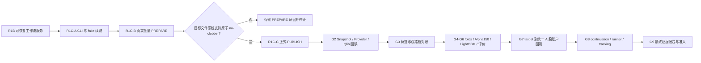
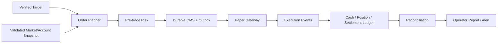

# M3 剩余工作与 M4 实施总规划

更新日期：2026-07-15  
用途：面向项目使用者说明 M3 剩余关键路径、M4 轻量交易闭环及外部 Agent 的执行顺序。  
状态依据：[`M3当前验收与返工总览.md`](M3当前验收与返工总览.md)；M3 详细契约以 [`M3实施与Agent交接.md`](M3实施与Agent交接.md) 和 [`agent/`](agent/README.md) 中现行分包任务书为准。

## 1. 路线结论

当前不应扩建新框架，而应沿两条边界清楚的主线推进：

1. **M3 研究闭环**：把已验收的 G1 数据合同推进到真实、不可变的数据发布，再依次完成 Qlib Provider、标签对账、Alpha158/LightGBM、统一 A 股回测、编排追踪和最终准入。
2. **M4 纸面交易闭环**：在 M3 研究产物之上建立“目标权重 → 订单计划 → 事前风控 → PAPER OMS → 成交/账本 → 对账报告”的最小闭环；M4 不接实盘 Gateway，不开启自动交易。

M3 的正式 G1 发布依赖支持目录级原子 no-clobber 的文件系统。当前项目所在 DrvFS 不能伪装成满足 `RENAME_NOREPLACE`；在该门禁解决前可完成 R1B/R1C 的代码和 PREPARE 证据，但不得伪造 `VerifiedG1Release`。M4 的纯领域合同和 PAPER 路径可在不读取 M3 真实数据目录的前提下用 fixtures 独立推进。

## 2. 数据与代码边界

本项目采用以下强制边界：

- `src/` 只保存生产代码；`archive/legacy_pre_greenfield/` 保存绿地重建前的旧代码和 Notebook，生产代码不得 import 或动态加载其中内容。
- `data/` 只保存数据；除 `quant.data` 的显式 repository/工具外，其他模块不得遍历或打开项目数据目录。
- `data/legacy/` 只作为待迁移历史资料，不参与默认发现、普通测试或生产运行；迁移必须通过显式工具读入、Schema 校验、来源记录和 clean 发布。
- `artifacts/` 保存运行产物、报告和实验记录，不作为业务输入 SSOT。
- 因子、策略、组合、回测和执行层只消费已验证的 DataFrame、领域对象或 repository 接口，不接收任意数据目录路径。

## 3. M3 剩余关键路径

### 3.1 执行包清单

| 顺序 | 包 | 封闭输出 | 前置 | 现行详细任务书 |
|---:|---|---|---|---|
| 1 | R1B | 可恢复的五阶段 G1 workflow service | R1A、R1L 已主验 | [`agent/M3_G1_R1B可恢复工作流服务骨架外部闭环任务单.md`](agent/M3_G1_R1B可恢复工作流服务骨架外部闭环任务单.md) |
| 2 | R1C-A | CLI、fake handler、断点续跑与稳定 summary | R1B 主验 | [`agent/M3_G1_R1C分阶段CLI与真实全量运行外部闭环任务单.md`](agent/M3_G1_R1C分阶段CLI与真实全量运行外部闭环任务单.md) |
| 3 | R1C-B | 真实全量 PREPARE 候选及审计证据 | R1C-A 主验、真实数据源可用 | 同上 |
| 4 | R1C-C | 正式不可变 `VerifiedG1Release` | R1C-B + 支持原子 no-clobber 的 FS | 同上 |
| 5 | G2A–G3B | snapshot、Qlib Provider、确定性回读、标签与对账 verified artifacts | 正式 G1 release | [`agent/M3_G2_G3快照Provider标签分包骨架与外部闭环任务单.md`](agent/M3_G2_G3快照Provider标签分包骨架与外部闭环任务单.md) |
| 6 | G4A–G6B | fold、Alpha158、监督对齐、模型、预测、评价、汇总 | G2/G3 主验 | [`agent/M3_G4_G6研究链分包骨架与外部闭环任务单.md`](agent/M3_G4_G6研究链分包骨架与外部闭环任务单.md) |
| 7 | G7P0–G7F | target、计划、公司行动、账户循环、三成本场景 | G4–G6 + G1 facts | [`agent/M3_G7目标到账户回测分包骨架与外部闭环任务单.md`](agent/M3_G7目标到账户回测分包骨架与外部闭环任务单.md) |
| 8 | G8A–G8F | registry、runner、CLI、tracking、复现与 DAG | 对应 verified readers/handlers | [`agent/M3_G8Continuation编排恢复追踪分包骨架与外部闭环任务单.md`](agent/M3_G8Continuation编排恢复追踪分包骨架与外部闭环任务单.md) |
| 9 | G9A–G9G | 质量、证据计划、Gate checker、决策和 acceptance | G1–G8 全部主验 | [`agent/M3_G9最终准入分包骨架与外部闭环任务单.md`](agent/M3_G9最终准入分包骨架与外部闭环任务单.md) |

### 3.2 每包的固定交付边界

每个包只做一个可独立验真的算法闭包：

- 输入必须是上一包的 verified 类型、冻结配置或显式 fixture，不能扫描目录猜输入。
- 计算逻辑与发布逻辑分开；先在临时目录产生候选并验真，再使用既定 no-clobber 协议发布。
- 输出包括 typed result/manifest/receipt，且 identity 覆盖所有会改变科学结论或账户结果的输入。
- 实现 Agent 只改任务书白名单文件；完成定向测试、全量回归、Ruff、mypy 后提交交付报告。
- 新会话的独立初验 Agent 保持生产代码和实现测试只读，逐条映射合同并补至少一个实现者未使用的反例。
- 初验失败回到实现会话返工；通过后才交主 Agent 最终验收。任何过程报告均不得更新 Gate 或路线图完成状态。

## 4. M4 目标与范围

M4 的完成定义不是“能连券商”，而是一个可重启、可审计、默认安全的 PAPER/SHADOW 交易闭环：

### 4.1 MVP 范围

- 市场：A 股和港股通；只支持日频目标及限价/DAY 纸面订单。
- 模式：`PAPER` 和只读 `SHADOW`；`auto_trade=false`，无实盘 Gateway。
- A 股：T+1 可卖、停牌、涨跌停、板块申报数量规则、版本化费用。
- 港股通：T+0 交易能力、每证券 board lot、碎股只卖、两地交易日、价格档位/增强限价约束、显式额度状态、HKD 报价与人民币结算/FX 快照、T+2 结算账本。
- OMS：稳定 client order id、状态机、重复/乱序回报幂等、部分成交、拒单、撤单、超时、重启恢复。
- 风控：总开关、人工确认、仅卖出、冻结证券、单票/总仓/单日成交/撤单上限、数据质量失败禁止新买入。
- 运维：SQLite 持久化、transactional outbox、每日对账、结构化脱敏日志、故障演练和至少四周 PAPER 稳定运行。

M4 不包含实盘 MiniQMT 适配、无人值守下单、高频/分钟撮合、融资融券、期权、复杂订单类型或分布式服务；这些属于 M5 或以后。

### 4.2 M4 分包与依赖

| 波次 | 包 | 唯一职责 | 主要输出 | 前置 |
|---|---|---|---|---|
| 0 | M4-C0 | 交易配置、安全默认值、有效期与 identity | `TradingConfig` / versioned rule selectors | M3 C0 约定 |
| 0 | M4-D0 | OMS/账本领域契约增量 | immutable intents/events/snapshots | 现有 domain SSOT |
| 0 | M4-D1 | 数据访问端口 | `MarketDataRepository` / `AccountSnapshotRepository` Protocol | D0 |
| 1 | M4-B1 | A 股纯交易规则适配 | eligibility/reject/quantity 纯函数 | C0、D0、M3 G7D 主验 |
| 1 | M4-B2 | 港股通纯交易规则 | dual-calendar/lot/tick/quota 纯函数 | C0、D0 |
| 1 | M4-B3 | 费用、FX 与有效期 | deterministic cost/FX result | C0、D0、M3 G7D 主验 |
| 2 | M4-B4 | target 到订单计划 | `OrderPlan` + rejection diagnostics | B1–B3、D1 |
| 2 | M4-B5 | 多币种结算与公司行动账本 | immutable ledger transitions | B1–B3、D0、M3 G7C/E 主验 |
| 3 | M4-B6 | 统一事件回测 | verified scenario result | B4、B5、M3 G7F 主验 |
| 3 | M4-B7 | 指标与压力场景 | admission metrics/report | B6 |
| 3 | M4-B8 | 策略准入比较 | M2/M3 同口径 decision | B7、M3 verified target |
| 1 | M4-P0 | SQLite schema/migration/repository | durable store | C0、D0 |
| 1 | M4-P1 | OMS 纯状态机与幂等键 | deterministic transitions | D0 |
| 2 | M4-P2 | Paper Gateway | deterministic fills/events | P1、B1–B3 |
| 2 | M4-P3 | 事前风控与人工控制 | risk decisions/audit events | C0、D0、D1 |
| 3 | M4-P4 | 执行服务与 transactional outbox | restart-safe command flow | B4、P0–P3 |
| 3 | M4-P5 | 恢复与对账 | reconciliation result/issues | P0、P1、P4、B5 |
| 4 | M4-P6 | 操作 CLI | inspect/plan/approve/paper-submit/cancel | P4、P5 |
| 4 | M4-P7 | 报告与告警 | EOD report / structured alerts | P5 |
| 5 | M4-P8 | 稳定性与故障演练 Gate | soak evidence / gate decision | P6、P7 |

冻结共同规则和逐包反例见 [`agent/M3_M4_Grok交接清单.md`](agent/M3_M4_Grok交接清单.md)，M4 精确接口、白名单和失败语义见 [`agent/M4轻量交易闭环分包任务书.md`](agent/M4轻量交易闭环分包任务书.md)。

### 4.3 可并行边界

为避免共享文件冲突，只有白名单互斥时才并行：

- C0 → D0 → D1 先顺序冻结。
- M3 G7 对应能力主验后，B1、B2、B3 可并行；P0、P1 可在 D0 后并行。
- B4 与 B5 可并行；P2 与 P3 可并行。
- B6–B8 和 P4–P8 各自顺序推进。
- 同一时间最多十个外部会话：最多六个代码写会话、最多四个代码只读审查/验证会话。每个写会话绑定互斥的生产代码、测试和报告白名单；只读会话使用全新身份，只能写自己的唯一报告，且不得验证正被写会话修改的文件。前置、依赖或 I/O 集合存在冲突时必须串行。

## 5. M4 市场规则证据与版本化要求

以下官方规则只用于冻结工程边界；具体费率、阈值和有效期仍必须存入 `configs/`，不能复制成散落常量：

- 上交所现行交易规则说明 A 股买入申报数量、零股卖出和价格涨跌幅等基础边界：[上海证券交易所交易规则（2026 年修订）](https://www.sse.com.cn/lawandrules/sselawsrules2025/stocks/exchange/c/c_20260424_10816482.shtml)。
- 深交所程序化交易管理实施细则自 2025-07-07 起施行，M4 的程序化报告/频率门禁应保留版本位置而不假定永久不变：[深交所正式发布程序化交易管理实施细则](https://www.szse.cn/lawrules/rule/allrules/bussiness/t20250403_612770.html)。
- 港股通证券按各证券 board lot 交易，内地投资者碎股仅可卖出，并允许日内回转：[Stock Connect Investor Book](https://www.hkex.com.hk/-/media/HKEX-Market/Mutual-Market/Stock-Connect/Getting-Started/Information-Booklet-and-FAQ/Information-Book-for-Investors/Investor_Book_En.pdf)。
- 港交所订单类型、增强限价和价格档位约束以交易机制页面为准：[HKEX Trading Mechanism](https://www.hkex.com.hk/Services/Trading/Securities/Overview/Trading-Mechanism?sc_lang=en)。
- 港股通结算存在 T+2 资金/证券交收边界：[沪港通交易风险揭示书](https://www.sse.com.cn/lawandrules/sselawsrules2025/global/hkexsc/c/c_20250612_10781679.shtml)。
- 港交所已公布 2026 年 board-lot 框架后续阶段，说明 board lot 必须是按证券、按有效期的数据，而非硬编码常量：[HKEX 2026-06-30 Market Communication](https://www.hkex.com.hk/News/Market-Communications/2026/260630news?sc_lang=en)。

每个 M4 规则对象必须携带 `rule_version`/`effective_from`；历史回放按交易日选择当时规则，未知或过期配置应 fail closed。

## 6. Gate 与停止条件

### M3 停止条件

- 没有正式 `VerifiedG1Release` 时，G2A 及其后真实实现停止；允许使用明确标记的 fake 做接口单测，但不得改变 Gate 状态。
- Qlib 只在 WSL `py312` 隔离环境运行兼容探针/Provider 真实回读；主体回归仍在 WSL `base`。
- 真实 Tushare 调用只读取 ignored token 配置，任何日志、报告、异常和测试快照不得含 token。

### M4 停止条件

- 缺失市场规则版本、board lot/tick/FX/交易日、账户快照或数据质量 Gate 失败时，不生成新买单。
- `auto_trade`、实盘 Gateway 或真实账号能力不在 M4 授权范围；遇到相关需求立即停止并回报。
- OMS 状态无法解释、账本不守恒、broker snapshot 对账不平、重复事件产生二次资金/持仓影响时，Gate 必须失败。

## 7. 推荐下一步

R1B/R1C-A、M4-B2、P0-H1 与 P4-P0 已完成对应主验；M3 HISTORY 也已完成 `3186/3186` raw/receipt
闭包，不得再按旧 PILOT/全量计划重复请求。M3 下一关键步是先冻结 full-OHLC benchmark 科学口径，再对 9 条
分红异常形成带官方证据和 identity 的处置闭包，之后重建真实 candidate、REFERENCE/PREPARE，并只能在
支持且经探针验证原子 `RENAME_NOREPLACE` 的 ext4 release root 正式 PUBLISH；不得跨前置预建真实 G2–G9。
M4 的 B1/B3/P2/P4 service 等继续等待 M3 G7/B 系列前置。
