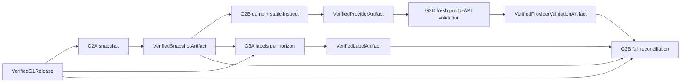

# M3 G2–G3 Snapshot、Provider 与标签对账分包骨架及外部闭环任务单

日期：2026-07-14  
状态：**设计冻结；G2A 合同实现中；正式数据运行仍等待当前 G1 Windows release 发布并经主 Agent 验真**
运行环境：G2A parent 为 Windows/WSL 双平台；Qlib worker 仍使用 WSL `py312`，Linux Gate 单独验收
设计 SSOT：[`M3实施与Agent交接.md`](../M3实施与Agent交接.md) §4.2、§4.3、§4.5、§4.9  
历史设计与审查：[`M3_G2-G3Provider与标签对账实现初验任务单.md`](../archive/M3_G2-G3Provider与标签对账实现初验任务单.md)、
[`M3_G2-G3设计审查与修订记录.md`](M3_G2-G3设计审查与修订记录.md)、
[`M3_G2-G3跨文档一致性初验报告.md`](M3_G2-G3跨文档一致性初验报告.md)

> 本文取代旧任务书“一次交付 P0–P4”的执行颗粒度，但保留其中已冻结的业务口径。本文只完成困难边界、
> 类型、函数、身份和验收设计，不宣称 G2A/G2B/G2C/G3A/G3B、G2、G3、M3 或任何 Gate 已实现或通过。

> **开发并行轨边界（2026-07-31）：** 正式 G2A 的前置仍是经主验的 `VerifiedG1Release`。正式 G1 长时 I/O
> 期间，可按 [`M3_DevelopmentExampleRelease开发并行轨任务单.md`](M3_DevelopmentExampleRelease开发并行轨任务单.md)
> 使用独立的 `VerifiedDevelopmentExampleG1Release` 验证 snapshot/staging 与后续接口；该对象、其
> `development-snapshot` receipt 和所有结果均不是正式 G2A 或 Gate 证据。

## 1. 当前事实与拆包结论

当前工作区的真实状态：

- `snapshot.py` 的 strict manifest/session-calendar/request/receipt 与开发 nominal G2A 已实现；正式 G2A 仍等待
  `VerifiedG1Release`；
- `contracts.py` 已包含现行 G2A/G2B/G2C 冻结 value objects；
- 开发轨已实现 provider manifest/static inspector 与 G2C fresh Qlib worker/validation；正式轨仍等待
  `VerifiedG1Release` 后执行并主验，开发证据不得用于关闭正式 G2B/G2C 或 Gate；
- `labels.py` 已有独立标签公式和守恒，但没有 label artifact manifest、verified bundle 或 G3 对账；
- WSL base 当前为 Python 3.13 且不承载 `pyqlib 0.9.7`；已验收的 WSL `py312` 用于无网络真实 Qlib
  development smoke。该证据仍不代替正式 G2/G3 Gate。

旧任务书合并了 snapshot 文件系统、dump subprocess、Qlib 全局状态和标签语义四种风险。现拆为五包：

| 包 | 唯一职责 | Qlib import | 副作用 | 前置 |
|---|---|---|---|---|
| **G2A** | Verified G1 release → strict snapshot artifact | 禁止 | 只写 StageRunner 空 temp | 真实、正式发布且经主验的 `VerifiedG1Release`；P4C 代码合同或 R1C PREPARE 均不充分 |
| **G2B** | pinned dump tool + provider materialization + 全量静态结构验真 | parent 禁止；dump 脚本子进程可用 | 只写 provider stage temp | G2A 主验 |
| **G2C** | 确定性 3×20×7 fresh-process Qlib public API 回读 | 仅 worker | 只写 validation stage temp | G2B 主验 |
| **G3A** | 每 horizon 独立标签 artifact/manifest/验真 | 禁止 | 只写 labels stage temp | G2A；运行时还需 experiment identity |
| **G3B** | 每 horizon 全量 fresh-worker 标签三层对账 | 仅 worker | 只写 reconciliation stage temp | G2C、G3A 主验 |

每包单独执行“外部实现 → 未参与实现的外部独立复验 → 主 Agent 最终验收”。实现者不得跨包顺手补后续
功能；如果前包接口有问题，提交最小证据给主 Agent 修改 SSOT，不得在后包复制一套临时接口。



## 2. 跨包信任与身份规则

### 2.1 禁止裸 DataFrame + 自报 hash

跨包只传以下 verified bundle：

```text
VerifiedG1Release
VerifiedSnapshotArtifact
VerifiedProviderArtifact
VerifiedProviderValidationArtifact
VerifiedLabelArtifact
VerifiedLabelReconciliationArtifact
```

每个 verified bundle 由 strict manifest reader、物理文件 hash、逻辑 Schema/内容和 StageReceipt 闭包重建。
函数消费时再次重建其嵌套 dataclass；`frozen=True` 或对象曾构造成功不能代替消费边界重验。不得设计
`frame: DataFrame, frame_sha256: str` 让 caller 任意配对。

### 2.2 identity DAG

```text
G1 release + snapshot narrow config + code
  -> snapshot_request_key
snapshot artifact content manifest
  -> snapshot_id
snapshot_id + provider config + dump tool + Qlib/runtime + code
  -> provider_key
provider receipt + provider-validation config + runtime + code
  -> provider_validation_key
snapshot/provider/scientific/dependency/code
  -> experiment_key
experiment + horizon + provider-validation receipt + label manifest
  + label-reconciliation config + dependency + code
  -> reconciliation_key
```

所有 key/digest 是裸 64 位小写 hex，组合 key 只调用 `run_state.py` 的唯一具名函数。snapshot 是内容寻址，
其 manifest hash/文件 hash 产生 snapshot ID；provider 不写入 snapshot 目录。改变 tracking 不影响上述身份；
改变 NumPy/pandas/Qlib 改变 provider；改变 LightGBM 只改变 experiment；改变 label tolerance 只改变
reconciliation。

### 2.3 parent/worker 边界

- `snapshot.py/provider.py/labels.py` 的 parent 生产路径不得 import `qlib`，也不得通过项目包 `__init__` 间接
  导入；只有既有 SSOT 模块 `qlib_adapter.py` 的 worker 入口和固定 `dump_bin.py` 子进程可 import。
- 每次 G2C validation、G3B horizon reconciliation 启动全新 Python；一个 worker 只 `qlib.init` 一个 URI。
- parent 在启动 worker 前验真全部 bundle/receipt/hash；worker request echo identity；parent 不信 worker
  summary，必须从 worker 原始结果重算。
- request/response 中可含临时绝对路径，但只存在 StageRunner temp，禁止进入稳定 JSON/manifest/receipt。
- 持久产物不保存 PID、wall-clock、stdout/stderr、绝对 provider URI 或环境变量。

任何公开 build/plan/verify 函数只要消费 `*_config_sha256`，就必须同时接收同一个严格 `LoadedM3Config`，并在
任何文件写入、tool fetch 或 worker 启动前调用 C0 唯一 `canonical_config_sha256(selector=...)` 重算对应窄
selector。禁止仅验证“64 位 hex”后相信 spec/manifest 自报 hash。完整 TOML、tracking 字段和物理 config path
仍不得写入 artifact 或内容 identity。

### 2.4 发布所有权

本五包 helper 只写 StageRunner 分配的空 temp。StageRunner 是 final directory、原子 rename 和 stage receipt 的
唯一 publisher。helper 不扫描 artifact 根、不取得跨 stage 锁、不修补 final、不发布 receipt。相同 key 并发、
orphan 认领和 receipt 验真遵循 E3/G8；本任务只提供可重算的确定性 temp 内容。

本五包自行写出的 Parquet（snapshot staging/calendar、validation details、labels/diagnostics、reconciliation
details）统一固定 `compression="zstd"`、`compression_level=3`、`statistics=True`、
`row_group_size=65536`、`use_pyarrow=False`；各表列序由 Schema/本文冻结。Qlib 官方 dump 生成的 `.bin/.txt`
不套用此规则。任何模块不得依赖 Polars writer 默认值。

### 2.5 Stage receipt 精确闭包

通用 `verify_stage_receipt` 只证明 receipt 自身列出的文件未漂移；每个 bundle verifier 还必须证明下表集合
“不多不少”。上游 receipt 文件本身可以作为下一 continuation 的 `ExternalInput`，但永远不列入自己的 outputs。

| stage / scope / scope key | inputs 精确语义集合 | outputs 精确语义集合 |
|---|---|---|
| `snapshot` / `SNAPSHOT` / `snapshot_request_key` | G1 manifest、bar、membership、calendar | snapshot request record、manifest、session calendar、全部 staging |
| `provider` / `PROVIDER` / `provider_key` | snapshot request record/receipt/manifest/calendar/全部 staging、pinned dump tool | provider manifest、`provider/` 严格树全部普通文件 |
| `provider-validation` / `PROVIDER` / `provider_validation_key` | snapshot request/receipt/manifest/calendar/staging、provider receipt/manifest/严格树 | validation details、summary |
| `labels` / `EXPERIMENT` / `experiment_key` | experiment receipt/manifest、G1 release manifest/bar/benchmark/eligible、snapshot receipt/manifest/calendar | 当前 horizon 的 labels、diagnostics、label manifest |
| `label-reconciliation` / `EXPERIMENT` / `reconciliation_key` | experiment、G1、snapshot、provider、provider-validation、label 各自 receipt/manifest 及函数实际读取的数据文件 | reconciliation details、summary |

`inputs` 中列出的“严格树/全部 staging”都从已验真 manifest 展开为逐文件 `ArtifactDigest`；禁止用目录 hash、
只列 manifest 或省略实际读取文件。bundle verifier 同时重算 stage/scope/scope key、manifest 身份和 receipt
bytes hash。这样 wholesale 替换一整套自洽业务文件但沿用另一 stage receipt 也不能通过。

## 3. G2A：strict snapshot artifact

### 3.1 文件范围

```text
src/quant/research/m3/contracts.py
src/quant/research/m3/snapshot.py
src/quant/domain/schemas.py
src/quant/domain/__init__.py
src/quant/research/m3/__init__.py
tests/unit/test_m3_snapshot.py
tests/unit/test_schemas.py
docs/M3_G2A快照Artifact交付报告.md
docs/M3_G2A快照Artifact独立初验报告.md
```

不得创建 provider/worker，不改 label 公式、run-state identity 或 G1 release。

### 3.2 冻结类型

```python
@dataclass(frozen=True)
class SnapshotBuildSpec:
    snapshot_request_key: str
    config_version: str
    snapshot_config_sha256: str
    code_version: str
    history_start: dt.date
    history_end: dt.date
    staging_schema_version: str
    adjustment_formula_version: Literal["qlib_yahoo_like_v1"]

@dataclass(frozen=True)
class SnapshotRequestRecordV1:
    schema_version: Literal["m3-snapshot-request-v1"]
    snapshot_request_key: str
    snapshot_id: str
    snapshot_manifest_sha256: str
    g1_release_id: str
    g1_release_manifest_sha256: str
    snapshot_config_sha256: str
    code_version: str
    history_start: dt.date
    history_end: dt.date
    signal_start: dt.date
    signal_end: dt.date

@dataclass(frozen=True)
class SnapshotArtifactEntryV1:
    path: str
    sha256: str
    size_bytes: int
    row_count: int
    schema_name: str
    symbol: str | None
    min_date: dt.date
    max_date: dt.date

@dataclass(frozen=True)
class SnapshotManifestV1:
    schema_version: Literal["m3-snapshot-manifest-v1"]
    snapshot_id: str
    config_version: str
    snapshot_config_sha256: str
    g1_release_id: str
    g1_release_manifest_sha256: str
    source: Literal["tushare"]
    universe: Literal["CSI300_TUSHARE_MONTHLY_OBSERVED_PIT_V1"]
    history_start: dt.date
    history_end: dt.date
    signal_start: dt.date
    signal_end: dt.date
    row_count: int
    symbol_count: int
    min_date: dt.date
    max_date: dt.date
    session_calendar_sha256: str
    session_count: int
    session_start: dt.date
    session_end: dt.date
    staging_format: Literal["parquet"]
    staging_schema_version: str
    adjustment_formula_version: Literal["qlib_yahoo_like_v1"]
    adjustment_spec_sha256: str
    files: tuple[SnapshotArtifactEntryV1, ...]

@dataclass(frozen=True)
class SnapshotBuildResult:
    root: Path
    manifest: SnapshotManifestV1
    manifest_sha256: str

@dataclass(frozen=True)
class VerifiedSnapshotArtifact:
    root: Path
    request: SnapshotRequestRecordV1
    request_sha256: str
    manifest: SnapshotManifestV1
    manifest_sha256: str
    snapshot_receipt_sha256: str
    session_calendar_path: Path
    staging_paths: tuple[Path, ...]
```

废止早期 `DatasetSnapshot.source_fingerprint` 摘要作为跨包信任对象；如保留兼容导出，只能由
`VerifiedSnapshotArtifact` 只读投影产生，后续接口不得接收旧对象。

`SnapshotSessionCalendarSchema` 严格只有 `date: pl.Date`，非空、唯一、严格递增。

### 3.3 接口

```python
def build_snapshot_session_calendar(
    *, release: VerifiedG1Release, history_start: dt.date, history_end: dt.date,
) -> pl.DataFrame: ...

def prepare_qlib_staging(
    *, release: VerifiedG1Release, history_start: dt.date, history_end: dt.date,
) -> pl.DataFrame: ...

def write_staging_by_symbol(
    *, frame: pl.DataFrame, output_dir: Path,
) -> tuple[Path, ...]: ...

def build_snapshot_artifact(
    *, release: VerifiedG1Release, config: LoadedM3Config,
    spec: SnapshotBuildSpec, output_root: Path,
) -> SnapshotBuildResult: ...

def build_snapshot_request_record(
    *, release: VerifiedG1Release, config: LoadedM3Config,
    spec: SnapshotBuildSpec,
    result: SnapshotBuildResult,
) -> SnapshotRequestRecordV1: ...

def read_snapshot_manifest(path: Path) -> SnapshotManifestV1: ...
def read_snapshot_request_record(path: Path) -> SnapshotRequestRecordV1: ...

def verify_snapshot_artifact(
    *, snapshot_root: Path, snapshot_request_path: Path,
    snapshot_receipt_path: Path, release: VerifiedG1Release,
    config: LoadedM3Config, spec: SnapshotBuildSpec,
    artifact_roots: Mapping[str, Path],
) -> VerifiedSnapshotArtifact: ...
```

`build_snapshot_artifact` 先重算 `snapshot_request_key`，并验证 spec 的 G1/config/code 输入。`output_root` 必须
已存在、为空、真实目录；不得 `mkdir(parents=True)` 越权创建父目录，不得覆盖文件。
`spec.history_start/history_end` 必须分别精确等于 G1 manifest 的 `history_start/history_end`；request record
与 snapshot manifest 的 `signal_start/signal_end` 必须从同一 verified G1 manifest 投影，不能由 caller 传入，
并且必须精确等于同一 `LoadedM3Config` 的 `data.start_date/end_date`；二者须已由 G1 证明为 SH session，G2
不得再次自动对齐或容忍旧 `2016-01-01` 示例。四日期还须满足
`history_start <= signal_start <= signal_end <= history_end`。因此相同 G1 release/config/code 不可能在
同一个 request key 下由 caller 偷换日期窗口。

`SnapshotRequestRecordV1` 是 request identity 到内容 identity 的唯一不可变映射，不进入 `snapshot_id`，避免
自引用。其 canonical JSON SHA-256 是 `request_sha256`。记录中的 request key 必须调用
`compute_snapshot_request_key` 重算，snapshot ID/manifest hash 必须从完整 temp artifact 重算；不得让 handler
或调用者自报。request record 已存在时只能严格验真并复用，不能重指向另一 snapshot。

### 3.4 staging 与 manifest 规则

- 入口先调用/重建 `verify_g1_release`；bars、membership、calendar 的 artifact path 只从
  `VerifiedG1Release.artifact_paths` 取得并在读取前复算 manifest bytes hash。
- symbol 域是 PIT membership 历史并集，不按 effective interval 删除行情；日期域是显式 history window；
  source 固定 Tushare，SH session 唯一，不做 SH/SZ 并集。
- 输出精确 `symbol,date,open,high,low,close,vwap,volume,factor`；每证券独立归一化，公式继续使用
  `ADJUSTMENT_SPEC`。重复、非正/non-finite、zero amount/volume 全部失败。
- session calendar 只从 G1 `trade_calendar.parquet` 过滤 SH/open/history；不能从 staging 日期并集反推。
- 全部 staging 日期并集必须精确等于 session calendar；缺任一全市场 session 失败。单证券 gap 合法。
- `session_calendar.parquet` 位于 root；staging 位于 `staging/<qlib-symbol>.parquet`。文件名 codec 只用
  `to_qlib_symbol/from_qlib_symbol`，互为逆。
- manifest files 精确包含一个 calendar entry 和全部 staging entries，按 path 排序；manifest 不列自己。
  `snapshot_id` 是除自身字段外严格 manifest 对象的规范 JSON SHA-256。
- `session_calendar_sha256` 是对严格日期序列的逻辑 canonical digest，不是 Parquet bytes；
  `adjustment_spec_sha256` 是对项目 `ADJUSTMENT_SPEC` 完整具名对象的 canonical digest。每个 file entry 的
  `sha256` 才是物理 bytes hash。
- snapshot request 期望在冻结 writer/runtime 下产生确定物理 bytes；若同一 request key 在另一平台或依赖
  版本产生不同 Parquet bytes，request mapping 必须冲突并 fail-closed，禁止静默重指向。当前受控 Windows/WSL
  探针均为 Python 3.13.13、Polars 1.42.1，固定 writer 的 calendar/staging bytes SHA-256 已逐文件一致；依赖
  版本变化后必须重跑该探针，探针证据不替代正式 full snapshot 验真。
- snapshot temp 根精确只有 `manifest.json`、`session_calendar.parquet` 和 `staging/`；staging 文件名集合必须
  与 manifest 精确相等。Parquet 写参数固定为 `compression="zstd"`、`compression_level=3`、
  `statistics=True`、`row_group_size=65536`、`use_pyarrow=False`，不得依赖 Polars 默认值。
- strict reader 拒绝 duplicate JSON key、未知/缺字段、字符串数字、bool 冒充 int、NaN/Infinity、绝对/逃逸
  path、错误排序/计数/hash。verifier 重读 Parquet、Schema、symbol/date/行数和 bytes。

G8 发布顺序固定为：在空 temp 完成并验真 snapshot → 从 manifest 取得裸 64 hex `snapshot_id` → 以目录级
no-clobber 发布到 `snapshots/<snapshot_id>/` → no-clobber 发布
`snapshot-requests/<snapshot_request_key>.json` → 最后发布 receipt。若在中间崩溃，重跑只能在完整逐字节
一致时认领已发布 snapshot/映射；冲突 fail-closed。G2A helper 不自行写 final、mapping 或 receipt。

snapshot receipt 固定 `stage="snapshot"`、`scope="SNAPSHOT"`、`scope_key=snapshot_request_key`。inputs 精确
绑定 G1 `manifest.json` 以及本阶段实际读取的 `bar_1d.parquet`、`universe_membership.parquet`、
`trade_calendar.parquet`；outputs 精确绑定 request record、snapshot manifest、session calendar 和全部 staging
Parquet。verifier 必须重算该集合，不能只调用通用 receipt parser 后接受任意自洽 inputs/outputs。

### 3.5 G2A 必测反例

至少覆盖：tracking 改变 snapshot 不变；G1 manifest/bar/calendar 混配；保持 config hash/request key 不变而
偷换 history 首尾；history 首尾越界；request record 重指向另一个 snapshot；snapshot 已发布但 mapping 前
崩溃及反向崩溃；SH/SZ 分歧；某
权威 session 全证券缺行；单证券 gap；membership 调入前历史保留；文件名大小写/codec；output 非空、symlink、
hardlink；Parquet/hash/manifest 任一漂移；snapshot ID 自洽整套替换在原 verified G1 input 重建时失败；四观察
面路径/token 脱敏；静态证明无 Qlib import/网络。

## 4. G2B：provider materialization 与全量静态验真

### 4.1 文件范围

```text
src/quant/research/m3/contracts.py
src/quant/research/m3/fetch_qlib_tool.py
src/quant/research/m3/provider.py
src/quant/research/m3/__init__.py
tests/unit/test_m3_fetch_qlib_tool.py
tests/unit/test_m3_provider_materialization.py
docs/M3_G2BProvider构建与静态验真交付报告.md
docs/M3_G2BProvider构建与静态验真独立初验报告.md
```

不得实现 public API sample 或 label reconciliation。

### 4.2 工具、runtime 与 build 类型

```python
@dataclass(frozen=True)
class QlibDumpToolSpec:
    url: str
    sha256: str
    size_bytes: int
    qlib_version: Literal["0.9.7"]
    command: Literal["dump_all"]

@dataclass(frozen=True)
class ProviderRuntimeFingerprint:
    python_version: str
    packages: tuple[tuple[str, str], ...]
    sha256: str

@dataclass(frozen=True)
class ProviderBuildSpec:
    snapshot_id: str
    snapshot_manifest_sha256: str
    provider_key: str
    provider_config_sha256: str
    dump_tool: QlibDumpToolSpec
    qlib_version: Literal["0.9.7"]
    code_version: str
    runtime_fingerprint: ProviderRuntimeFingerprint
    fields: tuple[str, ...]
    frequency: Literal["day"]
    dump_contract_version: Literal["m3-qlib-dump-all-v1"]

@dataclass(frozen=True)
class ProviderManifestV1: ...  # 字段精确使用 §4.2 SSOT，并由 strict reader 重建

@dataclass(frozen=True)
class ProviderBuildResult:
    root: Path
    qlib_dir: Path
    manifest: ProviderManifestV1
    manifest_sha256: str

@dataclass(frozen=True)
class VerifiedProviderArtifact:
    root: Path
    qlib_dir: Path
    manifest: ProviderManifestV1
    manifest_sha256: str
    provider_receipt_sha256: str
```

旧 `QlibDumpToolSpec.bytes/version` 字段迁移为 `size_bytes/qlib_version` 并新增 command；这是一次明确的现行
SSOT 对齐，不保留双格式 parser。builder 保持位于 `fetch_qlib_tool.py`，仍只从同一个 `LoadedM3Config`
显式映射；`ensure_qlib_dump_tool` 自身不读 TOML。

runtime packages 精确且按 name 排序：`python,numpy,pandas,pyarrow,pyqlib,fire,tqdm,loguru`。parent 使用
`sys.version_info` 和 `importlib.metadata.version`，不得为取版本 import Qlib。缺包或版本不符在任何 output 写入
前稳定失败。

### 4.3 接口与唯一 argv

```python
def build_qlib_dump_tool_spec(config: LoadedM3Config) -> QlibDumpToolSpec: ...
def ensure_qlib_dump_tool(*, spec: QlibDumpToolSpec, target_path: Path) -> Path: ...
def build_provider_runtime_fingerprint() -> ProviderRuntimeFingerprint: ...

def materialize_qlib_provider(
    *, snapshot: VerifiedSnapshotArtifact, qlib_dump_script: Path,
    python_executable: Path, config: LoadedM3Config,
    spec: ProviderBuildSpec, output_root: Path,
    timeout_seconds: float,
) -> ProviderBuildResult: ...

def inspect_provider_structure(
    *, qlib_dir: Path, snapshot: VerifiedSnapshotArtifact,
    spec: ProviderBuildSpec,
) -> ProviderManifestV1: ...

def read_provider_manifest(path: Path) -> ProviderManifestV1: ...

def verify_provider_artifact(
    *, provider_root: Path, provider_receipt_path: Path,
    snapshot: VerifiedSnapshotArtifact, config: LoadedM3Config,
    artifact_roots: Mapping[str, Path],
) -> VerifiedProviderArtifact: ...
```

唯一真实 argv：

```text
<python> <verified dump_bin.py> dump_all
--data_path <snapshot>/staging --qlib_dir <output-root>/provider --freq day
--file_suffix .parquet --date_field_name date --symbol_field_name symbol
--include_fields open,high,low,close,vwap,volume,factor --max_workers 1
```

参数数组、`shell=False`；禁止 backup/fix/update/limit/额外 fields。稳定 manifest 只保存对应占位符 logical argv。
output root 必须空；dump exit 0 后仍必须执行全量结构检查。subprocess timeout/return code/stdout 只用于稳定
错误分类，不持久化原始文本。

### 4.4 全量静态检查

- `calendars/day.txt` 全量等于 snapshot session calendar；
- `instruments/all.txt` 证券集合、codec、每证券 min/max 等于 staging；
- 每证券恰有七个 `<field>.day.bin`，无额外 symbol/field/file/symlink；
- bin 是 `<f4`；首值是该证券首日相对全局 calendar 的整数 offset；字节数 `4*(1+span)`；offset 必须能
  无损解释为整数，NaN/负数/分数失败；
- staging emitted 值转 `np.float32` 后逐 bit/逐位置相等；区间 gap 全为 NaN；
- tree files bytes hash/size、calendar/instrument 摘要和 tree digest 写入 manifest；manifest 不列自己、receipt
  或 validation。

静态 inspector 不 import Qlib。provider root 固定只含 `provider/{calendars,instruments,features}` 和
`provider_manifest.json`。

上述格式不是项目猜测：Qlib v0.9.7 的固定
[`scripts/dump_bin.py`](https://github.com/microsoft/qlib/blob/v0.9.7/scripts/dump_bin.py) 明确把 calendar offset
作为首个 little-endian float32、在证券 min/max 间按全局 calendar reindex，并在 dump 前 drop duplicate date。
实现仍以本项目 pinned bytes/SHA 为执行证据；网页只用于设计核对，不能替代本地 tool 验真。

### 4.5 G2B 必测反例

精确 argv/shell/timeout、runtime package 漂移、tool size/hash/version/command、provider key 重算、dump 0 但少
factor、多 field/symbol、错 calendar/offset/span/endian、finite 值漂移、gap 非 NaN、重复 staging 被 dump
静默 drop、output 非空、树中 symlink/FIFO/hardlink/unknown、manifest JSON 严格性、parent import isolation 和
异常脱敏。fake subprocess 可以证明合同，但报告必须明确未证明真实 Qlib。

## 5. G2C：fresh-process Qlib public API validation

### 5.1 文件范围

```text
src/quant/research/m3/provider.py
src/quant/research/m3/qlib_adapter.py
src/quant/research/m3/__init__.py             # 只导出 provider parent API，禁止 import qlib_adapter
tests/unit/test_m3_provider_validation.py
tests/unit/test_m3_qlib_worker_protocol.py
docs/M3_G2CProvider公共API验真交付报告.md
docs/M3_G2CProvider公共API验真独立初验报告.md
```

### 5.2 probe、spec 与 verified result

```python
@dataclass(frozen=True)
class ProviderValidationSpec:
    provider_validation_key: str
    provider_validation_config_sha256: str
    code_version: str
    qlib_version: Literal["0.9.7"]
    sampling_policy_version: Literal["provider_market_stratified_hash_first_last_v1"]
    worker_protocol_version: Literal["m3-qlib-worker-v1"]

@dataclass(frozen=True)
class ProviderProbePlan:
    schema_version: Literal["m3-provider-probe-v1"]
    provider_validation_key: str
    provider_key: str
    snapshot_id: str
    sampling_policy_version: Literal["provider_market_stratified_hash_first_last_v1"]
    candidate_keys_sha256: str
    selected_rows: tuple[tuple[str, dt.date], ...]
    selected_gap_rows: tuple[tuple[str, dt.date], ...]
    emitted_keys_sha256: str
    gap_keys_sha256: str

@dataclass(frozen=True)
class ProviderValidationSummaryV1:
    schema_version: Literal["m3-provider-validation-v1"]
    provider_validation_key: str
    provider_key: str
    provider_receipt_sha256: str
    provider_manifest_sha256: str
    snapshot_id: str
    provider_validation_config_sha256: str
    provider_runtime_fingerprint_sha256: str
    qlib_version: str
    sampling_policy_version: str
    worker_protocol_version: str
    probe_plan_sha256: str
    candidate_keys_sha256: str
    emitted_keys_sha256: str
    gap_keys_sha256: str
    emitted_key_count: int
    gap_key_count: int
    emitted_comparison_count: int
    gap_comparison_count: int
    details_sha256: str
    details_row_count: int
    api_calendar_sha256: str
    api_instrument_ranges_sha256: str
    missing_emitted_cell_count: int
    extra_cell_count: int
    duplicate_cell_count: int
    non_finite_emitted_cell_count: int
    emitted_mismatch_cell_count: int
    gap_finite_cell_count: int
    calendar_mismatch_count: int
    instrument_mismatch_count: int
    provider_uri_sha256: str
    parent_import_audit_sha256: str
    read_audit_sha256: str
    passed: bool

@dataclass(frozen=True)
class ProviderValidationResult:
    details: pl.DataFrame
    summary: ProviderValidationSummaryV1

@dataclass(frozen=True)
class VerifiedProviderValidationArtifact:
    root: Path
    details: pl.DataFrame
    summary: ProviderValidationSummaryV1
    summary_sha256: str
    validation_receipt_sha256: str
```

原 `candidate_sha256` 改名为 `candidate_keys_sha256`，明确它是 probe 前完整候选键身份，不是 G1 candidate。

### 5.3 接口

```python
def plan_provider_probe(
    *, snapshot: VerifiedSnapshotArtifact, provider: VerifiedProviderArtifact,
    config: LoadedM3Config, spec: ProviderValidationSpec,
) -> ProviderProbePlan: ...

def validate_provider_public_api(
    *, snapshot: VerifiedSnapshotArtifact, provider: VerifiedProviderArtifact,
    probe_plan: ProviderProbePlan, config: LoadedM3Config,
    spec: ProviderValidationSpec,
    python_executable: Path, output_root: Path, timeout_seconds: float,
) -> ProviderValidationResult: ...

def read_provider_validation_summary(path: Path) -> ProviderValidationSummaryV1: ...

def verify_provider_validation_artifact(
    *, validation_root: Path, validation_receipt_path: Path,
    snapshot: VerifiedSnapshotArtifact, provider: VerifiedProviderArtifact,
    config: LoadedM3Config, spec: ProviderValidationSpec,
    artifact_roots: Mapping[str, Path],
) -> VerifiedProviderValidationArtifact: ...
```

`spec` 是重算 `provider_validation_key` 与确定性 probe 的可信输入；若 verifier 不接收它，summary key、receipt
scope 和 plan hash 可被整套自洽替换，因此旧无 `spec` 签名废止。

### 5.4 确定性 sample

- 候选证券是 staging 中至少 20 emitted rows 的全部证券；如果 SH/SZ 任一无候选或总数不足 3，失败；
- 分别按 `sha256(canonical_json(["provider-symbol-v1",snapshot_id,provider_key,symbol]))` 选最低 SH、最低
  SZ，再从剩余全部候选取最低；hash tie 以 symbol 排序；
- 每证券必含首尾 emitted date，再从内部日期按
  `sha256(canonical_json(["provider-date-v1",provider_key,symbol,date_iso]))` 取 18；不足失败；
- 每证券从首尾区间内非 emitted session 按
  `sha256(canonical_json(["provider-gap-date-v1",provider_key,symbol,date_iso]))` 排序取最多 5；没有 gap 合法；
- emitted 精确 60 keys，gap 0–15。键最终按 `(symbol,date)` 排序，任何输入行序不影响。

### 5.5 worker protocol 与证据

parent 以参数数组启动：

```text
<python> -m quant.research.m3.qlib_adapter validate-provider
  --request <ephemeral-request.json>
  --response <ephemeral-response.json>
  --details <ephemeral-details.parquet>
```

worker strict request echo provider/snapshot/validation key、Qlib version、URI hash、60/gap keys、七 fields；随后
在 fresh process `qlib.init(provider_uri=唯一目录)`，通过公开 API 全量读取 calendar/instruments，并读取 probe
fields。worker 不写 summary/PASS，只写逐 cell actual 和全量 API 摘要；parent 重算 expected、missing/extra/
duplicate、420+gap×7 counts、status 和 summary。

details 每个计划 cell 一行；worker 原始返回中额外 cell 不伪装成计划行，而进入 `extra_cell_count` 和
`read_audit_sha256`：

```text
sample_kind, symbol, date, field, api_row_present,
expected, actual, expected_f32_bits, actual_f32_bits, status
```

`sample_kind=EMITTED/GAP`；field 顺序七项固定。emitted expected 是 staging cast `<f4` 后提升为 float64 的精确
值，必须以 `UInt32` bit pattern 等价；signed zero 不得被普通浮点相等吞掉。gap 在 Qlib public API 中可以是
“该 row 缺失”或“row 存在且值为 NaN”，两者都规范为 nullable `actual=null`，并用 `api_row_present/status`
区分 `GAP_ABSENT/GAP_NAN`；任何 finite gap 值都是 `GAP_FILLED` 并失败。emitted row 缺失、NaN/Inf 或 bit
不等价分别计数。summary 分开记录 emitted/gap key 和 comparison 数，不把 gap计入固定 420。
calendar/instruments 经 Qlib API 全量 hash 对账。

`probe_plan_sha256` 是完整 strict plan（除自报 hash 外无省略）的 canonical digest；`details_sha256` 是固定
schema、排序和 nullable/bit-field 规则下的逻辑内容 digest。summary `passed` 当且仅当所有八个错误/漂移计数
均为 0、`emitted_key_count=60`、`emitted_comparison_count=420`、gap counts 与 plan 精确相等，且所有 identity/
digest 重算一致。产物目录精确只有 `provider_validation.parquet`、`provider_validation.json`；output root 必须
预先为空，parent 从 details 与 worker raw audit 重算 summary 后才写 JSON。

parent 在 subprocess 前后断言自身 `sys.modules` 无 `qlib` 前缀；持久 `parent_import_audit_sha256` 对规范空
违规集合 hash。`provider_uri_sha256` 对规范 URI identity（provider key + 相对 `provider`）计算，不 hash 本机
绝对路径。read audit 绑定 worker request keys/fields、API calendar/instrument digest 和 response row-key digest。

### 5.6 G2C 必测反例

跨运行同 sample、hash tie、缺市场/不足 20、A 后 B cache 污染、worker identity echo 漂移、MultiIndex level
逆序/改名、timezone/non-midnight、missing/extra/duplicate cell、字段顺序、float32 signed-zero/NaN/Inf、gap row
缺失与显式 NaN 均合法、gap 被 forward-fill、calendar/instrument API 漂移、worker timeout/非零/坏 JSON/Parquet、父进程预加载 qlib、summary
整套自洽替换在原 worker rows 重算时失败。

## 6. G3A：每 horizon strict label artifact

### 6.1 文件范围

```text
src/quant/research/m3/labels.py
src/quant/research/m3/contracts.py
src/quant/research/m3/__init__.py
tests/unit/test_m3_labels.py
tests/unit/test_m3_label_artifact.py
docs/M3_G3A标签Artifact交付报告.md
docs/M3_G3A标签Artifact独立初验报告.md
```

不得 import Qlib 或实现 reconciliation worker。

### 6.2 manifest 与 verified bundle

```python
@dataclass(frozen=True)
class ExperimentIdentityManifestV1:
    schema_version: Literal["m3-experiment-identity-v1"]
    experiment_key: str
    snapshot_id: str
    snapshot_manifest_sha256: str
    provider_key: str
    provider_manifest_sha256: str
    provider_receipt_sha256: str
    scientific_config_sha256: str
    dependency_fingerprint_sha256: str
    code_version: str

@dataclass(frozen=True)
class VerifiedExperimentIdentity:
    root: Path
    manifest: ExperimentIdentityManifestV1
    manifest_sha256: str
    experiment_receipt_sha256: str

def read_experiment_identity_manifest(path: Path) -> ExperimentIdentityManifestV1: ...

def verify_experiment_identity(
    *, experiment_root: Path, experiment_receipt_path: Path,
    snapshot: VerifiedSnapshotArtifact, provider: VerifiedProviderArtifact,
    config: LoadedM3Config, artifact_roots: Mapping[str, Path],
) -> VerifiedExperimentIdentity: ...

@dataclass(frozen=True)
class LabelBuildSpec:
    experiment_key: str
    experiment_manifest_sha256: str
    horizon_sessions: Literal[5, 10]
    benchmark: Literal["H00300.CSI"]
    label_version: str
    label_build_code_version: str

@dataclass(frozen=True)
class LabelArtifactManifest:
    schema_version: Literal["m3-label-artifact-v1"]
    experiment_key: str
    experiment_manifest_sha256: str
    g1_release_id: str
    g1_release_manifest_sha256: str
    snapshot_id: str
    snapshot_manifest_sha256: str
    horizon_sessions: int
    benchmark: str
    label_version: str
    label_build_code_version: str
    eligible_keys_sha256: str
    bars_sha256: str
    session_calendar_sha256: str
    benchmark_bars_sha256: str
    labels_sha256: str
    labels_row_count: int
    label_key_sha256: str
    diagnostics_sha256: str
    diagnostics_row_count: int
    diagnostic_key_sha256: str
    candidate_count: int
    success_count: int
    diagnostic_count: int  # diagnostics.sample_count 之和，不是 diagnostics 行数

@dataclass(frozen=True)
class VerifiedLabelArtifact:
    root: Path
    labels: pl.DataFrame
    diagnostics: pl.DataFrame
    manifest: LabelArtifactManifest
    manifest_sha256: str
    label_receipt_sha256: str
```

### 6.3 接口与语义

```python
def build_label_artifact(
    *, release: VerifiedG1Release, snapshot: VerifiedSnapshotArtifact,
    experiment: VerifiedExperimentIdentity,
    config: LoadedM3Config, spec: LabelBuildSpec, output_root: Path,
) -> LabelArtifactManifest: ...

def read_label_artifact_manifest(path: Path) -> LabelArtifactManifest: ...

def verify_label_artifact(
    *, label_root: Path, label_receipt_path: Path,
    release: VerifiedG1Release, snapshot: VerifiedSnapshotArtifact,
    experiment: VerifiedExperimentIdentity,
    config: LoadedM3Config, artifact_roots: Mapping[str, Path],
) -> VerifiedLabelArtifact: ...
```

`ExperimentIdentityManifestV1` 的生产和 receipt 发布仍属于 G8；G3A 实现 strict reader/consumer verifier，
不能为了提前实现 G3A 而临时生成 experiment key。manifest 必须调用唯一 `compute_experiment_key` 重算，
且 verified bundle 必须由 experiment stage receipt 证明。G8 后续只编排/发布这一合同，不得另定义字段。

生产 stage 每次只构建一个 horizon；内部可调用既有 `compute_forward_relative_labels(horizons=[h])`。入口从
verified G1 release 读取 bars/benchmark/eligible keys，从 verified snapshot 读取唯一 session calendar；所有
物理/逻辑 digest 在计算前重验。

标签语义保持：as-of `t`，start=`t+1` SH session open，end=`t+h` SH session close。不得用自然日。注意当
`h=1` 时 start=end 是合法的同日 open-to-close；因此公共 Schema 应要求 `return_end_date >= return_start_date`，
只有 `h>1` 才严格晚于。M3 v1 production 仍只允许 h=5/10。

每个 eligible key 恰好成功或进入一个 reason；优先级固定 tail→benchmark entry→benchmark exit→asset entry→
asset exit→entry factor→exit factor。candidate_count 精确等于该 horizon eligible row count，且
`candidate=success+diagnostic_count`。diagnostics 是聚合表，manifest 同时绑定行数、聚合 key hash 和
sample_count 总和。

目录精确为 `labels.parquet,diagnostics.parquet,label_manifest.json`。strict reader/verify 规则同前：未知字段、
duplicate JSON key、NaN/字符串数字、路径逃逸、frame/hash/receipt 混配全部失败。

### 6.4 G3A 必测反例

除权事件手算、Friday→Monday→h session、h=1 同日边界、尾部、停牌缺 entry/exit、factor 两端、benchmark
extra/dtype、eligible 非成员污染、reason 优先级、守恒、diagnostics row count 与 sample sum 混淆、bars digest
遗漏攻击、A frame+B manifest/receipt、输出非空/symlink、异常脱敏和零 Qlib import。

## 7. G3B：每 horizon 全量 fresh-worker reconciliation

### 7.1 文件范围

```text
src/quant/research/m3/labels.py
src/quant/research/m3/qlib_adapter.py
src/quant/research/m3/__init__.py             # 只导出 labels parent API，禁止 import qlib_adapter
tests/unit/test_m3_label_reconciliation.py
tests/unit/test_m3_qlib_worker_protocol.py
docs/M3_G3B标签全量对账交付报告.md
docs/M3_G3B标签全量对账独立初验报告.md
```

### 7.2 spec、summary 与接口

```python
@dataclass(frozen=True)
class LabelReconciliationSpec:
    reconciliation_key: str
    experiment_key: str
    horizon_sessions: Literal[5, 10]
    provider_validation_receipt_sha256: str
    label_manifest_sha256: str
    label_reconciliation_config_sha256: str
    dependency_fingerprint_sha256: str
    code_version: str
    worker_protocol_version: Literal["m3-qlib-worker-v1"]
    qlib_version: Literal["0.9.7"]
    qlib_expression_atol: float
    benchmark_return_atol: float
    label_return_atol: float

@dataclass(frozen=True)
class LabelReconciliationSummaryV1:
    schema_version: Literal["m3-label-reconciliation-v1"]
    reconciliation_key: str
    experiment_key: str
    horizon_sessions: int
    provider_validation_receipt_sha256: str
    label_manifest_sha256: str
    label_reconciliation_config_sha256: str
    dependency_fingerprint_sha256: str
    code_version: str
    worker_protocol_version: str
    qlib_version: str
    qlib_expression: str
    details_sha256: str
    row_count: int
    row_key_sha256: str
    missing_key_count: int
    extra_key_count: int
    duplicate_key_count: int
    non_finite_count: int
    expression_direct_max_abs_error: float
    expression_direct_p99_abs_error: float
    benchmark_max_abs_error: float
    benchmark_p99_abs_error: float
    raw_label_max_abs_error: float
    raw_label_p99_abs_error: float
    relative_label_max_abs_error: float
    relative_label_p99_abs_error: float
    qlib_expression_atol: float
    benchmark_return_atol: float
    label_return_atol: float
    passed: bool

@dataclass(frozen=True)
class LabelReconciliationResult:
    details: pl.DataFrame
    summary: LabelReconciliationSummaryV1

@dataclass(frozen=True)
class VerifiedLabelReconciliationArtifact:
    root: Path
    details: pl.DataFrame
    summary: LabelReconciliationSummaryV1
    summary_sha256: str
    reconciliation_receipt_sha256: str

def reconcile_labels_with_qlib(
    *, release: VerifiedG1Release, snapshot: VerifiedSnapshotArtifact,
    experiment: VerifiedExperimentIdentity,
    provider: VerifiedProviderArtifact,
    provider_validation: VerifiedProviderValidationArtifact,
    labels: VerifiedLabelArtifact, config: LoadedM3Config,
    spec: LabelReconciliationSpec,
    python_executable: Path, output_root: Path, timeout_seconds: float,
) -> LabelReconciliationResult: ...

def read_label_reconciliation_summary(path: Path) -> LabelReconciliationSummaryV1: ...

def verify_label_reconciliation_artifact(
    *, reconciliation_root: Path, reconciliation_receipt_path: Path,
    release: VerifiedG1Release, snapshot: VerifiedSnapshotArtifact,
    experiment: VerifiedExperimentIdentity,
    provider: VerifiedProviderArtifact,
    provider_validation: VerifiedProviderValidationArtifact,
    labels: VerifiedLabelArtifact,
    config: LoadedM3Config, artifact_roots: Mapping[str, Path],
) -> VerifiedLabelReconciliationArtifact: ...
```

入口从 verified bundle（含 `VerifiedExperimentIdentity`）重算唯一 `compute_label_reconciliation_key`；horizon/experiment/provider-validation/
label manifest 必须互相一致。任何混配在启动 worker 前失败。
三个 tolerance 必须是 exact finite non-negative float（bool/int 均拒绝），且满足 C0 已冻结的层级约束；summary
中的值必须与 spec 精确相等。`details_sha256` 对固定列、固定排序、nullable 语义的逻辑内容计算，不能使用
Parquet bytes 冒充。

### 7.3 worker 查询与 parent 独立计算

每个 horizon 一个 fresh worker。worker 通过 Qlib public API：

1. 对完整 label symbol/date 域读取固定表达式
   `Ref($close,-h)/Ref($open,-1)-1`；
2. 另读取原始 `$open/$close` 覆盖所有 return start/end dates；
3. 按命名 MultiIndex level 解析，只返回 label keys 的 expression 值和由原始 lookup 直接计算的
   `provider_raw_return`；
4. echo 全部 identity 和 row-key digest，不计算 benchmark、label diff 或最终 PASS。

parent 使用 snapshot session calendar 独立推导每行 start/end；用 verified G1 原始 `H00300.CSI` open/close
独立计算 `audit_benchmark_return`，不得调用 label builder或复制 label benchmark。然后形成四个误差序列：

```text
expression_direct = |qlib_expression - provider_raw_return|
benchmark          = |audit_benchmark_return - label_benchmark_return|
raw_label          = |provider_raw_return - label_raw_return|
relative_label     = |provider_raw_return - audit_benchmark_return - label_relative_return|
```

只用绝对容差。provider float32 与权威 label Float64 的差异由 `label_return_atol` 容纳；不得把容差放大到能
掩盖 session/date 错位。所有值必须 finite。

### 7.4 details、summary 与 p99

details 精确列：

```text
as_of,symbol,benchmark,horizon_sessions,label_version,
return_start_date,return_end_date,
qlib_expression_raw,provider_direct_raw,label_raw,
audit_benchmark,label_benchmark,
audit_relative,label_relative,
expression_direct_abs_error,benchmark_abs_error,
raw_label_abs_error,relative_label_abs_error,
expression_status,benchmark_status,raw_label_status,relative_label_status,overall_status
```

主 join key 固定前五列；start/end 不进入 join key，避免用错误日期自洽。expected/actual keys 精确相等，
missing/extra/duplicate/non-finite 任一失败。summary 必须增加并重算
`missing_key_count/extra_key_count/duplicate_key_count/non_finite_count`，并分别记录四组 max/p99/tolerance。

p99 不调用依赖版本可能改变插值的 quantile 默认值；固定 nearest-rank：对升序 n 个误差，索引
`ceil(0.99*n)-1`（n>0）。summary `passed` 当且仅当所有计数为 0 且每个 cell 四项均通过。

产物目录精确 `reconciliation.parquet,reconciliation.json`；strict reader 从 details 重算全部 count、row-key、
max/p99/PASS，拒绝自报 summary。跨包与 G9 只能消费 `VerifiedLabelReconciliationArtifact` 或由该 verifier
重新取得的 receipt/summary，不得接受裸 summary、caller 自报 receipt hash 或仅凭文件存在。

### 7.5 G3B 必测反例

全量非抽样、expression 正确/direct 错和反向、label benchmark 错用 t+2、start/end 交换但 join 仍命中、
Float32 正常量化、missing/extra/duplicate key、MultiIndex 顺序、horizon/experiment 混配、provider validation
自报 hash、worker cache A→B、worker echo/JSON/Parquet/timeout、p99 n=1/100/101、NaN/Inf/signed zero、summary
wholesale drift、parent Qlib import isolation 和四观察面脱敏。

## 8. 稳定异常与“抓大放小”

每包定义一个边界异常，`str(error)==code`、`repr` 只含 code、`from None`：

```text
M3SnapshotError: SNAPSHOT_INPUT_INVALID / SNAPSHOT_OUTPUT_INVALID / SNAPSHOT_IDENTITY_MISMATCH
M3ProviderError: PROVIDER_INPUT_INVALID / PROVIDER_RUNTIME_UNAVAILABLE /
                 PROVIDER_SUBPROCESS_FAILED / PROVIDER_STRUCTURE_INVALID /
                 PROVIDER_IDENTITY_MISMATCH
M3ProviderValidationError: PROVIDER_VALIDATION_INPUT_INVALID /
                           PROVIDER_WORKER_FAILED / PROVIDER_VALIDATION_MISMATCH
M3LabelArtifactError: LABEL_ARTIFACT_INPUT_INVALID / LABEL_ARTIFACT_IDENTITY_MISMATCH
M3LabelReconciliationError: LABEL_RECONCILIATION_INPUT_INVALID /
                            LABEL_WORKER_FAILED / LABEL_RECONCILIATION_MISMATCH
```

阻塞 P0/P1：identity/receipt 混配、session/PIT/return 日期错误、dump/tree/bin 错误仍通过、Qlib cache 污染、
worker/parent 可自报 PASS、发布覆盖/路径逃逸、凭据泄露、fake 冒充真实 Gate。

可记录 P2 后置：错误码可更细、注释/命名、deprecation warning、非关键性能优化。不得把全量结构、fresh
process、独立 benchmark、Float32 口径或 verified bundle 降为“小问题”。

## 9. 外部闭环报告与执行顺序

固定报告：

```text
docs/M3_G2A快照Artifact交付报告.md
docs/M3_G2A快照Artifact独立初验报告.md
docs/M3_G2BProvider构建与静态验真交付报告.md
docs/M3_G2BProvider构建与静态验真独立初验报告.md
docs/M3_G2CProvider公共API验真交付报告.md
docs/M3_G2CProvider公共API验真独立初验报告.md
docs/M3_G3A标签Artifact交付报告.md
docs/M3_G3A标签Artifact独立初验报告.md
docs/M3_G3B标签全量对账交付报告.md
docs/M3_G3B标签全量对账独立初验报告.md
```

每包实现者先读 `AGENTS.md`、`karpathy-guidelines.md`、本文、对应 SSOT 和上包最终验收报告。独立验收者
不得参与实现，至少增加两个不同 dtype/identity/故障点反例。失败按“现象—根因—规则—最小复现—新增
测试—通过条件”退回循环。外部通过只可表述“可交主 Agent 终验”，不得勾选 G2/G3/Gate。

原顺序把 snapshot receipt 的唯一 publisher 放在 G8B，却又要求 G2B 先消费 `VerifiedSnapshotArtifact`，形成
执行依赖循环。修订后的实现/正式运行顺序为：

```text
G1-P4C 主验
  -> G2A temp builder/strict verifier 合同实现 + 双平台定向主验
  -> G8A/G8B 最小 publication/StageRunner 前置
  -> 正式 G2A publish + receipt + VerifiedSnapshotArtifact 主验
  -> G2B 外部闭环 + 主验
  -> G2C 外部闭环 + 主验
  -> G3A 外部闭环 + 主验
  -> G3B 外部闭环 + 主验
  -> 兼容 WSL/Qlib 真实链路终验
```

## 10. 验证与真实 Gate 边界

每包先跑定向，再统一运行：

```bash
PYTHONPATH=src /home/mabw/miniforge3/bin/conda run -n base --no-capture-output \
  python -m pytest -q
/home/mabw/miniforge3/bin/conda run -n base --no-capture-output \
  python -m ruff check src tests
/home/mabw/miniforge3/bin/conda run -n base --no-capture-output \
  python -m mypy src
```

G2A/G3A 可在当前环境真实执行无 Qlib 部分。G2B/G2C/G3B 默认使用 fake subprocess/worker；报告必须记录
当前 Python、Qlib availability 和真实命令未执行。最终 G2/G3 Gate 还要求在满足 `>=3.8,<3.13`、精确
`pyqlib 0.9.7` 的 WSL Miniforge 环境中：

1. 用已固定 SHA/bytes 的本地 `dump_bin.py` materialize；
2. 全量 static tree/bin 验真；
3. fresh Qlib public API 60×7 emitted + gap 回读；
4. h=5/h=10 全量 label reconciliation；
5. 全部 stage receipts、strict manifests 和 read/import audit 通过。

缺兼容依赖只能报告 G0/exit 4 blocker，不能把 fake 绿测写成 G2/G3 通过，也不能擅自降级 Python、Qlib 或
修改 base 环境。
