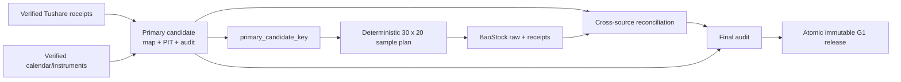

# M3 G1 B2–B4 契约独立设计审查报告

日期：2026-07-13  
状态：设计问题已确认并写回 SSOT/实现任务书；B2–B4 仍未实现、G1 未通过  
权威契约：[`M3实施与Agent交接.md`](../M3实施与Agent交接.md)  
实现与初验任务：[`M3_G1数据实现与初验任务单.md`](../../../M3_G1数据实现与初验任务单.md)

## 1. 审查边界

本轮只审查 B2 请求/receipt、B3 成分观察/PIT 和 B4 全局质量/release，未修改代码，未读取
Tushare token，未调用真实数据接口，也未读取 `_old/`。审查目标是让任务书能被实现 Agent
机械执行，并让独立验收 Agent 可以从 raw 重算而不必须信任调用方自报字段。

## 2. 确认的问题与修订方向

| 级别 | 问题 | 根因 | 必须写回的规则 | 关键回归证据 |
|---|---|---|---|---|
| P0 | `TushareRequestSpec` 可把 A 的 `request_id` 与 B 的参数拼在一起 | dataclass 只存结果，没有唯一构造/验真边界 | 只允许 factory 从 endpoint+排序参数构造；executor 在任何 IO 前重算 ID | 伪造 ID、未排序/重复参数均在连网前失败 |
| P0 | receipt 可能把抓取时间、raw 路径间接带入 release ID | 物理 raw 证据与稳定逻辑响应身份未分开 | receipt 同时保存 raw file hash 和规范内容 hash；release 只绑定后者及请求身份 | 同一逻辑响应落入不同日期目录，release ID 不变；改一个值必变 |
| P0 | raw 写入后、receipt 前崩溃时没有可执行的发现/验真 API | `RawStore` 只有 `write`，无受控候选搜索 | 按 source/endpoint/规范参数扫描严格 metadata；0 个才连网，1 个验真后恢复，多个拒绝 | raw 后崩溃重跑 0 API；双候选即使内容相同也拒绝 |
| P0 | B2 未冻结七个 endpoint 的精确 `fields` | connector 故意通用，planner 又没有唯一字段表 | `fields` 是 request 参数和 ID 的一部分；planner 只能使用代码 SSOT 常量 | 少字段、多字段、改顺序都使 request ID 变化；mapper 缺字段失败 |
| P0 | 两阶段 planner 只返回松散 tuple，B4 不知完整请求集 | 请求生成与发布完整性没有共享对象 | 引入 weight/history batch 和最终 `G1RequestPlan`；candidate 要求 plan IDs=receipt IDs | 删一个 factor receipt、加一个跨 plan receipt、重复 receipt 均失败 |
| P0 | B3 接受裸 `raw_frames` 却要输出 `source_snapshot_id` | 数据与 receipt 血缘被分开 | normalize 只接受已验真 raw bundle；membership 额外接受证券主表、期望月份和预期成分数 | 用 A frame+B receipt 失败；未知/未上市证券、缺月、299/301 失败 |
| P0 | B1 raw 与旧 mapper 接口直接不兼容 | raw 正确不附加 `_request_symbol/_market`，旧 mapper 却必需它们并删除连续 factor 行 | G1 新建六类专用 mapper，只消费 verified response，保留每日 factor | B1 raw 可直接映射；不得在 raw 前吞重复键或在 clean 前丢 factor 证据 |
| P0 | B4 publisher 接受调用方传入的 `quality` | 发布器信任了本应独立重算的 PASS 证据 | publisher 不接受裸质量列表；只接受 build spec、已验真输入和跨源证据，发布前重做全部审计 | 伪造空质量列表无法发布；任一 raw/映射改动被重算抓出 |
| P0 | 跨源对账没有明确生产者，也存在 release ID→抽样→对账→release ID 循环 | 直接用“release 候选 hash”但没有定义候选边界 | 先从 Tushare+日历+主表生成 `primary_candidate_key`，再固定 30×20 sample，抓 BaoStock raw/receipt，对账后生成最终 release | 输入乱序样本不变；事后换样、缺 reference receipt、少一个样本都失败 |
| P0 | `apply_adjustment_factors_strict` 返回裸 bars，无法证明每行确实匹配 factor | 结果值和匹配证据未绑定 | 返回 bars+factor-match evidence，publisher 与 manifest 同时验真 | factor 缺失即使价格看似无需复权也失败 |
| P0 | G1 manifest/quality 没有严格 v1 reader，物理布局未唯一 | 只定义文件概念，G9 无法调用生产 validator | 首版用单文件 Parquet 布局；manifest/quality/cross-source JSON 都有严格 schema version 和 reader | 未知/缺字段、duplicate JSON key、NaN、路径逃逸、多普通文件均失败 |
| P0 | release 缺少下游必需的 `eligible_keys` | B4 输出表未与 G8 required-input 闭包反查 | 固定发布 `eligible_keys.parquet`，两列严格契约且 digest 进 release | 缺文件失败；G2/G3 不得自行从 membership 重建 |
| P0 | release ID 没有绑定构建代码/运行时语义 | 只写 mapper/schema version，未防止 Parquet/数值库差异 | build code version、依赖指纹、mapper/schema/membership version 全进候选和 manifest | 改映射实现或运行时指纹必须产生新 release |
| P1 | 重试口径只有自然语言 | 未区分尝试开始时间、限频等待与退避等待 | 只重试显式 typed transient error；下次尝试时间是 rate-limit 和 exponential-backoff 两个 deadline 的最大值 | fake monotonic clock 精确验证首次立即、缓存不等待、重试次数与时间 |
| P1 | 部分 endpoint 文档未公开承诺页大小 | 把项目安全阈值容易写成供应商保证 | 配置中七个数值一律称“项目 fail-closed 单请求行数安全阈值” | 返回行数等于阈值必须失败，不需声称这是供应商最大值 |
| P0 | `stk_limit` null 无法证明合法无限制 | 供应商缺值与交易规则证据混同 | M3 v1 对任一 null/单侧/整行缺失 fail-closed；未来需已验真 unlimited-keys 规则源 | null 不得被 mapper 默认成 `has_price_limit=false` |
| P0 | 公司行动多公告版本与日期条件未冻结 | 公告行和经济事件混淆 | 冻结分组键、最新版选择、tie 冲突、event ID 和 cash/stock 日期条件 | 同版数值冲突、cash 无 pay date、stock 无 list date 失败，选择证据入 release |

## 3. 首版最小发布流程

`primary_candidate_key` 只绑定 G1 配置身份、Tushare 逻辑 receipt、已验真日历/主表、规范
clean 内容 digest 和构建方法/运行时指纹，不含 BaoStock 证据。最终 `release_id` 再加入 sample
plan、BaoStock 逻辑 receipt 与对账产物 digest，从而消除循环依赖。

## 4. 对实现与验收 Agent 的指导

1. 不要让 dataclass 中的 hash 或 PASS 布尔值成为信任边界；每个持久化身份都必须有一个从实际
   bytes/frame 重算的生产 validator。
2. raw 证据保留供应商返回顺序和重复行；规范内容 hash 可以为了身份稳定而排序，但不得因此
   覆盖 raw 重复键问题。
3. 指定样本后才能请求参考源；参考源返回的多余日期只留在 raw，对账明细只允许冻结样本键。
4. 实现 Agent 若发现 Tushare SDK 只抛出没有稳定代码的字符串异常，默认不可重试；先上报真实脱敏样例，
   由主 Agent 冻结转换表，不做宽泛中文子串匹配。
5. 独立验收必须至少构造：A frame+B receipt、raw 双候选、伪造 PASS、样本计划后替换键、manifest
   新增普通文件五类对抗反例。

## 5. 本轮不关闭的项目

- 未实现 B2–B4，未运行真实 300 成分全历史回填。
- 未运行 Tushare/BaoStock 30 只×20 日真实对账。
- 未验证公司行动公告版本选择和 factor-ratio 容差在全历史数据上的稳定性。
- 未更新路线图 Gate 状态；只有实现、独立验收、主 Agent 最终验收和真实小样本均通过后才能更新。
