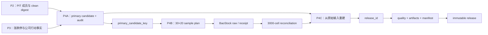

# M3 G1-P4 / B4 候选、审计、跨源证据与不可变发布设计及任务拆分

日期：2026-07-15  
状态：**P4A、P4B、P4C 已通过主 Agent 最终验收；B4/G1/Gate 均未关闭**  
适用环境：WSL Miniforge `base`，不兼容 Windows 原生 Python  
权威上游：[`M3实施与Agent交接.md`](../M3实施与Agent交接.md) §4.10、
[`M3_G1_P2_B3PIT成员状态外部闭环任务单.md`](M3_G1_P2_B3PIT成员状态外部闭环任务单.md)、
[`M3_G1_P3_B2C执行事实外部闭环任务单.md`](M3_G1_P3_B2C执行事实外部闭环任务单.md)

P4B 现行可执行补充合同见
[`M3_G1_P4B跨源证据外部闭环任务单.md`](M3_G1_P4B跨源证据外部闭环任务单.md)；若本总设计的旧接口与该补充
合同冲突，以主 Agent 针对现行代码复核后的补充合同为准，再同步修正本文和主契约。

P4C 现行可执行补充合同见
[`M3_G1_P4C不可变发布外部闭环任务单.md`](M3_G1_P4C不可变发布外部闭环任务单.md)；该合同补充 manifest 的
`price_limit_required_keys_sha256`，使 final verifier 可从发布文件重算 primary identity。

> 本文冻结 G1-P4 的实现边界和外部交接合同；P4A/P4B/P4C 的通过证据见各自主验报告，只表示三个代码合同子包完成，不表示 B4、G1、M3 或任何 Gate 已通过。真实 BaoStock smoke、完整 G1 数据和支持 `RENAME_NOREPLACE` 的 Linux/WSL2 commit 仍未验收。
> 上游 P2/P3 已通过主验。P4A 必须消费并重执行其现行契约，不得为了让 P4 测试先绿而复制、弱化或临时替代。

## 1. 结论：B4 必须拆成三个外部闭环

原 B4 同时包含纯数据组合、供应商网络 journal、跨源比较和不可变目录发布。一次性交给实现 Agent 会把三类
不同失败面混在一起，复验也难以判断错误来自业务口径、网络证据还是文件系统状态机。现拆为：

| 包 | 唯一职责 | 允许副作用 | 前置 |
|---|---|---|---|
| **P4A** | 从原始冻结输入重建 primary candidate，计算唯一身份并做全局主源审计 | 无网络、无文件系统写入 | P2、P3 主验通过 |
| **P4B** | 由 primary identity 确定性抽样，取得 BaoStock raw/receipt 并完成 3000 cell 对账 | 只有 executor 可联网和写 reference raw/journal | P4A 主验通过 |
| **P4C** | 从原始输入再次重建 P4A/P4B，生成严格 JSON/Parquet 并原子发布 immutable release | 无网络；允许受控 release 文件系统写入 | P4B 主验通过 |

每个包各走一次“外部实现 → 未参与实现的外部独立复验 → 主 Agent 终验”。P4A 未通过时不得开始 P4B，
P4B 未通过时不得开始 P4C。这样既能发挥 Cursor Grok 4.5 对中型完整包的实现能力，也不会把三个信任边界
压成一个无法审计的巨型提交。



## 2. 跨包不变量

### 2.1 只保留一个 primary identity

废止原草案中含义重叠的 `candidate_sha256`。`primary_candidate_key` 是 Tushare 主源 candidate 的唯一内容
身份；quality、cross-source summary、manifest 和抽样均只引用这个字段。不得再增加同义 hash 或要求两个
hash 相等。

`primary_candidate_key` 是下列对象经项目严格 canonical JSON 编码后的 SHA-256；不得换成位置数组、字段子集或
`repr(dataclass)`：

```json
{
  "schema_version": "m3-g1-primary-candidate-identity-v1",
  "build_spec": {
    "config_version": "...",
    "g1_config_sha256": "...",
    "mapper_version": "...",
    "schema_version": "...",
    "membership_method_version": "...",
    "price_limit_method_version": "...",
    "corporate_action_selection_version": "...",
    "corporate_action_reconciliation_version": "...",
    "build_code_version": "...",
    "dependency_fingerprint_sha256": "..."
  },
  "request_plan_sha256": "...",
  "signal_start": "YYYY-MM-DD",
  "signal_end": "YYYY-MM-DD",
  "history_start": "YYYY-MM-DD",
  "history_end": "YYYY-MM-DD",
  "input_receipts": ["按 (source,endpoint,request_id) 排序的完整 G1ReceiptProjectionV1 对象"],
  "table_content_digests": [["table_name", "sha256"], "按 table_name 排序，共 14 项"],
  "price_limit_required_keys_sha256": "..."
}
```

不包含 BaoStock、抓取时间、物理路径、Parquet bytes、进程 ID或本机目录。calendar 和 instruments 是 14 张表
的一部分，因此改变 `is_open/list_date/delist_date` 必须改变 identity。

### 2.2 身份 DAG 不得形成自引用

身份顺序固定：

1. primary 表和 Tushare receipt → `primary_candidate_key`；
2. primary key → `sample_plan_sha256`；
3. sample plan + BaoStock receipt → reconciliation detail/summary；
4. primary key + sample plan + BaoStock stable receipt + detail/summary digest → `release_id`；
5. `release_id` 进入 `quality.json`；
6. manifest 绑定 quality 和全部 artifact bytes/content digest；manifest 不列自己；
7. 后续 snapshot/stage receipt 绑定 manifest bytes。

`quality_sha256` **不得**进入 `release_id`，因为 quality 内含 release ID；manifest bytes 也不得进入 release ID，
否则会产生循环。quality 结论已经由进入 release identity 的 primary/cross-source 证据确定，不需要再次加入。

### 2.3 publisher 不接受自报 candidate/audit

`publish_g1_release` 不再接受 `candidate: G1Candidate` 或 `audit: G1AuditResult`。它必须接收 P4A 的原始
`G1BuildInputs`、冻结的 cross-source policy 和全部已验真 reference responses，在任何正式文件写入前内部调用
同一 P4A/P4B 纯函数重建。这样：

- 修改 candidate frame 但同步修改自报 hash，仍会被原始输入重建发现；
- 修改 audit issues/PASS 不影响 publisher 结论；
- 替换一整套自洽 candidate/audit，也无法绕过 request/receipt/frame 闭包；
- `verify_g1_release` 只证明已发布目录内部不可变一致；“从 raw 重建”证据由 publisher 和主验另行证明，
  verifier 不得夸大自己没有原始输入时的能力。

### 2.4 层级和环境边界

- 新实现都属于 `quant.data`，不得 import `quant.research.m3`；C0 只把已验证的配置身份和值显式传入。
- P4A/P4B 的 pure 函数不得读配置文件、环境变量、时钟或随机数。
- P4B 只有 `execute_baostock_reference_plan` 可联网；默认测试全部 fake client/RawStore。
- P4C 不联网，不调用 Tushare/BaoStock connector。
- 不复用 `BarUpdatePipeline/CleanBarStore`；不写逐日 clean 目录。
- 只在 WSL Miniforge base 运行。不得用 Windows conda/Python，也不得为 Windows 原生发布语义加兼容分支。

## 3. 公共冻结类型

以下接口进入 [`M3实施与Agent交接.md`](../M3实施与Agent交接.md) §4.10；实现者不得自行改名、增删字段或改成
松散 `Mapping[str, object]`。

```python
@dataclass(frozen=True)
class G1BuildInputs:
    build_spec: G1BuildSpec
    request_plan: G1RequestPlan
    responses: tuple[VerifiedRawResponse, ...]
    calendars: pl.DataFrame
    instruments: pl.DataFrame
    universe: Literal["CSI300_TUSHARE_MONTHLY_OBSERVED_PIT_V1"]
    signal_start: dt.date
    signal_end: dt.date
    history: HistoryWindow
    expected_constituent_count: int
    factor_ratio_rtol: float

@dataclass(frozen=True)
class G1ReceiptProjectionV1:
    source: Literal["tushare", "baostock"]
    request_id: str
    endpoint: str
    parameters_sha256: str
    stable_response_sha256: str
    row_count: int
    columns: tuple[str, ...]

@dataclass(frozen=True)
class G1Candidate:
    build_spec: G1BuildSpec
    request_plan: G1RequestPlan
    signal_start: dt.date
    signal_end: dt.date
    history_start: dt.date
    history_end: dt.date
    input_receipts: tuple[G1ReceiptProjectionV1, ...]  # P4A 此处只能是 tushare
    calendars: pl.DataFrame
    instruments: pl.DataFrame
    observations: pl.DataFrame
    membership: pl.DataFrame
    eligible_keys: pl.DataFrame
    bars: pl.DataFrame
    adjustment_factors: pl.DataFrame
    factor_match_evidence: pl.DataFrame
    benchmark_bars: pl.DataFrame
    suspensions: pl.DataFrame
    price_limits: pl.DataFrame
    corporate_actions: pl.DataFrame
    corporate_action_selection_evidence: pl.DataFrame
    corporate_action_reconciliation: pl.DataFrame
    table_content_digests: tuple[tuple[str, str], ...]
    price_limit_required_keys_sha256: str
    primary_candidate_key: str

@dataclass(frozen=True)
class G1PrimaryAuditResult:
    primary_candidate_key: str
    plan_sha256: str
    input_receipts: tuple[G1ReceiptProjectionV1, ...]
    table_content_digests: tuple[tuple[str, str], ...]
    issues: tuple[G1QualityIssue, ...]
    passed: bool

@dataclass(frozen=True)
class G1CrossSourcePolicy:
    reference_source: Literal["baostock"]
    sample_symbols: Literal[30]
    dates_per_symbol: Literal[20]
    price_atol: float
    price_rtol: float
    volume_rtol: float
    max_mismatch_rate: float
```

所有公开 dataclass 在 `__post_init__` 重建嵌套值对象、验证 exact type（`bool` 不得冒充 int/float）、finite、
排序、唯一性、固定 literal 和 digest。仅检查“64 位 hex”不构成自证。
`price_atol >= 0`，`price_rtol/volume_rtol/max_mismatch_rate ∈ [0,1]`；四者均为 exact finite float，禁止
int、bool、NaN 和 Infinity。配置中的现行值由 C0 传入，不在 data 层复制默认值。

对 P4A 的 `G1Candidate`，上述规则具体表示：构造时必须在 Schema/coercion 写回后从对象内 14 张表逐表重算
content digest、从对象内 calendar/instrument/eligible/suspension 重算 required price-limit keys digest，并从
build spec、plan、四日期、receipt projections、重算后的表 digest 与 required digest 重算
`primary_candidate_key`。只校验 64 hex、把检查推迟到 `audit_g1_candidate`，或只靠带原始 inputs 的
`verify_g1_candidate` 都不满足值对象自证；后两者分别承担跨表审计与来源闭包，不能代替构造身份闭包。

## 4. P4A：primary candidate 与全局主源审计

### 4.1 文件范围

```text
src/quant/data/m3_g1_candidate.py
src/quant/domain/schemas.py                 # 只新增 AdjustmentFactorMatchSchema
src/quant/data/__init__.py                  # 仅导出冻结公共接口
src/quant/domain/__init__.py                # 仅导出新 Schema
tests/unit/test_m3_g1_candidate.py
docs/M3_G1_P4A候选与主审计交付报告.md
docs/M3_G1_P4A候选与主审计独立初验报告.md
```

不得继续把 B4 塞进 `m3_backfill.py`。P4A 不修改 connector、RawStore、P2/P3 算法、配置 parser、路线图或
research 层。

### 4.2 接口与稳定异常

```python
class M3G1CandidateError(ValueError):
    code: Literal[
        "G1_CANDIDATE_INPUT_INVALID",
        "G1_CANDIDATE_PLAN_RESPONSE_MISMATCH",
        "G1_CANDIDATE_COMPONENT_INVALID",
        "G1_CANDIDATE_IDENTITY_MISMATCH",
    ]

def apply_adjustment_factors_strict(
    *,
    bars: pl.DataFrame,
    adjustment_factors: pl.DataFrame,
    daily_responses: Sequence[VerifiedRawResponse],
    factor_responses: Sequence[VerifiedRawResponse],
) -> AdjustmentApplicationResult: ...

def build_g1_candidate(*, inputs: G1BuildInputs) -> G1Candidate: ...

def verify_g1_candidate(
    *, inputs: G1BuildInputs, candidate: G1Candidate,
) -> None: ...

def audit_g1_candidate(*, candidate: G1Candidate) -> G1PrimaryAuditResult: ...
```

`str/repr/cause/traceback` 不得出现底层 client repr、绝对路径或凭据。边界异常固定 `from None`。P2/P3 的稳定
错误可归一为 `G1_CANDIDATE_COMPONENT_INVALID`，不得把其原始异常文本拼进 message。

### 4.3 request/response 闭包与组件重建

`build_g1_candidate` 必须按以下顺序执行：

1. 重建 `G1BuildInputs/G1BuildSpec/G1RequestPlan/HistoryWindow`；验证 v1 固定 universe、300、日期关系、
   `factor_ratio_rtol ∈ [0,0.01]`，price-limit method version 精确为
   `tushare_stk_limit_suspension_aware_v1`，且 corporate-action reconciliation version 精确为
   `tushare_factor_daily_preclose_v1`。
2. 将两个 batch 的 request ID 组成精确多重集合；重建每个 `VerifiedRawResponse`，证明 spec、receipt、frame、
   content digest；responses 少、多、重复、跨 plan 一律失败。
3. 验证 endpoint/request 参数闭包：`daily/adj_factor/stk_limit/dividend` 对每个 history symbol 各恰好一个，
   `index_daily` 恰好一个且为 `H00300.CSI`，`index_weight/suspend_d` 的月域与 plan 完全一致。
4. 对 index-weight 调 P2 normalize/build，并以完整 `batch/responses/result/calendars/instruments/universe/
   signal_start/signal_end/expected_constituent_count` 调严格 result verifier；不得调用 result-only verifier。
   `build_spec.membership_method_version` 必须精确等于
   `tushare_monthly_observed_next_session_close_v1`，旧 literal 拒绝；history symbol 集必须与 observation 历史
   并集精确相等。
5. 对每个 response 调既有 B2B/P3 mapper；不得接受调用方传入的裸 mapped frame。`suspend_d` 是全市场月表，
   mapper 后只保留 history symbol 集，raw receipt 仍完整绑定被过滤的原证据。
6. `apply_adjustment_factors_strict` 对 daily 和 factor 以 `(symbol,trade_date/effective_date,source)` 精确连接；
   无默认 1.0、无 forward fill、无最近值匹配。它还必须从对应 verified response 注入逐行 lineage。
7. 从 verified raw、calendar、instrument、mapped suspensions 和 history 直接调用 P3 公开纯函数重建
   suspension-aware price-limit required keys、
   公司行动 selection/reconciliation；reconciliation 必须同时传入 plan 中完整 daily verified responses 与
   mapped suspensions，从 raw `pre_close` 重建除权参考价，并只让 verified FULL_DAY 缺行进入 declared fallback；
   不得只传 mapped bars/因子。随后立即调用对应 result verifier；
   `G1BuildInputs` 不接受调用方传入的 P2/P3 result，不能对一个自报 result 只验 digest 后拼装 candidate。
8. 规范排序并逐张执行生产 Schema，再计算 14 张表 digest、required-price-key digest 和 primary identity。

candidate 的四个日期必须从 `G1BuildInputs` 复制并在 `primary_candidate_key` envelope 中显式绑定；不能只依赖
opaque `request_plan.plan_sha256` 间接表达。`verify_g1_candidate(inputs=...)` 与 global audit 都重算其顺序关系、
request-plan/date coverage 和 identity。这样 G1 manifest 只能从 candidate 投影日期，修改任一日期必然改变
primary key 与 release ID。

`AdjustmentFactorMatchSchema` 固定字段：

```text
symbol, trade_date, source, adj_factor,
bar_request_id, bar_stable_response_sha256,
factor_request_id, factor_stable_response_sha256
```

唯一键为 `(symbol,trade_date,source)`；两个 request ID 必须能回指 candidate 的 receipt projection，且 symbol/
日期必须落在对应请求范围。这样 factor evidence 不是一个只有“匹配成功”布尔值的无来源表。

### 4.4 14 张表和 digest 名称

`table_content_digests` 必须按下列 table name 字典序保存，名称集合精确相等：

```text
adjustment_factor
adjustment_factor_match
bar_1d
benchmark_bar_1d
corporate_action_ledger
corporate_action_reconciliation
corporate_action_selection_evidence
eligible_keys
index_constituent_observation
instrument
price_limit_1d
suspension_1d
trade_calendar
universe_membership
```

统一调用 P2 的 `clean_table_content_sha256`。不得用 Parquet bytes、Polars `hash_rows`、Python `hash()` 或当前
DataFrame 行序替代。

### 4.5 global audit

P4A build 对单表合同 fail-fast；`audit_g1_candidate` 对可安全检查的跨表问题全部收集，不得首错即停。至少检查：

- 所有表 Schema、唯一键、排序、digest、receipt projection 和 primary identity 自证；
- SH/SZ 在完整依赖日期域日期集及 `is_open` 一致；不得求并集；
- observations/membership/eligible result 三表重验；每个 signal session 恰好 300 eligible keys；
- 每个 eligible key 恰好满足“一个 bar 或一个 FULL_DAY suspension”；两者同时存在报冲突；PARTIAL 必须有 bar；
- bar 的 symbol 在 instrument 生命周期内，且所有 OHLC/volume/amount/factor 正且 finite；零 volume/amount 失败；
- 每个 emitted bar 恰有一条 factor-match evidence，factor 正且与 adjustment-factor 原行相等；
- benchmark 对 history 内每个 SH open session 恰好一行；warmup/tail 均在 history 内，不只检查 signal window；
- P3 required price-limit keys 精确覆盖且全部 `has_price_limit=true`；FULL_DAY key 明确不在 required digest，
  PARTIAL/无 suspension 不得借 raw null/zero sentinel 逃逸；
- 公司行动 ledger、selection evidence、factor-transition reconciliation 相互闭包，行数和 digest 重验；event
  transition 的 daily request/stable-response lineage 必须回指 candidate receipt projection，raw pre-close、
  declared/market 两套 ratio 及条件 status 均重算；
- 未知证券、重复键、日期越界、plan/receipt 漂移均 fail-closed。

P4A 只产生主源 issue，不包含 `CROSS_SOURCE_*`。首版没有需要发布的 WARNING；任何 issue 均为 ERROR，
`passed` 当且仅当 issues 为空。保留 [`M3实施与Agent交接.md`](../M3实施与Agent交接.md) 冻结的 issue code，
不为同一现象另造近义码。

### 4.6 P4A 必测反例

除 happy path 外至少覆盖：

1. 少/多/重复/cross-plan response；构造后 frame、receipt 或 spec 单独漂移；
2. response 输入顺序和各 clean frame 行序变化，primary key 不变；修改一个 price/calendar/list-date 后 key 改变；
3. 缺 factor、重复 factor、factor 非正、错误 symbol request lineage、错误 stable digest；
4. eligible day：bar-only、full-suspension-only 合法；两者皆无、两者皆有、partial 无 bar 非法；
5. 299/301 成员、观察月缺失、SH/SZ calendar 分歧、退市后 bar、未知证券；
6. benchmark 缺 warmup 首日或 tail 末日；price-limit 缺 required key；公司行动 result 的 frame/hash 各自漂移；
   daily raw pre-close 漂移或被 caller 公式值替换；FULL_DAY event 缺 daily 行时 declared 公式闭合可走显式
   NO_MARKET_REFERENCE status，公式超差仍失败；
7. wholesale 替换 candidate 全部 frame 并同步自报 digest：`verify_g1_candidate(inputs=原输入, ...)` 必须失败；
8. 异常中注入绝对路径/token/client repr，四观察面脱敏；
9. 函数调用期间 monkeypatch `open/socket/RawStore`，证明 P4A 零文件 IO、零网络。

## 5. P4B：确定性 BaoStock 跨源证据

### 5.1 文件范围

```text
src/quant/data/m3_reference.py
src/quant/data/connectors/baostock.py       # 只新增单请求 raw 方法
src/quant/data/__init__.py
tests/unit/test_m3_reference.py
tests/unit/test_baostock_connector.py
docs/M3_G1_P4B跨源证据交付报告.md
docs/M3_G1_P4B跨源证据独立初验报告.md
```

不得改 P4A/P2/P3 业务算法。不得复用会循环多个 symbol 并附加 `_request_symbol/_endpoint` 的现有
`fetch_bar_1d` 作为 raw 证据接口。

### 5.2 reference request/journal 类型

```python
@dataclass(frozen=True)
class CrossSourceSamplePlan:
    schema_version: Literal["m3-g1-cross-source-sample-v1"]
    primary_candidate_key: str
    sample_symbols: Literal[30]
    dates_per_symbol: Literal[20]
    keys: tuple[tuple[str, dt.date], ...]  # 精确 600，按 symbol/date 排序
    sample_plan_sha256: str

@dataclass(frozen=True)
class ReferenceRequestSpec:
    schema_version: Literal["m3-g1-baostock-request-v1"]
    request_id: str
    endpoint: Literal["query_history_k_data_plus"]
    symbol: str
    parameters: tuple[tuple[str, str], ...]

@dataclass(frozen=True)
class ReferenceRequestPlanV1:
    schema_version: Literal["m3-g1-baostock-request-plan-v1"]
    sample_plan_sha256: str
    requests: tuple[ReferenceRequestSpec, ...]  # 精确 30，按 request_id 排序
    request_plan_sha256: str

@dataclass(frozen=True)
class ReferenceRequestIntentV1:
    schema_version: Literal["m3-g1-baostock-intent-v1"]
    request_id: str
    endpoint: Literal["query_history_k_data_plus"]
    symbol: str
    parameters: tuple[tuple[str, str], ...]
    parameters_sha256: str

@dataclass(frozen=True)
class ReferenceRawCandidateV1:
    schema_version: Literal["m3-g1-baostock-candidate-v1"]
    request_id: str
    endpoint: Literal["query_history_k_data_plus"]
    symbol: str
    parameters_sha256: str
    raw_snapshot_id: str
    raw_data_path: str
    raw_metadata_path: str
    raw_file_sha256: str
    raw_metadata_sha256: str
    response_content_sha256: str
    raw_size_bytes: int
    row_count: int
    columns: tuple[str, ...]

@dataclass(frozen=True)
class ReferenceRequestReceipt:
    schema_version: Literal["m3-g1-baostock-receipt-v1"]
    request_id: str
    endpoint: Literal["query_history_k_data_plus"]
    symbol: str
    parameters: tuple[tuple[str, str], ...]
    parameters_sha256: str
    raw_snapshot_id: str
    raw_data_path: str
    raw_metadata_path: str
    raw_file_sha256: str
    raw_metadata_sha256: str
    response_content_sha256: str
    stable_response_sha256: str
    raw_size_bytes: int
    row_count: int
    columns: tuple[str, ...]

@dataclass(frozen=True)
class VerifiedReferenceResponse:
    spec: ReferenceRequestSpec
    receipt: ReferenceRequestReceipt
    receipt_sha256: str
    frame: pl.DataFrame
```

intent/candidate 字段与 receipt 对应，但使用各自固定 schema version。它们必须像 B2A 一样逐层自证，不允许
只在 executor 中临时拼 dict。

### 5.3 接口

```python
def plan_cross_source_reconciliation(
    *, candidate: G1Candidate, policy: G1CrossSourcePolicy,
) -> CrossSourceSamplePlan: ...

def plan_baostock_reference_requests(
    *, sample_plan: CrossSourceSamplePlan,
) -> ReferenceRequestPlanV1: ...

def execute_baostock_reference_plan(
    *, sample_plan: CrossSourceSamplePlan, plan: ReferenceRequestPlanV1,
    connector: BaostockConnector,
    raw_store: RawStore, journal_root: Path,
) -> tuple[ReferenceRequestReceipt, ...]: ...

def verify_reference_receipt(
    *, spec: ReferenceRequestSpec, receipt_path: Path,
    raw_root: Path, journal_root: Path,
) -> VerifiedReferenceResponse: ...

def reconcile_cross_source(
    *, candidate: G1Candidate, sample_plan: CrossSourceSamplePlan,
    reference_responses: Sequence[VerifiedReferenceResponse],
    policy: G1CrossSourcePolicy,
) -> CrossSourceReconciliationBundle: ...
```

connector 新接口：

```python
def fetch_reference_bar_raw(
    self, *, symbol: str, start: dt.date, end: dt.date,
    fields: str, frequency: str, adjustflag: str,
) -> pl.DataFrame: ...
```

每次调用只登录一次、只发一个 `query_history_k_data_plus`、退出一次；原样返回供应商 columns、rows、重复和
顺序，不附加内部列，不映射，不去重。异常文本由 executor 脱敏，connector 自身不得记录 token/路径。

### 5.4 抽样算法

- symbol 候选为 candidate bars 的全部唯一证券，不得先按“至少 20 日”过滤；按
  `sha256(canonical_json(["m3-g1-cross-source-symbol-v1", primary_candidate_key, symbol]))` 与 symbol
  二级排序取前 30；证券总数不足 30 即失败。某个已选证券不足 20 个 bar 日期也必须失败，不能跳过它再
  顺延选择下一个证券，否则事后数据缺失会改变冻结样本。
- 每个选中 symbol 的 bar 日期按
  `sha256(canonical_json(["m3-g1-cross-source-date-v1", primary_candidate_key, symbol, date.isoformat()]))`
  与 date 二级排序取前 20。
- 最终 600 keys 按 `(symbol,trade_date)` 排序。candidate 当前行序、线程数或随机种子不得影响结果。
- 每个 symbol 恰好一个 reference request，start/end 为其 20 个样本日 min/max。

参数集合精确为：

```text
fields=date,code,open,high,low,close,volume,amount,adjustflag,tradestatus
frequency=d
adjustflag=3
start_date=YYYY-MM-DD
end_date=YYYY-MM-DD
```

BaoStock code 由 symbol 确定性转换，但不作为另一个 caller 可变参数。request ID 绑定固定 endpoint、symbol 和
完整规范参数。

`sample_plan_sha256` 的 envelope 精确为：

```json
{
  "schema_version": "m3-g1-cross-source-sample-v1",
  "primary_candidate_key": "...",
  "sample_symbols": 30,
  "dates_per_symbol": 20,
  "keys": [["000001.SZ", "YYYY-MM-DD"], "按 (symbol,date) 排序，共 600 项"]
}
```

`request_plan_sha256` 的 envelope 精确为：

```json
{
  "schema_version": "m3-g1-baostock-request-plan-v1",
  "sample_plan_sha256": "...",
  "requests": ["按 request_id 排序的完整 ReferenceRequestSpec 对象，共 30 项"]
}
```

每个 request spec 必须能由 sample plan 唯一重算。executor 同时接受完整 `CrossSourceSamplePlan` 与整个
`ReferenceRequestPlanV1`，并在任何 journal 写入或网络调用前从前者重建后者，精确比较 sample hash、30 个
request spec 和 plan hash；禁止只拿无法恢复 600 keys 的 `sample_plan_sha256` 自证，也禁止接受 caller 任意
裁剪的裸 request sequence。receipt 返回集合必须与 plan request ID 精确相等。

### 5.5 reference journal

- 布局固定 `journal/<request_id>/{intent.json,candidate.json,receipt.json}`；raw 通过 `RawStore` 写 source
  `baostock`、table `query_history_k_data_plus`、snapshot/request ID 相等。
- 整个 request plan 先完成静态 preflight；非法 symlink、未知文件、冲突 intent/candidate/receipt 必须在
  第一个 intent 和网络调用前失败，即零网络、零证据增量。
- 有效 receipt 重跑零网络；candidate 完整时恢复 receipt；孤儿/冲突 raw 或未知目录失败，不自动覆盖。
- 首版串行、无自动 retry。网络失败保留已提交请求和当前 intent，人工重跑继续；不得删除历史证据。
- columns 必须精确等于冻结 fields；`row_count >= 6000` 视为可能截断并失败；空响应可形成 receipt，但会在
  reconciliation 作为缺 reference 失败。
- 发布使用 exclusive temp + `fsync` + `os.link` no-clobber + parent-dir `fsync`；不得 `os.replace`。所有 I/O、
  cleanup、close、symlink/hardlink/路径异常稳定脱敏。

### 5.6 3000-cell reconciliation

detail 固定每个 sample key 五行，字段顺序为：

```text
symbol, trade_date, field,
primary_value, reference_value,
abs_diff, relative_diff, tolerance,
missing_side, matched
```

`field` 顺序精确为 `open,high,low,close,volume`；`missing_side` 只允许 `NONE/PRIMARY/REFERENCE/BOTH`。
缺一侧时 value/diff 可 null，但该 cell 必定 `matched=false`。raw 区间额外日期不进入 detail；区间内重复
`(code,date)`、错误 code、错误 adjustflag 或非法数值直接失败。sample 日 `tradestatus != "1"` 视为缺
reference 行，不把停牌字符串当成 0 值。

价格容差：

```text
abs(primary-reference) <= price_atol + price_rtol * abs(reference)
```

成交量容差：

```text
abs(primary-reference) <= volume_rtol * max(abs(reference), 1)
```

summary 必须重算 600 keys、5 fields、3000 comparisons、每字段 600、缺行数、mismatch cells/rate、最大差异、
双方 receipt projections 和 detail digest。缺一行计五个 mismatch；`mismatch_rate = mismatch_cells / 3000`。
缺 row 产生 `CROSS_SOURCE_INCOMPLETE`，超过 rate 产生 `CROSS_SOURCE_MISMATCH`；issues 按冻结顺序排序，
`passed` 当且仅当无 issue。

`CrossSourceReconciliationBundle` 固定包含：

