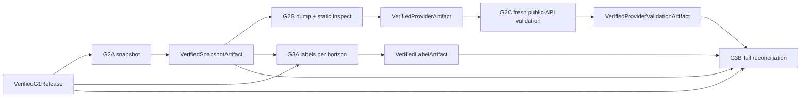

# M3 G2–G3 Snapshot、Provider 与标签对账分包骨架及外部闭环任务单

日期：2026-07-14  
状态：**设计冻结；G2A 合同实现中；正式数据运行仍等待当前 G1 Windows release 发布并经主 Agent 验真**
运行环境：G2A parent 为 Windows/WSL 双平台；Qlib worker 仍使用 WSL `py312`，Linux Gate 单独验收
设计 SSOT：[`M3实施与Agent交接.md`](../M3实施与Agent交接.md) §4.2、§4.3、§4.5、§4.9  
历史设计与审查：[`M3_G2-G3Provider与标签对账实现初验任务单.md`](../../../M3_G2-G3Provider与标签对账实现初验任务单.md)、
[`M3_G2-G3设计审查与修订记录.md`](M3_G2-G3设计审查与修订记录.md)、
[`M3_G2-G3跨文档一致性初验报告.md`](M3_G2-G3跨文档一致性初验报告.md)

> 本文取代旧任务书“一次交付 P0–P4”的执行颗粒度，但保留其中已冻结的业务口径。本文只完成困难边界、
> 类型、函数、身份和验收设计，不宣称 G2A/G2B/G2C/G3A/G3B、G2、G3、M3 或任何 Gate 已实现或通过。

> **开发并行轨边界（2026-07-31）：** 正式 G2A 的前置仍是经主验的 `VerifiedG1Release`。正式 G1 长时 I/O
> 期间，可按 [`M3_DevelopmentExampleRelease开发并行轨任务单.md`](M3_DevelopmentExampleRelease开发并行轨任务单.md)
> 使用独立的 `VerifiedDevelopmentExampleG1Release` 验证 snapshot/staging 与后续接口；该对象、其
> `development-snapshot` receipt 和所有结果均不是正式 G2A 或 Gate 证据。

## 1. 当前事实与拆包结论

当前工作区的真实状态：

- `snapshot.py` 的 strict manifest/session-calendar/request/receipt 与开发 nominal G2A 已实现；正式 G2A 仍等待
  `VerifiedG1Release`；
- `contracts.py` 已包含现行 G2A/G2B/G2C 冻结 value objects；
- 开发轨已实现 provider manifest/static inspector 与 G2C fresh Qlib worker/validation；正式轨仍等待
  `VerifiedG1Release` 后执行并主验，开发证据不得用于关闭正式 G2B/G2C 或 Gate；
- `labels.py` 已有独立标签公式和守恒，但没有 label artifact manifest、verified bundle 或 G3 对账；
- WSL base 当前为 Python 3.13 且不承载 `pyqlib 0.9.7`；已验收的 WSL `py312` 用于无网络真实 Qlib
  development smoke。该证据仍不代替正式 G2/G3 Gate。

旧任务书合并了 snapshot 文件系统、dump subprocess、Qlib 全局状态和标签语义四种风险。现拆为五包：

| 包 | 唯一职责 | Qlib import | 副作用 | 前置 |
|---|---|---|---|---|
| **G2A** | Verified G1 release → strict snapshot artifact | 禁止 | 只写 StageRunner 空 temp | 真实、正式发布且经主验的 `VerifiedG1Release`；P4C 代码合同或 R1C PREPARE 均不充分 |
| **G2B** | pinned dump tool + provider materialization + 全量静态结构验真 | parent 禁止；dump 脚本子进程可用 | 只写 provider stage temp | G2A 主验 |
| **G2C** | 确定性 3×20×7 fresh-process Qlib public API 回读 | 仅 worker | 只写 validation stage temp | G2B 主验 |
| **G3A** | 每 horizon 独立标签 artifact/manifest/验真 | 禁止 | 只写 labels stage temp | G2A；运行时还需 experiment identity |
| **G3B** | 每 horizon 全量 fresh-worker 标签三层对账 | 仅 worker | 只写 reconciliation stage temp | G2C、G3A 主验 |

每包单独执行“外部实现 → 未参与实现的外部独立复验 → 主 Agent 最终验收”。实现者不得跨包顺手补后续
功能；如果前包接口有问题，提交最小证据给主 Agent 修改 SSOT，不得在后包复制一套临时接口。



## 2. 跨包信任与身份规则

### 2.1 禁止裸 DataFrame + 自报 hash

跨包只传以下 verified bundle：

```text
VerifiedG1Release
VerifiedSnapshotArtifact
VerifiedProviderArtifact
VerifiedProviderValidationArtifact
VerifiedLabelArtifact
VerifiedLabelReconciliationArtifact
```

每个 verified bundle 由 strict manifest reader、物理文件 hash、逻辑 Schema/内容和 StageReceipt 闭包重建。
函数消费时再次重建其嵌套 dataclass；`frozen=True` 或对象曾构造成功不能代替消费边界重验。不得设计
`frame: DataFrame, frame_sha256: str` 让 caller 任意配对。

### 2.2 identity DAG

```text
G1 release + snapshot narrow config + code
  -> snapshot_request_key
snapshot artifact content manifest
  -> snapshot_id
snapshot_id + provider config + dump tool + Qlib/runtime + code
  -> provider_key
provider receipt + provider-validation config + runtime + code
  -> provider_validation_key
snapshot/provider/scientific/dependency/code
  -> experiment_key
experiment + horizon + provider-validation receipt + label manifest
  + label-reconciliation config + dependency + code
  -> reconciliation_key
```

所有 key/digest 是裸 64 位小写 hex，组合 key 只调用 `run_state.py` 的唯一具名函数。snapshot 是内容寻址，
其 manifest hash/文件 hash 产生 snapshot ID；provider 不写入 snapshot 目录。改变 tracking 不影响上述身份；
改变 NumPy/pandas/Qlib 改变 provider；改变 LightGBM 只改变 experiment；改变 label tolerance 只改变
reconciliation。

### 2.3 parent/worker 边界

- `snapshot.py/provider.py/labels.py` 的 parent 生产路径不得 import `qlib`，也不得通过项目包 `__init__` 间接
  导入；只有既有 SSOT 模块 `qlib_adapter.py` 的 worker 入口和固定 `dump_bin.py` 子进程可 import。
- 每次 G2C validation、G3B horizon reconciliation 启动全新 Python；一个 worker 只 `qlib.init` 一个 URI。
- parent 在启动 worker 前验真全部 bundle/receipt/hash；worker request echo identity；parent 不信 worker
  summary，必须从 worker 原始结果重算。
- request/response 中可含临时绝对路径，但只存在 StageRunner temp，禁止进入稳定 JSON/manifest/receipt。
- 持久产物不保存 PID、wall-clock、stdout/stderr、绝对 provider URI 或环境变量。

任何公开 build/plan/verify 函数只要消费 `*_config_sha256`，就必须同时接收同一个严格 `LoadedM3Config`，并在
任何文件写入、tool fetch 或 worker 启动前调用 C0 唯一 `canonical_config_sha256(selector=...)` 重算对应窄
selector。禁止仅验证“64 位 hex”后相信 spec/manifest 自报 hash。完整 TOML、tracking 字段和物理 config path
仍不得写入 artifact 或内容 identity。

### 2.4 发布所有权

本五包 helper 只写 StageRunner 分配的空 temp。StageRunner 是 final directory、原子 rename 和 stage receipt 的
唯一 publisher。helper 不扫描 artifact 根、不取得跨 stage 锁、不修补 final、不发布 receipt。相同 key 并发、
orphan 认领和 receipt 验真遵循 E3/G8；本任务只提供可重算的确定性 temp 内容。

本五包自行写出的 Parquet（snapshot staging/calendar、validation details、labels/diagnostics、reconciliation
details）统一固定 `compression="zstd"`、`compression_level=3`、`statistics=True`、
`row_group_size=65536`、`use_pyarrow=False`；各表列序由 Schema/本文冻结。Qlib 官方 dump 生成的 `.bin/.txt`
不套用此规则。任何模块不得依赖 Polars writer 默认值。

### 2.5 Stage receipt 精确闭包

通用 `verify_stage_receipt` 只证明 receipt 自身列出的文件未漂移；每个 bundle verifier 还必须证明下表集合
“不多不少”。上游 receipt 文件本身可以作为下一 continuation 的 `ExternalInput`，但永远不列入自己的 outputs。

| stage / scope / scope key | inputs 精确语义集合 | outputs 精确语义集合 |
|---|---|---|
| `snapshot` / `SNAPSHOT` / `snapshot_request_key` | G1 manifest、bar、membership、calendar | snapshot request record、manifest、session calendar、全部 staging |
| `provider` / `PROVIDER` / `provider_key` | snapshot request record/receipt/manifest/calendar/全部 staging、pinned dump tool | provider manifest、`provider/` 严格树全部普通文件 |
| `provider-validation` / `PROVIDER` / `provider_validation_key` | snapshot request/receipt/manifest/calendar/staging、provider receipt/manifest/严格树 | validation details、summary |
| `labels` / `EXPERIMENT` / `experiment_key` | experiment receipt/manifest、G1 release manifest/bar/benchmark/eligible、snapshot receipt/manifest/calendar | 当前 horizon 的 labels、diagnostics、label manifest |
| `label-reconciliation` / `EXPERIMENT` / `reconciliation_key` | experiment、G1、snapshot、provider、provider-validation、label 各自 receipt/manifest 及函数实际读取的数据文件 | reconciliation details、summary |

`inputs` 中列出的“严格树/全部 staging”都从已验真 manifest 展开为逐文件 `ArtifactDigest`；禁止用目录 hash、
只列 manifest 或省略实际读取文件。bundle verifier 同时重算 stage/scope/scope key、manifest 身份和 receipt
bytes hash。这样 wholesale 替换一整套自洽业务文件但沿用另一 stage receipt 也不能通过。

## 3. G2A：strict snapshot artifact

### 3.1 文件范围

```text
src/quant/research/m3/contracts.py
src/quant/research/m3/snapshot.py
src/quant/domain/schemas.py
src/quant/domain/__init__.py
src/quant/research/m3/__init__.py
tests/unit/test_m3_snapshot.py
tests/unit/test_schemas.py
docs/framework/agent/M3_G2A快照Artifact交付报告.md
docs/M3_G2A快照Artifact独立初验报告.md
```

不得创建 provider/worker，不改 label 公式、run-state identity 或 G1 release。

### 3.2 冻结类型

```python
@dataclass(frozen=True)
class SnapshotBuildSpec:
    snapshot_request_key: str
    config_version: str
    snapshot_config_sha256: str
    code_version: str
    history_start: dt.date
    history_end: dt.date
    staging_schema_version: str
    adjustment_formula_version: Literal["qlib_yahoo_like_v1"]

@dataclass(frozen=True)
class SnapshotRequestRecordV1:
    schema_version: Literal["m3-snapshot-request-v1"]
    snapshot_request_key: str
    snapshot_id: str
    snapshot_manifest_sha256: str
    g1_release_id: str
    g1_release_manifest_sha256: str
    snapshot_config_sha256: str
    code_version: str
    history_start: dt.date
    history_end: dt.date
    signal_start: dt.date
    signal_end: dt.date

@dataclass(frozen=True)
class SnapshotArtifactEntryV1:
    path: str
    sha256: str
    size_bytes: int
    row_count: int
    schema_name: str
    symbol: str | None
    min_date: dt.date
    max_date: dt.date

@dataclass(frozen=True)
class SnapshotManifestV1:
    schema_version: Literal["m3-snapshot-manifest-v1"]
    snapshot_id: str
    config_version: str
    snapshot_config_sha256: str
    g1_release_id: str
    g1_release_manifest_sha256: str
    source: Literal["tushare"]
    universe: Literal["CSI300_TUSHARE_MONTHLY_OBSERVED_PIT_V1"]
    history_start: dt.date
    history_end: dt.date
    signal_start: dt.date
    signal_end: dt.date
    row_count: int
    symbol_count: int
    min_date: dt.date
    max_date: dt.date
    session_calendar_sha256: str
    session_count: int
    session_start: dt.date
    session_end: dt.date
    staging_format: Literal["parquet"]
    staging_schema_version: str
    adjustment_formula_version: Literal["qlib_yahoo_like_v1"]
    adjustment_spec_sha256: str
    files: tuple[SnapshotArtifactEntryV1, ...]

@dataclass(frozen=True)
class SnapshotBuildResult:
    root: Path
    manifest: SnapshotManifestV1
    manifest_sha256: str

@dataclass(frozen=True)
class VerifiedSnapshotArtifact:
    root: Path
    request: SnapshotRequestRecordV1
    request_sha256: str
    manifest: SnapshotManifestV1
    manifest_sha256: str
    snapshot_receipt_sha256: str
    session_calendar_path: Path
    staging_paths: tuple[Path, ...]
```

废止早期 `DatasetSnapshot.source_fingerprint` 摘要作为跨包信任对象；如保留兼容导出，只能由
`VerifiedSnapshotArtifact` 只读投影产生，后续接口不得接收旧对象。

`SnapshotSessionCalendarSchema` 严格只有 `date: pl.Date`，非空、唯一、严格递增。

### 3.3 接口

```python
def build_snapshot_session_calendar(
    *, release: VerifiedG1Release, history_start: dt.date, history_end: dt.date,
) -> pl.DataFrame: ...

def prepare_qlib_staging(
    *, release: VerifiedG1Release, history_start: dt.date, history_end: dt.date,
) -> pl.DataFrame: ...

def write_staging_by_symbol(
    *, frame: pl.DataFrame, output_dir: Path,
) -> tuple[Path, ...]: ...

def build_snapshot_artifact(
    *, release: VerifiedG1Release, config: LoadedM3Config,
    spec: SnapshotBuildSpec, output_root: Path,
) -> SnapshotBuildResult: ...

def build_snapshot_request_record(
    *, release: VerifiedG1Release, config: LoadedM3Config,
    spec: SnapshotBuildSpec,
    result: SnapshotBuildResult,
) -> SnapshotRequestRecordV1: ...

def read_snapshot_manifest(path: Path) -> SnapshotManifestV1: ...
def read_snapshot_request_record(path: Path) -> SnapshotRequestRecordV1: ...

def verify_snapshot_artifact(
    *, snapshot_root: Path, snapshot_request_path: Path,
    snapshot_receipt_path: Path, release: VerifiedG1Release,
    config: LoadedM3Config, spec: SnapshotBuildSpec,
    artifact_roots: Mapping[str, Path],
) -> VerifiedSnapshotArtifact: ...
```

`build_snapshot_artifact` 先重算 `snapshot_request_key`，并验证 spec 的 G1/config/code 输入。`output_root` 必须
已存在、为空、真实目录；不得 `mkdir(parents=True)` 越权创建父目录，不得覆盖文件。
`spec.history_start/history_end` 必须分别精确等于 G1 manifest 的 `history_start/history_end`；request record
与 snapshot manifest 的 `signal_start/signal_end` 必须从同一 verified G1 manifest 投影，不能由 caller 传入，
并且必须精确等于同一 `LoadedM3Config` 的 `data.start_date/end_date`；二者须已由 G1 证明为 SH session，G2
不得再次自动对齐或容忍旧 `2016-01-01` 示例。四日期还须满足
`history_start <= signal_start <= signal_end <= history_end`。因此相同 G1 release/config/code 不可能在
同一个 request key 下由 caller 偷换日期窗口。

`SnapshotRequestRecordV1` 是 request identity 到内容 identity 的唯一不可变映射，不进入 `snapshot_id`，避免
自引用。其 canonical JSON SHA-256 是 `request_sha256`。记录中的 request key 必须调用
`compute_snapshot_request_key` 重算，snapshot ID/manifest hash 必须从完整 temp artifact 重算；不得让 handler
或调用者自报。request record 已存在时只能严格验真并复用，不能重指向另一 snapshot。

### 3.4 staging 与 manifest 规则

- 入口先调用/重建 `verify_g1_release`；bars、membership、calendar 的 artifact path 只从
  `VerifiedG1Release.artifact_paths` 取得并在读取前复算 manifest bytes hash。
- symbol 域是 PIT membership 历史并集，不按 effective interval 删除行情；日期域是显式 history window；
  source 固定 Tushare，SH session 唯一，不做 SH/SZ 并集。
- 输出精确 `symbol,date,open,high,low,close,vwap,volume,factor`；每证券独立归一化，公式继续使用
  `ADJUSTMENT_SPEC`。重复、非正/non-finite、zero amount/volume 全部失败。
- session calendar 只从 G1 `trade_calendar.parquet` 过滤 SH/open/history；不能从 staging 日期并集反推。
- 全部 staging 日期并集必须精确等于 session calendar；缺任一全市场 session 失败。单证券 gap 合法。
- `session_calendar.parquet` 位于 root；staging 位于 `staging/<qlib-symbol>.parquet`。文件名 codec 只用
  `to_qlib_symbol/from_qlib_symbol`，互为逆。
- manifest files 精确包含一个 calendar entry 和全部 staging entries，按 path 排序；manifest 不列自己。
  `snapshot_id` 是除自身字段外严格 manifest 对象的规范 JSON SHA-256。
- `session_calendar_sha256` 是对严格日期序列的逻辑 canonical digest，不是 Parquet bytes；
  `adjustment_spec_sha256` 是对项目 `ADJUSTMENT_SPEC` 完整具名对象的 canonical digest。每个 file entry 的
  `sha256` 才是物理 bytes hash。
- snapshot request 期望在冻结 writer/runtime 下产生确定物理 bytes；若同一 request key 在另一平台或依赖
  版本产生不同 Parquet bytes，request mapping 必须冲突并 fail-closed，禁止静默重指向。当前受控 Windows/WSL
  探针均为 Python 3.13.13、Polars 1.42.1，固定 writer 的 calendar/staging bytes SHA-256 已逐文件一致；依赖
  版本变化后必须重跑该探针，探针证据不替代正式 full snapshot 验真。
- snapshot temp 根精确只有 `manifest.json`、`session_calendar.parquet` 和 `staging/`；staging 文件名集合必须
  与 manifest 精确相等。Parquet 写参数固定为 `compression="zstd"`、`compression_level=3`、
  `statistics=True`、`row_group_size=65536`、`use_pyarrow=False`，不得依赖 Polars 默认值。
- strict reader 拒绝 duplicate JSON key、未知/缺字段、字符串数字、bool 冒充 int、NaN/Infinity、绝对/逃逸
  path、错误排序/计数/hash。verifier 重读 Parquet、Schema、symbol/date/行数和 bytes。

G8 发布顺序固定为：在空 temp 完成并验真 snapshot → 从 manifest 取得裸 64 hex `snapshot_id` → 以目录级
no-clobber 发布到 `snapshots/<snapshot_id>/` → no-clobber 发布
`snapshot-requests/<snapshot_request_key>.json` → 最后发布 receipt。若在中间崩溃，重跑只能在完整逐字节
一致时认领已发布 snapshot/映射；冲突 fail-closed。G2A helper 不自行写 final、mapping 或 receipt。

snapshot receipt 固定 `stage="snapshot"`、`scope="SNAPSHOT"`、`scope_key=snapshot_request_key`。inputs 精确
绑定 G1 `manifest.json` 以及本阶段实际读取的 `bar_1d.parquet`、`universe_membership.parquet`、
`trade_calendar.parquet`；outputs 精确绑定 request record、snapshot manifest、session calendar 和全部 staging
Parquet。verifier 必须重算该集合，不能只调用通用 receipt parser 后接受任意自洽 inputs/outputs。

### 3.5 G2A 必测反例

至少覆盖：tracking 改变 snapshot 不变；G1 manifest/bar/calendar 混配；保持 config hash/request key 不变而
偷换 history 首尾；history 首尾越界；request record 重指向另一个 snapshot；snapshot 已发布但 mapping 前
崩溃及反向崩溃；SH/SZ 分歧；某
权威 session 全证券缺行；单证券 gap；membership 调入前历史保留；文件名大小写/codec；output 非空、symlink、
hardlink；Parquet/hash/manifest 任一漂移；snapshot ID 自洽整套替换在原 verified G1 input 重建时失败；四观察
面路径/token 脱敏；静态证明无 Qlib import/网络。

## 4. G2B：provider materialization 与全量静态验真

### 4.1 文件范围

```text
src/quant/research/m3/contracts.py
src/quant/research/m3/fetch_qlib_tool.py
src/quant/research/m3/provider.py
src/quant/research/m3/__init__.py
tests/unit/test_m3_fetch_qlib_tool.py
tests/unit/test_m3_provider_materialization.py
docs/framework/agent/M3_G2BProvider构建与静态验真交付报告.md
docs/M3_G2BProvider构建与静态验真独立初验报告.md
```

不得实现 public API sample 或 label reconciliation。

### 4.2 工具、runtime 与 build 类型

```python
@dataclass(frozen=True)
class QlibDumpToolSpec:
    url: str
    sha256: str
    size_bytes: int
    qlib_version: Literal["0.9.7"]
    command: Literal["dump_all"]

@dataclass(frozen=True)
class ProviderRuntimeFingerprint:
    python_version: str
    packages: tuple[tuple[str, str], ...]
    sha256: str

@dataclass(frozen=True)
class ProviderBuildSpec:
    snapshot_id: str
    snapshot_manifest_sha256: str
    provider_key: str
    provider_config_sha256: str
    dump_tool: QlibDumpToolSpec
    qlib_version: Literal["0.9.7"]
    code_version: str
    runtime_fingerprint: ProviderRuntimeFingerprint
    fields: tuple[str, ...]
    frequency: Literal["day"]
    dump_contract_version: Literal["m3-qlib-dump-all-v1"]

@dataclass(frozen=True)
class ProviderManifestV1: ...  # 字段精确使用 §4.2 SSOT，并由 strict reader 重建

@dataclass(frozen=True)
class ProviderBuildResult:
    root: Path
    qlib_dir: Path
    manifest: ProviderManifestV1
    manifest_sha256: str

@dataclass(frozen=True)
class VerifiedProviderArtifact:
    root: Path
    qlib_dir: Path
    manifest: ProviderManifestV1
    manifest_sha256: str
    provider_receipt_sha256: str
```

旧 `QlibDumpToolSpec.bytes/version` 字段迁移为 `size_bytes/qlib_version` 并新增 command；这是一次明确的现行
SSOT 对齐，不保留双格式 parser。builder 保持位于 `fetch_qlib_tool.py`，仍只从同一个 `LoadedM3Config`
显式映射；`ensure_qlib_dump_tool` 自身不读 TOML。

runtime packages 精确且按 name 排序：`python,numpy,pandas,pyarrow,pyqlib,fire,tqdm,loguru`。parent 使用
`sys.version_info` 和 `importlib.metadata.version`，不得为取版本 import Qlib。缺包或版本不符在任何 output 写入
前稳定失败。

### 4.3 接口与唯一 argv

```python
def build_qlib_dump_tool_spec(config: LoadedM3Config) -> QlibDumpToolSpec: ...
def ensure_qlib_dump_tool(*, spec: QlibDumpToolSpec, target_path: Path) -> Path: ...
def build_provider_runtime_fingerprint() -> ProviderRuntimeFingerprint: ...

def materialize_qlib_provider(
    *, snapshot: VerifiedSnapshotArtifact, qlib_dump_script: Path,
    python_executable: Path, config: LoadedM3Config,
    spec: ProviderBuildSpec, output_root: Path,
    timeout_seconds: float,
) -> ProviderBuildResult: ...

```
