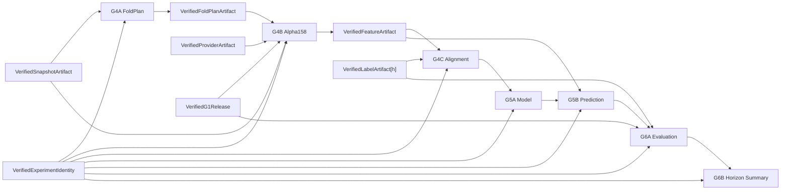

# M3 G4–G6 研究链分包骨架与外部闭环任务单

日期：2026-07-14  
状态：**G4A development example 契约实现与主 Agent 验证中；正式 G4 Gate 仍等待正式 G1**
运行环境：G4A 纯 Python/Polars 契约须在 Windows 原生 Miniforge 与 WSL Miniforge `base` 双平台验证；Windows 结果不替代 Linux Gate
设计 SSOT：[`M3实施与Agent交接.md`](../M3实施与Agent交接.md) §4.4–§4.7、§4.9  
历史任务与审查：[`M3_G4-G6研究链实现与初验任务单.md`](../../../M3_G4-G6研究链实现与初验任务单.md)、
[`M3_G4-G6设计审查与修订记录.md`](M3_G4-G6设计审查与修订记录.md)

> 本文取代旧任务书 H0–H5 的执行颗粒度，但保留其中已冻结的业务口径。本文只冻结困难边界、类型、
> 函数、身份、失败语义和验收反例。当前 development example 只用于工程契约开发，固定
> `release_kind="development_example"`、`formal_gate_eligible=False` 和显式 example 路径；它不得生成
> `VerifiedG1Release`/`VerifiedFoldPlanArtifact`，不得写入正式 G1 根目录、journal 或候选映射，也不宣称
> G4–G6、M3 的正式 Gate 已实现或通过。

## 1. 当前事实与七包结论

- G4A 已在隔离 development example 路径实现 strict FoldPlan；旧裸 `TemporalFold` 仅保留模块级兼容，
  不再从包根公开，后续生产消费者只接收 verified FoldPlan；正式 G4 仍等待正式 G1 验证；
- `evaluate.py` 仍是 matched/expected-label 单一 coverage 和 NaN 汇总；
- `qlib_adapter.py`、`features.py`、`alignment.py`、`model.py`、`predictions.py` 均不存在；
- `ml_topk.py` 仍拥有 prediction rank normalizer，当前 `PredictionScoreSchema` 的唯一键/rank 分组也尚未把
  `model` 纳入；
- WSL base 没有 `pyqlib`、`lightgbm`。fake 协议可实现，真实 Gate 仍需兼容环境证据。

旧 H0–H5 混合了日历 artifact、Qlib 全局状态、标签对齐、模型发布和评价 denominator。现拆为：

| 包 | 唯一职责 | 重依赖边界 | 前置 |
|---|---|---|---|
| **G4A** | strict FoldPlan artifact 与可知截止点 | 禁止重依赖 | G2A、experiment identity |
| **G4B** | 每 fold 一次 fresh-worker Alpha158 FeatureArtifact | 仅 worker import Qlib | G2C、G4A |
| **G4C** | 每 work 监督对齐；test 无标签 inference loader | 禁止重依赖 | G3A、G4B |
| **G5A** | native LightGBM 模型 artifact、validation-l2 early stop | 仅 `model.py` 延迟 import | G4C |
| **G5B** | test 全量 prediction、唯一 rank normalizer、lineage | 预测只经 `model.py` | G5A、G4B |
| **G6A** | 每 work 五层 coverage、逐日 IC、evaluation artifact | 禁止重依赖 | G5B、G3A |
| **G6B** | 同 horizon 跨折 research summary | 禁止重依赖 | 全部对应 G6A |



## 2. 全链路信任和发布规则

跨包只接受 `VerifiedG1Release`、`VerifiedSnapshotArtifact`、`VerifiedProviderArtifact`、
`VerifiedProviderValidationArtifact`、`VerifiedExperimentIdentity`、`VerifiedLabelArtifact` 以及本任务新增的
七类 verified artifact。禁止裸 `DataFrame + caller_sha256`、松散 `Mapping manifest + passed=True`，也不能因
frozen dataclass 曾构造成功就跳过消费边界重验。

- verifier 从 strict JSON、StageReceipt、物理 bytes、逻辑 key/hash 和上游 verified bundle 重建对象；
- builder 只写 StageRunner 分配的已存在空 temp；StageRunner 是 final rename 和 receipt 的唯一 publisher；
- JSON 拒绝非 UTF-8、BOM/CRLF、duplicate/未知/缺字段、宽松数字、bool-int、NaN/Infinity、非规范 bytes、
  绝对/逃逸路径；稳定产物不含 PID、时间戳、stdout、机器名或 token；
- `qlib_adapter.py` 是唯一 Qlib import 模块，且不由包根导入；`model.py` 是唯一 LightGBM import 模块并延迟
  import；domain/strategies/backtest/package root 不得加载 Qlib/LightGBM/MLflow；
- 上游混配、时间泄露、test-label 筛选、prediction 漏 key、模型篡改、coverage denominator 错误、NaN JSON、
  覆盖 final 或凭据/路径泄露阻断主验。文案、非关键命名和更细错误码可记 P2 后推进。

### 2.1 逻辑 key/matrix digest

G4–G6 的逻辑摘要统一使用 `m3-f64-matrix-digest-v1`，不得以 pickle、NumPy `.tobytes()` 的本机默认字节序、
Parquet bytes 或带 NaN 的 JSON 代替：

1. row key 先按 artifact 冻结顺序形成 `[["YYYY-MM-DD","symbol"], ...]`，以项目 canonical JSON 求
   `row_keys_sha256`；不得在 hash helper 内再次排序来掩盖 X/y 错位。
2. matrix header 是 canonical JSON 对象
   `{"digest_version":"m3-f64-matrix-digest-v1","n_rows":N,"columns":[...],"dtype":"float64-le"}`；
   values 按 row-major 转为 IEEE-754 little-endian Float64。inf 失败，所有 NaN 先规范成同一个 quiet-NaN bits
   `0x7ff8000000000000`；finite、正负零保留原 bits。
3. `matrix_sha256 = SHA256(header_bytes + b"\n" + value_bytes)`；finite label series 使用同一协议，columns
   固定为 `["relative_return"]`。schema hash 只对有序 column name/dtype 对象求 canonical JSON hash，不能替代
   values hash。

`FeatureSegmentManifestV1.content_sha256` 精确是对
`{"name":...,"feature_row_keys_sha256":...,"feature_matrix_sha256":...,"selected_schema_sha256":...}`
的 canonical JSON hash；它不等于 Parquet bytes hash，也不重复包含资格域。资格域由独立
`eligible_keys_sha256` 证明，scorable 域由 `scorable_keys_sha256` 证明。

所有 producer 与 verifier 调同一个安全核心 helper；Qlib/LightGBM 模块不得复制。相同逻辑 Float64 内容跨
Parquet 重写必须得到同一逻辑摘要，任一 row order、column order、signed-zero 或 finite value 改变必须改变摘要。

## 3. G4A：strict FoldPlan artifact

文件范围：`contracts.py`、`folds.py`、包根安全导出、`test_m3_folds.py`，以及交付/独立初验报告。

```python
@dataclass(frozen=True)
class PlannedFold:
    name: str
    train_dates: tuple[dt.date, ...]
    train_validation_embargo_dates: tuple[dt.date, ...]
    validation_dates: tuple[dt.date, ...]
    validation_test_embargo_dates: tuple[dt.date, ...]
    test_dates: tuple[dt.date, ...]
    train_label_available_by: dt.date
    validation_label_available_by: dt.date
    planned_fold_sha256: str

@dataclass(frozen=True)
class FoldPlanBuildSpec:
    experiment_key: str
    experiment_manifest_sha256: str
    snapshot_id: str
    snapshot_manifest_sha256: str
    signal_start: dt.date
    signal_end: dt.date
    train_sessions: int
    validation_sessions: int
    test_sessions: int
    step_sessions: int
    embargo_sessions: int
    max_horizon_sessions: int

@dataclass(frozen=True)
class FoldPlanUpstreamPaths:
    snapshot_request_path: Path
    snapshot_receipt_path: Path
    provider_dump_tool_path: Path
    provider_receipt_path: Path
    experiment_receipt_path: Path

@dataclass(frozen=True)
class FoldPlanManifestV1:
    schema_version: Literal["m3-fold-plan-v1"]
    experiment_key: str
    experiment_manifest_sha256: str
    snapshot_id: str
    snapshot_manifest_sha256: str
    session_calendar_sha256: str
    signal_dates_sha256: str
    scientific_config_sha256: str
    signal_start: dt.date
    signal_end: dt.date
    max_horizon_sessions: int
    folds: tuple[PlannedFold, ...]

@dataclass(frozen=True)
class VerifiedFoldPlanArtifact:
    root: Path
    manifest: FoldPlanManifestV1
    manifest_sha256: str
    folds_receipt_sha256: str
```

接口：

```python
def build_temporal_fold_plan(
    *, snapshot: VerifiedSnapshotArtifact,
    experiment: VerifiedExperimentIdentity, config: LoadedM3Config,
    spec: FoldPlanBuildSpec, output_root: Path,
) -> FoldPlanManifestV1: ...
def read_fold_plan_manifest(path: Path) -> FoldPlanManifestV1: ...
def verify_fold_plan_artifact(
    *, root: Path, receipt_path: Path, release: VerifiedG1Release,
    snapshot: VerifiedSnapshotArtifact, snapshot_spec: SnapshotBuildSpec,
    provider: VerifiedProviderArtifact, provider_spec: ProviderBuildSpec,
    experiment: VerifiedExperimentIdentity,
    experiment_spec: ExperimentIdentitySpec, config: LoadedM3Config,
    spec: FoldPlanBuildSpec, upstream_paths: FoldPlanUpstreamPaths,
    artifact_roots: Mapping[str, Path],
) -> VerifiedFoldPlanArtifact: ...
def select_supervised_labels(
    *, label: VerifiedLabelArtifact, folds: VerifiedFoldPlanArtifact,
    release: VerifiedG1Release, snapshot: VerifiedSnapshotArtifact,
    snapshot_spec: SnapshotBuildSpec, provider: VerifiedProviderArtifact,
    provider_spec: ProviderBuildSpec, experiment: VerifiedExperimentIdentity,
    experiment_spec: ExperimentIdentitySpec, config: LoadedM3Config,
    label_spec: LabelBuildSpec, fold_spec: FoldPlanBuildSpec,
    label_receipt_path: Path, folds_receipt_path: Path,
    upstream_paths: FoldPlanUpstreamPaths,
    artifact_roots: Mapping[str, Path], fold_name: str,
    segment: Literal["train", "validation"],
) -> pl.DataFrame: ...
```

development example 使用同一 manifest/schema/receipt 形态和精确平行 API：
`build_development_example_temporal_fold_plan`、
`verify_development_example_fold_plan_artifact`、
`select_development_example_supervised_labels`，返回
`VerifiedDevelopmentExampleFoldPlanArtifact`；formal API 必须在任何写入前拒绝 development nominal。
当前确定 fixture 是 38 个 history sessions，其中前 28 个属于 signal window，后 10 个只作 label tail；
development walk-forward 固定 `2/2/2/2/10`，恰好生成两折。空 FoldPlan 一律失败。

规则：只从 verified snapshot 读取唯一严格递增 SH calendar；`signal_start/signal_end` 必须精确等于 snapshot
request/manifest 中从 G1 release 继承的值；walk-forward 数值必须精确等于 `LoadedM3Config` 的 scientific
selector，且该 hash 等于 experiment identity 中的 `scientific_config_sha256`。不得另造
`walk_forward_config_sha256` 或信任 caller 自报 code version。只取 signal window，warmup/tail 永不进入 segment；
固定 rolling 布局 train→embargo→validation→embargo→test；尾部半折丢弃；embargo≥最大 horizon、step≥test，
跨折 test 不重叠。两个 label cutoff 是对应 embargo 最后一日。fold 名固定从 `fold_001` 递增；每折 hash 对除
自身外完整对象做规范 JSON hash。`select_supervised_labels` 不接受裸 labels/benchmark/version。

每次 label selection 都必须用 release/snapshot/experiment/config/spec/receipt/root 对 label 与 FoldPlan 两个
verified bundle 重新验真，不能只信 dataclass。fold receipt 固定为 `EXPERIMENT` scope；formal stage 为
`folds`，development stage 为 `development-folds`。直接输入精确为 snapshot request、snapshot
manifest/receipt/calendar、experiment manifest/receipt，输出只有 `folds.json`；漏项、增项或 decoy 均失败。
`FoldPlanUpstreamPaths` 是唯一上游物理路径来源；禁止从最具体 root alias 反推公共 artifacts base，也禁止
按 basename 搜索。snapshot、provider、experiment 必须在 Fold verifier 内依次 fresh 验真自己的 exact
receipt 闭包；重叠 root alias 通过 digest 指向的精确物理路径核对，不改变历史 receipt 的 alias 身份。

必测：warmup/tail 越界、逆序/重复 calendar、signal 边界非法、embargo<10、test 重叠、半折、cutoff 错用
segment end、fold/hash/receipt 漂移、snapshot/experiment 混配、strict JSON、无重依赖 import。

## 4. G4B：每 fold fresh-worker Alpha158

文件范围：新增 `features.py`、`qlib_adapter.py`，安全包根导出、对应单测与两份报告。

```python
@dataclass(frozen=True)
class FeatureBuildSpec:
    experiment_key: str
    experiment_manifest_sha256: str
    fold: str
    planned_fold_sha256: str
    provider_key: str
    provider_manifest_sha256: str
    provider_receipt_sha256: str
    feature_version: str
    expected_qlib_version: Literal["0.9.7"]
    worker_protocol_version: Literal["m3-qlib-worker-v1"]

@dataclass(frozen=True)
class FeatureSchemaManifestV1:
    feature_version: str
    qlib_version: str
    input_names: tuple[str, ...]
    expressions: tuple[str, ...]
    input_schema_sha256: str
    selected_names: tuple[str, ...]
    selected_dtypes: tuple[str, ...]
    dropped_all_nan_train: tuple[str, ...]
    selected_schema_sha256: str

@dataclass(frozen=True)
class FeatureSegmentManifestV1:
    name: Literal["train", "validation", "test"]
    path: str
    bytes_sha256: str
    content_sha256: str
    eligible_keys_sha256: str
    feature_row_keys_sha256: str
    feature_matrix_sha256: str
    scorable_keys_sha256: str
    n_eligible: int
    n_feature_rows: int
    n_scorable: int

@dataclass(frozen=True)
class FeatureManifestV1:
    schema_version: Literal["m3-feature-artifact-v1"]
    experiment_key: str
    experiment_manifest_sha256: str
    g1_release_id: str
    g1_release_manifest_sha256: str
    snapshot_id: str
    snapshot_manifest_sha256: str
    provider_key: str
    provider_manifest_sha256: str
    provider_receipt_sha256: str
    fold: str
    planned_fold_sha256: str
    scientific_config_sha256: str
    eligible_keys_sha256: str
    worker_protocol_version: str
    schema: FeatureSchemaManifestV1
    segments: tuple[FeatureSegmentManifestV1, ...]
    coverage_path: str
    coverage_sha256: str
    coverage_row_count: int

@dataclass(frozen=True)
class VerifiedFeatureArtifact:
    root: Path
    manifest: FeatureManifestV1
    manifest_sha256: str
    feature_receipt_sha256: str
```

parent 接口 `build_feature_artifact(...)`、`read_feature_manifest(...)`、`verify_feature_artifact(...)` 只接收
verified release/snapshot/provider/experiment/folds、`LoadedM3Config` 与 strict spec。provider-validation PASS
是 G8 启动本 stage 前的编排门禁，不传给 builder/worker，也不列 feature 内容 receipt。唯一 worker 命令为：

```python
def build_feature_artifact(
    *, release: VerifiedG1Release, snapshot: VerifiedSnapshotArtifact,
    provider: VerifiedProviderArtifact, experiment: VerifiedExperimentIdentity,
    folds: VerifiedFoldPlanArtifact, config: LoadedM3Config,
    spec: FeatureBuildSpec, python_executable: Path,
    output_root: Path, timeout_seconds: float,
) -> FeatureManifestV1: ...

def verify_feature_artifact(
    *, root: Path, receipt_path: Path, release: VerifiedG1Release,
    snapshot: VerifiedSnapshotArtifact, provider: VerifiedProviderArtifact,
    experiment: VerifiedExperimentIdentity, folds: VerifiedFoldPlanArtifact,
    config: LoadedM3Config, spec: FeatureBuildSpec,
    artifact_roots: Mapping[str, Path],
) -> VerifiedFeatureArtifact: ...
```

```text
<python> -m quant.research.m3.qlib_adapter build-alpha158 \
  --request <stage-temp/request.json> --output-root <stage-temp/worker-output>
```

每 fold 一个 fresh worker，一个 worker 只 `qlib.init` 一个 URI。request/response echo 全部 identity；parent 不信
worker summary，重读普通文件并重算。provider-validation PASS 只作编排前置，不列 feature 内容 input。
稳定 request/response 不得持久化 provider 绝对路径、PID 或环境变量；真实 URI 只经 fresh subprocess 的
临时环境传入，稳定 request 仅保存 `provider_uri_sha256`。formal/development verifier 必须沿显式
`FeatureUpstreamPaths` 重新调用 G4A fresh verifier，禁止把可构造的 verified dataclass 当作当前磁盘证据。

固定 Qlib v0.9.7 Alpha158，显式空 infer/learn processors 与 `label=([],[])`；handler 加载 provider history
start→test end，instrument 使用 provider 历史并集；不使用默认 csi300/csi500。只 prepare feature+DK_I，运行时
恰好 158 个唯一 name/expression。index 按命名 level 映射，时间必须无时区午夜，symbol 只用 snapshot codec。

资格只来自 verified G1 `eligible_keys`：按 fold/资格过滤，inf→NaN；只用 train eligible rows 删除全 NaN 列，
validation/test 复用同一有序 float64 projection。不填值、不删普通含 NaN 行；selected 后整行全 NaN 才
unscorable。为使 `feature_row_keys_sha256` 与 `scorable_keys_sha256` 都可从稳定产物重建，segment parquet
保留 eligible∩worker-returned 的全部 selected feature rows（包括 selected 后全 NaN 行）；G4C/inference
只消费其中 scorable 子集。parquet 列固定 `as_of,symbol,<selected_names>`，coverage 按 segment×date守恒，固定写参数为
`compression="zstd"`、`compression_level=3`、`statistics=True`、`row_group_size=65536`、
`use_pyarrow=False`。FeatureBuildSpec
不含 horizon，同 fold h=5/h=10 必须共享同一 manifest/receipt。

必测：158/157/159、重复 leaf、默认 processor/label/instrument、history 从 train 开始、非法 index、重复/区间外
key、train 全 NaN test 有值仍永久删除、普通 NaN 被填/删、列换序、eligible/coverage 漂移、worker echo 漂移、
不同 URI/PID 隔离、持久 PID/绝对路径、package import 加载 Qlib。fake 通过不关闭真实 Gate。

阶段状态（2026-08-02）：development example 的 parent、离线 fresh worker、逻辑摘要、coverage、精确 receipt
与 verifier 已通过 Windows 定向及独立对抗测试，证据见
[`M3_G4B开发示例FeatureArtifact主Agent阶段验收报告.md`](M3_G4B开发示例FeatureArtifact主Agent阶段验收报告.md)。
production `build-alpha158`、真实 Qlib 0.9.7 和 Linux Gate 仍待完成，故 G4B 正式 Gate 保持未通过。

## 5. G4C：监督对齐与无标签 inference

文件范围：新增 `alignment.py`、安全包根导出、单测与两份报告。

```python
@dataclass(frozen=True)
class AlignmentBuildSpec:
    experiment_key: str
    work_key: str
    fold: str
    planned_fold_sha256: str
    horizon_sessions: Literal[5, 10]
    feature_manifest_sha256: str
    label_manifest_sha256: str

@dataclass(frozen=True)
class AlignmentSegmentManifestV1:
    name: Literal["train", "validation"]
    path: str
    bytes_sha256: str
    row_keys_sha256: str
    matrix_sha256: str
    labels_sha256: str
    n_feature_scorable: int
    n_label_identity: int
    n_label_joined: int
    n_cutoff_dropped: int
    n_final: int

@dataclass(frozen=True)
class AlignmentManifestV1:
    schema_version: Literal["m3-alignment-artifact-v1"]
    experiment_key: str
    work_key: str
    fold: str
    planned_fold_sha256: str
    horizon_sessions: int
    feature_manifest_sha256: str
    label_manifest_sha256: str
    selected_feature_schema_sha256: str
    segments: tuple[AlignmentSegmentManifestV1, ...]
    diagnostics_path: str
    diagnostics_sha256: str
    diagnostics_row_count: int

@dataclass(frozen=True)
class VerifiedAlignmentArtifact:
    root: Path
    manifest: AlignmentManifestV1
    manifest_sha256: str
    alignment_receipt_sha256: str

@dataclass(frozen=True)
class SupervisedSegment:
    name: Literal["train", "validation"]
    features: pd.DataFrame
    labels: pd.Series
    metadata: pl.DataFrame

@dataclass(frozen=True)
class InferenceSegment:
    name: Literal["test"]
    features: pd.DataFrame
    metadata: pl.DataFrame
```

`build_alignment_artifact(...)` 只接收 verified feature/label/folds/experiment、`LoadedM3Config`；
`load_supervised_segment(*, alignment, segment)` 返回严格同键同序 X/y/metadata。
`build_inference_segment(*, feature, folds, fold_name)` 必须从 verified fold bundle 重新取得并验真 fold；签名不得有
label、label artifact、horizon label 或 cutoff 参数，只加载 test scorable rows；不发布 test alignment。不得接受
可伪造的裸 `PlannedFold`。

```python
def build_alignment_artifact(
    *, feature: VerifiedFeatureArtifact, label: VerifiedLabelArtifact,
    folds: VerifiedFoldPlanArtifact, experiment: VerifiedExperimentIdentity,
    config: LoadedM3Config, spec: AlignmentBuildSpec, output_root: Path,
) -> AlignmentManifestV1: ...

def load_supervised_segment(
    *, alignment: VerifiedAlignmentArtifact,
    segment: Literal["train", "validation"],
) -> SupervisedSegment: ...

def build_inference_segment(
    *, feature: VerifiedFeatureArtifact, folds: VerifiedFoldPlanArtifact,
    fold_name: str,
) -> InferenceSegment: ...
```

train/validation 一对一 join 当前 horizon label 并使用对应 embargo cutoff；parquet 列固定
`as_of,symbol,<selected_names>,relative_return`。work key 重算，重复、跨 identity、跨 segment、超 cutoff 和空
train/validation 均失败或进入冻结 diagnostics；不得填 feature/label。

阻断反例：同日 A/B 可评分但 B 无未来 exit，inference 必须仍含 A/B；另覆盖错 horizon、跨 work、晚一日
available_by、重复 key、projection 漂移、X/y 行序错位和任何 test-label read audit。

阶段状态（2026-08-02）：development example 已实现 per-work train/validation 监督对齐、cutoff、逻辑摘要、
diagnostics、精确 receipt，以及完全无 label 参数/读取的 test inference。阶段证据见
[`M3_G4C开发示例监督对齐主Agent阶段验收报告.md`](M3_G4C开发示例监督对齐主Agent阶段验收报告.md)。
production G4B/G4C 与 Linux Gate 仍待完成，故 G4C 正式 Gate 保持未通过。

## 6. G5A：native LightGBM 模型 artifact

文件范围：新增 `model.py`、安全包根导出、单测与两份报告。
