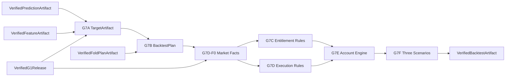

# M3 G7 目标到账户回测分包骨架与外部闭环任务单

日期：2026-07-14  
状态：**设计冻结；等待 G1-P4C 与 G4A–G6B 主 Agent 最终验收后从 G7P0 开始**  
环境：WSL Miniforge `base`；默认测试不联网、不调用券商  
设计 SSOT：[`M3实施与Agent交接.md`](../M3实施与Agent交接.md) §4.8、§4.11、§4.9  
历史任务与审查：[`M3_G7统一回测实现与初验任务单.md`](../../archive/M3_G7统一回测实现与初验任务单.md)、
[`M3_G7设计审查与修订记录.md`](M3_G7设计审查与修订记录.md)

> 本文取代旧 E4A–E4E 的执行颗粒度，保留其业务口径并补齐 verified artifact、金额舍入、无执行价、
> PARTIAL 停牌和 entitlement 时序。本文不宣称任何子包、G7、M3 或 Gate 已实现或通过。

## 1. 当前事实与七包拆分

当前只有 M2 ETF 薄模拟器、通用市场拒绝 helper 和早期 A 股成本对象；不存在 A 股账户循环、target artifact、
backtest plan、公司行动状态机或 G7 manifest。ETF 模拟器按 bar 驱动、反推分红、无 T+1/应收/停牌估值，
不得复制后打补丁。

| 包 | 唯一职责 | 产物/边界 | 前置 |
|---|---|---|---|
| **G7P0** | 补齐四个 G7 scientific config 字段 | C0 strict config extension | C0 主验基线 |
| **G7A** | verified prediction → 完整 target domain | `VerifiedTargetArtifact` | G5B、G4B、G1 |
| **G7B** | 目标调度、BacktestWindow、成本日程 | `VerifiedBacktestPlanArtifact` | G7A、G4A |
| **G7D-F0** | fresh G1八表 + G7B窗口 → formal market-facts capability | `VerifiedAShareMarketFacts`；不发布stage | G7B、G1 |
| **G7C** | 公司行动 entitlement 纯状态转移 | 无独立 stage；只消费formal market facts | G7D-F0、G1-P3/P4C |
| **G7D** | open state、订单差量、T+1、分板块申报数量与费用 | 无独立 stage；纯函数合同 | G7D-F0、G7B、G7C |
| **G7E** | 单场景逐 session 账户循环和 golden fixture | `AShareSimulationResult` 内存结果 | G7C、G7D |
| **G7F** | 0.5×/1×/2× 独立回放、指标与不可变发布 | `VerifiedBacktestArtifact` | G7E |



## 2. G7P0：配置合同增量

当前 `config.py` 和示例 TOML 尚不存在本文已要求的三种舍入方法及 annualization session，不能让 G7B
handler 硬编码后冒充配置身份。G7P0 只修改 C0 字段表、示例 TOML、配置测试和文档；不实现 target/backtest。
在 `[backtest.a_share]` 新增并固定：

```toml
execution_price_rounding = "BUY_CEIL_SELL_FLOOR_TICK_V1"
fee_rounding = "EACH_COMPONENT_HALF_UP_CENT_V1"
cash_settlement_rounding = "HALF_UP_CENT_V1"
annualization_sessions = 252
```

四项属于 scientific selector；field-spec closure 从 138 精确变为 142，缺字段、未知值、bool 冒充 252 均失败。G7P0
必须单独经过外部实现—独立初验—主验，不回写“C0 从未改变”的历史报告；只形成增量交付记录。

## 3. 全链路共同规则

- 跨 stage 只接收 verified bundle；禁止裸 target/DataFrame 搭 caller hash、松散 manifest 或目录名推断 lineage。
- builder 只写 StageRunner 分配的空 temp；StageRunner 是 final rename/receipt 的唯一 publisher。
- A 股账本只使用 verified G1 release 的未复权 bars、calendar、instrument、limit、suspension、corporate action
  和 benchmark；Qlib factor、研究调整价、label 不得进入账户。
- 内部金额、价格、费率计算使用 `Decimal`，禁止二进制 float epsilon 决定现金可行性。Schema/Parquet 出口可
  用 Float64，但必须由规范十进制结果转换并可按冻结规则复算。
- 所有 JSON strict、规范、`allow_nan=false`，不含绝对路径、token、PID、时间戳或机器状态。
- 以下阻断主验：target 不完整、label/未来数据参与成交、停牌持仓归零、T+1 越卖、现金为负、公司行动错配、
  场景混用 market facts、identity 混配、半套目录可见、税费被错误缩放。诊断码更细、注释和命名可记 P2。

## 4. G7A：完整 TargetArtifact

文件：新增 `src/quant/research/m3/targets.py`；修改安全包根、`ml_topk.py`；新增 target 单测和两份报告。

```python
@dataclass(frozen=True)
class TargetBuildSpec:
    experiment_key: str
    work_key: str
    fold: str
    horizon_sessions: Literal[5, 10]
    strategy: Literal["topk"]
    strategy_version: str
    top_k: int
    cash_buffer: float
    max_weight: float
    minimum_scorable_coverage: float

@dataclass(frozen=True)
class TargetManifestV1:
    schema_version: Literal["m3-target-artifact-v1"]
    experiment_key: str
    experiment_manifest_sha256: str
    work_key: str
    g1_release_id: str
    g1_release_manifest_sha256: str
    scientific_config_sha256: str
    prediction_manifest_sha256: str
    feature_manifest_sha256: str
    fold_plan_manifest_sha256: str
    snapshot_id: str
    fold: str
    horizon_sessions: int
    model: str
    model_version: str
    strategy: str
    strategy_version: str
    eligible_keys_sha256: str
    signal_dates_sha256: str
    n_dates: int
    n_eligible: int
    n_scorable: int
    n_predicted: int
    n_selected: int
    target_keys_sha256: str
    targets_sha256: str
    target_daily_sha256: str

@dataclass(frozen=True)
class VerifiedTargetArtifact:
    root: Path
    targets: pl.DataFrame
    target_daily: pl.DataFrame
    manifest: TargetManifestV1
    manifest_sha256: str
    target_receipt_sha256: str
```

```python
def build_target_artifact(
    *, release: VerifiedG1Release, feature: VerifiedFeatureArtifact,
    prediction: VerifiedPredictionArtifact, folds: VerifiedFoldPlanArtifact,
    experiment: VerifiedExperimentIdentity, config: LoadedM3Config,
    spec: TargetBuildSpec, output_root: Path,
) -> TargetManifestV1: ...
def read_target_manifest(path: Path) -> TargetManifestV1: ...
def verify_target_artifact(
    *, root: Path, receipt_path: Path, release: VerifiedG1Release,
    feature: VerifiedFeatureArtifact, prediction: VerifiedPredictionArtifact,
    folds: VerifiedFoldPlanArtifact, experiment: VerifiedExperimentIdentity,
    config: LoadedM3Config, artifact_roots: Mapping[str, Path],
) -> VerifiedTargetArtifact: ...
```

`TargetBuildSpec` 的所有策略数值必须精确等于 scientific selector；不得另造 `portfolio_config_sha256`，也不得让
caller 自报 G1/prediction/feature/signal/eligibility/code hash。manifest 的这些字段全部从 verified bundles
投影，builder/verifier 在任何写入前重算 experiment/work identity。

每个 test signal date 的 target keys 精确等于该日 eligible keys；scorable⊆eligible，prediction=scorable，低于
coverage 阈值、空 eligible/prediction 或日期缺 batch 均失败。Top-k 只在 scorable prediction 中按已验真 rank
选择；未选和 unscorable eligible 显式 0。选中权重为
`min((1-cash_buffer)/n_selected,max_weight)`；剩余为现金，不把 lineage 塞入通用 `TargetWeightSchema`。
权重公式先将 config 值经 `Decimal(str(value))` 精确计算，再投影 Float64；不得依赖 Schema 的 float tolerance
决定是否超配。
`n_selected` 是逐日 selected 数之和，不是唯一证券数。输出精确为 `target_weights.parquet`、
`target_daily.parquet`、`target_manifest.json`；daily 列精确为
`as_of,n_eligible,n_scorable,n_predicted,n_selected,scorable_coverage,total_target_weight`，日期严格递增。
`target_keys_sha256` 使用 G4–G6 的 canonical row-key 协议，`targets_sha256/target_daily_sha256` 是物理 bytes hash；
两个 Parquet 使用统一冻结写参数。

必测：300/299/301 target domain、预测少/多 key、调出证券不在当日 target 但后续由账户补 0、同 model version
不同 model、错 fold/horizon、低 coverage、空预测不能清仓、tie、max-weight/cash-buffer、manifest/parquet
wholesale 替换、策略不读取持仓。

## 5. G7B：BacktestPlanArtifact

文件：新增 `src/quant/backtest/a_share_plan.py`、Schema/导出、单测和两份报告。

```python
@dataclass(frozen=True)
class AShareCostPeriod:
    effective_from: dt.date
    effective_to: dt.date | None
    commission_rate: Decimal
    commission_min: Decimal
    stamp_tax_sell: Decimal
    transfer_fee: Decimal
    slippage: Decimal

@dataclass(frozen=True)
class BacktestWindow:
    signal_dates: tuple[dt.date, ...]
    execution_dates: tuple[dt.date, ...]
    first_execution_date: dt.date
    terminal_valuation_date: dt.date
    force_liquidation: Literal[False]

@dataclass(frozen=True)
class BacktestPlanManifestV1:
    schema_version: Literal["m3-a-share-backtest-plan-v1"]
    experiment_key: str
    experiment_manifest_sha256: str
    work_key: str
    target_manifest_sha256: str
    target_receipt_sha256: str
    g1_release_id: str
    g1_release_manifest_sha256: str
    scientific_config_sha256: str
    fold_plan_manifest_sha256: str
    fold: str
    horizon_sessions: int
    window: BacktestWindow
    session_calendar_sha256: str
    cost_schedule_sha256: str
    cost_schedule_version: str
    order_quantity_rule_version: str
    scheduled_targets_sha256: str
    schedule_diagnostics_sha256: str

@dataclass(frozen=True)
class VerifiedBacktestPlanArtifact:
    root: Path
    scheduled_targets: pl.DataFrame
    manifest: BacktestPlanManifestV1
    manifest_sha256: str
    plan_receipt_sha256: str
```

`build_backtest_plan_artifact(...)` 只接收 verified target/release/folds/experiment 和已验证 config，输出精确
`scheduled_targets.parquet`、`schedule_diagnostics.parquet`、`cost_schedule.json`、`manifest.json`。
不存在独立 `backtest_config_sha256`；全部数值精确重验 scientific selector 与 experiment identity。

```python
def build_backtest_plan_artifact(
    *, target: VerifiedTargetArtifact, release: VerifiedG1Release,
    folds: VerifiedFoldPlanArtifact, experiment: VerifiedExperimentIdentity,
    config: LoadedM3Config, output_root: Path,
) -> BacktestPlanManifestV1: ...

def verify_backtest_plan_artifact(
    *, root: Path, receipt_path: Path, target: VerifiedTargetArtifact,
    release: VerifiedG1Release, folds: VerifiedFoldPlanArtifact,
    experiment: VerifiedExperimentIdentity, config: LoadedM3Config,
    artifact_roots: Mapping[str, Path],
) -> VerifiedBacktestPlanArtifact: ...
```

调度使用 verified SH open sessions；每个完整 as_of batch 映射到共同严格下一 session。尾部缺下一 session、
非 signal date、重复/混策略/混 work、非 A 股均失败，不再静默丢行。最后 test 信号下一 session 同时是最后
execution 与 terminal close；第一个 execution open 是收益起点。每 fold×horizon 独立初始现金，不强平。

成本 schedule 闭区间连续、无重叠，`None` 只在末段；三 multiplier 精确 `(0.5,1,2)`。只缩放
commission rate/min 和 slippage；stamp/transfer 不变。配置新增并冻结：

```text
execution_price_rounding = BUY_CEIL_SELL_FLOOR_TICK_V1
fee_rounding = EACH_COMPONENT_HALF_UP_CENT_V1
cash_settlement_rounding = HALF_UP_CENT_V1
```

这些是研究模型假设，不宣称所有券商实务完全相同；必须进入 scientific identity。`cost_schedule.json` 中
日期用 ISO string、所有 Decimal 用无指数规范十进制字符串；从配置 float 只允许 `Decimal(str(value))`，
拒绝 `Decimal(float)`。schedule hash 对完整具名对象求 canonical JSON hash。

费率事实已于 2026-07-14 复核：证券交易印花税自 2023-08-28 减半的公告在税务政策库仍标记有效，支持
`0.001 → 0.0005`；中国结算 2022-04-29 调整由此前沪深 A 股 `0.02‰` 双向降至 `0.01‰` 双向，支持
`0.00002 → 0.00001`。权威依据分别为
[国家税务总局政策法规库](https://fgk.chinatax.gov.cn/zcfgk/c102416/c5211343/content.html) 与
[新华社转述中国结算通知](https://www.xinhuanet.com/2022-04/28/c_1128605983.htm)。`commission_rate/min` 和
slippage 是个人研究假设，不得标成法定费率；真实运行窗口若晚于本次复核日期，G9 前必须重新核对是否有
新有效期并通过版本化 config 更新，不能沿用开放末段靠“未发现变化”通过。

申报数量不是统一的“100 股 board lot”。本设计于 2026-07-14 复核的官方依据为：上交所一般 A 股买入
100 股整数倍、零股余额卖出规则见
[《上海证券交易所交易规则（2026年修订）》](https://www.sse.com.cn/lawandrules/sselawsrules2025/stocks/exchange/c/c_20260424_10816482.shtml)；
科创板限价/市价申报最少 200 股、超过 200 股可按 1 股递增且不足 200 股余额一次卖出见
[上交所科创板投资者教育页](https://edu.sse.com.cn/tib/)；深市主板/创业板买入 100 股整数倍见
[深交所主板与创业板交易机制说明](https://www.szse.cn/www/investor/institute/rules/t20230706_601604.html)，
创业板具体规则亦见
[深交所创业板投教说明](https://investor.szse.cn/thematic/chinext/article/t20200813_580574.html)。
首版规则常量固定为 `G7_A_SHARE_ORDER_QUANTITY_RULE_VERSION = "sse_szse_limit_order_quantity_v1"`；它是
交易所规则版本，不是可调研究参数，必须进入 plan/scenario manifest 和 receipt identity。当前
`InstrumentSchema.board_lot` 不足以表达“最小申报量 + 后续递增量 + 零股卖出”，G7 禁止把它当 A 股执行规则。

`scheduled_targets.parquet` 列精确为 TargetWeightSchema 五列加 `execution_date`，按
`execution_date,as_of,symbol` 排序；diagnostics 每个 signal date 一行，列为
`as_of,execution_date,n_targets,total_target_weight,session_lag`，其中 `session_lag` 固定 1。manifest window
的日期 tuple 与这两表、fold test dates 一一复算，Parquet 使用冻结写参数。

## 6. G7C：公司行动 entitlement 状态机

文件：新增 `src/quant/backtest/corporate_actions.py`，扩展 `domain/enums.py`、内部值对象/测试和两份报告。
不发布独立 stage。

```python
class EntitlementLegState(str, Enum):
    ABSENT = "ABSENT"
    NOT_APPLICABLE = "NOT_APPLICABLE"
    CAPTURED = "CAPTURED"
    RECOGNIZED = "RECOGNIZED"
    SETTLED = "SETTLED"

class EntitlementPostingType(str, Enum):
    CAPTURE = "CAPTURE"
    CASH_RECOGNIZE = "CASH_RECOGNIZE"
    STOCK_RECOGNIZE = "STOCK_RECOGNIZE"
    CASH_SETTLE = "CASH_SETTLE"
    STOCK_SETTLE = "STOCK_SETTLE"

@dataclass(frozen=True)
class EntitlementPosition:
    event_id: str
    symbol: str
    record_date: dt.date
    ex_date: dt.date
    pay_date: dt.date | None
    stock_list_date: dt.date | None
    cash_settlement_session: dt.date | None
    stock_settlement_session: dt.date | None
    record_quantity: int
    cash_per_share_gross: Decimal
    stock_ratio: Decimal
    cash_entitlement_gross: Decimal
    stock_entitlement: int
    cash_state: EntitlementLegState
    stock_state: EntitlementLegState

@dataclass(frozen=True)
class EntitlementPosting:
    date: dt.date
    event_id: str
    symbol: str
    posting_type: EntitlementPostingType
    cash_amount: Decimal
    stock_quantity: int
    cash_rounding_delta: Decimal
    cash_state_before: EntitlementLegState
    cash_state_after: EntitlementLegState
    stock_state_before: EntitlementLegState
    stock_state_after: EntitlementLegState

@dataclass(frozen=True)
class EntitlementTransition:
    positions: tuple[EntitlementPosition, ...]
    postings: tuple[EntitlementPosting, ...]
    cash_delta: Decimal
    settled_stock: tuple[tuple[str, int], ...]

def capture_record_close_entitlements(...) -> tuple[EntitlementPosition, ...]: ...
def recognize_ex_date_entitlements(...) -> EntitlementTransition: ...
def settle_due_entitlements(...) -> EntitlementTransition: ...
def mark_full_day_event_from_factor(
    *, previous_mark: Decimal, actual_factor_ratio: Decimal,
) -> Decimal: ...
```

单一 `CAPTURED/RECOGNIZED/SETTLED` 状态禁止使用：同一事件的 cash pay date 与 stock list date 可以不同，
必须由两个 leg 独立转换。`ABSENT` 只允许出现在 CAPTURE posting 的 before 字段，不允许存入已创建的
`EntitlementPosition`。经济分量为 0 的 leg 在 capture 后永远 `NOT_APPLICABLE`；非零 leg 严格
`CAPTURED → RECOGNIZED → SETTLED`，不得跳步或重复 posting。posting 同日按
`event_id`、再按 cash-before-stock 固定排序。

实际影响持仓的事件要求 `record_date < ex_date`，两者均为权威 SH session；同日无法先收盘捕获再盘前确认，
故 fail-closed，虽 G1 通用 Schema 可允许 `<=`。现金>0 才要求 pay，stock>0 才要求 list；结算日可晚于 terminal，
此时应收保留在终值权益中。record close 按当时总 quantity（含当日买入 unsettled）捕获；之后卖出仍有权益，
ex-date 买入没有。`pay_date/stock_list_date` 是供应商事实日，不要求恰为 SH open session；账户观测按权威
calendar 映射到第一个 `>= due_date` 的 SH session，超出 terminal/history 时 settlement session 为 null 并保留
应收。每个 session 盘前先 recognize 当日 ex，再 settle settlement session 到期 leg；若 ex 与 settlement
session 同日，可同日确认后结算。上市红股在该 session 开盘前进入 quantity 且 sellable。

现金和红股只入账一次；`record_quantity * stock_ratio` 必须精确为整数，否则失败。
`cash_entitlement_gross=record_quantity*cash_per_share_gross` 在 CAPTURED 时不计入 NAV，因为此时证券仍是
含权价格；到 ex-date RECOGNIZED 后才成为应收。pay-date 实际入现金时按 HALF_UP cent，差额作为明确
`cash_rounding_delta` posting 进入当日权益，不能静默改写 gross entitlement。未上市红股只有在 RECOGNIZED
后按当日合法 mark 估值；CAPTURED stock leg 不另计价值。

G1-P3 现已证明 dividend 两字段不能总能精确恢复交易所除权参考价，因此 G7 禁止在无 bar 的 ex-date 用
`(previous_mark-cash)/(1+stock)` 猜 mark，也不再公开 `theoretical_ex_mark`。若 event ex-date 有 bar，使用实际
未复权 bar；若因 FULL_DAY 停牌无 bar，只允许从同一 verified G1 release 的 corporate-action reconciliation
取得该日唯一、已闭合的 `actual_factor_ratio`，按 `previous_mark/actual_factor_ratio` 调整 market mark。
缺 reconciliation、ratio<=0、event 集不匹配或非 FULL_DAY 无 bar 均 fail-closed，不能 forward-fill 或重算
dividend 通式。`mark_full_day_event_from_factor` 只做 strict Decimal 正值校验与上述除法，不接 cash/stock，
也不自行查表。mark 与账户是否取得 entitlement 无关；只有 record-close 已捕获的账户才确认应收。首版税前
现金、不模拟个人红利税；配股或差异化参考价只由 G1 已验真的市场事实反映，不在账户层伪造额外 entitlement。
首版不参与配股：RIGHTS 在 record close 时账户 quantity>0 属于影响持仓的未支持权益事件，整场景立即
fail-closed；quantity==0 时只保留事件已扫描证据且不生成 position/posting。

## 7. G7D：开盘状态、订单和离散现金分配

文件：新增 `src/quant/backtest/a_share_execution.py`，扩展 `ExecutionRejectReason`，修改 A 股成本纯函数、
Schema/测试和两份报告。

```python
@dataclass(frozen=True)
class AShareMarketFactsIdentityV1:
    schema_version: Literal["m3-a-share-market-facts-v1"]
    g1_release_id: str
    g1_release_manifest_sha256: str
    window_sha256: str
    artifact_digests: tuple[ArtifactDigest, ...]
    input_market_facts_sha256: str

@dataclass(frozen=True)
class VerifiedAShareMarketFacts:
    identity: AShareMarketFactsIdentityV1
    instruments: pl.DataFrame
    calendar: pl.DataFrame
    bars: pl.DataFrame
    limits: pl.DataFrame
    suspensions: pl.DataFrame
    corporate_actions: pl.DataFrame
    corporate_action_reconciliation: pl.DataFrame
    benchmark_bars: pl.DataFrame

@dataclass(frozen=True)
class AccountPosition:
    symbol: str
    quantity: int
    sellable_quantity: int
    unsettled_quantity: int
    mark_price: Decimal

PositionBook = tuple[AccountPosition, ...]

@dataclass(frozen=True)
class AShareFeeComponents:
    commission: Decimal
    stamp_tax: Decimal
    transfer_fee: Decimal

class AShareBoard(str, Enum):
    SSE_MAIN = "SSE_MAIN"
    SSE_STAR = "SSE_STAR"
    SZSE_MAIN = "SZSE_MAIN"
    SZSE_CHINEXT = "SZSE_CHINEXT"

@dataclass(frozen=True)
class AShareOrderQuantityRule:
    rule_version: Literal["sse_szse_limit_order_quantity_v1"]
    board: AShareBoard
    buy_min_quantity: int
    buy_increment: int
    sell_min_quantity: int
    sell_increment: int
    odd_lot_sell_policy: Literal["MATCH_POSITION_REMAINDER", "FULL_BALANCE_BELOW_MIN"]

class ExecutionRejectReason(str, Enum):
    SUSPENDED = "SUSPENDED"
    OPEN_UNKNOWN = "OPEN_UNKNOWN"
    MISSING_OPEN = "MISSING_OPEN"
    BUY_AT_UPPER_LIMIT = "BUY_AT_UPPER_LIMIT"
    SELL_AT_LOWER_LIMIT = "SELL_AT_LOWER_LIMIT"
    T_PLUS_ONE = "T_PLUS_ONE"
    LOT_CONSTRAINT = "LOT_CONSTRAINT"
    CASH_CONSTRAINT = "CASH_CONSTRAINT"

@dataclass(frozen=True)
class TargetOrderIntent:
    symbol: str
    side: OrderSide
    target_weight: Decimal
    target_notional: Decimal
    raw_target_quantity: int | None
    target_position_quantity: int | None
    requested_quantity: int | None
    quantity_rule: AShareOrderQuantityRule

@dataclass(frozen=True)
class ExecutionFill:
    symbol: str
    side: OrderSide
    quantity: int
    reference_open: Decimal
    execution_price: Decimal
    notional: Decimal
    fees: AShareFeeComponents
    slippage_cost: Decimal

@dataclass(frozen=True)
class ExecutionRejection:
    symbol: str
    side: OrderSide
    reason: ExecutionRejectReason
    requested_quantity: int | None
    filled_quantity: int
    rejected_quantity: int | None
    rejected_notional: Decimal

@dataclass(frozen=True)
class ExecutionBatch:
    cash: Decimal
    positions: PositionBook
    fills: tuple[ExecutionFill, ...]
    rejections: tuple[ExecutionRejection, ...]

@dataclass(frozen=True)
class BuyAllocation:
    lambda_fraction: Fraction | None
    batch: ExecutionBatch

def build_open_execution_states(
    *, facts: VerifiedAShareMarketFacts, date: dt.date,
    symbols: tuple[str, ...],
) -> pl.DataFrame: ...

def resolve_a_share_order_quantity_rule(
    *, symbol: str, date: dt.date,
) -> AShareOrderQuantityRule: ...

def largest_valid_buy_quantity(
    *, requested_quantity: int, rule: AShareOrderQuantityRule,
) -> int: ...

def largest_valid_sell_quantity(
    *, requested_quantity: int, position_quantity: int,
    rule: AShareOrderQuantityRule,
) -> int: ...

def build_target_order_intents(
    *, date: dt.date, targets: pl.DataFrame, positions: PositionBook,
    open_states: pl.DataFrame, pre_trade_equity: Decimal,
) -> tuple[TargetOrderIntent, ...]: ...

def execute_sell_intents(...) -> ExecutionBatch: ...
def allocate_buy_lots(...) -> BuyAllocation: ...
def compute_a_share_fee_components(...) -> AShareFeeComponents: ...
```

上述 entitlement/posting/rejection/board 四类领域枚举只定义在 `quant.domain.enums` 并从该处 import；
execution/corporate-action 模块不得复制字符串集合。

`VerifiedAShareMarketFacts` 只能由 `build_a_share_market_facts(*, release, plan)` 从 verified G1 artifact paths
构造；八张 frame 逐一通过领域 Schema，且 source/release/window/键闭包在返回前重验。`artifact_digests` 精确
绑定 instrument、trade calendar、unadjusted bars、price limits、suspensions、corporate-action ledger、
corporate-action reconciliation、benchmark bars 八个实际文件并按相对路径排序；identity hash 对
release/window/digests 具名对象求 canonical JSON hash。每个窗口内 corporate-action ex-date 必须满足“恰有
bar”或“FULL_DAY 且恰有 matching reconciliation transition”二选一。不得公开“八个裸 DataFrame +
release_id”构造器。

`OpenExecutionStateSchema` 只含 `date,symbol,open,has_open,full_day_suspended,partial_open_status,
has_price_limit,up_limit,down_limit,buy_allowed,sell_allowed,reason`。不得读取当日 close/high/low/volume。

PARTIAL detail 按精确分隔符 `" | "` 拆分；每段只接受 `HH:MM-HH:MM` 24 小时格式并解释为半开区间。09:30
落入任一区间则开盘停牌；全部可解析且 09:30 不落入才是 `PROVEN_OPEN_TRADABLE`；任一未知文本为
`OPEN_UNKNOWN` 并保守拒绝。`FULL_DAY` 永远拒绝。有 bar 不能覆盖 suspension 证据。

开盘价在 limit 半个 tick 内：buy at upper / sell at lower 拒绝。G1 M3 v1 已冻结每个**非 FULL_DAY** required
key 必须 `has_price_limit=true`；因此 PARTIAL/无 suspension 的 false、缺行、单侧 limit 都在 market-facts
verifier 失败。FULL_DAY 本就双边拒绝，可缺 limit 且 `has_price_limit=false` 仅是执行状态投影，不是“依法
无限制”。未来只有加入独立交易规则证据并升级 manifest 后才可开放。执行价从 open 施加 slippage，buy 向上、
sell 向下按 tick 取整；随后夹在合法 limit 内。所有比较和取整使用 Decimal，半 tick 边界含等号。

规则分类只接受 G1 已验真 `instrument_type=STOCK` 的 CSI300 沪深代码：`600/601/603/605*.SH` 为沪市主板，
`688/689*.SH` 为科创板，`000/001/002/003*.SZ` 为深市主板，`300/301*.SZ` 为创业板；未知 prefix、suffix
错配或规则适用日早于证券上市日一律 fail-closed。分类器和前述官方 URL/复核日期必须由测试与报告绑定，
不能从 name、调用方自报 board 或 `board_lot` 猜测。

首版只模拟限价申报的数量约束。沪深主板/创业板买入量为 100 的正整数倍；卖出量 `q` 必须不超过盘前
总持仓 `p`，且 `q % 100` 只能是 `0` 或 `p % 100`，从而只能完整保留或一次带走公司行动产生的零股尾数。
科创板买入量必须 `>=200`，之后按 1 股递增；卖出量一般必须 `>=200`，只有盘前总持仓 `<200` 时才允许
`q=p` 一次卖尽。交易所接受的订单发生部分成交后，fill 数可以小于最小申报量；不得把 fill 再误判为非法订单。

目标差量以盘前权益为分母：`target_notional=Decimal(str(weight))*pre_trade_equity`。有 open 时先算
`raw_target_quantity=floor(target_notional/open)`，再按对应规则向下得到 target position：主板/创业板向下到
100 整数倍；科创板向下到整数股但 `(0,200)` 映射为 0。target=0 请求清空全部。正 target 因最小申报量
映射为 0、或目标差量无法构成合法订单时，必须产生 `LOT_CONSTRAINT` 及未实现名义缺口，不能当作无差量成功。

T+1 与数量规则按可审计残差分层：先令 `sellable_cap=min(requested,sellable_quantity)`，
`requested-sellable_cap` 归 `T_PLUS_ONE`；再从 `sellable_cap` 向下选择满足盘前总持仓规则的最大合法卖出量，
其余归 `LOT_CONSTRAINT`。例如主板持仓 257、可卖 120、请求卖 157 时，成交/申报 100、T+1 residual 37、
lot residual 20。不得用 `min(requested,sellable)` 直接生成一笔交易所不会接受的订单，也不得因部分未结算
整单拒绝。无 open
且 target>0 时 desired quantity 不可知：requested/rejected quantity 为 null，`rejected_notional` 使用
`abs(target_notional-current_mark_value)`；不得用未来 close 反推或伪造 0 股成功。weight/open/mark 从 Float64
进入账本时只能 `Decimal(str(value))`。

费用逐分项 Decimal 计算并 HALF_UP 到分：commission=`round(max(notional*rate,min))`，stamp 仅卖出，transfer
双边，fee 为三者精确和。卖出现金可供同日后续买入；blocked sell 不提供现金。

拒绝优先级固定为：无/不可信开盘状态 → 对应涨跌停 → T+1 residual → lot residual → cash residual；同一
requested quantity 只能被一个原因计数，filled+各 residual 必须守恒。无订单差量不写 rejection。

买单用期望股数 `d_i` 与该证券合法买入集合 `V_i` 建模；breakpoint 精确为
`{0,1} ∪ {q/d_i | q∈V_i,q<=d_i}`，使用 `fractions.Fraction` 选择使整组真实成本可付的最大 `lambda`。
基础数量是每个 `V_i` 中不超过 `lambda*d_i` 的最大值；余量按精确 Fraction DESC、symbol ASC 尝试下一
合法数量（主板/创业板增加 100；科创板从 0 激活时增加 200，激活后增加 1），每步按真实执行价和完整分项
费用重算。实现可用单调搜索/有序 breakpoint 迭代避免物化巨大集合，但结果必须等价。不得按输入顺序、连续
名义金额或最终总 fee 粗缩放；现金精确非负。

## 8. G7E：单场景账户循环

文件：新增 `src/quant/backtest/a_share_simulator.py`、七张输出 Schema、golden/integration 测试和两份报告。

```python
@dataclass(frozen=True)
class AShareSimulationResult:
    multiplier: Decimal
    nav: pl.DataFrame
    trades: pl.DataFrame
    positions: pl.DataFrame
    rejections: pl.DataFrame
    corporate_action_postings: pl.DataFrame
    daily_diagnostics: pl.DataFrame
    entitlements: pl.DataFrame

def simulate_a_share_scenario(
    *, target: VerifiedTargetArtifact, plan: VerifiedBacktestPlanArtifact,
    facts: VerifiedAShareMarketFacts, cost_periods: tuple[AShareCostPeriod, ...],
    multiplier: Decimal, initial_cash: Decimal,
) -> AShareSimulationResult: ...
```

账户所需 market-facts view 不公开裸多表+自报 release ID 构造器，只能由上一节窄 builder 从
`VerifiedG1Release.artifact_paths` 重建。模拟器只消费 verified target/plan/facts 和 config 派生值，输出内存
result，不负责 final 发布，也不接受 label、prediction 或 caller 自报 digest。

每日顺序固定：上一 session 买入转 sellable → recognize/settle entitlement → 生成 open states/盘前权益 →
持仓∪target∪事件证券补完整目标 → 先卖后买 → 未复权 close/普通日合法 carry/事件日 verified factor-ratio mark
估值 → 写七张表 →
record-date close 捕获 entitlement。NAV 中只计 RECOGNIZED 未结算 leg；CAPTURED leg 不计应收。持仓没有 bar
且无 FULL_DAY/公司行动解释失败；不得归零。

输出文件名和列冻结如下；所有金额/价格/比率列为 finite Float64，均由内部 Decimal 结果 `float(...)` 单向
投影，verifier 用 Decimal 规则复算，不用 float epsilon 决定账本是否成立：

| 文件 | 精确列 |
|---|---|
| `nav.parquet` | `date,pre_trade_equity,cash,market_value,cash_receivable,stock_receivable_value,equity,unit_nav,daily_return,cumulative_commission,cumulative_stamp_tax,cumulative_transfer_fee,cumulative_slippage_cost` |
| `trades.parquet` | `date,symbol,side,quantity,reference_open,execution_price,notional,commission,stamp_tax,transfer_fee,total_fee,slippage_cost` |
| `positions.parquet` | `date,symbol,quantity,sellable_quantity,unsettled_quantity,mark_price,market_value,target_weight,target_quantity,pending_exit` |
| `rejections.parquet` | `date,symbol,side,reason,requested_quantity,filled_quantity,rejected_quantity,rejected_notional` |
| `corporate_action_postings.parquet` | `date,event_id,symbol,posting_type,cash_amount,stock_quantity,cash_rounding_delta,cash_state_before,cash_state_after,stock_state_before,stock_state_after` |
| `daily_diagnostics.parquet` | `date,n_target_symbols,n_position_symbols,n_order_intents,n_trades,n_rejections,pre_trade_equity,gross_turnover,one_way_turnover,buy_allocation_lambda,cash_after` |
| `entitlements.parquet` | `date,event_id,symbol,record_quantity,cash_entitlement_gross,stock_entitlement,cash_state,stock_state,cash_receivable,stock_receivable,stock_receivable_value` |

nullable 只允许 `target_quantity`、`requested_quantity`、`rejected_quantity` 和没有 buy allocation 时的
`buy_allocation_lambda`；空表仍写精确 Schema。position 只列 quantity>0，entitlement 列所有未全部 SETTLED
事件；posting 是状态变化流水。七表按 `(date,symbol,event_id/side)` 的各自固定 key 排序并使用冻结 Parquet
参数。NAV 恒等式为 cash+market value+cash receivable+stock receivable value；position 满足
sellable+unsettled=quantity；fees 与 trades 分项和一致。终止报告未完成退出市值，不强平。
日期为 `pl.Date`，数量/count 为 `pl.Int64`，`pending_exit` 为 Boolean，标识/enum 为非空 Utf8，其余数值列为
Float64；Schema 还必须冻结各表唯一键，不能只检查列集合。

盘前权益中：有合法 open 的持仓按 raw open；FULL_DAY/no-open 普通日按 previous mark，公司行动日按 verified
reconciliation actual-factor-ratio mark；现金与
RECOGNIZED 应收按账面值。目标数量全部基于同一个 pre-trade equity。初始状态固定为全现金、无持仓、无
entitlement；首个 execution open 的 `pre_trade_equity=initial_cash`、基准 unit NAV=1，首日 close return 已含
当日价格变化、滑点和费用。

三证券五 session golden fixture 必须逐日手算：正常换仓、涨停买拒绝、全日停牌跨现金分红并用 factor-ratio
mark、T+1 部分卖、
blocked sell 不供买入、最低佣金 lot 分配、周五信号周一终值。输入行序变化所有输出逻辑 digest 不变。

## 9. G7F：三场景 BacktestArtifact 与指标

文件：新增 `src/quant/backtest/a_share_reporting.py` 或同职责小模块、strict reader/verifier、测试和两份报告。

```python
ScenarioName = Literal["0p5x", "1p0x", "2p0x"]

@dataclass(frozen=True)
class AShareScenarioMetricsV1:
    schema_version: Literal["m3-a-share-scenario-metrics-v1"]
    experiment_key: str
    work_key: str
    scenario: ScenarioName
    multiplier: float
    n_sessions: int
    initial_cash: float
    terminal_equity: float
    portfolio_return: float
    annualized_return: float
    test_max_drawdown: float
    benchmark_return: float
    test_net_excess_return: float
    relative_wealth: float
    target_gross_turnover: float
    target_one_way_turnover: float
    realized_gross_turnover: float
    test_turnover: float
    commission_total: float
    stamp_tax_total: float
    transfer_fee_total: float
    total_fees: float
    slippage_cost_total: float
    total_trading_cost: float
    cash_rounding_delta_total: float
    requested_order_count: int
    rejection_count: int
    rejection_rate: float | None
    unfilled_notional: float
    average_cash_ratio: float
    corporate_action_posting_count: int
    unexecutable_date_count: int
    terminal_positions_market_value: float
    terminal_pending_exit_value: float
    terminal_estimated_exit_cost_1x: float

@dataclass(frozen=True)
class BacktestMetricsV1:
    schema_version: Literal["m3-a-share-backtest-metrics-v1"]
    experiment_key: str
    work_key: str
    scenarios: tuple[AShareScenarioMetricsV1, ...]

@dataclass(frozen=True)
class BacktestArtifactEntryV1:
    path: str
    sha256: str
    size_bytes: int
    row_count: int | None
    schema_name: str

@dataclass(frozen=True)
class BacktestScenarioManifestV1:
    schema_version: Literal["m3-a-share-scenario-v1"]
    experiment_key: str
    experiment_manifest_sha256: str
    work_key: str
    scientific_config_sha256: str
    target_manifest_sha256: str
    backtest_plan_manifest_sha256: str
    g1_release_id: str
    g1_release_manifest_sha256: str
    fold: str
    horizon_sessions: int
    scenario: ScenarioName
    multiplier: float
    cost_periods_sha256: str
    order_quantity_rule_version: str
    input_market_facts_sha256: str
    output_files: tuple[BacktestArtifactEntryV1, ...]
    metrics_sha256: str

@dataclass(frozen=True)
class BacktestBundleManifestV1:
    schema_version: Literal["m3-a-share-backtest-bundle-v1"]
    experiment_key: str
    experiment_manifest_sha256: str
    work_key: str
    scientific_config_sha256: str
    target_manifest_sha256: str
    backtest_plan_manifest_sha256: str
    g1_release_id: str
    g1_release_manifest_sha256: str
    order_quantity_rule_version: str
    scenario_manifest_sha256s: tuple[tuple[str, str], ...]
    common_target_manifest_sha256: str
    common_market_facts_sha256: str
    backtest_metrics_sha256: str

@dataclass(frozen=True)
class VerifiedBacktestArtifact:
    root: Path
    metrics: BacktestMetricsV1
    manifest: BacktestBundleManifestV1
    manifest_sha256: str
    backtest_receipt_sha256: str
```

```python
def build_backtest_artifact(
    *, target: VerifiedTargetArtifact, plan: VerifiedBacktestPlanArtifact,
    release: VerifiedG1Release, experiment: VerifiedExperimentIdentity,
    config: LoadedM3Config, output_root: Path,
) -> BacktestBundleManifestV1: ...

def verify_backtest_artifact(
    *, root: Path, receipt_path: Path, target: VerifiedTargetArtifact,
    plan: VerifiedBacktestPlanArtifact, release: VerifiedG1Release,
    experiment: VerifiedExperimentIdentity, config: LoadedM3Config,
    artifact_roots: Mapping[str, Path],
) -> VerifiedBacktestArtifact: ...
```

三场景从相同初始现金、target、plan 和 market facts 独立回放，不能复用 1× fills。每场景输出七表、metrics、
manifest；根输出 `backtest_metrics.json`、`backtest_manifest.json`。0.5×/1×/2× 市场事实 digest 必须相同，
法定税费 rate 不变；因现金约束产生不同 fills 合法。低成本 NAV 不一定逐日支配高成本，若反常只诊断，
不得交换标签或篡改 fills。

`build_backtest_artifact(*, target, plan, release, experiment, config, output_root)` 先构造一次 verified market
facts，再用相同 facts、初始现金和 base schedule 独立运行三个 scenario。输出顺序固定 `0p5x,1p0x,2p0x`，
不接受 caller 自报 multiplier/schedule/metrics；verifier 重新运行全部账本纯函数并逐表、逐 metrics 核对。
`BacktestMetricsV1.scenarios`、scenario manifest hashes 与目录顺序都必须精确为该顺序；三个 scenario 和 plan
中的 `order_quantity_rule_version` 必须相同且等于生产常量，不能由 manifest 自报一个未知版本后自洽通过。

指标精确使用 `AShareScenarioMetricsV1`，公式冻结如下：

- `portfolio_return=terminal_equity/initial_cash-1`；`annualized_return=(1+portfolio_return)^(annualization_sessions/n_sessions)-1`，零权益特判为 -1；
- max drawdown 在 close unit NAV 序列前 prepend 1，字段名固定 `test_max_drawdown`；
- benchmark 使用用户批准且由配置/领域合同冻结的 `510300.SH` ETF，按 first execution raw open→terminal raw close；`test_net_excess_return=portfolio_return-benchmark_return`，relative wealth 按比值公式；
- target turnover 从第一日“全现金即前权重全 0”开始逐日计算完整 target weight 差；realized turnover 逐日为 `sum(abs(trade notional))/pre_trade_equity`，`test_turnover` 是各日 one-way 之和；
- `total_fees=commission+stamp+transfer`，`total_trading_cost=total_fees+slippage_cost`；四个分项均保留，cash rounding delta 独立记录；
- rejection rate 是有 residual 的 order intent 数/全部 order intent 数，denominator 0 时 null；unfilled notional 为 rejection 表总和；unexecutable date 是至少一条 rejection 的日期数；
- average cash ratio 是各 close `cash/equity` 等权均值，equity 必须正；terminal pending exit 只计最后 target=0 但仍持有的证券；terminal position value 计全部持仓；
- terminal estimated 1× exit cost 对全部 terminal positions 以 terminal mark、1× sell slippage 和该日 base commission/stamp/transfer 估算，只作披露，不生成 fill、不改变 NAV。

每场景输出七表、`metrics.json`、`manifest.json`；根输出 `backtest_metrics.json`、`backtest_manifest.json`。
root metrics 是三个 strict scenario metrics 的有序对象，不是松散 Mapping。所有非 null float 必须 finite；
negative return/excess 合法。`acceptance.required_metrics` 的固定投影为
`backtest.1p0x.test_net_excess_return/test_turnover/test_max_drawdown`，不得用别的字段或场景冒充。

## 9.1 G7 stage receipt 闭包

verifier 必须从 verified bundles 重建下表精确集合；“bundle”包含 manifest、receipt 与本 stage 实际读取的
全部数据文件。禁止只验 receipt 自洽、漏列 market-facts 文件或把 pure G7C/D/E 伪装成独立成功 stage。

| stage | scope/key | inputs 精确闭包 | outputs 精确闭包 |
|---|---|---|---|
| `targets` | `WORK/work_key` | G1 release manifest/receipt/eligible；feature manifest/receipt/test segment；prediction bundle；fold bundle；experiment bundle | target weights、target daily、target manifest |
| `backtest_plan` | `WORK/work_key` | target bundle；G1 release manifest/receipt/trade calendar；fold bundle；experiment bundle | scheduled targets、schedule diagnostics、cost schedule、plan manifest |
| `backtest` | `WORK/work_key` | target bundle；plan bundle；experiment bundle；G1 release manifest/receipt 与 market-facts 八文件 | 三场景各七表/metrics/manifest；root metrics/manifest |

三 stage 都只写 StageRunner 分配的已存在空 temp，JSON canonical、Parquet 固定参数；final directory 与 receipt
只由 runner no-clobber 发布。backtest receipt output 必须递归精确覆盖 manifest 声明的全部普通文件，但不得
把 manifest 自己纳入自身内容 hash。三个场景目录少一张空表也失败。

## 10. 外部闭环与执行顺序

固定顺序：

```text
G7P0 → G7A → G7B → G7D-F0 → G7C → G7D其余 → G7E → G7F → 真实 G1 release 完整折主验
```

每包执行“外部实现自测 → 未参与实现的外部只读初验 → 失败返工循环 → 主 Agent 最终验收”。不得一次性交付
七包。G7C/G7D/G7E 是风险峰值，应分别交付；实现者不得宣称 G7/Gate 通过或更新路线图。

2026-08-09只读审计补充：G7C不得另造独立formal公司行动facts capability。唯一八表fresh G1 view和窗口身份
属于G7D-F0；否则会复制release/window/digest/freshness SSOT。G7D-F0必须独立通过后，G7C才可在同一
`VerifiedAShareMarketFacts` 上加固RIGHTS正持仓fail-closed/零持仓仅记录扫描、漏ex/漏settlement
fail-closed等纯状态规则。

固定报告：

| 包 | 实现报告 | 独立初验报告 |
|---|---|---|
| G7P0 | `docs/M3_G7P0配置合同增量交付报告.md` | `docs/M3_G7P0配置合同增量独立初验报告.md` |
| G7A | `docs/M3_G7A目标Artifact交付报告.md` | `docs/M3_G7A目标Artifact独立初验报告.md` |
| G7B | `docs/M3_G7B回测计划交付报告.md` | `docs/M3_G7B回测计划独立初验报告.md` |
| G7D-F0 | `docs/M3_G7D-F0正式MarketFacts交付报告.md` | `docs/M3_G7D-F0正式MarketFacts独立初验报告.md` |
| G7C | `docs/M3_G7C公司行动账本交付报告.md` | `docs/M3_G7C公司行动账本独立初验报告.md` |
| G7D | `docs/M3_G7D执行与现金分配交付报告.md` | `docs/M3_G7D执行与现金分配独立初验报告.md` |
| G7E | `docs/M3_G7E账户循环交付报告.md` | `docs/M3_G7E账户循环独立初验报告.md` |
| G7F | `docs/M3_G7F三场景回测交付报告.md` | `docs/M3_G7F三场景回测独立初验报告.md` |

测试只写 pytest temp，不联网。每包定向后运行 WSL base 全量 pytest、Ruff、mypy。外部 Agent 发现真实
Tushare `record_date==ex_date`、无法解析 PARTIAL timing、权益日期越界或任务书矛盾时停止扩大实现，提交
原始 receipt 的脱敏最小证据，由主 Agent 先修改 SSOT。
