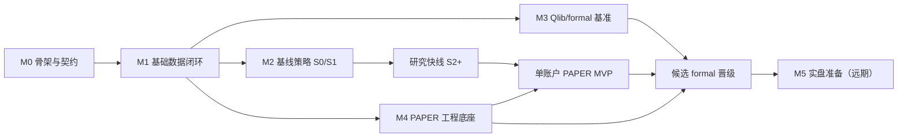

# A 股港股通个人量化系统 — 项目实施路线图

> 制定日期：2026-07-11（Asia/Shanghai）  
> 依据文档：[A股港股通个人量化投研交易系统调研.md](A股港股通个人量化投研交易系统调研.md)（2026-07-11 第二次修订版）  
> 已确认前提：(1) 当前无任何券商量化权限，实盘通道按 QMT/PTrade 为主评估；(2) 已购 Tushare Pro 2000 积分，作为研究主源，交易所官方源为港股通事实真源，AKShare/BaoStock 校验与降级；(3) 日频起步，先投研后实盘。

## 总原则

- 每个里程碑有明确的**验收标准**；严格验收决定候选能否晋级，但不阻止与其文件和运行边界隔离的早期策略研究。
- 研究、回测、纸面、实盘共用同一份数据契约和 `target_weight` 接口。
- 券商 API 永远隔离在 Gateway 抽象层之后；策略与组合代码不出现任何券商依赖。
- 每一步都保持可复现：数据来源与版本、代码版本、配置、随机种子可追溯。
- 采用“研究快线 + 工程稳线”：日常研究保持轻量可重复，完整 formal identity 和不可变发布用于候选晋级、PAPER 和资金安全边界。

## 当前总体路线（2026-08-13 第三次修订）

本节落实[《正式产物身份、数据溯源与可复现性方法论》§13](正式产物身份、数据溯源与可复现性方法论.md#13-轻量级量化系统的实施取舍建议)。
项目不再把“全部 formal 工程完成”作为投研框架完成或开始策略开发的条件。**M2 已经满足投研框架 MVP
完成定义，当前阶段就是策略发现与证伪，而不是继续等待框架。** 后续采用三条工作流、三种准入结论：

| 工作流 | 当前优先级与目标 | 最小完成标准 | 明确不等待 |
|---|---|---|---|
| 策略研究前台 | P0；持续提出可反驳假设，寻找 `PAPER_CANDIDATE` | 版本化配置、`as_of → 下一开市日`、固定数据截止日/随机种子、不可覆盖 `run.json`、统一市场约束回测、walk-forward 与成本压力 | G9 全闭包、Linux/ext4、完整 MLflow/fresh verifier、正式 Gateway |
| A 股/ETF PAPER MVP | P1；在候选出现前完成最小准备，候选出现后尽快开始单账户人工确认运行 | 目标到订单、现金/可卖量、幂等订单、持久账本、人工总开关、日终对账、异常时禁止新增买单 | 多账户、港股通第二波、无人值守、完整 formal artifact 链 |
| formal 工程后台 | P2；为 M3 基准、候选晋级和未来影子/实盘补齐严格证明 | 输入闭包、不可变发布、fresh verification、平台 Gate、正式授权与来源/账户对账 | 不反向阻塞日常研究，也不为尚无经济价值的假设逐阶段 formal 化 |

研究快线的基础设施工作包已经完成：已复用 `ETF_POOL_M2_V1`、标准 `TargetWeightSchema`、统一事件回测器和
轻量不可覆盖 `run.json`，没有另造框架。后续前台工作是连续提出并证伪策略假设，每轮只改变一个变量；
失败假设也保留摘要，防止事后挑选。M3 honest 300 长运行在资源限额下作为后台机器学习基准，完成后纳入
同一候选比较，但不阻塞其他策略开发。当前首轮 honest 300 业务计算已完成，验收仅在 stage root 新增文件
集合处失败；在小型探针定位前不重复长运行。

### 近期交付路径与 WIP 限制

1. **策略研究是唯一前台关键路径。** 默认先完成两个短策略实验或一个真实前向观察，再安排一个 formal
   工程小包；研究实际暴露的数据、撮合或账户语义缺口可临时提升为 P0，关闭后立即回到策略研究。
2. **PAPER MVP 只实现资金安全所需的最小闭环。** 在尚无 `PAPER_CANDIDATE` 时只完成候选无关且已确定的
   账户、订单、人工确认和对账能力；不得用多账户、复杂故障矩阵、无人值守或完整来源证明延迟第一次 PAPER。
3. **formal 工程保持一个在制包。** 新包必须能回答“由哪个候选晋级、平台 Gate 或已冻结验收直接消费”；
   没有近期消费者的通用 capability、额外 receipt 层或物理身份加严进入 backlog，不继续扩建。
4. **长计算只在后台运行。** 使用低于正常的优先级、既定 CPU/内存上限并为交互工作保留资源；长任务失败时
   先用小型探针定位，不重复启动完整链。GPU 仅作为版本化训练 profile 候选，不改变账户和验真语义。
5. **当前不新增第四条框架路线。** M1 港股 licensed 缺口只阻塞港股研究/PAPER；M3/G9 只负责机器学习基准
   与 formal 晋级；M4 第一波只负责 A 股/ETF PAPER。它们都不得成为 S2+ 策略实验的隐式前置。

### 共享核心与分层外壳

快速研究不能靠复制一套宽松业务公式实现。项目冻结为“同一计算核心，按风险增加外壳”：

| 层次 | 复用的唯一计算语义 | 该层新增内容 |
|---|---|---|
| 研究 | Schema、PIT/时间语义、因子、`target_weight`、市场规则、费用和账户数学 | 轻量配置、`run.json`、walk-forward、成本压力和研究结论 |
| PAPER | 同一目标、撮合、费用和账户原语 | 人工确认、幂等订单、持久账本、日终对账和 fail-closed |
| formal | 同一研究/PAPER 计算，不另写策略或撮合公式 | manifest、receipt、不可变发布、fresh verifier、平台与运行授权 |

轻量研究结果不能原地“升级”为正式产物。候选晋级时冻结策略配置、数据截止日和代码版本，然后通过 formal
入口重新运行并比较关键科学结果；formal 证明的是这次受控重跑的来源与完整性。这样既保留正式边界，也避免
让每一个失败研究假设承担完整发布工程成本。

## 里程碑总览

M2 与 M3 并行；新策略研究只依赖 M2 已验收契约，不再等待 M3/G9。M4 的 PAPER MVP 可消费 M2 候选，
不要求候选先成为 M3 formal artifact；但必须满足 PAPER 层的人工确认、订单幂等、资金/可卖量、账本和对账
要求。只有候选要晋级到 formal/影子/实盘时，才汇合对应的 M3/M4 formal Gate。

三个层级分别判定，不再用一个总 Gate：研究准入看科学与回测可信度；PAPER 准入看人工确认、
订单幂等、现金/可卖量、持久账本和日终对账；formal/影子/实盘候选准入才要求完整 identity、
不可变发布、fresh verification、平台 Gate 和正式授权。三层必须复用相同 Schema、规则与费用实现，
不得为快线复制一套宽松业务公式。

---

## M0 骨架与契约（已完成：2026-07-11）

**目标：** 项目结构、依赖、核心数据契约定义完成，最小单测通过。

任务：

- [x] 按调研文档 7.4 创建目录结构（`src/quant/`、`configs/`、`tests/`、`data/`、`artifacts/`）。
- [x] `pyproject.toml`：核心依赖（polars、duckdb、pyarrow、pandera、pydantic-settings、loguru、pytest）；qlib/mlflow/lightgbm 等列入 `research` 可选组。
- [x] `domain/` 数据契约：`instrument`、`trade_calendar`、`bar_1d`、`corporate_action`、`universe_membership`、`factor_value`、`target_weight`、`order/fill/position/cash` 的 Pandera schema 与枚举定义。
- [x] `data/` 层：`BaseConnector` 原始采集抽象接口（多源统一 fetch 签名；不得跳过 raw 层）。
- [x] `data/connectors/`：AKShare 原始连接器骨架（SDK 延迟导入；不访问网络的适配器测试）。
- [x] `strategies/` 层：`Strategy` 抽象接口（输入 `as_of` 可知数据，输出 `target_weight`）。
- [x] 契约最小单测：合法数据通过 schema、非法 OHLC / 负成交量被拒绝。

**验收标准：**

1. `pytest` 全部通过。
2. 任何模块都不 import 券商 SDK 或具体数据源 SDK（除 `data/connectors/` 内部）。
3. README 说明目录职责与两份文档的关系。

---

## M1 基础数据闭环（Windows A 股/ETF 与 HK60 不复权研究闭环已成）

**目标：** Tushare/交易所官方数据 → raw/clean Parquet → Pandera 门禁 → DuckDB 查询的完整数据闭环，含免费源交叉校验与质量报告。

任务：

- [x] AKShare A/H 股日线连接器与独立字段映射器；A 股东方财富主端点失败时回退新浪端点并保留端点血缘。
- [x] BaoStock A 股日线校验连接器与独立字段映射器（显式 login/logout，不复权口径）。
- [x] Tushare 私密本地配置、脱敏权限检查和 A/H 连接器；A 股日线、累计复权因子、三地基础日历及股票主表真实贯通。
- [x] Tushare 长区间按 3,000 日切片，避免 5,000/6,000 行上限截断；逐日复权因子压缩为变化事件。
- [x] 沪深股票/ETF 证券主表：BaoStock 上市/退市日期、类型和状态 → clean `instrument`，按市场幂等存储。
- [x] 沪深交易日历：BaoStock 开市/休市日 → clean `trade_calendar`，按市场幂等存储。
- [x] ETF 日线：AKShare 股票/ETF 多端点尝试；端点不可用时可无缝改用 BaoStock 日线连接器。
- [x] ETF 主表覆盖审计：BaoStock clean 主表含沪市 ETF 903 只、深市 ETF 695 只，`510300.SH` 与 `159919.SZ` 均存在；Tushare 2000 积分不具备 ETF 专题权限，不调用必然失败的接口。
- [x] raw 层：原始响应按 `source/table/date` 分区落盘，附抓取时间、参数、行列信息与 SHA-256 校验和。
- [x] clean `bar_1d`：标准证券代码、Schema 门禁、按交易日分区及业务键幂等合并。
- [x] BaoStock 累计后复权因子：独立 raw/clean 留档，按证券和生效日期 as-of 匹配到不复权 `bar_1d`。
- [x] 基础质量门禁：空值、重复键、OHLC 合法性；失败时保留 raw、拒绝 clean 并输出 JSON 报告。
- [x] Tushare bulk 四表历史 raw 全字节闭合并发布版本化 scoped clean snapshot：股票 17,766,134 行、
  基金 1,399,311 行通过 `Bar1dSchema`，2,088,304 条异常/缺因子/范围外记录逐行隔离；snapshot
  `b79a7b5e…089d2` 首发与 no-clobber 重放均通过，未覆盖现有日增量 clean。
- [x] 质量报告补充空值率及阈值、请求证券/日期缺失观测、异常收益跳点。
- [x] AKShare/BaoStock 跨源报告：覆盖差异、均值/最大绝对相对价差、超阈值行数。
- [x] 沪深单日增量更新由 clean 交易日历前置确认开市，并对每只请求证券执行“必须返回”门禁。
- [x] 沪深多日回补：要求 clean 日历完整覆盖自然日区间，并对每只证券核验全部预期开市日。
- [x] 港股通当前名单与调整事件：上交所/深交所官方接口 → raw 留档 → 双路由 clean 快照/事件；明确“基线快照 + 生效事件”才可重建历史，不以当前名单回填过去。
- [x] 深港通逐日交易日历：深交所官方接口，保留全日/半日休市及节假日名称。
- [x] 沪港通 2026 官方年度公告结构化配置：叠加沪市基础日历，覆盖全日休市及 12 月 24/31 日半日服务。
- [x] 2026 全年日历审计：沪/深港股通状态和半日市零差异，且两路由均无“内地或香港基础市场休市但服务开通”的违规。
- [x] HKEX 2026 证券市场通告直接复核：14 个工作日全日休市与 Tushare 无冲突，并补齐 3 个半日市标记；冲突时拒绝发布 clean。
- [x] 港股多日行情连续性：可恢复 v2c journal 8/8，v3 mixed publication 36,361 行；SH/SZ 两路
  613 只 STOCK 的 available-history 均 0 missing/0 unexpected，31 只 ETF 按官方资格排除，15 个精确
  No-Trade session 由 plan 内嵌证据豁免。
- [x] 增量更新 CLI：`python -m quant.data.update --date YYYY-MM-DD --symbols ...`；重复运行不产生重复 clean 行。
- [x] DuckDB 查询：截至指定日期按证券获取最近 N 个交易观测。
- [x] DuckDB 时点股票池查询：用 `as_of` 有效成员筛选证券，并按数据源取得每只证券最近 N 个历史观测；逐日交易资格仍由回测层校验。
- [x] 以 2026-07-10 官方快照为当前覆盖基线，使用官方事件状态机生成双路由成员区间；查询早于基线时显式失败。
- [x] 用官方启动规模核验历史状态机并扩展可证明覆盖：SH_CONNECT 从 2014-11-17 的 268 只、SZ_CONNECT
  从 2016-12-05 的 417 只起重建，至 2026-07-10 均为 644 只；双 Route 历史 universe 已受控发布并终验。

2026-07-17 增量审计与真实发布：深交所事件链从当前 644 只逆推至 2016-12-05 启动规模 417 只且零冲突；
上交所旧 mapper 曾把真实“调进/调出”误按 `"01"` 解释，SSE-E1 修复后由 SSE-REAL1 用一次官方请求受控
替换为 1,212 条 clean 事件（ADD 794 / REMOVE 418），逆推至 2014-11-17 的 268 只且零冲突。SSE-REAL2
随后原子发布 SH 1,062 段/919 个历史证券与 SZ 1,149 段/1,014 个历史证券；两路在 2026-07-10 均开放
644 段，preview 与发布逐字段一致，基线前查询 fail closed。证据见
[`M1_SSE-REAL1真实SHClean事件重建主Agent最终验收报告.md`](docs/framework/agent/M1_SSE-REAL1真实SHClean事件重建主Agent最终验收报告.md)
与 [`M1_SSE-REAL2双Route历史Universe发布主Agent最终验收报告.md`](docs/framework/agent/M1_SSE-REAL2双Route历史Universe发布主Agent最终验收报告.md)。

当前验证证据：2026-07-11/12 在 WSL Miniforge base 中完成 `000001.SZ` 的 Tushare 2026-07-10 单日 raw→clean→质量门禁；全历史因子分段抓取后压缩为 43 条变化事件。上交所取得 644 条名单、1,212 条事件；深交所取得 644 条名单、1,237 条事件及 2026 全年 365 日日历。双路由以 2026-07-10 为基线各生成 644 条当前成员区间。

Tushare 基础数据验证证据：Token 脱敏检查通过；2026 沪、深、港基础日历各 365 行，股票主表分别 2,454、3,079、3,219 行。账号可访问 `hk_daily` 但限频 1 次/小时，`hk_adjfactor` 无权限；因此港股复权链路未验收，不以不复权结果替代。

2026-07-18 港股增量证据：Tushare 股票主表与 HKEX 最终公告的 `02983.HK` 临时柜台生命周期已补齐；
`hk_daily(trade_date=20260710)` raw snapshot `122521.406613Z-f5b205dcd4e7` 为 612 行。`02609.HK`
开盘竞价价超出供应商 high 的反例已通过 HK-only mapper 规范化，跨市场 Schema 不变。31 个 ETF 曾由
HKEX 网页 JSONP 补入，但现行 HKEX Terms of Use 禁止未经许可的脚本化访问/系统性抓取/建库，故 R2A
通过结论已撤回、默认 connector 已零网络 fail closed；ETF 合规来源重新闭环前完整 HK Instrument/M1
Gate 不通过。available-history Gate 已改为优先消费双 Route 官方资格 `security_type`：31 个 ETF 可在没有
Instrument 行时排除，613 只官方 STOCK 仍必须有 Instrument 并按上市生命周期计算精确应有 sessions。
双 Route 真实 Gate 均得到 `required_stocks=613/excluded_etfs=31/structurally_short=11`，当前失败原因仅为
60 日行情缺失（`missing_session_total=36374`），不是 ETF 引用错误。

`hk_daily` P1 在距单日全市场探针超过 60 分钟后，用唯一一次请求实测两代码的 60 日区间；返回 120 行，
`00005.HK/00700.HK` 各自精确覆盖 clean HK 日历的 60 个开市日，零重复、空值和目标外证券，并全部通过
Schema。不可变 raw 为 `132620.624930Z-77c02bc1c1a8`。港股接口文档未明确承诺逗号多代码语法，故只能
在每批严格 fail-closed 的可恢复 manifest 下使用当前实测能力；全 613 股票回填尚未完成。

2026-08-15 重新从 HKEX 官方 `d260710e.htm` 留存 `02983.HK@2026-07-10` 完整 Daily Quotations response，
实际 raw 为 32,792,625 bytes、SHA-256 `88a45f28…db4d2`。canonical observed metadata 与 sales-record
经济字段闭包均通过，retained bundle identity 为 `8c6fae2f…b1426`；该证据关闭 02983 来源缺口，但不替代
该阶段仍缺 `01065.HK@2026-05-05` no-trade 事实；随后用户对不影响策略、持仓、现金、公司行动和真实订单的
小概率缺行作出精确业务裁决，最终以 `USER_APPROVED_MULTI_SOURCE_CONSENSUS` 建立可审计例外，未伪称 HKEX 官方证据。

历史 HK60 strict plan SHA `ffbf8f345626...50a03` 冻结 613 只/36,376 个应有键：P1 seed 120、
`02983.HK` 未解决 1、剩余 8 批。2026-07-18 第一批 80 只/4,800 键已 raw-first PASS，attempt=1、
failure=0、clean 零写入；23:29 第二批同样以恰好一次请求 PASS。第 3 批随后因
`01065.HK@2026-05-05` 稳定无行而以 `HK_HISTORY_RAW_INVALID` fail-closed 停止；2026-07-22 单代码一次
targeted raw-first 探针仍为 0 行。当前 2 receipt / 3 attempt / 0 finalize；禁止重试旧 attempt、合成 OHLC
或发布旧 plan，须在未来新 plan 中引入权威无交易事实语义。2026-08-02 已完成 plan v2、严格 evidence
投影和 `--recover-existing-only` 的双平台开发验证，但尚无许可允许的真实 evidence，未新建正式 plan/journal，
因此旧 plan 当时保持阻断；该状态已由 2026-08-15 的新 v2c plan/journal 取代，旧 plan/journal 继续只读留存。

2026-08-15 HK60 Windows 最终闭环：UA-M1-005 exact evidence set identity 为 `1ea65719…dc63`；新 plan
identity `c115e174…4e49`、journal `575c2ddf…f693`。首次零网络 recover 只恢复 7/8，唯一一次网络请求完成
request 8，第二次 recover 证明 8/8 且零网络。`--finalize-v3` 绑定既有 HKEX retained bundle，发布 36,361 行，
publication identity `7c4279e1…c8f7`。SH_CONNECT 与 SZ_CONNECT 使用同一显式
`verification_as_of=2026-08-16T00:00:00+00:00`，均得到 613 STOCK、36,361 行、0 missing、0 unexpected、
15 No-Trade 豁免并通过 fresh bundle 二次验真。见
[`M1_HK60_R4_v2c真实物化与MixedGate主Agent最终验收报告.md`](docs/framework/agent/M1_HK60_R4_v2c真实物化与MixedGate主Agent最终验收报告.md)。

因此 M1 当前 Windows 研究数据范围关闭。licensed 港股公司行动 provenance、复权/总回报、港股 ETF
Instrument 系统源和港股 PAPER 属于未来 formal/第二波，不得由本次不复权研究闭环冒充，也不再反向阻塞
A 股/ETF 投研与 PAPER MVP。

行情调度验证证据：Tushare 单日 A 股批量请求一次返回并筛选 `000001.SZ`、`600000.SH` 两行；港股单次全市场请求筛选 `00700.HK`、`00005.HK` 两行并通过不复权质量门禁。因子权限失败后可从既有 raw 快照重处理，不重复消耗接口额度。

时点查询验证证据：2026-07-12 使用 2026-07-10 双路由成员区间执行单条 DuckDB CTE 查询，沪港通和深港通结果均只命中 clean 中已有的 `00700.HK`、`00005.HK` 两只证券、各 2 行。查询能力已贯通，但本地港股行情仍只是单日烟雾样本，尚不能据此宣称“全市场近 60 日”数据验收完成。

日历审计证据：`artifacts/data_quality/calendar/2026.json` 覆盖 365 日，双路由缺失日 0、状态/半日差异 0，沪港通/深港通基础市场违规均为 0。该审计曾发现深交所“下午休市”被误映射为全天休市，修正后重新抓取并通过。

HKEX 基础日历证据：版本化通告 `configs/calendars/hk_market_2026.toml` 记录 HKEX `CT/075/25` 的来源、发布日期、14 个全日休市和 3 个半日市。2026-07-12 重新获取 Tushare 全年 365 行后，官方休市核对零冲突，clean 港股日历已补齐半日市，再次运行双路由审计仍为零违规。

市场基础数据验证证据：同日完成 2026-07-06 至 2026-07-12 沪市日历 7 行、沪市股票/ETF 主表 3358 行、深市股票/ETF 主表 3777 行；`510300.SH` 经 BaoStock 获取 2026-07-10 日线 1 行并通过门禁。AKShare 的 ETF 三个候选端点在本次验证中均被上游拒绝或返回无效响应，因此不计为 AKShare 实网成功。

复权与回补验证证据：`000001.SZ` 从 1990-01-01 至 2026-07-10 获取 41 条 BaoStock 因子事件，2026-07-10 匹配的累计后复权因子为 `124.911625`；2026-07-06 至 2026-07-10 五个开市日回补得到 5 行并通过连续性门禁。

**验收标准：**

1. 连续运行 5 个交易日的增量更新无人工干预，重复运行结果幂等。
2. 质量报告可展示缺失率、异常跳点、跨源（AKShare vs BaoStock）收盘价差异。
3. DuckDB 能用一条 SQL 拼出"某日全市场可交易股票的近 60 日行情"。
4. 换源演练：新增一个 mock 连接器，不改 clean 层以下任何代码即可接入。

2026-07-18 补充验收：第 4 项已由测试边界的 `FixtureConnector/FixtureMapper` 复用同一
raw → Schema/质量门禁 → clean → DuckDB 管道完成，WSL/Windows 均为 10 passed 且 Ruff/mypy 通过；见
[`M1_U0A换源演练主Agent补充验收报告.md`](docs/framework/agent/M1_U0A换源演练主Agent补充验收报告.md)。该证据不替代
HK60、合规 HK Instrument、港股复权或连续 5 个真实交易日运行。

2026-07-18 连续运行预注册：已为 2026-07-20 至 24 五个共同开市日注册 Windows 一次性任务，每日
21:30 唤起 Ubuntu WSL Miniforge base；任务定义均为 Ready、IgnoreNew、wake、missed start ASAP、零自动
重试。独立初验发现 scheduler wrapper 会接受不安全 identity 并写入日志，已收紧为 64 位小写 hash 与唯一
相对 receipt selector，新增绝对路径/错配/大写 hash 等反例；修复后 WSL/Windows 合并定向集均为
27 passed，Ruff/mypy 通过。2026-07-20、21 两次真实任务均 result=0，项目日志证明首次 SUCCESS 且同
identity 重放 ALREADY_COMPLETE；截至 2026-07-22 12:34 真实 streak 为 2/5。Task Scheduler Operational
历史通道仍关闭，故当时第 1 项
验收标准尚未通过。证据见
[`M1_U0C连续五交易日无人干预调度主Agent预验收报告.md`](docs/framework/agent/M1_U0C连续五交易日无人干预调度主Agent预验收报告.md)。

2026-08-14 最终验收：新窗口 2026-08-10 至 08-14 的五个一次性任务均在各自合同日 21:30 自然完成，
最后一项 `LastTaskResult=0`；五份 registered XML 与 runner SHA 未漂移。WSL Miniforge `base` 的零网络
`audit_daily_streak` fresh 验真五日日志、receipt 与 raw/quality 字节闭包，返回
`PASS/sessions=5`。因此第 1 项的 U0C-R3 连续调度子 Gate 已关闭；Operational 历史通道仍关闭，且该结论不替代
HK60、正式许可/复权/公司行动或 M1 整体 Gate。见
[`M1_U0C-R3五日自然窗口终审报告.md`](docs/framework/agent/M1_U0C-R3五日自然窗口终审报告.md)。

---

## M2 基线策略（S0 + S1）

**目标：** 买入持有基线和修正版 ETF 趋势轮动，验证回测口径正确。

任务：

- [x] 策略统一接口：等权和 ETF 趋势策略只消费传入数据并输出 `TargetWeightSchema`。
- [x] S1 候选池 `ETF_POOL_M2_V1`：宽基/行业/港股主题三组共 11 只，版本化冻结且已用本地证券主表核验。
- [x] S1 因子最小实现：20/60/120 日动量、60 日对数价格回归斜率×R²、绝对趋势/现金过滤；缺少当日观测时不沿用旧信号。
- [x] ETF 研究价格独立链路：账户核算保留不复权 `bar_1d`；研究层用既有 BaoStock raw 与 AKShare/Sina 分红事件构造分红再投资总回报价格，raw/clean/质量报告齐全。
- [x] 首个真实 S1 信号切片：11 只候选、44 个因子值、2 只目标 ETF、90% 总仓位，并安排到下一开市日。
- [x] 时间语义切片：收盘后 `as_of` 信号只映射到各证券所属市场的下一开市日，尾部无下一日时丢弃，绝不当日收盘成交。
- [x] S0 本地基线：ETF 买入持有与等权月调仓真实运行，使用不复权成交/估值、现金分红、次日开盘、100 股整手、佣金与滑点。
- [x] S0 独立对账：BaoStock 沪深300 YTD 与中证官方事实表误差低于预设容差；`510300.SH` 的价格除息、现金分红、执行/整手与成本差异分层后残差为零。
- [x] S1 walk-forward：补足 2023-01 至 2026-07 同口径历史，完成两折 24月预热/6月验证/6月测试及 0.5×/1×/2× 成本压力。
- [x] ETF 薄回测器第一版：日频推进、分红计息、次日开盘、整手、现金约束、先卖后买、版本化最低/比例佣金和滑点。
- [x] 统一规则原语：显式停牌/涨跌停状态、按已交收可卖量执行 A 股 T+1、股票双边佣金/过户费与卖出印花税；拒绝原因使用领域枚举。
- [x] 统一股票/ETF 日频事件模拟器：规则原语已接入权威 calendar-driven 账户循环，覆盖停牌持仓估值、
  上市/退市生命周期、股票 T+1、涨跌停、稳定 rejection 和股票费用 0.5×/1×/2× 独立压力重放；
  Windows/WSL 均为 118 passed，S0/S1 六个核心产物与既有基线逐字节相同。见
  [`M2_U1统一股票ETF日频事件模拟器主Agent最终验收报告.md`](docs/research/agent/M2_U1统一股票ETF日频事件模拟器主Agent最终验收报告.md)。
- [x] QuantStats 报告输出到 `artifacts/`：S0 两份基线和 S1 两个测试折均已生成 HTML tear sheet。

当前数据证据：`ETF_POOL_M2_V1` 的 11 只证券全部存在于本地 BaoStock 主表且状态为上市 ETF。2026-07-12 回补得到 2026-01-05 至 2026-07-10 共 1,364 行不复权 raw；BaoStock ETF 复权因子响应为空，因此未把供应商复权行情发布为研究收益序列。历史行情改由 AKShare/Sina 回补，并与 BaoStock 增量按时间分段合并；研究收益统一采用不复权价格和现金分红事件重建的总回报序列。

研究价格与信号证据：东方财富 HFQ 恢复后取得 `510300.SH` 367 行，但与“不复权价格 + 现金分红再投资”序列对比，124 个重叠观测的平均绝对日收益差为 13.58bp、最大 57.97bp，不能在截面排序中混用。最终 11 只候选统一使用 `TOTAL_RETURN_DIVIDEND`；2026-07-10 生成 44 个非空因子值，选择 `159922.SZ`、`510500.SH` 各 45%，并映射到 2026-07-13。产物位于 `artifacts/research/m2/as_of=2026-07-10/`；长期历史与 walk-forward 证据见下文。

S0 证据：2023–2025 AKShare/Sina 与 2026 BaoStock 不复权行情按时间分段，11 只 ETF 共 9,361 行连续数据通过门禁。100 万初始资金、配置假设费率下，买入持有期末权益 `1,025,562.02`、收益 `+2.556%`（零成本 `+2.666%`）、最大回撤 `-32.136%`、11 笔成交；等权月调仓期末权益 `1,036,840.87`、收益 `+3.684%`（零成本 `+4.156%`）、最大回撤 `-32.651%`、447 笔成交。报告位于 `artifacts/research/m2/s0/report.json`；停牌、涨跌停、股票 T+1 与费用规则现已接入统一事件回测器并通过双平台定向复验。

S0 独立对账证据：中证指数官方 2026-03-31 事实表公布沪深300 YTD `-3.89%`；BaoStock 由 2025-12-31 收盘计算为 `-3.8854%`，绝对误差 `0.0046%`，低于版本化配置 `0.01%` 容差。2026-01-06 至 2026-07-10，`510300.SH` 与指数日收益相关系数 `0.9948`、年化跟踪误差 `1.90%`；ETF 成本后账户收益 `1.975%`，指数价格收益 `1.305%`，价格除息、分红/整手和成本分解残差为 0。报告位于 `artifacts/research/m2/s0_reconciliation/report.json`。

S1 walk-forward 证据：AKShare/Sina 回补 2023–2025 共 7,997 行、每只候选 727 个观测，与 2026 BaoStock raw 合并后一次性重建 9,361 行连续总回报序列，形成两完整滚动折。第一折测试期 1×成本后收益 `+19.98%`、Sharpe `2.10`、最大回撤 `-7.53%`；第二折为 `-3.26%`、Sharpe `-0.32`、最大回撤 `-12.61%`，验证到测试收益衰减 `-29.75%`。两折顺序复合 `+16.06%`，仅 1/2 折为正；第二折在 0.5×/1×/2× 成本下均为负。结构化报告位于 `artifacts/research/m2/s1_walk_forward/report.json`，各测试折的 QuantStats HTML 位于同目录的 `quantstats/`。`ETF_POOL_M2_V1` 于 2026-07-12 才冻结，历史结果仍有候选池后见偏差，只能作为探索性证据。

**验收标准：**

1. S0 基线与指数公开收益率对得上（误差可解释）。
2. S1 在 walk-forward 框架下输出样本外结果，报告含成本前/后与 0.5×/1×/2× 成本压力测试。
3. 所有策略只输出 `target_weight`，不直接触碰行情下载或订单。

---

## 策略研究快线（投研框架 MVP 已完成，策略迭代为当前最高优先级）

**目标：** 不等待 M3/G9 全部 formal 工程完成，立即用 M2 已验收资产建立低摩擦、可反驳的
策略开发循环，尽快找到值得进入 PAPER 的候选。

当前最小工作包：

- [x] 定义轻量研究 `run.json` 契约，只覆盖假设、数据/配置/代码版本、时间切分、成本压力、结果和结论状态；不复制 G9 receipt 体系。同输入重跑会复用同一 `run_id`，输出被改写时拒绝复用。
- [x] 提供一个复用现有数据与统一事件回测器的研究运行入口，输入是版本化配置，输出是 `target_weight`、标准回测结果和 `run.json`。
- [x] 冻结并运行首轮 S2 假设 `s2-regime-filter-v1`：仅新增 `510300.SH` 多周期绝对正趋势市场状态过滤，不改变候选池、数据、walk-forward、成交时点或费用。
- [x] 以相同 walk-forward、下一开市日执行、市场约束和 0.5×/1×/2× 成本口径完成 S0/S1/S2 全比较。统一日频模拟器保留停牌、涨跌停和 T+1 拒单表；兼容 ETF 回放新增不改变旧 `nav/trades` 接口的 `test_target_gaps.parquet`，覆盖整手、现金和缺开盘价目标缺口，并把缺口数量/名义金额写入各成本场景指标。
- [x] 运行首个 S2 后续单变量假设：把月度调仓改为双月调仓。第二折换手降至约 `1.30×`，但收益转为 `-3.36%`、两折仅 1/2 为正，未满足“降换手且保留正折”的冻结假设；当前代码的 `REJECTED` run ID 为 `1383e5b3074907122717c4e3ccd8b917f54e9641c38bf43a9b1594bea32574f2`，不替换月度 S2 基线。
- [x] 运行第二个换手单变量假设：月度信号和 Top-K 选择保持不变，仅由组合层显式保留仍处于 `Top-K+1` 的上一期目标。第一折因验证选择 `Top-K=1` 而没有发生缓冲，收益/换手仍为 `+7.99% / 1.92×`；第二折换手降至约 `1.76×`、收益升至 `+12.82%`。由于预注册要求两个测试折都降低换手，假设仍以 `REJECTED` 和 run ID `24db2ef96866097b9d0312776d865d1284a421508378f8ba2d4d39ac7284a5df` 留档，不事后放宽标准。
- [x] 运行第三个单变量假设：固定 60 个共同收益观测、12% 年化、无杠杆的波动率目标，只降低月度 S2 总敞口，不改变选择。两折最大回撤由约 `-12.99% / -5.08%` 改善为 `-4.93% / -4.01%`，收益仍为 `+3.73% / +4.64%`，满足预注册条件；但复合收益降至 `+8.55%` 且没有真正前向样本，因此以 `RESEARCH_ONLY` 和 run ID `b61ae28d7efc370ca5433c8138d0968cb7d56d1ded20079d718a765e51131039` 留档，不晋级 PAPER。
- [x] 运行第四个单变量假设：只把 Top-K 搜索空间从 `[1,2,3]` 收窄到 `[2,3]`，禁止单只 ETF 集中持仓。第一折收益/回撤由约 `+7.99% / -12.99%` 改为 `+13.94% / -8.98%`，第二折保持约 `+6.40% / -5.08%`，两折复合约 `+21.23%`，满足预注册条件；但第一折验证期的获胜参数来自零交易并列，证据强度不足，仍以 `RESEARCH_ONLY` 和 run ID `4ea4493f798ed5df8ac61d316f74e56fbfd87730bc6ff578bf979705acb5f1e6` 留档，不晋级 PAPER。
- [x] 运行第五个独立信号假设：固定 Top-K=2、回归窗口60，不搜索宽度阈值；只有 11 只冻结 ETF 中严格多数的 120 日总回报动量为正才承担风险。两折 1×/2× 成本后收益均为正，复合收益约 `+31.09%`；但最差回撤只从约 `-8.9788%` 改善到 `-8.9775%`，远低于预注册的 1 个百分点，且第一折换手从约 `2.52×` 增至 `3.25×`。因此按原四项条件以 `REJECTED` 和 run ID `25ed53dfff8afbd35ec2141bd6fff0764a090b30ce1651f9b8a62dd3dd65d717` 留档，不因高收益事后改写标准。
- [x] 运行第六个独立选择信号：市场趋势过滤、月度执行和成本不变，固定按 60 日已实现波动率从低到高选择两只 ETF，不搜索窗口或 Top-K。两折 1×/2× 成本后均为正，最差回撤由约 `-8.98%` 改善到 `-5.55%`，单边换手降至约 `0.95× / 1.35×`；但两折 1×复合收益仅 `+13.78%`，只保留冻结比较器约 64.92%，未达到预注册的 80%。因此以 `REJECTED` 和来源闭合后的 run ID `ec701e4eb740b75a701694928ae7dc60aa97e1a2f4ab12e1804c146d5fca8c8c` 留档。首次运行漏绑 `risk.py`，旧目录保持不可覆盖但不再作为结论证据；详见 [`M2_S2_R6_固定低波动ETF选择研究结论.md`](docs/research/agent/M2_S2_R6_固定低波动ETF选择研究结论.md)。
- [x] 运行第七个独立排序信号：正趋势准入、Top-K=2 与月度执行不变，只按固定 `120日动量 / 60日实现波动率` 排名。第一折 1×/2× 收益为约 `-2.95% / -3.61%`，最差回撤恶化至 `-10.32%`，第一折换手升至 `2.73×`；两折复合只保留比较器约 15.38%。四项预注册条件全部失败，以 `REJECTED` 和 run ID `0361fa0a0e59964fac0dbc5d926e3ca64524a9c19209b6ec840c6e5e305e7e90` 留档；详见 [`M2_S2_R7_固定风险调整动量ETF选择研究结论.md`](docs/research/agent/M2_S2_R7_固定风险调整动量ETF选择研究结论.md)。
- [x] 建立冻结候选的非部署前向观察入口：只允许候选冻结后的完整自然月最后一个 SH 开市日，绑定来源 run/config/code/输入内容，no-clobber 发布目标权重与下一开市日计划；输出固定 `RESEARCH_ONLY`、`deployment_authority=false`。当前数据仅到 `2026-07-10`，首个允许信号日为 `2026-08-31`，因此尚未产生真实观察产物。
- [x] 候选状态只能为 `REJECTED`、`RESEARCH_ONLY` 或 `PAPER_CANDIDATE`。轻量 run 合同拒绝其他状态；普通 walk-forward 入口只能直接签发 `REJECTED/RESEARCH_ONLY`，不能自报 `PAPER_CANDIDATE`。当前月度 S2 为 `RESEARCH_ONLY`，双月调仓反证为 `REJECTED`，尚无策略获准晋级。

下一阶段不是继续建设通用投研基础设施，而是按统一协议连续开展短实验。双月频率、一位排名保留和
固定多数市场宽度、固定低波动选择和固定风险调整动量均已按原标准拒绝；波动率目标和最小两只 ETF 分散化均通过各自预注册条件，但仍只供研究。
同一两折不再继续微调 Top-K；冻结候选的前向观察入口已经就绪，待 `2026-08-31` 完整数据后才允许生成首个 observation。在此之前策略开发不停摆：下一项只能是预先解释清楚经济机制、输入可得性和失败条件的独立信号实验，或新增真实数据窗口；不能把等待期变成同一历史两折上的参数搜索。每一轮仍只改变一个变量。
若假设需要上一期目标或当前持仓，状态必须位于组合/执行边界，策略仍只输出 `target_weight`，不得读取
账户或发送订单。没有新增真实前向窗口前，任何历史两折改善默认仍为 `RESEARCH_ONLY`。

**快线完成标准：**

1. 任意一次研究可由版本化配置和记录的数据截止日重跑，不依赖 Notebook 隐式状态。
2. 不存在同收盘成交、未来数据、静态今日成分回填或绕过市场规则回测。
3. 输出可与 S0/S1 直接比较，且失败假设也留下结论，不只保留最佳结果。
4. `PAPER_CANDIDATE` 只是进入 M4 PAPER MVP 的输入，不等同 formal 或实盘准入。

首轮 S2 实证（当前均为 `RESEARCH_ONLY`）：同折 S0 等权两折为 `+14.36% / -5.07%`，
顺序复合 `+8.57%`；S1 当前版本两折顺序复合 `+16.06%`，但仅 1/2 折为正，
最差折 `-3.26%`；S2 顺序复合 `+14.90%`，两折分别为 `+7.99%` 和 `+6.40%`，
2/2 折为正，且两折在 2×成本下仍为正。S2 牺牲了一部分第一折收益，换取了更稳定的
跨折表现；但其两折单边换手约为初始资金的 `1.92× / 1.86×`，明显高于 S0 的
`0.60× / 0.59×`。这支持继续研究，但两折样本、候选池后见偏差和缺少真正
前向观察使其尚不具备 PAPER 晋级条件。S1/S2 轻量 run ID 分别为
`921e749b97ac9486295a241a776c2f9787410e3f19f238fcdb875c888f9fd842` 与
`f5674056ea7b2944be2ce03db5d0e44b40506b68e316acf961945f899b24cb00`。新版 S2
产物新增目标缺口表：1×成本下两折分别只有 4 行/约 `169.90` 元和 5 行/约
`1,033.97` 元未达目标名义金额，均为整手取整，没有现金约束；相对 100 万初始资金
不构成当前收益结论的主要解释变量。

---

## M3 Qlib 链路（S3）

**目标：** clean 数据 → Qlib 数据集 → Alpha158 + LightGBM + Top-k，MLflow 记录实验。

任务：

- [x] 冻结 M3 架构、标签时间语义、预测契约、配置骨架、模块边界和 G0–G9 验收矩阵；详见 [`docs/framework/M3实施与Agent交接.md`](docs/framework/M3实施与Agent交接.md)。
- [x] clean Parquet → 每证券 staging Parquet → Qlib bin provider 路线确认；Parquet 只是官方 `dump_bin.py` 的导入源，不再假设 LocalProvider 可直接挂载 clean 数据。
- [x] 定义未来 5/10 交易日基准相对收益和 `prediction_score` Schema；收益从信号次日开盘开始，标签可知时点必须晚于收益区间结束。
- [x] G0 供应链子项：固定 Qlib `v0.9.7` 官方 `dump_bin.py` URL、原始字节数和 SHA-256；D8 获取器负责校验缓存。
- [x] C0 配置基础：唯一 TOML 加载、严格类型/未知键/跨字段验证，以及 full/G1/snapshot/provider/scientific/
  provider-validation/label-reconciliation/acceptance/tracking 九类分层身份；任务见
  [`docs/M3_C0配置加载与身份哈希实现初验任务单.md`](docs/framework/agent/M3_C0配置加载与身份哈希实现初验任务单.md)，最终验收见
  [`docs/M3_C0主Agent最终验收报告.md`](docs/framework/agent/M3_C0主Agent最终验收报告.md)。
- [x] G0 Python 子项：WSL `py312` 已完成 Python 3.12、官方 `pyqlib==0.9.7` wheel、依赖一致性、关键模块 import 与双环境 readiness 验证，且 base 包指纹未变；见 [`docs/M3_G0_py312环境创建与兼容探针主Agent最终验收报告.md`](docs/framework/agent/M3_G0_py312环境创建与兼容探针主Agent最终验收报告.md)。该子项通过不等于 G0 Gate 关闭。
- [ ] G1–G3 数据：按 `CSI300_TUSHARE_MONTHLY_OBSERVED_PIT_V1` 保守月度观察口径取得历史成分、未复权
  A 股 OHLCV、复权因子、停牌、涨跌停和已实施分红送转，生成不可变 G1 release；snapshot 发布权威 SH
  session calendar，固定脚本生成 provider，经全量结构 + 3×20×7 真 Qlib 回读，并按三层容差全量对账标签。
  其中 E3 严格 Receipt R1–R4 与 B2A 确定性请求/raw journal 子包已通过主验；Windows G1 正式 release
  已完成 fresh 磁盘验真并可供研究工程消费，但真实 provider/label 全链与跨平台 Gate 仍未关闭；见
  [`docs/M3_E3严格Receipt主Agent最终验收报告.md`](docs/framework/agent/M3_E3严格Receipt主Agent最终验收报告.md) 与
  [`docs/M3_G1_B2A主Agent最终验收报告.md`](docs/framework/agent/M3_G1_B2A主Agent最终验收报告.md)。G2–G3 任务见
  [`docs/M3_G2-G3Provider与标签对账实现初验任务单.md`](docs/archive/M3_G2-G3Provider与标签对账实现初验任务单.md)。
- [ ] G4–G6 研究：formal fold/feature/alignment/model/prediction/evaluation/summary 的 immutable artifact、fresh verifier
  和编排工程合同已实现并通过 Windows 定向回归；真实 Qlib provider 上的完整 2 folds×2 horizons 运行仍开放。
  每 fold 共享一个无 Qlib label/processor 的 Alpha158 FeatureBundle，h=5/h=10 分别做
  train/validation 监督对齐；test inference 不读取未来标签；LightGBM 只按 validation l2 early stop，输出
  prediction manifest、五层样本 coverage、样本外 IC/ICIR 和不重叠跨折汇总。设计与任务见
  [`docs/M3_G4-G6研究链实现与初验任务单.md`](docs/archive/M3_G4-G6研究链实现与初验任务单.md)。
- [x] G7 组合（Windows 工程闭包）：formal target、backtest plan、八表 market facts、公司行动状态机、开盘撮合、三场景账户回放和
  29 文件 backtest artifact 工程合同已实现。旧 revision 的 honest 300 public CLI 曾完整消费该链，但其 summary stage 后来按 SSOT 修正为 `research-summary`，旧产物不能继续进入 tracking；修正 revision 已生成 retained locator，当前正重新消费 h5/h10。最终 M3 acceptance、真实 tracking 与 Linux/ext4 Gate 仍开放。预测分数 → 无状态等权 Top-k → `target_weight` + 血缘 manifest，进入统一 A 股回测器做
  历史费率、停牌/涨跌停、T+1、公司行动和 0.5×/1×/2× 摩擦压力测试；TopkDrop 不属于 M3。
- [x] G8 追踪与恢复（Windows 工程闭包）：StageRunner、formal backtest CLI、单 work `tracking` CLI、fresh-process
  reproducibility 和 48-node fake full DAG 已完成。旧 revision `706ab2c` 曾以受限资源完成 honest 300
  首发与 completed resume（`1 passed, 1123808 warnings in 9716.55s`），该证据继续证明当时的性能、恢复和
  零写边界，但不能替代 summary stage 修正后的当前 revision。当前 retained session 正在资源受限重跑；
  Linux/ext4 atomic publication 和真实 tracking 不包含在此 Windows 子项中。
  五段 continuation、严格版本 receipt、MLflow SQLite 幂等登记、每个
  fold×horizon 独立冷启动复现；任务见
  [`docs/M3_G8编排与追踪实现初验任务单.md`](docs/archive/M3_G8编排与追踪实现初验任务单.md)。
- [ ] G9 最终质量：G9A 固定命令、代码/依赖/config 前后身份和 quality artifact 已完成；共同 acceptance
  值类型已建立。`UA-M3-002` 已批准；G9B–G9F 的 readiness/comparison/acceptance/quality 发布和 G9G 的
  2-fold×2-horizon Windows fake 全链工程验收已完成。summary stage 修正后的 Windows retained honest h5/h10、
  summary、reproducibility 与 readiness 正在运行；其通过后，项目内 MLflow tracking（受 `UA-M3-003` 控制）、
  remote observations 与最终 acceptance 汇总仍开放。
  最终需重算 G0–G8 identity closure，逐 work 检查 coverage/复现，核对当前 MLflow target，
  再绑定 pytest/Ruff/mypy/import 隔离证据；任务见
  [`docs/M3_G9最终验收实现与独立初验任务单.md`](docs/archive/M3_G9最终验收实现与独立初验任务单.md)。

**验收标准：**

1. 实验完全可复现：同一 snapshot/config 的每个 fold×horizon 都由两个隔离 Python 子进程重新训练，
   prediction 行键一致，score 和指标在版本化容差内；不能用单一 canary 代表完整配置。
2. 报告样本外 IC/ICIR、成本后超额、换手；不以训练集拟合度作为结论。
3. Qlib 依赖只出现在独立 `qlib` 可选组，适配器延迟导入，不进入核心研究工具或交易路径。

当前环境证据：WSL Miniforge base 仍为 Python `3.13.13`，不安装 Qlib；按 `AGENTS.md` §8 的通用版本隔离
规则，独立 `py312` 已通过 Python 3.12 与 Qlib 0.9.7 兼容探针，base 指纹未变。该证据只关闭 G0 Python
子项；完整数据、provider 与正式 Gate 尚未运行，不能声称 M3 Qlib 真实业务链路已通过。

当前 G1 正式证据：公司行动与 HISTORY 返工闭环后，Windows 原生轨已重新完成
INDEX → HISTORY → REFERENCE → PREPARE → PUBLISH。最新 release id 为
`08eb9b31ab4d8c8473c0a7bb612df83009a68b761b8a35816653b2ce07807359`，primary candidate key 为
`f51655b078255760e8925534ac1dac3161a3ec874c88e47e592cb5afe5845036`。2026-08-09 主 Agent 从正式发布目录
fresh 调用公共 verifier，673.6 秒后返回 exact 17 artifact paths；quality 为0 error/0 warning，manifest
SHA-256 为 `d3923fa1143fbc5c4ff352f7b4d0cf5baeb197d2bb161ead34255bd7375f99c4`。见
[`20260809_M3_G1_Windows正式发布物磁盘复验报告.md`](docs/framework/agent/20260809_M3_G1_Windows正式发布物磁盘复验报告.md)。
该证据关闭 Windows G1发布物当前磁盘验真并可解锁Windows研究工程消费，但当前WSL仍为WSL1/DrvFS，
Linux `renameat2(RENAME_NOREPLACE)` / WSL2/ext4 Gate和完整M3 Gate仍未关闭；消费者必须绑定该exact id，
不得扫描两个历史release目录猜“最新”。

---

## M4 统一回测与纸面交易

**目标：** 两类策略经同一市场约束回测准入，纸面交易闭环运行。

**分波次决策：** 为尽快进入 PAPER，第一波只承接 A 股市场上交易的股票/ETF 和单账户人工确认流程；
港股通直接证券、多币种/FX、board lot 和 T+2 作为第二波，不阻塞 A 股 PAPER MVP。这不删除已建立的
港股通契约，只调整运行闭环的优先级。

任务：

- 统一准入回测：A 股（T+1、涨跌停、整手、印花税/过户费/佣金）与港股通（T+0、board lot、碎股只卖、费用、额度/交易日）约束完整。
- 目标仓位 → 差量订单生成（整手、最小金额、卖出可用量）。
- 纸面 OMS：订单状态机（创建/已报/部成/全成/撤单/拒单）、SQLite 账本、盘后对账。
- 事前风控：标的资格、价格范围、现金、单票/行业上限、当日下单与撤单次数上限（对齐程序化交易合规）。
- 日报：净值、持仓、成交、异常；通知通道（邮件/本地）。

2026-07-18 基础增量：P4-P0 SQLite v2 可恢复 outbox 存储前置通过主验，已具备 deterministic claim、lease
attempt fencing、`SENT/UNKNOWN` 终态、`TX_BUSY` 和方法级 SAVEPOINT 原子性；见
[`M4_P4-P0可恢复TransactionalOutbox存储前置主Agent最终验收报告.md`](docs/framework/agent/M4_P4-P0可恢复TransactionalOutbox存储前置主Agent最终验收报告.md)。
该子包不代表 Paper Gateway、service、对账或 M4 Gate 完成。

2026-07-22 基础增量：P2A Gateway dispatch 结果边界已实现三态 `NOT_SENT/SENT/UNKNOWN`、attempt fencing、
PAPER/UTC/identity 前置校验和 callback 闭包校验，并完成外部独立初验与主验。WSL/Windows 定向 pytest
均为 17 passed，Ruff 与 mypy 通过；只关闭 P2A 合同子包，不关闭 P2 或 M4 Gate。见
[`M4_P2A_GatewayDispatch结果边界合同主Agent最终验收报告.md`](docs/framework/agent/M4_P2A_GatewayDispatch结果边界合同主Agent最终验收报告.md)。

2026-08-14 formal PAPER Windows 工程增量：runtime/config 两态物化、execution policy、broker-policy binding、
正式账户 genesis、durable broker store、snapshot port、gateway dispatch、service、schedule 以及 formal daily
input/operator runner 已完成；人工 `approve/paper-submit/cancel/reconcile` 复用既有 CLI challenge 与幂等语义，
不自动确认或重试。首个 target 只接受策略会话产出的 `PAPER_CANDIDATE`，开盘事实只接受带 receipt 的
formal source；当前两项真实输入尚未形成。任务注册、真实 PAPER 启动和 28 日 soak 仍受 `UA-M4-002` 控制，
尚未启动。上述 Windows 结果不替代当前暂缓的 Linux/ext4 Gate。

**验收标准：**

1. 纸面交易连续运行 4 周以上，无对账差异、无重复下单。
2. 故障演练通过：进程重启后状态恢复、重复回报幂等。
3. 至少 1–2 个策略样本外与纸面表现无口径矛盾。

---

## M5 实盘准备（远期，触发条件驱动）

**前置（第零道门）：** 券商开户 → 量化权限申请（确认 QMT/PTrade 的 A 股与港股通权限、资金门槛）→ 程序化交易报备（先报告、后交易）。

任务：

- 按券商验收结果实现所选通道 Gateway（QMT 文件单/HTTP 对接、PTrade 云端、或 MiniQMT 存量），策略层零改动。
- 只读账户与行情 → 影子运行（实盘行情 + 纸面成交对比）→ 人工确认下单 → 小资金。
- 总开关、仅卖出模式、冻结证券、一键撤单等人工控制。
- 灾备通道：券商条件单/人工下单预案。
- 启用任何实盘通道前撤销并轮换研究阶段已知泄露的 Tushare token，更新本地 ignored 配置，并对候选
  配置、日志、manifest、receipt 和报告执行凭据扫描；不得沿用旧 token。

**实盘门槛（预先定义，不可事后放宽）：** 连续纸面/影子运行达标、无对账差异、无严重风控故障、样本外指标和回撤在预设阈值内。

---

## 风险与应对

| 风险 | 应对 |
|---|---|
| 券商通道政策继续收紧（如 QMT 门槛回升） | Gateway 抽象层隔离；同时评估 2–3 家券商;PTrade 权限可先开通占位 |
| Tushare 权限/限频或 AKShare 上游变更导致数据中断 | raw 留档 + 分段/限频 + BaoStock/AKShare 交叉校验 + 质量门禁；不得静默换口径 |
| 财务数据披露时间和修订版本尚未 PIT 化 | 即使已有 Tushare 权限，M1–M2 仍不启用基本面因子；先完成公告时点契约 |
| 过拟合与数据挖掘偏差 | 统一验证协议（调研文档 6.3）：冻结假设、时间切分、成本压力测试、多重检验控制 |
| WSL/Windows 混合环境（QMT 绑定 Windows） | 研究环境（WSL/Linux）与交易环境（Windows）物理分离，通过文件/网络接口通信 |

## 文档关系

- 调研文档：技术选型依据与模块设计（"为什么"）。
- 本路线图：实施顺序与验收标准（"何时做、做到什么程度"）。
- 项目 README：目录结构与开发约定（"在哪里做"）。
