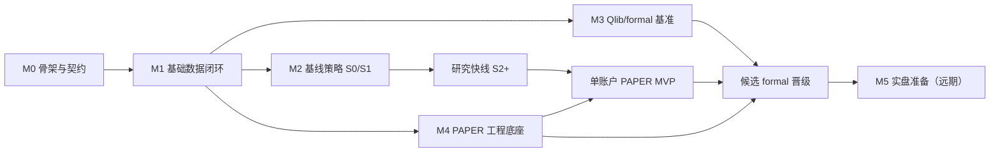

# A 股港股通个人量化系统 — 项目实施路线图

> 制定日期：2026-07-11（Asia/Shanghai）  
> 依据文档：[A股港股通个人量化投研交易系统调研.md]（历史路径 `A股港股通个人量化投研交易系统调研.md`，当前仓库未收录）（2026-07-11 第二次修订版）  
> 已确认前提：(1) 当前无任何券商量化权限，实盘通道按 QMT/PTrade 为主评估；(2) 已购 Tushare Pro 2000 积分，作为研究主源，交易所官方源为港股通事实真源，AKShare/BaoStock 校验与降级；(3) 日频起步，先投研后实盘。

## 总原则

- 每个里程碑有明确的**验收标准**；严格验收决定候选能否晋级，但不阻止与其文件和运行边界隔离的早期策略研究。
- 研究、回测、纸面、实盘共用同一份数据契约和 `target_weight` 接口。
- 券商 API 永远隔离在 Gateway 抽象层之后；策略与组合代码不出现任何券商依赖。
- 每一步都保持可复现：数据来源与版本、代码版本、配置、随机种子可追溯。
- 采用“研究快线 + 工程稳线”：日常研究保持轻量可重复，完整 formal identity 和不可变发布用于候选晋级、PAPER 和资金安全边界。

## 当前总体路线（2026-08-13 第三次修订）

本节落实[《正式产物身份、数据溯源与可复现性方法论》§13](正式产物身份、数据溯源与可复现性方法论.md#13-轻量级量化系统的实施取舍建议)。
项目不再把“全部 formal 工程完成”作为投研框架完成或开始策略开发的条件。**M2 已经满足投研框架 MVP
完成定义，当前阶段就是策略发现与证伪，而不是继续等待框架。** 后续采用三条工作流、三种准入结论：

| 工作流 | 当前优先级与目标 | 最小完成标准 | 明确不等待 |
|---|---|---|---|
| 策略研究前台 | P0；持续提出可反驳假设，寻找 `PAPER_CANDIDATE` | 版本化配置、`as_of → 下一开市日`、固定数据截止日/随机种子、不可覆盖 `run.json`、统一市场约束回测、walk-forward 与成本压力 | G9 全闭包、Linux/ext4、完整 MLflow/fresh verifier、正式 Gateway |
| A 股/ETF PAPER MVP | P1；在候选出现前完成最小准备，候选出现后尽快开始单账户人工确认运行 | 目标到订单、现金/可卖量、幂等订单、持久账本、人工总开关、日终对账、异常时禁止新增买单 | 多账户、港股通第二波、无人值守、完整 formal artifact 链 |
| formal 工程后台 | P2；为 M3 基准、候选晋级和未来影子/实盘补齐严格证明 | 输入闭包、不可变发布、fresh verification、平台 Gate、正式授权与来源/账户对账 | 不反向阻塞日常研究，也不为尚无经济价值的假设逐阶段 formal 化 |

研究快线的基础设施工作包已经完成：已复用 `ETF_POOL_M2_V1`、标准 `TargetWeightSchema`、统一事件回测器和
轻量不可覆盖 `run.json`，没有另造框架。后续前台工作是连续提出并证伪策略假设，每轮只改变一个变量；
失败假设也保留摘要，防止事后挑选。M3 honest 300 长运行在资源限额下作为后台机器学习基准，完成后纳入
同一候选比较，但不阻塞其他策略开发。当前首轮 honest 300 业务计算已完成，验收仅在 stage root 新增文件
集合处失败；在小型探针定位前不重复长运行。

### 近期交付路径与 WIP 限制

1. **策略研究是唯一前台关键路径。** 默认先完成两个短策略实验或一个真实前向观察，再安排一个 formal
   工程小包；研究实际暴露的数据、撮合或账户语义缺口可临时提升为 P0，关闭后立即回到策略研究。
2. **PAPER MVP 只实现资金安全所需的最小闭环。** 在尚无 `PAPER_CANDIDATE` 时只完成候选无关且已确定的
   账户、订单、人工确认和对账能力；不得用多账户、复杂故障矩阵、无人值守或完整来源证明延迟第一次 PAPER。
3. **formal 工程保持一个在制包。** 新包必须能回答“由哪个候选晋级、平台 Gate 或已冻结验收直接消费”；
   没有近期消费者的通用 capability、额外 receipt 层或物理身份加严进入 backlog，不继续扩建。
4. **长计算只在后台运行。** 使用低于正常的优先级、既定 CPU/内存上限并为交互工作保留资源；长任务失败时
   先用小型探针定位，不重复启动完整链。GPU 仅作为版本化训练 profile 候选，不改变账户和验真语义。
5. **当前不新增第四条框架路线。** M1 港股 licensed 缺口只阻塞港股研究/PAPER；M3/G9 只负责机器学习基准
   与 formal 晋级；M4 第一波只负责 A 股/ETF PAPER。它们都不得成为 S2+ 策略实验的隐式前置。

### 共享核心与分层外壳

快速研究不能靠复制一套宽松业务公式实现。项目冻结为“同一计算核心，按风险增加外壳”：

| 层次 | 复用的唯一计算语义 | 该层新增内容 |
|---|---|---|
| 研究 | Schema、PIT/时间语义、因子、`target_weight`、市场规则、费用和账户数学 | 轻量配置、`run.json`、walk-forward、成本压力和研究结论 |
| PAPER | 同一目标、撮合、费用和账户原语 | 人工确认、幂等订单、持久账本、日终对账和 fail-closed |
| formal | 同一研究/PAPER 计算，不另写策略或撮合公式 | manifest、receipt、不可变发布、fresh verifier、平台与运行授权 |

轻量研究结果不能原地“升级”为正式产物。候选晋级时冻结策略配置、数据截止日和代码版本，然后通过 formal
入口重新运行并比较关键科学结果；formal 证明的是这次受控重跑的来源与完整性。这样既保留正式边界，也避免
让每一个失败研究假设承担完整发布工程成本。

## 里程碑总览

M2 与 M3 并行；新策略研究只依赖 M2 已验收契约，不再等待 M3/G9。M4 的 PAPER MVP 可消费 M2 候选，
不要求候选先成为 M3 formal artifact；但必须满足 PAPER 层的人工确认、订单幂等、资金/可卖量、账本和对账
要求。只有候选要晋级到 formal/影子/实盘时，才汇合对应的 M3/M4 formal Gate。

三个层级分别判定，不再用一个总 Gate：研究准入看科学与回测可信度；PAPER 准入看人工确认、
订单幂等、现金/可卖量、持久账本和日终对账；formal/影子/实盘候选准入才要求完整 identity、
不可变发布、fresh verification、平台 Gate 和正式授权。三层必须复用相同 Schema、规则与费用实现，
不得为快线复制一套宽松业务公式。

---

## M0 骨架与契约（已完成：2026-07-11）

**目标：** 项目结构、依赖、核心数据契约定义完成，最小单测通过。

任务：

- [x] 按调研文档 7.4 创建目录结构（`src/quant/`、`configs/`、`tests/`、`data/`、`artifacts/`）。
- [x] `pyproject.toml`：核心依赖（polars、duckdb、pyarrow、pandera、pydantic-settings、loguru、pytest）；qlib/mlflow/lightgbm 等列入 `research` 可选组。
- [x] `domain/` 数据契约：`instrument`、`trade_calendar`、`bar_1d`、`corporate_action`、`universe_membership`、`factor_value`、`target_weight`、`order/fill/position/cash` 的 Pandera schema 与枚举定义。
- [x] `data/` 层：`BaseConnector` 原始采集抽象接口（多源统一 fetch 签名；不得跳过 raw 层）。
- [x] `data/connectors/`：AKShare 原始连接器骨架（SDK 延迟导入；不访问网络的适配器测试）。
- [x] `strategies/` 层：`Strategy` 抽象接口（输入 `as_of` 可知数据，输出 `target_weight`）。
- [x] 契约最小单测：合法数据通过 schema、非法 OHLC / 负成交量被拒绝。

**验收标准：**

1. `pytest` 全部通过。
2. 任何模块都不 import 券商 SDK 或具体数据源 SDK（除 `data/connectors/` 内部）。
3. README 说明目录职责与两份文档的关系。

---

## M1 基础数据闭环（Windows A 股/ETF 与 HK60 不复权研究闭环已成）

**目标：** Tushare/交易所官方数据 → raw/clean Parquet → Pandera 门禁 → DuckDB 查询的完整数据闭环，含免费源交叉校验与质量报告。

任务：

- [x] AKShare A/H 股日线连接器与独立字段映射器；A 股东方财富主端点失败时回退新浪端点并保留端点血缘。
- [x] BaoStock A 股日线校验连接器与独立字段映射器（显式 login/logout，不复权口径）。
- [x] Tushare 私密本地配置、脱敏权限检查和 A/H 连接器；A 股日线、累计复权因子、三地基础日历及股票主表真实贯通。
- [x] Tushare 长区间按 3,000 日切片，避免 5,000/6,000 行上限截断；逐日复权因子压缩为变化事件。
- [x] 沪深股票/ETF 证券主表：BaoStock 上市/退市日期、类型和状态 → clean `instrument`，按市场幂等存储。
- [x] 沪深交易日历：BaoStock 开市/休市日 → clean `trade_calendar`，按市场幂等存储。
- [x] ETF 日线：AKShare 股票/ETF 多端点尝试；端点不可用时可无缝改用 BaoStock 日线连接器。
- [x] ETF 主表覆盖审计：BaoStock clean 主表含沪市 ETF 903 只、深市 ETF 695 只，`510300.SH` 与 `159919.SZ` 均存在；Tushare 2000 积分不具备 ETF 专题权限，不调用必然失败的接口。
- [x] raw 层：原始响应按 `source/table/date` 分区落盘，附抓取时间、参数、行列信息与 SHA-256 校验和。
- [x] clean `bar_1d`：标准证券代码、Schema 门禁、按交易日分区及业务键幂等合并。
- [x] BaoStock 累计后复权因子：独立 raw/clean 留档，按证券和生效日期 as-of 匹配到不复权 `bar_1d`。
- [x] 基础质量门禁：空值、重复键、OHLC 合法性；失败时保留 raw、拒绝 clean 并输出 JSON 报告。
- [x] Tushare bulk 四表历史 raw 全字节闭合并发布版本化 scoped clean snapshot：股票 17,766,134 行、
  基金 1,399,311 行通过 `Bar1dSchema`，2,088,304 条异常/缺因子/范围外记录逐行隔离；snapshot
  `b79a7b5e…089d2` 首发与 no-clobber 重放均通过，未覆盖现有日增量 clean。
- [x] 质量报告补充空值率及阈值、请求证券/日期缺失观测、异常收益跳点。
- [x] AKShare/BaoStock 跨源报告：覆盖差异、均值/最大绝对相对价差、超阈值行数。
- [x] 沪深单日增量更新由 clean 交易日历前置确认开市，并对每只请求证券执行“必须返回”门禁。
- [x] 沪深多日回补：要求 clean 日历完整覆盖自然日区间，并对每只证券核验全部预期开市日。
- [x] 港股通当前名单与调整事件：上交所/深交所官方接口 → raw 留档 → 双路由 clean 快照/事件；明确“基线快照 + 生效事件”才可重建历史，不以当前名单回填过去。
- [x] 深港通逐日交易日历：深交所官方接口，保留全日/半日休市及节假日名称。
- [x] 沪港通 2026 官方年度公告结构化配置：叠加沪市基础日历，覆盖全日休市及 12 月 24/31 日半日服务。
- [x] 2026 全年日历审计：沪/深港股通状态和半日市零差异，且两路由均无“内地或香港基础市场休市但服务开通”的违规。
- [x] HKEX 2026 证券市场通告直接复核：14 个工作日全日休市与 Tushare 无冲突，并补齐 3 个半日市标记；冲突时拒绝发布 clean。
- [x] 港股多日行情连续性：可恢复 v2c journal 8/8，v3 mixed publication 36,361 行；SH/SZ 两路
  613 只 STOCK 的 available-history 均 0 missing/0 unexpected，31 只 ETF 按官方资格排除，15 个精确
  No-Trade session 由 plan 内嵌证据豁免。
- [x] 增量更新 CLI：`python -m quant.data.update --date YYYY-MM-DD --symbols ...`；重复运行不产生重复 clean 行。
- [x] DuckDB 查询：截至指定日期按证券获取最近 N 个交易观测。
- [x] DuckDB 时点股票池查询：用 `as_of` 有效成员筛选证券，并按数据源取得每只证券最近 N 个历史观测；逐日交易资格仍由回测层校验。
- [x] 以 2026-07-10 官方快照为当前覆盖基线，使用官方事件状态机生成双路由成员区间；查询早于基线时显式失败。
- [x] 用官方启动规模核验历史状态机并扩展可证明覆盖：SH_CONNECT 从 2014-11-17 的 268 只、SZ_CONNECT
  从 2016-12-05 的 417 只起重建，至 2026-07-10 均为 644 只；双 Route 历史 universe 已受控发布并终验。

2026-07-17 增量审计与真实发布：深交所事件链从当前 644 只逆推至 2016-12-05 启动规模 417 只且零冲突；
上交所旧 mapper 曾把真实“调进/调出”误按 `"01"` 解释，SSE-E1 修复后由 SSE-REAL1 用一次官方请求受控
替换为 1,212 条 clean 事件（ADD 794 / REMOVE 418），逆推至 2014-11-17 的 268 只且零冲突。SSE-REAL2
随后原子发布 SH 1,062 段/919 个历史证券与 SZ 1,149 段/1,014 个历史证券；两路在 2026-07-10 均开放
644 段，preview 与发布逐字段一致，基线前查询 fail closed。证据见
[`M1_SSE-REAL1真实SHClean事件重建主Agent最终验收报告.md`](framework/agent/M1_SSE-REAL1真实SHClean事件重建主Agent最终验收报告.md)
与 [`M1_SSE-REAL2双Route历史Universe发布主Agent最终验收报告.md`](framework/agent/M1_SSE-REAL2双Route历史Universe发布主Agent最终验收报告.md)。

当前验证证据：2026-07-11/12 在 WSL Miniforge base 中完成 `000001.SZ` 的 Tushare 2026-07-10 单日 raw→clean→质量门禁；全历史因子分段抓取后压缩为 43 条变化事件。上交所取得 644 条名单、1,212 条事件；深交所取得 644 条名单、1,237 条事件及 2026 全年 365 日日历。双路由以 2026-07-10 为基线各生成 644 条当前成员区间。

Tushare 基础数据验证证据：Token 脱敏检查通过；2026 沪、深、港基础日历各 365 行，股票主表分别 2,454、3,079、3,219 行。账号可访问 `hk_daily` 但限频 1 次/小时，`hk_adjfactor` 无权限；因此港股复权链路未验收，不以不复权结果替代。

2026-07-18 港股增量证据：Tushare 股票主表与 HKEX 最终公告的 `02983.HK` 临时柜台生命周期已补齐；
`hk_daily(trade_date=20260710)` raw snapshot `122521.406613Z-f5b205dcd4e7` 为 612 行。`02609.HK`
开盘竞价价超出供应商 high 的反例已通过 HK-only mapper 规范化，跨市场 Schema 不变。31 个 ETF 曾由
HKEX 网页 JSONP 补入，但现行 HKEX Terms of Use 禁止未经许可的脚本化访问/系统性抓取/建库，故 R2A
通过结论已撤回、默认 connector 已零网络 fail closed；ETF 合规来源重新闭环前完整 HK Instrument/M1
Gate 不通过。available-history Gate 已改为优先消费双 Route 官方资格 `security_type`：31 个 ETF 可在没有
Instrument 行时排除，613 只官方 STOCK 仍必须有 Instrument 并按上市生命周期计算精确应有 sessions。
双 Route 真实 Gate 均得到 `required_stocks=613/excluded_etfs=31/structurally_short=11`，当前失败原因仅为
60 日行情缺失（`missing_session_total=36374`），不是 ETF 引用错误。

`hk_daily` P1 在距单日全市场探针超过 60 分钟后，用唯一一次请求实测两代码的 60 日区间；返回 120 行，
`00005.HK/00700.HK` 各自精确覆盖 clean HK 日历的 60 个开市日，零重复、空值和目标外证券，并全部通过
Schema。不可变 raw 为 `132620.624930Z-77c02bc1c1a8`。港股接口文档未明确承诺逗号多代码语法，故只能
在每批严格 fail-closed 的可恢复 manifest 下使用当前实测能力；全 613 股票回填尚未完成。

2026-08-15 重新从 HKEX 官方 `d260710e.htm` 留存 `02983.HK@2026-07-10` 完整 Daily Quotations response，
实际 raw 为 32,792,625 bytes、SHA-256 `88a45f28…db4d2`。canonical observed metadata 与 sales-record
经济字段闭包均通过，retained bundle identity 为 `8c6fae2f…b1426`；该证据关闭 02983 来源缺口，但不替代
该阶段仍缺 `01065.HK@2026-05-05` no-trade 事实；随后用户对不影响策略、持仓、现金、公司行动和真实订单的
小概率缺行作出精确业务裁决，最终以 `USER_APPROVED_MULTI_SOURCE_CONSENSUS` 建立可审计例外，未伪称 HKEX 官方证据。

历史 HK60 strict plan SHA `ffbf8f345626...50a03` 冻结 613 只/36,376 个应有键：P1 seed 120、
`02983.HK` 未解决 1、剩余 8 批。2026-07-18 第一批 80 只/4,800 键已 raw-first PASS，attempt=1、
failure=0、clean 零写入；23:29 第二批同样以恰好一次请求 PASS。第 3 批随后因
`01065.HK@2026-05-05` 稳定无行而以 `HK_HISTORY_RAW_INVALID` fail-closed 停止；2026-07-22 单代码一次
targeted raw-first 探针仍为 0 行。当前 2 receipt / 3 attempt / 0 finalize；禁止重试旧 attempt、合成 OHLC
或发布旧 plan，须在未来新 plan 中引入权威无交易事实语义。2026-08-02 已完成 plan v2、严格 evidence
投影和 `--recover-existing-only` 的双平台开发验证，但尚无许可允许的真实 evidence，未新建正式 plan/journal，
因此旧 plan 当时保持阻断；该状态已由 2026-08-15 的新 v2c plan/journal 取代，旧 plan/journal 继续只读留存。

2026-08-15 HK60 Windows 最终闭环：UA-M1-005 exact evidence set identity 为 `1ea65719…dc63`；新 plan
identity `c115e174…4e49`、journal `575c2ddf…f693`。首次零网络 recover 只恢复 7/8，唯一一次网络请求完成
request 8，第二次 recover 证明 8/8 且零网络。`--finalize-v3` 绑定既有 HKEX retained bundle，发布 36,361 行，
publication identity `7c4279e1…c8f7`。SH_CONNECT 与 SZ_CONNECT 使用同一显式
`verification_as_of=2026-08-16T00:00:00+00:00`，均得到 613 STOCK、36,361 行、0 missing、0 unexpected、
15 No-Trade 豁免并通过 fresh bundle 二次验真。见
[`M1_HK60_R4_v2c真实物化与MixedGate主Agent最终验收报告.md`](framework/agent/M1_HK60_R4_v2c真实物化与MixedGate主Agent最终验收报告.md)。

因此 M1 当前 Windows 研究数据范围关闭。licensed 港股公司行动 provenance、复权/总回报、港股 ETF
Instrument 系统源和港股 PAPER 属于未来 formal/第二波，不得由本次不复权研究闭环冒充，也不再反向阻塞
A 股/ETF 投研与 PAPER MVP。

行情调度验证证据：Tushare 单日 A 股批量请求一次返回并筛选 `000001.SZ`、`600000.SH` 两行；港股单次全市场请求筛选 `00700.HK`、`00005.HK` 两行并通过不复权质量门禁。因子权限失败后可从既有 raw 快照重处理，不重复消耗接口额度。

时点查询验证证据：2026-07-12 使用 2026-07-10 双路由成员区间执行单条 DuckDB CTE 查询，沪港通和深港通结果均只命中 clean 中已有的 `00700.HK`、`00005.HK` 两只证券、各 2 行。查询能力已贯通，但本地港股行情仍只是单日烟雾样本，尚不能据此宣称“全市场近 60 日”数据验收完成。

日历审计证据：`artifacts/data_quality/calendar/2026.json` 覆盖 365 日，双路由缺失日 0、状态/半日差异 0，沪港通/深港通基础市场违规均为 0。该审计曾发现深交所“下午休市”被误映射为全天休市，修正后重新抓取并通过。

HKEX 基础日历证据：版本化通告 `configs/calendars/hk_market_2026.toml` 记录 HKEX `CT/075/25` 的来源、发布日期、14 个全日休市和 3 个半日市。2026-07-12 重新获取 Tushare 全年 365 行后，官方休市核对零冲突，clean 港股日历已补齐半日市，再次运行双路由审计仍为零违规。

市场基础数据验证证据：同日完成 2026-07-06 至 2026-07-12 沪市日历 7 行、沪市股票/ETF 主表 3358 行、深市股票/ETF 主表 3777 行；`510300.SH` 经 BaoStock 获取 2026-07-10 日线 1 行并通过门禁。AKShare 的 ETF 三个候选端点在本次验证中均被上游拒绝或返回无效响应，因此不计为 AKShare 实网成功。

复权与回补验证证据：`000001.SZ` 从 1990-01-01 至 2026-07-10 获取 41 条 BaoStock 因子事件，2026-07-10 匹配的累计后复权因子为 `124.911625`；2026-07-06 至 2026-07-10 五个开市日回补得到 5 行并通过连续性门禁。

**验收标准：**

1. 连续运行 5 个交易日的增量更新无人工干预，重复运行结果幂等。
2. 质量报告可展示缺失率、异常跳点、跨源（AKShare vs BaoStock）收盘价差异。
3. DuckDB 能用一条 SQL 拼出"某日全市场可交易股票的近 60 日行情"。
4. 换源演练：新增一个 mock 连接器，不改 clean 层以下任何代码即可接入。

2026-07-18 补充验收：第 4 项已由测试边界的 `FixtureConnector/FixtureMapper` 复用同一
raw → Schema/质量门禁 → clean → DuckDB 管道完成，WSL/Windows 均为 10 passed 且 Ruff/mypy 通过；见
[`M1_U0A换源演练主Agent补充验收报告.md`](framework/agent/M1_U0A换源演练主Agent补充验收报告.md)。该证据不替代
HK60、合规 HK Instrument、港股复权或连续 5 个真实交易日运行。
