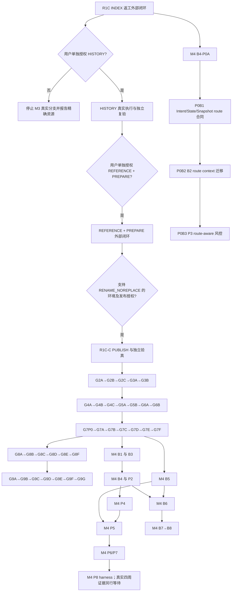

# M3/M4 后续外部总执行任务书

日期：2026-07-17  
状态：**冻结待启动；当前 R1C-B INDEX 身份合同返工进程退出并完成独立复验后生效**  
角色：供一个外部总协调 Agent 组织多个互相独立的 Cursor Agent 会话执行  
目标模型：实现、返工及高风险验收统一使用非 fast `cursor-grok-4.5-high`

本任务书把后续可执行工作整体交给外部 Agent 完成“设计冻结（需要时）→ 实现 → 独立初验 → 返工 →
独立复验”的循环。主 Agent 不做逐包修补或逐包终验；外部批次全部完成、或只剩本文列明的真实授权/环境/
时间硬门禁后，再由用户唤醒主 Agent 做一次集中整体验收。

这项流程调整只改变验收批次，不放宽数据、身份、原子发布、交易安全或 Gate 合同。外部报告只能写“外部闭环
通过、待主 Agent 整体验收”，不得勾选路线图或宣称 M3/M4/Gate 完成。

## 1. 权威输入与阅读顺序

总协调 Agent 先按顺序读取：

1. `AGENTS.md`
2. `.ai/README.md`、`.ai/coding_rules.md`、`.ai/workflows/multi_agent_delivery.md`
3. `docs/M3当前验收与返工总览.md`
4. `docs/M3_M4实施总规划.md`
5. `docs/agent/M3_M4_Grok交接清单.md`
6. 本任务书

每个子包只再读取其现行详细任务书、直接前序报告和目标源码/测试。禁止批量读取全部历史报告；发现状态冲突时，
以代码、测试、可重现产物及 `docs/M3当前验收与返工总览.md` 为准，并在总报告记录冲突，不能另造第三套状态。

现行详细任务书继续作为接口 SSOT：

- G1 真实运行：`docs/agent/M3_G1_R1C分阶段CLI与真实全量运行外部闭环任务单.md`
- G2–G3：`docs/agent/M3_G2_G3快照Provider标签分包骨架与外部闭环任务单.md`
- G4–G6：`docs/agent/M3_G4_G6研究链分包骨架与外部闭环任务单.md`
- G7：`docs/agent/M3_G7目标到账户回测分包骨架与外部闭环任务单.md`
- G8：`docs/agent/M3_G8Continuation编排恢复追踪分包骨架与外部闭环任务单.md`
- G9：`docs/agent/M3_G9最终准入分包骨架与外部闭环任务单.md`
- M4：`docs/agent/M4轻量交易闭环分包任务书.md`
- M4 Route 前置：`docs/agent/M4_B4港股通Route与日历接口前置裁定.md` 与 P0A/P0B 任务书

## 2. 外部协调职责与会话隔离

### 2.1 四类会话

| 角色 | 是否可改生产代码 | 唯一职责 |
|---|---:|---|
| 总协调 Agent | 否 | 维护依赖图、白名单、授权清单、总报告；派发全新子会话 |
| 设计 Agent | 否 | 对只有骨架的高风险包写精确任务书；不实现 |
| 实现/返工 Agent | 是，仅白名单 | 按冻结任务书实现、自测、写唯一交付报告 |
| 独立初验/复验 Agent | 否 | 全新上下文，只读代码与数据；增加新反例；只写唯一验收报告 |

实现者和验收者必须是不同全新上下文。若平台不能创建真正独立的上下文，立即停止并报告，不能在同一会话中
切换角色冒充职责分离。

### 2.2 并发上限与 I/O 互斥

- 同时最多十个外部会话：六个代码写会话、四个代码只读审查会话。
- 并发不是目标。存在相同生产文件、相同测试文件、相同报告、真实数据目录、SQLite、MLflow、source-tree
  identity 或前置依赖时必须串行。
- 只读验收不能检查正被写入的文件；每个报告路径只有一个写者。
- G1/G9 或任何捕获源码树 identity 的命令运行期间，冻结全部 `src/`、`tests/`、`configs/` 写入。
- 真实 Tushare/BaoStock 阶段同一时刻只能有一个数据写者；不得并行启动两个 workflow executor。
- 总协调 Agent 每次派发前在 `docs/agent/外部Agent并发调度台账.md` 登记：会话角色、模型、依赖、生产/测试/
  报告白名单和互斥原因。

### 2.3 固定迭代协议

1. 对已有精确任务书的包直接实现；只有骨架的高风险包先由设计 Agent 写精确子任务书，再由另一只读设计审查
   Agent 对接口、失败语义、identity、反例和白名单做审查，直到设计审查通过。
2. 实现 Agent 只改白名单并运行最小定向测试、定向 Ruff/mypy；不机械跑全量 pytest。
3. 新验收 Agent 逐条做“合同—源码—测试—运行证据”映射，并增加实现者未使用的反例。
4. 初验失败时写清“现象—根因—被破坏规则—最小复现—所需新增测试—通过条件”，回到实现 Agent 返工；
   返工后再开新的验收上下文复验。循环直至通过。
5. 外部初验通过后，下游可按本文依赖图做“基于待整体主验接口的预实现”，但不得更新 Gate、路线图或删除历史
   失败报告。若下游要求真实已发布 artifact，则还必须满足对应真实 Gate，不能用 fake 代替。

## 3. 环境、效率与安全

- Windows 只启动 Cursor Agent。所有项目命令在 WSL
  `/mnt/g/BaiduSyncdisk/wsl/Cursor/quant` 执行，默认使用
  `/home/mabw/miniforge3/bin/conda run -n base <command>`。
- Qlib/LightGBM 的明确兼容任务才使用现有 `py312`；不得修改 base，不得用 Windows Python/conda。
- 开发测试使用最小确定 fixture。普通包只跑改动节点及直接消费者；全量 pytest 只允许在最终跨模块合流、正式
  发布、里程碑/Gate 或定向测试无法排除公共回归时运行一次。
- 长测试、真实网络或大 I/O 启动后按预计完成窗口或下一次用户唤醒读取结果；禁止分钟级轮询。只有一次性的
  进程/CPU 诊断可用于判断是否卡死。
- 不初始化 Git；不修改或复制 `archive/legacy_pre_greenfield/`；非 `quant.data` 代码不得遍历 `data/`。
- token 只能从 ignored 配置间接读取，不能进入 prompt、stdout、stderr、report、receipt、fixture 或异常链。
- M4 不接实盘、不创建真实 broker 命令、不启用 `auto_trade`，不把 PAPER/SHADOW 结果描述成实盘可用。

## 4. 启动前置与当前活动任务

启动本总任务前必须确认现有 `R1C-B INDEX 身份合同返工` Cursor 进程及其全部 WSL pytest 子进程已经退出。
不得通过频繁轮询等待；由用户通知完成，或只在预计完成窗口做一次事件状态检查。

退出后先完成以下零网络闭环：

1. 读取 `docs/agent/M3_G1_R1C-B_INDEX身份合同返工交付报告.md`，核对修改严格位于原白名单。
2. 启动全新的 `cursor-grok-4.5-high` 只读验收会话，严格执行
   `docs/agent/M3_G1_R1C-B_INDEX身份合同返工独立复验Prompt.md`。
3. 若不通过，按固定迭代协议返工/复验；若通过，运行一次零网络 `status`，冻结真实历史成员并集 `S`、
   `history_requests=4*S+131`、当前 evidence 数量及磁盘摘要。
4. 更新 `docs/agent/M3_G1_R1C-B真实运行授权与资源清单.md` 和外部总报告，仅生成 HISTORY 授权建议；禁止启动
   HISTORY。

预期但尚须零网络复验确认的数值为 `S=637`、HISTORY Tushare 计划请求 `2679`、REFERENCE BaoStock 请求
`637`。任何差异以实际已验真的 status/plan 为准，并记录原因；不能为了匹配预期修改数据或计划。

## 5. 执行总图与停止点

## 6. 立即可执行队列

### 6.1 R1C INDEX 身份合同闭环

严格按第 4 节执行。该分支不联网、不改真实 evidence、不重新调用 INDEX。通过后只生成资源清单并停在 HISTORY
授权 Gate。

### 6.2 M4 B4-P0A

R1C 的 source-tree 测试和独立复验完全退出后，使用现有
`docs/agent/M4_B4-P0A港股通RouteContext实现Prompt.md` 启动全新实现会话。完成后再启动全新只读验收会话；
验收报告固定为 `docs/agent/M4_B4-P0A港股通RouteContext领域合同独立初验报告.md`。P0A 不得提前修改
OrderIntent、SymbolMarketState、B2 或 P3。

### 6.3 M4 B4-P0B：显式 Route 串行贯通

P0A 外部独立初验通过后，按
`docs/agent/M4_B4-P0B显式Route贯通外部闭环任务单.md` 的 P0B1→P0B2→P0B3 严格串行执行。每个子包分别
实现、独立初验、必要返工和复验；前一子包初验未通过时不得启动后一子包。

立即可执行队列完成后，若 HISTORY 仍未授权，则外部协调 Agent 停止新增代码任务并提交阶段总报告。M4 B4、
P2 等不得绕过 G7/B1/B3 前置。

## 7. 真实数据与发布授权队列

这些阶段不得由总 Prompt 自动授权。每个阶段必须把精确资源、允许端点、停止点和已有 evidence 报给用户，取得
该阶段的明确授权后才能执行。

### 7.1 HISTORY

- 前置：INDEX 返工外部复验通过；零网络 status 已冻结真实 `S` 和计划请求数。
- 网络：仅任务书冻结的 Tushare `daily/adj_factor/stk_limit/dividend/index_daily/suspend_d`。
- 上限：必须等于已验真 plan 的计划 request 数；重试按冻结配置，不把 attempt 偷换成 request。
- 执行：单数据写会话，可恢复，完成后新进程 status 并严格停止，不启动 BaoStock。
- 验收：全新只读会话核对 plan/request/receipt/raw 集合、端点/参数闭包、重复/缺页/空响应和凭据扫描；不重新
  执行完整网络阶段。

### 7.2 REFERENCE + PREPARE

- 前置：HISTORY 外部复验通过和用户新的明确授权。
- REFERENCE 只调用 BaoStock，计划数为实际 `S`；PREPARE 零网络。
- PREPARE 冷启动两次必须得到相同 candidate/release identity 与 counts；不得 PUBLISH。
- 独立验收只复用 evidence，最多使用任务书明确允许的最小只读探针，不能擅自重跑全量引用数据。

### 7.3 R1C-C PUBLISH

- 前置：PREPARE 通过；目标环境独立能力探针证明目录级原子 `RENAME_NOREPLACE`；用户同意使用该 release root。
- 禁止 `os.replace`、先检查后 rename、先删、硬链接或 copy 伪装正式发布。
- 发布后必须从正式目录重新验真 `VerifiedG1Release`，覆盖同 id 同内容幂等、同 id 异内容冲突、并发发布、fsync/
  cleanup 失败和路径/symlink 边界。
- 当前 WSL1/DrvFS 能力失败时只报告硬阻塞；不得因为总任务目标而降级协议。

## 8. M3 发布后的外部闭环队列

只有真实 `VerifiedG1Release` 已由 R1C-C 外部独立验真后才能启动真实 G2。每个编号是一个独立实现—独立验收
闭环；不合并 G7C/D/E 等高风险账户语义。

1. G2A → G2B → G2C → G3A → G3B
2. G4A → G4B → G4C → G5A → G5B → G6A → G6B
3. G7P0 → G7A → G7B → G7C → G7D → G7E → G7F
4. G8A → G8B → G8C → G8D → G8E → G8F
5. G9A → G9B → G9C → G9D → G9E → G9F → G9G

约束：

- G2B/G2C、G4B、G5A/B 等 Qlib 路径按详细任务书使用 `py312`，base 仍运行核心合同回归。
- G5 只用冻结 seeds/threads/features/labels/folds；不得为了测试快而缩短正式科学窗口，开发测试另用小 fixture。
- G7C/D/E 分开交付；公司行动、T+1、费用和账户守恒不得互相复制。
- G8 fake DAG 只能证明编排，不能把 fake handler 报成真实 Gate。
- G9 捕获 source-tree/current target 时暂停所有 M4 源码写入；G9 只验证证据合取，不重算上游公式。
- 普通子包不跑全量；G3/G6/G7/G9 合流点可各运行一次任务书要求的关键合流验证。

## 9. M4 后续队列

已通过主验的 C0、D0、D1、B2、P0、P0-H1、P1、P3 只做必要兼容迁移，不重写。P0A/P0B 先按第 6 节关闭。
G7 外部独立初验通过后，按以下波次推进：

| 波次 | 可执行包 | 并发条件 | 完成条件 |
|---|---|---|---|
| M4-1 | B1、B3 | 文件白名单互斥，可并行 | 共用 G7 规则/费用纯函数，不复制实现 |
| M4-2 | B4、B5、P2 | B4/B5/P2 文件互斥；P2 等 B1–B3 | planner、账本、paper events 各自闭环 |
| M4-3 | B6、P4 | B6 等 B4/B5；P4 等 B4/P0–P3 | 统一回放和 durable outbox 闭环 |
| M4-4 | B7、P5 | 各自前置满足且文件互斥 | 指标与恢复/对账闭环 |
| M4-5 | B8、P6、P7 | P6/P7 可并行，B8 独立 | admission、操作 CLI、EOD 报告 |
| M4-6 | P8 | P6/P7 已通过 | harness/故障矩阵完成；真实四周证据另计 |

任何只有骨架、尚未冻结精确签名/identity/错误码的包，必须先执行第 2.3 节的独立设计冻结循环。尤其 B4、B5、
B6、P2、P4、P5 属高风险包，不能直接根据标题编码。设计任务书必须给出：精确 public API、typed 输入/输出、
identity envelope、失败语义、文件白名单、至少六类反例和定向验证命令。

P8 只能实现并验证 harness、故障矩阵和证据格式；“至少四周 PAPER/SHADOW”是自然时间 Gate，不能用 fake clock
或回放冒充。代码闭环完成后应写明 `WAITING_FOR_SOAK_EVIDENCE`。

## 10. 每包最低验收矩阵

实现报告必须记录：

- 冻结输入、输出和不做事项；
- 实际修改文件及每个文件目的；
- 定向 pytest/Ruff/mypy 的命令、结果和耗时摘要；
- 哪些证据来自 fake、真实网络、正式发布或真实时间；
- 未验证事项与更高 Gate 明确保持未通过。

独立验收至少检查：

1. 输入对象和携带 identity 在读取经济字段前重新自证；同 id 异 payload 必须失败。
2. 时间、市场、币种、route、session、as_of 和上下游 identity 闭包。
3. 重复、乱序、部分失败、重启、并发和 no-clobber 语义（适用时）。
4. 非法类型、bool-as-int、Decimal 极值、NaN/Infinity、空集、重复 key、顺序扰动。
5. 异常、cause/context、报告和日志不泄露 token、绝对个人路径或 SDK 文本。
6. import/IO 边界：domain/strategy/portfolio 不读数据目录、不 import connector；券商 SDK 不进入 M4。
7. 实现者未使用的至少一个对抗性反例；不能只复跑实现测试。

## 11. 总报告、阻塞报告与交回主 Agent

总协调 Agent 维护唯一总报告：

`docs/archive/agent-history/2026-08-external-batch/M3_M4后续外部执行总报告.md`

报告采用表格逐包记录：状态（未启动/实现中/初验中/返工中/外部闭环通过/硬阻塞）、实现报告、最新独立验收
报告、定向验证摘要、真实/fake 证据类型、依赖和下一动作。历史失败报告保留链接，不能覆盖。

以下任一情况发生时停止对应分支并在总报告给出用户可直接决定的清单：

- 需要新的 Tushare/BaoStock 请求授权；
- 缺少支持 `RENAME_NOREPLACE` 的发布环境或 release root 授权；
- 正式数据/SDK 行为推翻任务书；
- 需要实盘凭据、真实券商或 `auto_trade=true`；
- P8 只剩四周自然时间证据；
- 平台无法创建实现/验收独立上下文。

当所有当前可执行包均为“外部闭环通过”，且其余项只剩上述硬阻塞时：

1. 运行一次按风险选择的跨模块定向合流；除 G9/M4 总 Gate 等关键节点外不机械跑全量；
2. 对修改文件做凭据与绝对个人路径扫描；
3. 更新总报告，不更新路线图/Gate；
4. 停止所有外部会话，向用户返回压缩摘要，请用户唤醒主 Agent 做最终整体验收。
