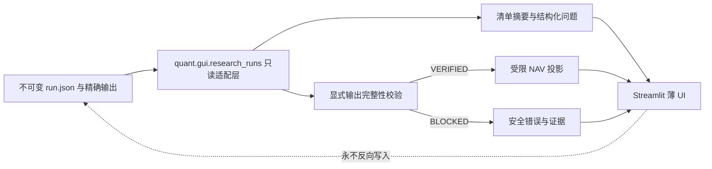

# GUI 产品与技术设计

## 1. 产品定位

GUI 是现有框架之上的“研究工作台 + 运维控制面”，不是第二套数据、因子、策略、回测或交易引擎。首要用户
是研究员；默认页必须在不点击任何控件时回答：

1. 当前有多少份可读轻量研究运行，各自处于什么研究结论；
2. 哪些运行清单自洽，哪些因损坏或危险路径被阻塞；
3. 研究覆盖到什么日期，可按结论和策略怎样快速缩小范围；
4. 选中运行的假设、时间语义、fold、成本压力、指标、caveat 和输出证据是什么。

G0 的核心来源只有不可变 `run.json` 及其列出的精确输出。目录时间、UI 缓存、session state 和图表计算都不
是事实来源。

## 2. 研究员信息架构

### G0 页面

- **运行总览**：运行数、结论分布、最大 `data_end`、异常条目数；提供结论和策略两个高信号筛选器，以及
  运行明细表。
- **运行详情**：展示假设、策略/版本、universe、数据窗口、`close → next_session_open → close`、fold、
  成本倍数、聚合指标、caveat、input/output 摘要。
- **证据钻取**：用户显式触发输出完整性校验；只有通过后才加载 1.0× 成本 NAV 曲线和有限明细。

### 后续候选页面

数据中心、因子实验室、策略实验室、运行中心、结果/报告、晋级治理、运维中心分别排入后续任务。它们需要
受控注册表、持久化 Job/Run repository、外置 worker、权限与审计，不在 G0 用占位按钮伪装完成。

## 3. 架构

### 组件职责

- `research_runs.py`：唯一文件访问层；固定根、直接子目录、严格 V1 清单重建、身份校验、精确输出校验和
  有界 NAV 投影。
- `app.py`：只编排视图与用户选择，不计算领域指标，不保留权威任务状态。
- `launcher.py`：构造本地回环地址启动命令；缺依赖时清晰失败，不自动安装。
- `python -m quant.gui`：唯一包级入口；不要求修改共享项目脚本表。

## 4. 可信度与状态模型

| 层级 | 显示语义 | 必要证据 | 明确不代表 |
| --- | --- | --- | --- |
| Catalog issue | 条目不可安全解释 | 稳定问题码与安全摘要 | 运行失败原因已被修复 |
| Manifest valid | 清单自洽 | 规范 JSON、V1 dataclass、目录/内容身份一致 | 输出仍存在且未篡改 |
| Outputs verified | 输出完整性已验证 | 无链接/重解析点、精确文件树、size/SHA-256 匹配 | formal/PAPER 准入 |
| NAV projected | 已显示受限 NAV | 完整性通过、必要列/类型/有限正数通过 | GUI 重算或认可研究结论 |

异常必须显式显示 `partial` / `blocked` / `not available`，不能退化为空图或静默跳过。catalog 中一个坏运行
不能拖垮全部列表，但坏运行绝不能进入可信摘要。

## 5. 路径与产物安全

- 固定读取 `<artifact_root>/research/runs`，只接受 64 位小写十六进制直接子目录；不递归发现别处运行。
- 根、运行目录、清单、输出和中间目录均拒绝 symlink、junction 与 Windows reparse point；不解析其目标。
- 输出路径必须是规范 POSIX 相对路径，无反斜线、绝对路径、`.` 或 `..`。
- 输出集合必须与清单精确相等，另加唯一 `run.json`；额外临时文件也会阻塞完整性。
- JSON 必须与项目 canonical encoder 的字节结果一致；run identity 按现有轻量研究合同计算，不自创弱化版本。
- NAV 读取只在完整性通过后发生；限定文件名、所需列和最大投影行数，避免 UI 意外加载任意或无限数据。
- G0 同步完整性校验总量固定为 128 MiB；超限保持 `BLOCKED`，未来由外置 verifier 处理。

## 6. UI 与运行安全

- 页面持续显示“只读、无 PAPER/LIVE 权限”；不出现暗示可晋级或交易的主按钮。
- 普通筛选器只改变投影；完整性校验是显式动作，但仍无外部写副作用。
- 不用 `st.session_state`、缓存或 MLflow tag 保存权威运行状态；G0 不启用缓存。
- Streamlit rerun 只重做有界只读操作；长数据任务、训练和回测未来必须提交到外置、持久化 worker。
- G0 不 import 任一 M2 `run_*` 私有 helper，也不复制策略、回测或准入逻辑；后续运行入口只接另行冻结的
  公共应用服务。
- G0 不建设 catalog 数据库、任务队列、权限框架或 orchestration 抽象；公共运行边界未关闭前不出现发起
  运行能力。性能优化必须由真实 manifest 规模下的可重现延迟/内存证据触发，先基准、后最小优化。
- `artifact_root` 只能由运维侧进程环境/启动参数确定，不接受 URL/query 参数或页面文本框提供任意路径。
- 默认只绑定 `127.0.0.1`；远程共享、鉴权、TLS 和反向代理必须另做安全任务。

## 7. 技术选择与外部框架借鉴

- [QuantConnect LEAN Local Platform](https://www.quantconnect.com/docs/v2/local-platform/key-concepts/features)：借鉴
  project / research / backtest / result 分层、运行历史和代码快照，不采用其市场或准入语义替换本项目合同。
- [Qlib Recorder](https://qlib.readthedocs.io/en/stable/component/recorder.html)：借鉴 Experiment → Recorder、状态、
  params / metrics / artifacts 分层；不可变 `run.json` 仍是本项目事实来源。
- [VeighNa CTA 回测界面](https://www.vnpy.com/docs/cn/community/app/cta_backtester.html)：借鉴模块导航、参数、
  进度、结果图与委托/成交明细的工作流，不在 GUI 动态重载任意策略或复制 Gateway。
- [Streamlit 多页应用](https://docs.streamlit.io/develop/concepts/multipage-apps/overview) 与
  [缓存/执行模型](https://docs.streamlit.io/develop/concepts/architecture/caching)：适合个人 Python 投研首包；
  rerun 与共享缓存边界要求长任务外置、状态持久化、缓存不作权威。
- [Dash 后台回调](https://dash.plotly.com/background-callbacks)：多人、复杂交互和成熟任务基础设施出现后再评估；
  不为未来可能性提前承担 callback/Celery/Redis 复杂度。
- [Panel 异步回调](https://panel.holoviz.org/how_to/callbacks/async.html)：仅在项目形成 HoloViz 技术惯性后作为
  备选。

首期选择 Streamlit 是为了最小学习和维护成本；图表先复用 Streamlit 与 Polars 已有能力，不新增 Plotly。
技术选择的项目级裁决仍由现有调研 SSOT 管理。

依赖被隔离为 optional `gui` group，不进入核心或交易运行时。
[Streamlit 官方仓库](https://github.com/streamlit/streamlit)与包元数据标记 Apache-2.0；该宽松许可证不引入
GPL 类传播要求，分发时仍需履行适用的许可证/NOTICE 义务。未安装 optional group 时，纯 Python 只读
适配层仍可测试，包入口稳定退出码 2 且不会自动安装或启动服务。

## 8. 可运维性设计

- 启动器明确地址、端口、headless 与 artifact root；默认回环地址，不隐式开放局域网。
- 日志不得输出 token、账号或清单原始敏感字段；异常面只展示稳定码和已脱敏路径条目名。
- 坏运行隔离为条目问题；无 runs 根、空目录、全部坏运行都有可操作空态。
- 未来 job 页面必须把排队、运行、失败、取消请求和恢复状态放在持久化 repository，不由 Web session 推断。
- 未来所有副作用都要复用现有 CLI/application service、幂等键、人工确认与审计；UI 只调用受控用例。
