# A 股与港股通个人量化投研交易系统调研

> 调研日期：2026-07-10；Pipeline 路线补充：2026-07-11（Asia/Shanghai）  
> 修订：2026-07-12 第三次修订。新增决策：已购 Tushare Pro 2000 积分并升级为研究主源；交易所官方源继续承担港股通资格、交易安排等最终事实；AKShare/BaoStock 降级为校验与灾备。Token 只存放在 Git 忽略的本地配置。  
> 范围：个人使用、A 股与港股通、先轻量投研再逐步接入实盘  
> 路线决策口径：按全新绿地项目评估，不复用、不迁移、也不受当前目录既有代码、数据和实验结果影响。  
> 本轮动作：仅调研并盘点本项目目录；未移动、删除、归档或改写任何既有代码和数据。

## 1. 结论先行

推荐采用“研究与交易解耦、共享同一数据与订单模型”的组合方案，而不是自行开发一套全包框架：

1. **研究主干：选择 Microsoft Qlib。** 这一选择基于其 A 股截面研究、Alpha158/360、机器学习、滚动训练、组合回测和实验工作流的完整度，而不是基于本地已有资产。Qlib 采用 MIT 许可，适合日频多因子选股和机器学习研究。
2. **快速规则策略：vectorbt 只作为可选实验工具，不作为系统核心依赖。** ETF 轮动、参数扫描和简单择时可以用 vectorbt 快速探索；其 Commons Clause 不是标准宽松开源许可。最终准入回测必须回到统一的市场规则和成本模拟层，避免 Qlib、vectorbt 各自产生不可比较的结果。
3. **行情和实盘：按券商通道现状做条件选择，不再默认 MiniQMT 首选。** 截至 2026-07，多家券商已全面停止 MiniQMT 新申请，存量用户暂可运行但通道处于收缩期；个人程序化通道正向标准版 QMT（本地客户端内置 Python）和恒生 PTrade（云端托管）收敛。本项目当前没有任何量化权限，应按“标准版 QMT → PTrade → MiniQMT（个别券商如仍开放）”的顺序向券商确认 A 股与港股通标的、实时行情、历史数据和 Python 交易权限；所有券商 API 必须包在自有 Gateway 抽象层之后，隔离通道政策变化，不要在确认前绑定任何第三方交易框架。
4. **交易中台：第一版不必引入；需要统一 OMS、风控、算法单和监控时再引入 vn.py。** vn.py 4.4.0 仍在活跃更新，已包含多因子研究、Alpha158、Alpha101、组合策略、纸面账户、风控、TWAP 等能力；但公开列出的股票柜台主要是 A 股，港股通能否通过 XtQuant/具体券商交易必须实际验收。
5. **数据：双源设计。** 历史研究以 Tushare Pro 或券商/XtQuant 为主源，AKShare 为免费补充与交叉校验；交易日历、证券状态、港股通名单、交易规则和公司公告以交易所/中证指数/HKEX 官方为最终依据。不能把任何单一爬虫接口当作生产级唯一来源。
6. **MVP 策略：先做可解释基线。** 优先验证 ETF 趋势轮动、A 股长仓多因子（价值 + 低风险 + 流动性/交易特征）、Alpha158 + LightGBM + Top-k，以及港股通高股息/低波动。暂不从高频、深度学习、强化学习、新闻 NLP 和 A/H 套利起步。

最重要的现实判断是：**系统难点不在“算出信号”，而在时间点正确的数据、退市/停牌/涨跌停/成分变更、真实成本、订单状态一致性和实盘故障保护。** MVP 应先把这些地基做好。

## 2. 目标、边界与原则

### 2.1 MVP 目标

- 支持 A 股、ETF、港股通股票/ETF的日频研究；分钟级仅保留扩展接口。
- 每日自动更新数据、执行质量检查、计算因子和信号。
- 支持因子评价、滚动训练、组合构建、含成本回测、纸面交易。
- 生成“目标仓位—订单建议—成交回报—持仓/资金对账—绩效归因”的闭环。
- 第一阶段默认人工复核并确认下单；纸面稳定后再开启自动执行。
- 所有结果可复现：数据版本、代码版本、参数、训练区间、随机种子和报告均可追溯。

### 2.2 暂不纳入 MVP

- Tick/逐笔高频、Level-2 订单簿、超低延迟执行。
- 融资融券、做空、期权、期货、可转债和场外资产。
- 强化学习、自动挖因子、LLM 新闻交易。
- 多账户、多租户、微服务/Kubernetes、大型实时数仓。
- 用未经许可的网页抓取数据直接驱动实盘。

### 2.3 设计原则

- 研究、回测、模拟和实盘共用同一份策略信号和组合目标定义。
- 数据接入、因子、模型、组合、执行通过清晰接口解耦，可替换不重写。
- 原始数据不可覆盖；清洗数据和派生特征可重建。
- 所有财务数据使用真实披露时间（Point-in-Time），禁止用报告期代替可知时间。
- 默认保守：无法确认能成交时按不能成交处理；费用、滑点和税费按不利方向估计。
- 实盘前必须经过历史回测、样本外、仿真、影子运行和小资金五道门。

### 2.4 程序化交易合规前提（实盘的“第零道门”）

沪深北三大交易所《程序化交易管理实施细则》已于 2025-07-07 正式施行，对个人程序化交易同样适用：

- **先报告、后交易。** 程序化交易投资者须通过开户券商报备账户基本信息、资金信息、交易信息和软件信息，履行报告义务后方可进行程序化交易；信息变更需要更新报备。
- **高频交易认定标准：** 单账户每秒申报、撤单合计 300 笔以上，或单账户全日申报、撤单合计 2 万笔以上。本系统按日频/低频设计，远低于该阈值，不属于高频交易，但**仍属于程序化交易，报备义务不可免除**。
- **异常交易监控：** 交易所对瞬时申报速率异常、频繁瞬时撤单、频繁拉抬打压、短时间大额成交四类行为重点监控。OMS 事前风控应内置当日下单/撤单次数上限，与 3.7 节的风控清单合并实现。
- **落地方式：** 把“完成券商程序化交易报备”列为五道门（回测、样本外、仿真、影子、小资金）之前的第零道门；合规要求与市场规则一样做成带有效期的版本表，规则修订时更新而不是硬编码。

## 3. 系统模块与功能拆分

### 3.1 证券主数据与市场规则

这是全系统的公共基础，不应散落在策略代码中。

- 统一证券标识：`000001.SZ`、`600000.SH`、`00700.HK`，同时保存交易端/数据源代码映射。
- 证券生命周期：上市、退市、暂停上市、代码变更、简称/ST 状态。
- 每日可交易域：A 股市场池、指数历史成分、当日港股通名单；必须是历史时点版本，不能用今天名单回测过去。
- 双交易日历：SSE/SZSE、HKEX，以及港股通可交易日、半日市和交收日。
- 交易单位和价格精度：A 股整手、港股每只证券不同的 board lot、港股价格档位。
- 市场制度：A 股 T+1、涨跌幅、停复牌；港股通 T+0、无个股涨跌幅、每日额度、只允许碎股卖出、T+2 交收、人民币换汇与公司行动差异。
- 公司行动：分红、送转、拆并股、配股/供股、复权因子；价格研究和现金账户核算分开。

截至本调研日，上交所 2026 年修订交易规则已于 2026-07-06 生效，主板风险警示股票涨跌幅等规则发生过调整，因此规则必须做成有效期版本表，不能硬编码一次后永久使用。

### 3.2 数据接入、落库与治理

- 连接器：交易所参考数据、Tushare、AKShare、XtQuant/券商，后续可加 RQData/JQData/Wind/Choice。
- 调度：全量初始化、每日增量、失败重试、限频、断点续传、补数。
- 分层：`raw` 原始响应、`clean` 标准表、`feature` 因子/标签、`mart` 回测和报表。
- 幂等：同一数据日期重复运行不产生重复行；更正数据有版本号与审计记录。
- 质量检查：唯一键、时间连续性、OHLC 合法性、成交量/金额单位、异常跳点、复权连续性、跨源差异、缺失率和延迟。
- 数据血缘：记录来源、接口、抓取时间、参数、校验和、清洗版本。
- 建议存储：MVP 使用 Parquet + DuckDB；研究框架需要时生成 Qlib bin。SQLite 只存配置、任务和订单元数据，不承载大规模行情。

核心标准表至少包括：

| 表 | 关键字段 |
|---|---|
| `instrument` | symbol、market、currency、list/delist date、board lot、status |
| `trade_calendar` | market、date、is_open、is_connect_open、is_half_day |
| `bar_1d` | symbol、trade_date、不复权 OHLC、volume、amount、累计后复权因子、source |
| `adjust_factor` | symbol、effective_date、累计后复权因子、source |
| `corporate_action` | ex_date、action type、cash/share ratio、announce time |
| `financial_pit` | symbol、period、announce_time、revision、statement fields |
| `universe_membership` | universe、symbol、effective_from/to |
| `factor_value` | date、symbol、factor、value、factor_version |
| `target_weight` | as_of、strategy/version、symbol、weight |
| `order/fill/position/cash` | broker ids、状态、价格、数量、费用、时间戳 |

### 3.3 研究环境与实验管理

- Notebook 只做探索和展示；稳定逻辑下沉为可测试的 Python 包。
- 配置化数据区间、股票池、因子、标签、模型、成本和组合约束。
- MLflow 记录参数、指标、模型、预测、组合报告和数据快照 ID。
- 因子/模型注册表：名称、公式、依赖字段、方向、版本、作者、有效期。
- 自动生成研究报告，包含数据范围、样本量、缺失率、IC、换手、分组收益、成本后结果和失败原因。

### 3.4 因子工程与因子评价

- 因子计算：价量、波动率、流动性、反转/动量、估值、质量、成长、分红、分析师/资金流（有可靠数据后）。
- 清洗：去极值、缺失处理、截面标准化、行业/市值中性化；所有拟合参数只能在训练期获得。
- 标签：未来 1/5/20 日收益、相对基准收益；信号可知时间与成交时间明确分离。
- 单因子检验：Pearson/Spearman IC、ICIR、分位数组合、单调性、多空差、胜率、换手、容量、行业和市值暴露。
- 稳健性：滚动窗口、不同市场阶段、不同股票池、不同调仓频率、成本敏感性、参数扰动。
- 冗余控制：相关性聚类、VIF/共线性、增量 IC、模型特征重要度稳定性。

### 3.5 策略与模型

- 统一策略接口：输入 `as_of` 可知数据，输出目标权重和原因；不得直接操作券商 API。
- 规则策略：ETF/行业轮动、趋势过滤、低波/高股息、多因子打分。
- 机器学习：先 Lasso/LightGBM，再考虑 MLP/时序模型；必须滚动训练。
- 组合构建：等权/分数权重、行业和个股上限、换手惩罚、最小交易金额、现金缓冲。
- 基准：A 股按股票池匹配 CSI300/500/1000；港股通按实际可投资基准和人民币收益口径。
- 组合优化属于后续项；MVP 用透明约束规则通常更稳健。

### 3.6 回测与验证引擎

- 时间正确性：信号时点、下单时点、成交价、财报披露时点和指数成分生效日。
- A 股撮合：T+1、涨跌停不可成交、停牌、100 股整手、最小佣金、印花税和过户费。
- 港股通撮合：T+0、board lot、碎股限制、增强限价盘、费用、换汇、额度/交易日、T+2 交收。
- 成本：双边佣金、税费、平台费用、滑点、冲击成本；按券商最新费率配置并带有效期。
- 数据偏差：幸存者偏差、未来函数、前视复权、指数成分后视、退市遗漏。
- 验证：训练/验证/测试、walk-forward、purged/embargo（标签重叠时）、参数稳定性、压力测试。
- 输出：收益、超额、波动、Sharpe/Sortino/Calmar、最大回撤及持续期、换手、成本、容量、暴露、持仓和逐笔交易。

实现时，停牌、涨停和跌停必须由带来源的显式日状态输入，不得由“成交量为零”或
缺失行情猜测。A 股卖出准入使用已交收可卖数量落实 T+1；股票成本按方向拆分为
双边佣金、双边过户费和卖出印花税，数值及有效期仍以 `configs/` 为 SSOT。
规则依据包括[上交所交易规则](https://www.sse.com.cn/lawandrules/sselawsrules2025/stocks/exchange/c/c_20250519_10779396.shtml)
以及[财政部、税务总局 2023 年第 39 号公告](https://shanxi.chinatax.gov.cn/web/detail/sx-11400-545-1780448)；
实盘前还需用开户券商交割单校准佣金和代收费用。

### 3.7 纸面交易、订单管理与执行

- 目标仓位转订单：当前持仓与目标权重差异、现金、整手、最小金额、卖出可用量。
- OMS 状态机：创建、已报、部分成交、全成、撤单中、已撤、拒单；券商订单 ID 幂等映射。
- 预交易风控：标的资格、交易时间、价格范围、数量、现金、可卖量、单票/行业/组合上限、当日下单和撤单次数。
- 执行算法：MVP 为限价/被动拆单；后续增加 TWAP/VWAP/尾盘执行。
- 对账：启动时、盘中和收盘后核对资金、持仓、订单、成交；券商状态为准，异常时只减仓不加仓。
- 人工控制：总开关、仅卖出、冻结证券、取消全部订单、人工确认队列。

### 3.8 调度、监控、日志与报表

- 日前：交易日检查、数据更新、质量门禁、模型/信号生成、目标仓位审核。
- 盘中：连接心跳、行情延迟、订单积压、拒单、成交偏差、风险阈值。
- 盘后：对账、净值、归因、交易成本、异常报告、数据补齐。
- 结构化日志，密钥脱敏；错误、预警和审计日志分开。
- 通知：本地/邮件/微信均可，但通知失败不能阻塞风控与撤单。
- 备份：配置、证券主数据、订单/成交、策略产物必须备份；原始行情可按来源恢复时降低备份等级。

### 3.9 配置、安全与测试

- 券商账号、token、密码不写入 Git、Notebook、日志或 MLflow；使用环境变量/系统凭据库。
- 研究和实盘配置物理分离，实盘默认关闭自动下单。
- 单元测试：复权、成本、整手、T+1、涨跌停、港股 board lot、状态机。
- 集成测试：数据源沙盒、纸面账户、券商查询/下单/撤单/重连。
- 回归测试：固定小数据集和“黄金结果”，框架或规则升级后对比。
- 故障演练：断网、终端退出、重复回报、部分成交、进程重启、时钟偏差和数据延迟。

### 3.10 端到端 Pipeline 全景与模块边界

轻量系统不等于缺少模块，而是把模块保留为清晰接口、尽量在一个进程和一台机器内运行。完整 Pipeline 可分为数据面、研究面、交易面和运维面：

```mermaid
flowchart LR
    subgraph DATA["数据面"]
        A["交易所 / 数据商 / 券商"] --> B["采集与增量同步"]
        B --> C["Raw 不可变原始层"]
        C --> D["标准化 / 复权 / PIT"]
        D --> E["质量门禁"]
        E --> F["Parquet + DuckDB / Qlib 数据集"]
    end

    subgraph RESEARCH["研究面"]
        F --> G["股票池 / 因子 / 标签"]
        G --> H["模型或规则策略"]
        H --> I["预测分数 / 交易信号"]
        I --> J["组合构建与目标权重"]
        J --> K["含成本与市场约束回测"]
        K --> L["实验记录 / 归因 / 报告"]
    end

    subgraph TRADING["交易面"]
        J --> M["目标仓位快照"]
        M --> N["差量订单生成"]
        N --> O["事前风控"]
        O --> P["OMS / EMS"]
        P --> Q["券商通道 Gateway：QMT / PTrade / MiniQMT"]
        Q --> R["委托 / 成交 / 资金 / 持仓"]
        R --> S["对账与账本"]
        S --> L
    end

    subgraph OPS["运维面"]
        T["调度 / 配置 / 密钥 / 日志 / 监控 / 告警 / 测试 / 备份"]
    end

    T -.治理.-> DATA
    T -.治理.-> RESEARCH
    T -.治理.-> TRADING
```

各模块最关键的输入和输出如下。只要这些契约稳定，内部工具可以替换：

| 阶段 | 输入 | 核心职责 | 标准输出 |
|---|---|---|---|
| 证券主数据 | 交易所、券商、指数公司文件 | 统一代码、上市状态、历史成分、交易单位、规则有效期 | `instrument`、`universe_membership`、`trade_calendar` |
| 数据采集 | API/文件/行情订阅 | 全量与增量下载、限频、重试、幂等、原始响应留档 | 带来源和抓取时间的 raw 数据 |
| 标准化与质量 | raw 数据 | 字段映射、单位、复权、PIT、缺失/异常/跨源检查 | clean Parquet + 质量报告 |
| 特征与因子 | clean 行情、财务、股票池 | 因子计算、去极值、标准化、中性化、标签生成 | `(as_of, symbol, factor/value/label)` |
| 模型/规则 | 因子与标签 | 拟合、滚动训练、参数搜索或规则计算 | `score` 或离散信号，不直接下单 |
| 组合构建 | score、风险暴露、当前持仓 | 排名、权重、行业/个股/换手/现金约束 | `target_weight` 快照 |
| 回测 | 目标权重、行情、规则、成本 | 时间推进、撮合、账户与公司行动模拟 | orders、fills、positions、NAV、metrics |
| 订单生成 | 目标权重、实盘持仓、现金 | 权重转股数、整手、最小金额、差量和顺序 | `order_intent` |
| 风控/OMS/EMS | order intent、行情、账户 | 合法性、状态机、拆单、撤单、重试、幂等 | broker order + 本地订单事件 |
| Gateway | 标准订单/查询命令 | 转成券商 API，接收异步回报 | 标准化委托、成交、持仓、资金事件 |
| 对账与账本 | 券商回报、本地事件 | 以券商为准核对订单、成交、现金、持仓和费用 | 可审计账本、差异和修复动作 |
| 报告与监控 | 研究/交易/系统事件 | 绩效、归因、数据新鲜度、连接和风险状态 | HTML/仪表盘/可执行告警 |

### 3.11 Qlib、vectorbt、券商通道在 Pipeline 中的位置

三者负责不同层次，不应当作三选一：

| 工具 | Pipeline 位置 | 它擅长做什么 | 它不负责什么 | 本项目定位 |
|---|---|---|---|---|
| **Qlib** | clean 数据之后的研究面：因子/标签、数据集、模型、预测、组合回测、实验分析 | 截面因子与机器学习工作流；Alpha158/360；LightGBM/深度模型；TopkDropout；训练/验证/测试；通过 MLflow 保存实验 | 原始数据治理、港股通主数据、可靠实盘 OMS、券商重连、资金/持仓对账 | **A 股截面投研主引擎**。输出预测分数或目标权重，不能直接成为实盘账户的唯一状态源 |
| **vectorbt** | 研究面的规则策略、信号矩阵、快速参数扫描和向量化回测 | ETF 轮动、技术择时、多参数批量实验、费用/滑点敏感性、交互图表 | 高保真 A 股/港股通事件规则、财务 PIT、券商接入、订单状态机、实盘恢复 | **规则策略快速试验台**。通过统一 `target_weight` 接口与 Qlib 汇合，不进入实盘进程 |
| **券商通道（QMT/PTrade/MiniQMT 存量）** | 数据面最前端和交易面最末端：券商行情、账户和交易 Gateway | 获取券商授权行情；查询资金/持仓/委托/成交；下单、撤单、接收异步回报 | 因子研究、严谨历史回测、实验管理、跨源数据治理、本地 OMS 审计和组合决策 | **券商适配器和最终交易通道**。2026-07 起 MiniQMT 停止新申请，具体通道以券商验收为准；外面必须包一层自己的标准 Gateway、风控、幂等和对账，使换通道不影响策略与组合层 |

一个典型的日频工作日流程是：

1. 调度器在收盘后从 Tushare/交易所/券商增量更新数据。
2. Pandera/自定义检查通过后写入 Parquet，并导出 Qlib 所需格式。
3. Qlib 生成股票截面分数；vectorbt/规则模块生成 ETF 策略目标权重。
4. 组合层合并策略预算，输出唯一的目标仓位快照。
5. 次一交易日前或指定时点，订单生成器读取券商通道的真实持仓并计算差量订单。
6. 风控通过后，OMS 将标准订单交给券商通道适配器（QMT/PTrade/MiniQMT）；适配器只负责与券商通信。
7. 成交回报进入本地账本并与券商资金/持仓对账，结果回流报告和下一轮组合计算。

必须避免以下错误边界：

- 让 Qlib 策略代码直接调用 `xttrader.order_stock` 或任何券商下单 API，导致研究与实盘耦合。
- 把券商通道返回的历史数据直接喂给模型而没有版本、质量和复权检查。
- 把 vectorbt 的向量化成交结果当作港股通真实可成交结果。
- 同时让 Qlib、vectorbt 和交易进程各自维护一份“当前持仓”。真实持仓只能以券商 + 本地对账账本为准。

### 3.12 各模块的可选工具对比

以下列出对个人 A 股/港股通系统有现实意义的主要选项。不是每一项都要安装；MVP 应选择每行最轻的一种。

#### 3.12.1 数据源与券商接入
