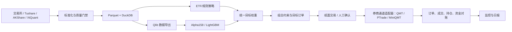

| 项目 | 适用部分 | 优点 | 主要限制 | 建议 |
|---|---|---|---|---|
| [Microsoft Qlib](https://github.com/microsoft/qlib) | 因子、ML、信号、组合回测 | MIT；A 股示例成熟；Alpha158/360 与 LightGBM workflow 完整；官方 dump 工具可读取 CSV/Parquet 导入源 | 不是面向个人券商的可靠 OMS；需自备 PIT 数据；当前 WSL base Python 3.13 无可安装 `pyqlib` 发行包；最终回测仍需本项目规则 | **保留为 M3 研究适配器，先过兼容门禁** |
| [vn.py](https://github.com/vnpy/vnpy) | 研究、交易网关、OMS、组合策略、算法单、风控、监控 | MIT；活跃；4.4.0（2026-05，新增微信通知、QuestDB 时序库支持）；Alpha158/101、Lasso/LightGBM/MLP、纸面账户、TWAP 等较全 | 组件较多；股票柜台权限受券商约束；公开文档不能证明任意券商的港股通可直接交易 | **第二阶段交易中台候选** |
| [XtQuant/MiniQMT](https://dict.thinktrader.net/nativeApi/start_now.html) | 券商行情与实盘 API | 与券商终端连接，本地 Python 直连，最接近个人 A 股/港股通实际账户 | **2026-07 起多数券商停止新申请，存量收缩**；Windows/终端/券商版本依赖；权限和覆盖必须向券商验收 | 仅存量用户；新用户按 QMT/PTrade 评估，先确认券商 |
| [RQAlpha](https://github.com/ricequant/rqalpha) | 中国市场事件驱动回测 | 模块化、风控/成本/分析完整，2026 仍有发布 | 仅限非商业使用；港股通支持需额外工作；与 Qlib 研究链路存在功能重叠 | 备选，不作为主干 |
| [WonderTrader](https://github.com/wondertrader/wondertrader) | 高性能一体化回测与执行 | C++ 内核、SEL 多因子、数据伺服、风控、调度齐全 | 架构和运维重，MVP 明显过度；券商/港股通接入仍要验证 | 后续高性能需求再评估 |
| [Hikyuu](https://github.com/fasiondog/hikyuu) | A 股研究与组合策略 | C++/Python、国内市场适配较深、可扩展 QMT | 与既有 Qlib 资产重叠；港股通闭环需验证 | A 股规则研究备选 |
| [vectorbt](https://github.com/polakowo/vectorbt) | 快速向量化策略、参数扫描 | 高速、费用/滑点/组合统计丰富、适合 ETF 轮动 | Commons Clause；不负责真实券商执行；复杂成交规则需自己建模 | 轻量规则策略可用 |
| [Backtrader](https://github.com/mementum/backtrader) | 教学和事件驱动回测 | 简单、生态资料多 | 原主线老化；A 股/港股通细则与数据需大量定制 | 不建议作为新主干 |
| [Zipline Reloaded](https://github.com/stefan-jansen/zipline-reloaded) | 通用事件驱动回测 | 活跃维护、Apache-2.0、Pipeline 思路成熟 | 默认美国市场语义，A 股/港股通日历和撮合改造较多 | 不优先 |

### 推荐的组合边界

- **Qlib 负责**：读取单向派生的 provider、Alpha158 特征、DatasetH 切分和模型研究；其 Top-k 回测与 recorder 仅作诊断。
- **MLflow 负责**：版本化实验元数据和 artifact 登记；标准预测、目标权重和报告仍独立保存。
- **轻量策略层负责**：ETF 轮动、高股息低波等规则型策略和统一目标权重输出。
- **自有薄层负责**：证券主数据、市场规则、双源数据标准化、组合约束、目标订单、对账和审计。这部分是业务差异，无法完全外包给框架。
- **券商通道（QMT/PTrade/MiniQMT 存量）负责**：券商行情、资金/持仓/订单/成交查询和实盘指令。
- **vn.py 可在后续负责**：统一事件引擎、OMS、风控、算法单、纸面账户和监控；是否引入取决于所选券商通道的适配验证结果。

不要同时维护 Qlib、vn.py、RQAlpha、Backtrader 和 WonderTrader 五套策略语义。MVP 最多保留 Qlib + 一套轻量规则回测 + 一个券商适配器。

当前 Qlib 0.9.7 官方仅支持 Python 3.8–3.12，PyPI 也只发布到 CPython 3.12 wheel；项目 WSL base 为
Python 3.13，因此不采用不受支持的 Qlib 源码硬装。`py312` 是当前需要 Python 3.12 的工具隔离环境，已完成
Qlib 0.9.7 官方 wheel、关键 import、依赖与 readiness 验收；完整数据/provider Gate 尚未运行。具体通用环境
边界、G0/G1 决策、工具哈希和取数计划见
[`docs/archive/2026-07至09_多Agent治理期/framework/M3实施与Agent交接.md`](../../archive/2026-07至09_多Agent治理期/framework/M3实施与Agent交接.md)（已归档冻结）。

### 4.8 港股通名单与日历的落地口径（2026-07-11）

- **名单不是历史成分。** 上交所、深交所网页提供的是当前名单；历史可投资域应采用“某日官方基线快照 + 此后官方调入/调出事件”重建，并明确基线日前不可知，不能用今日名单回测过去。
- **双路由分别建模。** 同一只港股可能分别属于沪港通或深港通，clean 层使用 `SH_CONNECT` / `SZ_CONNECT`，不合并成一个无来源的 `HK_CONNECT` 布尔值。
- **官方机器源与年度通告。** 上交所名单与调整事件来自 `query.sse.com.cn/commonQuery.do` 的官方查询；深交所名单/调整来自 `api/report/ShowReport`，日历来自 `api/report/exchange/ggtrl`。香港基础日历用 Tushare 提供逐日底表，并以 HKEX 年度证券市场通告强制复核全日休市、补齐半日市；通告结构化配置保留 URL、文号和发布日期。所有接口响应先进入不可变 raw，再映射为 snapshot/event/calendar 契约。
- **交易日历不可简单取交集。** 港股通服务日还受新增交易日、半日市和交收安排影响。深交所提供逐日机器日历；上交所目前以年度与节假日公告为权威来源，在公告解析与复核完成前，不用深港通日历冒充沪港通日历。
- **日历必须做关系审计。** 除单表 Schema 外，还要验证沪/深路由状态及半日市差异，并保证任一港股通开通日对应的内地路由市场和香港市场同时开市。2026 年审计结果为双路由差异 0、基础市场违规 0。
- **快照与事件语义。** `snapshot_date` 表示官网当前名单的发布日期；事件以 `effective_date` 为准。上交所说明若名单更新日不是港股通交易日，实际从下一个港股通交易日起适用，回测重建应遵循公告而非网页抓取时间。

官方入口：[上交所港股通标的名单](https://www.sse.com.cn/services/hkexsc/disclo/eligible/)、[上交所标的调整](https://www.sse.com.cn/services/hkexsc/disclo/eligiblead/)、[深交所标的名单](https://www.szse.cn/szhk/hkbussiness/underlylist/)、[深交所交易日历](https://www.szse.cn/szhk/hkbussiness/tradecalendar/)、[HKEX Stock Connect 交易日历资料](https://www.hkex.com.hk/Mutual-Market/Stock-Connect/Reference-Materials/Trading-Hour%2C-Trading-and-Settlement-Calendar?sc_lang=en)。

## 5. 数据源调研

### 5.1 可靠性分层

| 层级/来源 | A 股 | 港股/港股通 | 成本与稳定性 | 推荐用途 |
|---|---:|---:|---|---|
| [SSE](https://www.sse.com.cn/)、[SZSE](https://www.szse.cn/)、[HKEX](https://www.hkex.com.hk/)、[中证指数](https://www.csindex.com.cn/) | 是 | 是 | 官方“黄金源”；批量历史/实时深度数据常需授权或付费 | 规则、日历、证券状态、通名单、公告、指数成分核验 |
| 券商通道（QMT/PTrade/MiniQMT 存量） | 是 | 取决于券商权限 | 对实盘最可靠；历史长度和字段需验收；MiniQMT 已停止新申请 | 实时行情、账户、订单成交；可作近期历史主源 |
| [Tushare Pro](https://tushare.pro/document/2) | 覆盖广 | 有港股日线/复权/财务/日历 | 已购 2000 积分；统一、易增量；港股行情/复权另有权限和低频限制 | **当前历史研究主源**，但港股复权尚未开通 |
| [AKShare](https://github.com/akfamily/akshare) | 广 | 有港股公开源接口 | MIT 库免费，但数据来自公开网页，接口可能因上游变更而删除 | 免费补充、原型、交叉校验，不作实盘唯一源 |
| [BaoStock](https://www.baostock.com/) | 日线/财务，免费 | 基本不覆盖 | 免费、接口简单，更新与字段有限 | A 股备用校验/教学 |
| RQData/JQData | 强 | 需逐项确认 | 商业服务，数据治理和 PIT 通常更好 | 若时间价值高，可替代大量自建清洗 |
| Wind/Choice/iFinD | 强 | 强 | 昂贵、授权严格 | 预算充足时作为专业主源 |

### 5.2 已决策的分阶段数据路线（2026-07-12 更新）

**第一阶段（当前）：**

- A 股行情/复权/日历/股票列表：Tushare Pro 为研究主源；BaoStock 与 AKShare 做交叉校验和降级。Tushare 日线的手/千元必须映射为股/元，长区间必须切片避免接口行数上限。
- 港股基础信息与市场日历：Tushare 2000 积分接口可用；`hk_daily` 当前账号限频 1 次/小时，`hk_adjfactor` 无权限，因此港股研究暂只可验证不复权行情，不能形成复权收益基线。
- ETF：Tushare `etf_basic` 要求 8000 积分、`fund_daily` 要求 5000 积分，当前套餐不可用；MVP 继续使用 BaoStock/交易所数据并做核心 ETF 覆盖审计。升级积分应由策略需求触发，而不是为了统一供应商。
- 日常增量调用按交易日批量取全市场后本地筛选，尤其港股不能按证券逐只调用；历史单证券区间则按行数上限切片。raw 成功而下游失败时从 raw 重处理，避免重复消耗低频额度。
- 主数据/规则/港股通名单：交易所和中证指数官方为最终依据。
- 财务/基本面因子仍暂缓：即使 Tushare 可取财务表，也必须先建立公告披露时间、版本修订和 PIT 门禁，不能按报告期直接回填。
- **所有连接器实现统一的 `BaseConnector` 原始采集接口**；raw 原样留档后由独立 mapper 映射到 clean Schema，换源不改 clean 层以下代码。
- `bar_1d` 保存不复权价格；canonical `adj_factor` 为累计后复权因子，研究价格按两者相乘得到，账户核算仍使用不复权价。

**第二阶段（流程跑通、准备实盘时升级）：**

- 若要开展港股复权研究，单独购买/开通 `hk_adjfactor` 权限并核验限频；否则继续使用官方公司行动或其他合规数据源。
- 券商通道行情作为实时与近期历史源。
- 每日对主源/交易源的收盘价、成交量、复权因子、交易状态做差异报告。
- 预算进一步允许时再评估 RQData/JQData 替代自建清洗。

### 5.3 Tushare MCP 是否接入

**当前不接入生产数据管道。** Tushare MCP 适合让 AI 工具通过自然语言临时查数、选择接口和生成分析；本项目的数据流水线要求确定参数、raw 原始留档、字段契约、限频重试、质量门禁和可重复执行，直接 Python SDK/HTTP 连接器更合适。

另外，MCP 地址本身携带 Token，容易出现在客户端配置、诊断日志、截屏或工具元数据中。当前 Token 只存放在 Git 忽略的 `configs/tushare.local.toml`，不复制到项目级 MCP 配置。未来若确有“智能体临时查数”需求，可在用户级私密配置中单独启用 MCP，但其返回只能作为探索证据，正式数据仍须通过连接器进入 raw/clean 流程。参考：[Tushare MCP 官方说明](https://tushare.pro/document/1?doc_id=463)。

### 5.4 必须向券商确认的清单

**通道与准入（2026-07 新增，最优先确认）：**

- 是否仍受理 MiniQMT 新申请（截至 2026-07 多数券商已停止；如已停，直接评估下两项）。
- 标准版 QMT 是否开放、资金门槛（2026 年部分券商已降至 10 万日均资产）、是否支持文件单/HTTP 等外部程序对接方式。
- PTrade 是否开放、是否支持港股通、云端环境的 Python 版本与第三方库限制。
- 程序化交易报备的流程、材料和时限（先报告、后交易，见 2.4 节）。

**所选通道的能力验收：**

- 所选通道是否同时开放 A 股和港股通 Python 交易权限。
- 港股通证券代码、board lot、可买/只可卖状态能否查询。
- 港股通实时行情级别、延迟、历史日线/分钟覆盖和复权方式。
- 是否支持增强限价盘、碎股卖出、撤单、部分成交回报。
- 终端是否必须登录常驻，断线重连和 token/会话有效期。
- 仿真环境是否支持股票/港股通，还是只能用本地纸面撮合。
- 佣金、平台费、印花税、交易征费、换汇价差的账户真实口径。

### 5.4 数据质量门禁

以下任一项失败时，不生成新买入订单：

- 主交易日历或港股通名单缺失/过期。
- 最新交易日行情未齐、重复键、OHLC 不合法、成交量单位异常。
- 主源与券商源价格差超过阈值且无法解释（复权口径除外）。
- 证券状态、复权因子或公司行动出现未审核的大范围变化。
- 财务因子使用了晚于 `as_of` 的披露记录。
- 模型输入缺失率或横截面覆盖低于阈值。

## 6. 成熟因子库与可直接验证的策略

### 6.1 可直接复用的因子集合

1. **Qlib Alpha158：首选基线。** 包含 K 线形态、价格/成交量滚动统计、波动和量价特征；优点是配置、模型和基准结果完整，适合作为绿地项目的第一套可复现实验。
2. **Qlib Alpha360：扩大价量历史窗口的机器学习特征。** 维度更高、计算和过拟合风险更大，放在 Alpha158 基线稳定之后。
3. **WorldQuant 101 Formulaic Alphas：作为候选库，不作为“已保证有效策略”。** 论文给出 101 个明确公式；vn.py 4.3 起已有 Alpha101 数据集，可免去手工翻译。必须在 A 股/港股通重新检验方向、换手和成本。
4. **vn.py Alpha158/Alpha101：若后续选择 vn.py，可直接复用其 Polars 表达式、因子分析和训练流水线。** 不建议同时维护一份 Qlib 公式和一份自有重复实现，需选一个权威实现并做一致性测试。
5. **基本面风格库：** 价值（EP/BP/FCFP/股息率）、质量（ROE/毛利率/应计、杠杆）、成长（收入/利润增长）、低风险（波动率/beta/特异波动）、流动性/交易特征。关键不在公式，而在 PIT 财务数据和中性化。
6. **TA-Lib/Pandas TA：** 适合作为技术特征工具箱，不应把大量技术指标直接当作独立策略结论。

Alphalens 能提供 IC、分组收益、换手等经典分析，但原项目最后版本较老；新系统可借鉴其方法，优先使用 Qlib/vn.py 自带分析或维护中的兼容分支，不必强依赖原包。

### 6.2 推荐按顺序验证的策略

#### S0：买入持有与等权基线

- 对每个股票池和 ETF 池建立买入持有、等权月调仓基线。
- 用来检查收益口径、复权、费用、交易日和报告是否正确。
- 成交和账户估值必须使用不复权价格；总回报序列只用于现金分红还原与独立收益核对。基线至少同时输出费用、滑点、整手现金残差和不含成本对照。
- 指数源应先与指数公司公开事实表在固定日期对账，再用于 ETF 跟踪比较；本项目以[中证指数 2026-03-31 沪深300事实表](https://oss-ch.csindex.com.cn/static/html/csindex/public/uploads/indices/detail/files/en/000300factsheeten.pdf)的 YTD 收益作为首个黄金检查点。
- 没有这一步，复杂策略的“高收益”无法判断是 alpha 还是数据错误。

#### S1：现有 ETF 趋势轮动修正版

- 候选池分为宽基/行业/港股主题，避免随意混入事后表现好的资产。
- 收益口径统一使用“不复权收盘价 + 除息日每份现金分红再投资”构造的总回报指数，并与账户核算用不复权行情物理分离。不得在同一截面混用供应商 HFQ 与总回报序列；本地 124 个重叠观测验证显示两者平均绝对日收益差约 13.58bp。
- 信号：20/60/120 日动量、回归斜率 × R²、波动调整动量；增加绝对趋势/现金过滤。
- 调仓：周频或月频；次日开盘/VWAP 成交；计入佣金、滑点、ETF 申赎以外的二级市场费用。
- 用 walk-forward 选择参数，不能在全样本上挑最优 N。
- 对规则策略，“训练期”只作为因子预热历史；参数只能在随后验证期选择并在测试期冻结。必须逐折报告，不能用跨折复合收益掩盖某一折转负；若候选池在历史测试结束后才冻结，还应单列后见偏差，不能称为真正前向样本。
- 绿地实现必须明确“收盘后计算、下一可交易时点成交”，计入费用和滑点，并预先冻结候选池；不能使用同收盘价成交或事后挑选资产。

#### S2：A 股长仓多因子打分

- 股票池：CSI300/500/1000 的历史成分；剔除新股、长期停牌、流动性不足和当日不可买证券。
- 因子：价值 + 低风险 + 流动性/交易特征为第一组；质量作为组合分散项；普通价格动量需谨慎。
- 行业和市值中性，月度/双周调仓，持有 30–100 只，个股和行业上限，换手惩罚。
- 公开研究对 2000–2019 年 A 股的 32 类异常检验发现，价值、低风险和交易类异常证据较强，传统规模、质量和过去收益证据较弱，但残差动量/反转较强。因此不要照搬美股“价值 + 质量 + 动量”的默认权重。

#### S3：Alpha158 + LightGBM + Top-k

- 以 Qlib 官方 LightGBM/Alpha158 配置为可复现起点，但重新建立独立代码、配置、数据快照和测试，不引用项目目录中的旧 Notebook。
- 标签先用未来 5 或 10 日相对收益，避免每日高换手；训练/验证/测试按时间切分并滚动更新。
- 输出预测分数后使用 Top-k + Drop 或带换手惩罚的目标权重。
- 评估重点是样本外 IC/ICIR、成本后超额、换手、不同市场状态稳定性，而不是训练集拟合度。

#### S4：港股通高股息/低波动

- 股票池必须是每日历史港股通可买列表，并处理 HKD/RMB 收益、股息税费、board lot 和流动性。
- 因子：股息率、盈利/现金流覆盖、低波动、流动性、估值；行业和市值约束。
- 避免只按高股息排序形成地产/金融集中；股息数据必须按公告与除息时间处理。

#### 后续实验，不进 MVP

- 残差反转/残差动量：需要严格风险模型和高换手成本评估。
- A/H 溢价与跨市场相对价值：港股通不可做空、汇率和双市场交易日使其更像择时/配置而非无风险套利。
- 新闻、公告、北/南向资金、分析师预期：先解决授权、时间戳和文本可知时间。
- 深度学习/强化学习：只有在简单基线长期稳定、数据量和交易约束建模充分后再做。

### 6.3 统一验证协议

- 冻结研究假设和候选池，再运行样本外；保留所有失败实验。
- 至少分训练、验证、测试三段，最终测试段只能使用一次；之后用滚动 walk-forward。
- 报告含成本前/后两套结果，并做 0.5×、1×、2× 成本压力测试。
- 与同股票池等权、匹配指数、简单因子基线比较。
- 参数小幅变化应保持方向，不能只在单点最优。
- 按牛/熊/震荡、大小盘、行业、流动性分组评估。
- 检查容量：单笔金额/日成交额、参与率、涨跌停和连续停牌。
- 多重检验：大量因子搜索时采用 FDR/Deflated Sharpe/白现实检验等控制数据挖掘偏差。
- 实盘门槛应预先定义，例如连续纸面交易、无对账差异、无严重风控故障、样本外指标和回撤达标；阈值由个人风险承受力决定。

## 7. 轻量化 MVP 方案

### 7.1 建议架构

### 7.2 MVP 必做功能

- A 股与港股通证券主表、双日历、历史股票池。
- 日线行情、复权、公司行动、基础财务（若有可靠 PIT 数据）。
- Parquet/DuckDB 数据仓与 Qlib 导出。
- 数据增量任务和质量门禁报告。
- Qlib Alpha158 + LightGBM + Top-k 基线。
- 修正后的 ETF 轮动基线。
- 含 A 股/港股通约束与费用的日频回测。
- 统一目标仓位、订单建议、纸面成交和盘后对账。
- MLflow 实验、日报、异常通知、配置和密钥隔离。

### 7.3 分阶段迭代

**阶段 A：数据与可复现研究**

- 从 Tushare Pro 主源初始化 A 股日线、复权、三地日历和股票主表，交易所官方源初始化港股通资格/服务日；AKShare/BaoStock 做校验与降级。记录来源、字段、许可、复权和 PIT 口径并完成质量报告。
- 建统一证券代码、日历、历史股票池和费用配置。
- 将 Notebook 稳定逻辑下沉到 `src/`，锁定依赖和小型回归数据集。

**阶段 B：策略 MVP**

- 跑通 S0–S3；输出统一报告和样本外结论。
- ETF 轮动加入次日成交、费用、滑点、固定候选池和 walk-forward。
- 选 1–2 个策略进入纸面交易，其他只保留研究状态。

**阶段 C：交易闭环**

- 完成券商开户、量化权限申请和程序化交易报备（第零道门）。
- 根据券商验收结果实现所选通道（QMT/PTrade/MiniQMT 存量）的适配器。
- 先只读账户与行情，再开纸面/影子订单，最后人工确认下单。
- 完成订单状态机、重连、幂等、对账、总开关和仅卖出模式。

**阶段 D：增强**
