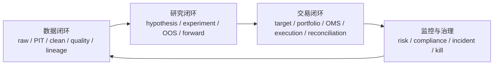

# 量化机构投研与实盘基础设施调研

> 状态：持续更新
> 首次冻结：2026-08-15
> 最近更新：2026-08-16
> 适用范围：本项目的日频 A 股/港股通投研、PAPER 与未来受控实盘
> 证据标记：`[事实]` 表示来源直接支持；`[推断]` 表示结合多份公开资料和本项目约束形成的工程判断。

## 1. 技术摘要

成熟量化机构公开披露的系统并不是一个包办一切的“大回测框架”。更稳定的共同结构，是三个彼此隔离、通过版本化契约衔接的闭环：

[推断] 对本项目而言，最快进入真实策略研究的路线不是复制大型机构的基础设施规模，而是先做到：

1. 数据可重放，特别是财务公告、修订和成分的 Point-in-Time；
2. 因子与策略是纯计算和版本化定义，不自行读数据或下单；
3. 研究结果绑定数据、代码、配置、成本和全部尝试；
4. `target_weight` 经统一市场规则、账户和 OMS 才能进入 PAPER/实盘；
5. 实盘事实以券商回报和对账为准，研究回测绝不直接充当账户。

## 2. 公开证据支持的共同能力

### 2.1 数据像代码一样治理

- [事实] Two Sigma 公开介绍了数据、转换、测试、CI/CD、质量监控和数据契约的版本化治理，并强调可重放。
- [事实] Man Group 的 ArcticDB 公开材料强调 Python DataFrame 接口、底层高性能引擎、对象存储、版本和 Point-in-Time 访问。
- [事实] Qlib 的 PIT 数据库以“公告时间—报告期—修订”组织历史事实，而不是只保留最终值。
- [推断] 因子库不应只保存一列预计算值；每个因子还必须绑定输入字段、可知时间、公式/代码版本、缺失规则、市场/频率和数据快照。

### 2.2 研究和生产共享语义，不必共享同一技术栈

- [事实] LEAN 使用统一事件模型贯通回测与实盘，并把手续费、滑点、成交、保证金等定义为现实模型。
- [事实] Man、Jane Street 等公开材料同时出现 Python 研究接口和 C++、OCaml、CUDA、FPGA 等生产或性能工程技术。
- [推断] 本项目需要统一 `as_of → 最早合法成交时点`、日历、费用、停复牌、涨跌停和公司行动，但不必强迫研究、批处理、OMS 与 Gateway 同进程或同语言。

### 2.3 Alpha、组合、风险、订单和账户职责分离

- [事实] Citadel GQS 描述量化研究员与研究工程师从 idea、alpha、组合到执行的全生命周期协作。
- [事实] BlackRock Aladdin 产品材料强调统一持仓语言、IBOR、风险、合规和前中后台工作流。
- [事实] 上交所程序化交易规则、EU RTS 6 和 FINRA 指引都强调测试、限额、监控、变更管理、应急停机与责任边界。
- [推断] 紧密协作与职责分离并不矛盾：研究反馈要快，但生产授权、风险和账户事实仍必须独立。

### 2.4 实盘是异步状态机

- [事实] QuantConnect 文档明确实盘订单与成交是异步的，成交事实由券商回报驱动。
- [推断] 回测中的“成交”只是模型结果。未来 PAPER/实盘必须保存 client order id、券商 order id、状态转换、部分成交、撤单、拒单和重启恢复，并对券商持仓、订单、成交、现金做周期性对账。

### 2.5 发布治理是生存底线

- [事实] EU RTS 6 和 FINRA 15-09 要求测试/生产隔离、受控部署、变更记录、限额、快速停用、容量压力和上线后监控。
- [事实] Man AHL 的过拟合讨论强调冻结数据、参数稳定性、复杂度惩罚、独立复核和小规模试交易。
- [推断] 本项目的 `run.json`、人工准入、PAPER、仅卖出模式和 kill switch，比继续增加模型复杂度更优先。

## 3. 不同机构运行模式与可借鉴边界

| 模式 | 主要目标 | 公开材料例子 | 本项目取舍 |
|---|---|---|---|
| 系统化资管 | PIT、研究吞吐、多资产组合、容量和成本 | Man AHL、Citadel GQS | 最接近日频 A 股/港股通主线 |
| 做市/HFT | 流式事件、确定性、尾延迟和硬件协同 | Jane Street | 只借鉴 profiling、状态机和可靠性，不建设微秒系统 |
| 企业投管平台 | 统一持仓、风险、合规、前中后台 | BlackRock Aladdin | 借鉴契约和 IBOR 思想，不复制平台规模 |
| 开源模块化栈 | 数据、模型、回测、券商可插拔 | Qlib、LEAN、MLflow | 选择性复用设计，不整体替换现有系统 |

公开资料存在明显边界：机构官网和招聘材料不是独立技术审计；开源工具的能力不等于某家机构正在采用；没有可靠一手资料时，不推断 Renaissance、D. E. Shaw 等机构的内部实现。

## 4. 面向本项目的目标分层

### 4.1 现在必须具备

| 层 | 最小能力 | 当前推进方向 |
|---|---|---|
| 数据 | raw 不可覆盖、请求台账、PIT 修订、clean snapshot、质量门禁 | Tushare 全量/增量、daily_basic、财务四表审计与发布 |
| 因子 | 纯函数、定义注册、输入/时点/缺失规则、测试 | 价量、daily_basic、PIT 质量因子 |
| 研究 | 假设卡、walk-forward、成本 0.5/1/2、不可变 run | M2 lightweight research |
| 策略 | 输入 `as_of`，只输出 `target_weight` | 因子组合与 ETF 风险模块 |
| 回测 | A 股交易规则、公司行动、费用、账户 | 已有 formal A-share replay，研究侧不得绕过准入 |
| 交易 | PAPER 隔离、OMS 幂等、对账、人工开关 | 仅在候选准入后启用 |

### 4.2 随研究量增长再引入

- 因子定义与实验元数据注册表；
- 共享列式特征缓存，但缓存必须绑定数据和代码版本；
- 研究队列、资源预算、失败实验索引；
- 模型数量和多人协作明显增长后再评估 MLflow 服务；
- 数据量和测量结果证明现有存储瓶颈后，再评估 ArcticDB 或分布式对象存储。

### 4.3 当前明确暂缓

- Kafka/Flink 在线特征物化、PB 级数据湖和跨机房复制；
- Kubernetes/Ray 常驻集群；
- FPGA、自定义 CUDA、主机托管和 HFT；
- 完整 Aladdin 式前中后台平台；
- LLM/Agent 自动晋级策略、改变仓位、订单或风险结论。

## 5. CPU、GPU 与资源治理

[事实] Jane Street 的公开性能材料强调从存储、网络、主机到尾延迟做端到端 profiling；GPU、FPGA 和自定义 CUDA 是针对明确工作负载的工具，不是默认答案。

[推断] 本项目当前的瓶颈主要是数据接口限速、磁盘 I/O、列式转换和中小规模横截面计算，因此：

1. Tushare 采集遵守供应商速率限制，GPU 无法加速网络等待；
2. Parquet/Polars 扫描、排序、join 和多数日频因子优先使用列式 CPU；
3. 留出桌面和采集资源，研究 runner 默认最多 2 个线程，不榨干全部核心；
4. 只有 profile 证明 LightGBM/深度模型训练占主要墙钟时间，才启用 GPU；
5. GPU 加速不得改变时间语义、随机种子、数据划分或结果身份。

应持续记录读取、转换、特征、训练、回测、内存峰值、CPU 占用、GPU 占用和缓存命中率，而不是只看训练时间。

## 6. 近期实施优先级

### P0：尽快进入真实研究

- 完成财务 regular 采集、质量审计和不可覆盖 snapshot；
- 跑通 PIT 质量因子月频 walk-forward；
- 建立因子 eligibility 原因账本，不能让缺失股票从分母消失；
- 固化 `as_of → next-open`、`target_weight`、成本压力和不可覆盖 `run.json`；
- 结果最高只能是 `RESEARCH_ONLY`，不得因历史表现自动进入 PAPER。

### P1：建立可维护的研究工厂

- 版本化 `factor_spec` 和 `strategy_spec`；
- 保存全部试验和失败结果；
- 因子族内收缩、跨族增量检验；
- 加入容量、拥挤、不可成交和市场事件压力；
- 建立冻结 forward 预测日志。

### P2：候选准入后补齐 PAPER 运行能力

- 研究产物只读进入交易域；
- OMS 异步状态、幂等重启和券商对账；
- 数据新鲜度、策略心跳、风险暴露、订单异常和账户差异监控；
- 人工总开关、仅卖出、限额、kill 和回滚。

## 7. 维护约定

每次更新本文件时应记录：新增一手来源、结论是否为事实或推断、它改变了哪个研究/工程决策、是否需要加入路线图。不得把招聘宣传、工具文档或海外监管要求直接写成中国个人账户的既定事实。

## 8. 主要参考资料

1. [Two Sigma — Treating Data as Code](https://www.twosigma.com/articles/treating-data-as-code-at-two-sigma/)
2. [Two Sigma — Smooth Storage](https://www.twosigma.com/articles/smooth-storage-a-distributed-storage-system-for-managing-structured-time-series-data-at-two-sigma/)
3. [Two Sigma — Head-to-Head Development](https://www.twosigma.com/articles/introduction-to-head-to-head-development-part-1/)
4. [Man Group — ArcticDB](https://www.man.com/news-centre/man-group-brings-powerful-dataframe-database-product-arcticdb-to-market-with-bloomberg)
5. [Man AHL — Overfitting and Its Impact on the Investor](https://www.man.com/insights/overfitting-and-its-impact-on-the-investor)
6. [Jane Street — Performance Engineering](https://www.janestreet.com/performance-engineering/)
7. [Citadel — Global Quantitative Strategies](https://www.citadel.com/what-we-do/global-quantitative-strategies/)
8. [BlackRock — Aladdin Whole Portfolio](https://www.blackrock.com/aladdin/literature/product-brief/aladdin-whole-portfolio-brochure.pdf)
9. [Microsoft Research — Qlib](https://www.microsoft.com/en-us/research/publication/qlib-an-ai-oriented-quantitative-investment-platform/)
10. [Qlib — Point-in-Time Database](https://qlib.readthedocs.io/en/stable/advanced/PIT.html)
11. [QuantConnect — LEAN Algorithm Engine](https://www.quantconnect.com/docs/v2/writing-algorithms/key-concepts/algorithm-engine)
12. [QuantConnect — Live Trading Orders](https://www.quantconnect.com/docs/v2/writing-algorithms/live-trading/trading-and-orders)
13. [MLflow — Model Registry Workflows](https://mlflow.org/docs/latest/ml/model-registry/workflow)
14. [上交所 — 程序化交易管理实施细则答记者问](https://star.sse.com.cn/aboutus/mediacenter/hotandd/c/c_20250403_10776805.shtml)
15. [EU — RTS 6, Regulation 2017/589](https://eur-lex.europa.eu/eli/reg_del/2017/589/oj/eng)
16. [FINRA — Regulatory Notice 15-09](https://www.finra.org/rules-guidance/notices/15-09)
